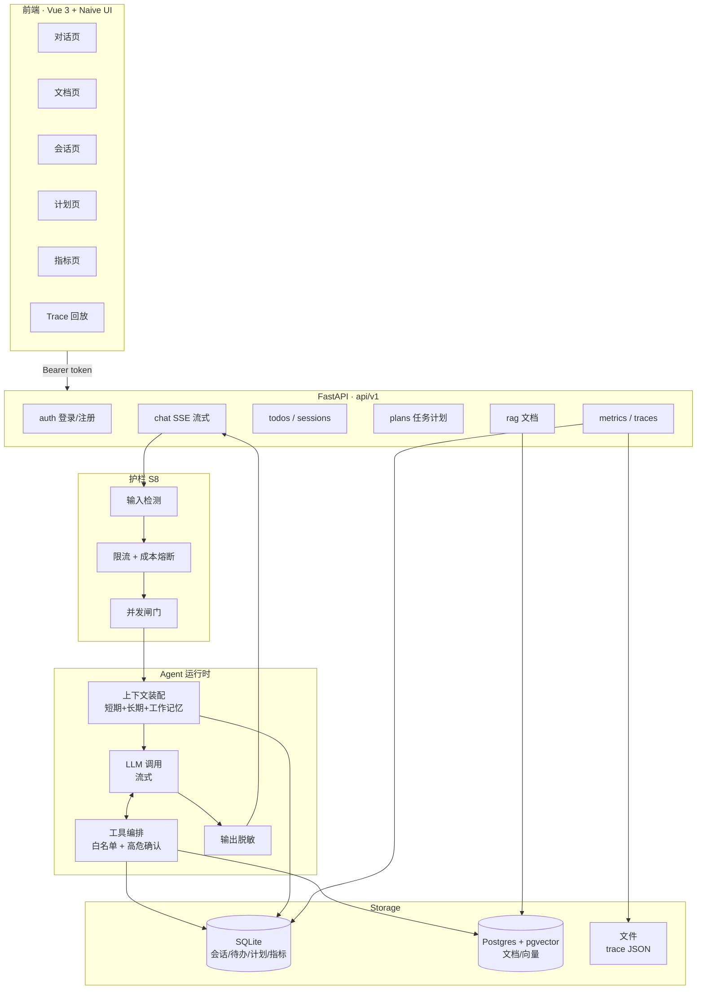
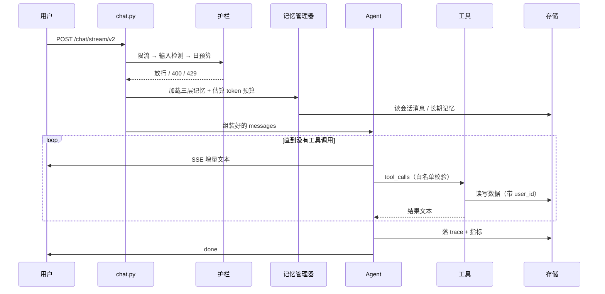

# agent-lab

一个从零实现的 AI Agent 项目，目标不是"能聊天"，而是把一套完整闭环跑通：
**对话 → 工具调用 → 知识检索 → 任务规划 → 评测 → 可观测 → 安全 → 部署**。

麻雀虽小，五脏俱全：每个环节都有最小可用实现，核心路径（工具、规划、护栏、鉴权、检索）都有测试覆盖。

---

## 架构



### 一次对话发生了什么



---

## 能力清单

| 阶段 | 能力 | 关键实现 |
|---|---|---|
| S0 | 工程骨架 | 分层、配置、统一错误、SSE 编码 |
| S1 | 流式对话 | SSE、推理过程分离、可中断 |
| S2 | 工具调用 | 白名单、参数校验、trace 记录 |
| S3 | 知识库 | pgvector、混合检索（向量 + BM25 + RRF）、可选 cross-encoder 重排 |
| S4 | 记忆 | 三层记忆、上下文预算、会话管理 |
| S5 | 产品化 | 前端六个页面 |
| S6 | 结构化输出 | JSON 校验 + 失败重试、任务计划可暂停/编辑/审批 |
| S7 | 评测与可观测 | 50 条分层集、配置指纹、指标看板 |
| S8 | 安全 | 四层护栏、限流、成本熔断、脱敏 |
| S9 | 鉴权与多租户 | JWT、密码哈希、全链路 user_id 隔离 |

---

## 快速开始

### 一键启动（推荐）

```powershell
# Windows
.\scripts\start.ps1
```

```bash
# macOS / Linux
./scripts/start.sh
```

脚本会依次完成：生成 `.env` → 拉起 Postgres → 安装依赖 → 播种演示数据 → 启动前后端。

**演示账号：`demo` / `demo123`**，已预置 13 条待办、2 份文档、40 条指标样本。

> 首次运行前请在 `.env` 里填 `LLM_API_KEY` 和 `LLM_BASE_URL`，否则对话会返回 503。

### 手动启动

```bash
# 1. 数据库
docker compose up -d pg

# 2. 依赖
uv sync
cd ../agent-lab-web && npm install && cd ../agent-lab

# 3. 演示数据（可选但强烈建议）
uv run python scripts/seed.py

# 4. 后端
uv run uvicorn agent_lab.app.main:app --port 8001 --reload

# 5. 前端（另一个终端）
cd ../agent-lab-web && npm run dev
```

打开 http://127.0.0.1:9999 。

---

## 目录结构

```
agent-lab/
├── src/agent_lab/app/
│   ├── api/v1/          # HTTP 层：auth chat todos sessions plans rag metrics traces
│   ├── core/            # 配置、SQLite/PG、SSE、错误、鉴权(security)
│   ├── models/          # Pydantic 模型
│   └── services/        # 业务层：agent / tools / planning / memory / rag / guard
├── data/
│   ├── seed/            # 演示文档
│   ├── traces/          # trace JSON
│   └── app.db           # SQLite
├── evals/               # 评测集与判分器
├── scripts/             # seed / 上线自查 / 压测 / 一键启动
└── tests/               # 144 个测试

agent-lab-web/           # Vue 3 + Naive UI 前端
```

---

## 测试与评测

```bash
uv run pytest                          # 144 passed
uv run ruff check src tests scripts    # 静态检查（规则集固定在 pyproject.toml）
uv run python scripts/selfcheck.py     # 上线自查
uv run python scripts/loadtest.py --concurrency 50  # 压测
```

评测集分三层（标准 / 主观 / 对抗），四种指标（通过率、P50/P95、成本、崩溃率）：

```bash
uv run python scripts/eval_run.py --category standard
```

### 持续集成

`.github/workflows/ci.yml` 拆成三个 job，按「快 → 慢 → 花钱」排序：

| job | 触发条件 | 内容 |
|---|---|---|
| 后端 | 每次 push / PR | `ruff` + 144 个单测 + 评测集 20/20/10 配比自检 |
| 前端 | 每次 push / PR | `npm ci` + `vue-tsc` 类型检查 + 打包 |
| 评测门禁 | 仓库变量 `ENABLE_EVAL_GATE=true` | 起 pgvector 与真实服务，跑 50 条评测集，通过率 < 80% 阻塞合并 |

不需要模型 Key 的前两个 job 每次都跑；要花钱的评测默认关闭，fork 不会因为缺 Secret 红一片。

CI 里有两个刻意的选择：`uv sync --frozen`（lock 与 pyproject 不一致就直接失败，防止本地和 CI 跑在不同版本）、`npm ci`（严格按 lock 装，避免「本地有残留所以能过」）。

---

## 鉴权说明

所有业务接口都要求 `Authorization: Bearer <token>`，服务端按 `user_id` 隔离数据：
会话、待办、计划、文档、trace、指标各查各的。

- `AUTH_ENABLED=true` 时生效（默认）
- 本地调 Swagger 可临时设为 `false`，此时所有请求都算 demo 用户
- **上线前必须换 `AUTH_SECRET`**，用默认值等于没有鉴权：

```bash
python -c "import secrets; print(secrets.token_urlsafe(48))"
```

---

## 已知限制

1. **计划执行是 in-process 后台任务**，进程重启会丢掉执行中的计划（状态停在 `running`）。
   生产应换成持久队列（Celery / RQ / arq）。
2. **限流是单实例内存令牌桶**，多副本部署时每个副本各算各的，需要换 Redis。
3. **trace 存在本地文件**，多实例部署时各写各的，需要改成对象存储或数据库。
4. **向量模型固定**为 `BAAI/bge-small-zh-v1.5`，换模型需要重新索引全部文档。
5. **没有 refresh token**，token 7 天过期后需要重新登录。

这些限制都不是"没做完"，而是这个规模下**刻意不做的取舍** —— 每一条上面都已经写清了升级路径。