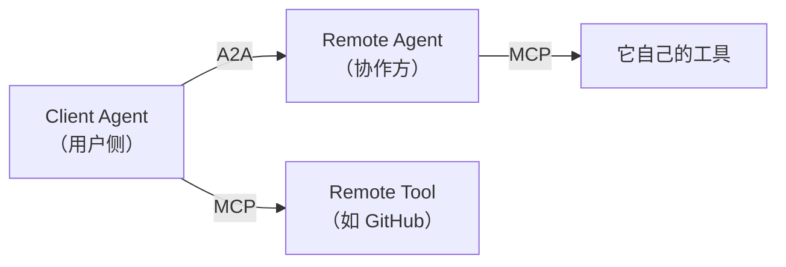
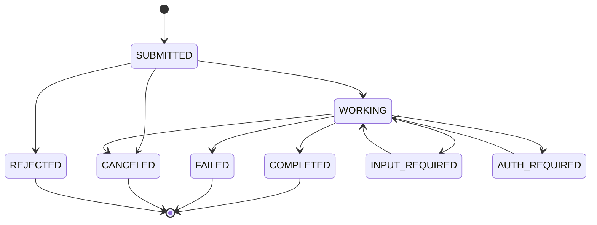
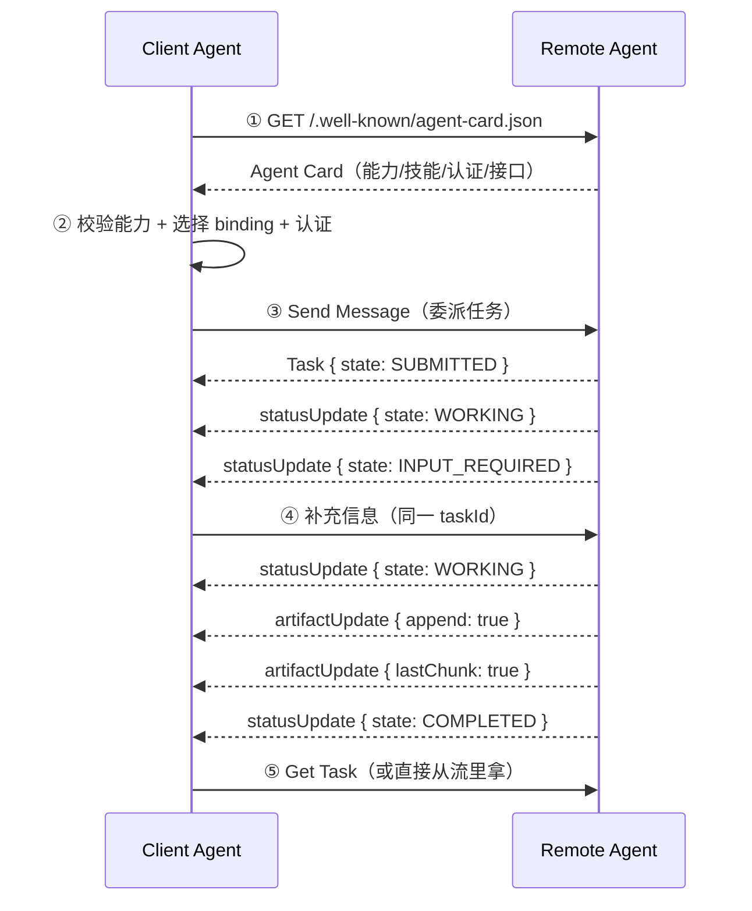

# A2A 与 Agent 间协议

> **权威依据**
> ① **A2A Protocol 官方规范 v1.0.0**（a2a-protocol.org）— Linux Foundation，Apache 2.0
> ② **A2A 官方首页** — 定义、目标、与 MCP 的分工
> ③ 本知识库：`MCP协议.md`、`MCP Client.md`、`MCP Server.md`、`单Agent与多Agent.md`

## 结论

**A2A（Agent2Agent）是让"不同框架、不同厂商构建的 Agent 互相发现、委派任务、交换结果"的开放标准。**

> **官方定位公式**：
> **"用 ADK（或任何框架）构建，用 MCP（或任何工具）装备，用 A2A 通信——对远程 Agent、本地 Agent，以及人类。"**

**它和 MCP 不是竞争，是补位：**

| | **MCP** | **A2A** |
|---|---|---|
| **方向** | **Agent ↔ 工具** | **Agent ↔ Agent** |
| **类比** | 给员工配**工具箱** | 让员工之间**打电话** |
| **解决** | 怎么用工具 | 怎么找人协作 |

> **一句话**：**MCP 让 Agent 长出手脚，A2A 让 Agent 学会协作。**

## 一、为什么需要 A2A

### 1.1 MCP 没解决的问题

```
MCP 解决了：我的 Agent 怎么调用 GitHub / 数据库 / 文件系统
MCP 没解决：我的 Agent 怎么找"另一个公司的报价 Agent"干活
```

### 1.2 三个典型场景

| 场景 | 说明 |
|------|------|
| **跨组织协作** | 旅行社 Agent ↔ 航空公司 Agent（互不共享内部逻辑） |
| **跨框架集成** | LangGraph 写的 Agent ↔ CrewAI 写的 Agent |
| **专业分工** | 主 Agent 把"法务审查"委派给专业的法务 Agent |

### 1.3 一个关键设计主张：**不透明（Opaque）**

> **官方原文**：代理交互时**无需共享内部记忆、工具或专有逻辑**。

**含义**：

> **A2A 定义的是"边界协议"，不是"内部结构"。**
> 对方怎么实现、用什么模型、内部有几个子 Agent——**你不需要知道，也不该知道**。

## 二、定位：A2A vs MCP（最重要的一张表）

| 维度 | **MCP** | **A2A** |
|------|---------|---------|
| **通信双方** | Agent ↔ 工具/资源 | **Agent ↔ Agent** |
| **典型场景** | 访问 GitHub、SQL、文件 | 跨框架、跨组织协作 |
| **一方是否"智能"** | 否（工具是被动的） | **是（对方也是 Agent）** |
| **协议核心** | Tools / Resources / Prompts | **Task / Message / Artifact** |
| **谁发起** | Agent 决定用哪个工具 | Agent **委派一个任务** |
| **时间跨度** | 秒级 | **可长达数天**（长任务） |
| **状态** | 通常无状态 | **有状态（Task 有生命周期）** |
| **是否暴露内部** | 工具是明确的 | **不透明（只暴露能力）** |
| **治理** | Anthropic 提出 | **Google 提出 → 捐给 Linux Foundation** |

### 2.1 组合使用



> **一个 Agent 可以同时是 A2A 的服务端和客户端。**
> **协议是分层的，不是二选一的。**

## 三、三层架构（理解规范的钥匙）

> A2A 1.0 采用三层设计，**这是读懂规范的关键**。

```
┌──────────────────────────────────────────┐
│ L3 协议绑定（可插拔）                     │
│    JSONRPC / GRPC / HTTP+JSON / 自定义    │
├──────────────────────────────────────────┤
│ L2 抽象操作（11 个，绑定无关）            │
│    Send Message / Get Task / Cancel Task  │
├──────────────────────────────────────────┤
│ L1 规范数据模型                           │
│    spec/a2a.proto（唯一权威定义）         │
└──────────────────────────────────────────┘
```

**两个必须知道的规则**：

| 规则 | 说明 |
|------|------|
| **`spec/a2a.proto` 是唯一权威** | `a2a.json` 是构建产物，**非规范**；SDK 与 JSON Schema 必须从 proto 重新生成 |
| **各绑定必须功能等价** | 换传输层不改变语义 |

> **这也是为什么"1.0 的方法名"和"0.3 的方法名"看起来不一样**——
> **v0.3 的 `message/send`、`tasks/get` 是 JSON-RPC 绑定的表达；v1.0 已改为 11 个抽象操作 + 三套绑定映射。**

## 四、五个核心对象

### 4.1 Agent Card（代理卡片）

> **Agent 的"名片 + 能力清单"**，是一份 JSON 元数据文档，用于**能力发现**与**能力校验**。

**关键字段**：

| 字段 | 必填 | 说明 |
|------|------|------|
| `name` / `description` | ✅ | 人类可读 |
| **`supportedInterfaces`** | ✅ | **有序**接口列表，**第一项为首选** |
| `version` | ✅ | Agent 自身版本 |
| `capabilities` | ✅ | 能力开关 |
| `defaultInputModes` / `defaultOutputModes` | ✅ | MIME 类型 |
| `skills` | ✅ | 技能列表 |
| `provider` | ❌ | 提供方（`url` + `organization`） |
| `securitySchemes` / `securityRequirements` | ❌ | 认证方案与要求 |
| **`signatures`** | ❌ | **对卡片的 JWS 签名**（防伪造/篡改） |
| `documentationUrl` / `iconUrl` | ❌ | 文档与图标 |

**`AgentInterface`（一个 Agent 可暴露多种绑定）**：

| 字段 | 说明 |
|------|------|
| `url` | HTTP 系须为**绝对 HTTPS**；gRPC 为 `hostname:port` |
| **`protocolBinding`** | **`JSONRPC` / `GRPC` / `HTTP+JSON`**（开放字符串） |
| `tenant` | 不透明路由标识；**若设置，客户端必须在所有请求中回填** |
| `protocolVersion` | 如 `"1.0"` |

**`capabilities`**：`streaming`、`pushNotifications`、`extensions[]`、**`extendedAgentCard`**

> **`extendedAgentCard = true` 的含义**：公开卡片只给概要，**认证后**可调 `Get Extended Agent Card` 拿更详细版本。
> **这是"分级披露"**——保护商业敏感能力。

**`skills[]`**：`id`、`name`、`description`、`tags`（必填）；`examples`、`inputModes`、`outputModes`、`securityRequirements`（可选）

### 4.2 Task（任务）与状态机

> **Task 是一次工作请求的载体，有状态，是 Agent 之间协作的基本单元。**

| 字段 | 必填 | 说明 |
|------|------|------|
| **`id`** | ✅ | **由服务端生成**（客户端不能自行指定） |
| `contextId` | ❌ | 会话上下文，用于聚合相关任务 |
| **`status`** | ✅ | `state` + `message` + `timestamp` |
| `artifacts` | ❌ | 产出物 |
| `history` | ❌ | 交互历史 |
| `metadata` | ❌ | 自定义元数据 |

### 4.3 九个任务状态

| 状态 | 含义 | 类别 |
|------|------|------|
| `TASK_STATE_UNSPECIFIED` | 未知 | — |
| `TASK_STATE_SUBMITTED` | 已提交受理 | 进行中 |
| `TASK_STATE_WORKING` | 正在处理 | 进行中 |
| `TASK_STATE_COMPLETED` | 成功完成 | **终态** |
| `TASK_STATE_FAILED` | 失败 | **终态** |
| `TASK_STATE_CANCELED` | 被取消 | **终态** |
| `TASK_STATE_REJECTED` | Agent 拒绝受理 | **终态** |
| **`TASK_STATE_INPUT_REQUIRED`** | 需要补充输入 | **中断态** |
| **`TASK_STATE_AUTH_REQUIRED`** | 需要额外认证 | **中断态** |

**两类状态的语义差别（很重要）**：

| 类别 | 能否继续 |
|------|----------|
| **终态** | ❌ **不能再收新消息**，也不能订阅（返回 `UnsupportedOperationError`） |
| **中断态** | ✅ **可用同一 `taskId` + `contextId` 继续对话** |

> **中断态正是 A2A 版的 HITL**（见 `HITL与持久化执行.md`）。
> **任务可以停在"我需要更多信息"，等几天再续。**

### 4.4 Message

| 字段 | 必填 | 说明 |
|------|------|------|
| **`messageId`** | ✅ | **由创建方生成**（可用于去重） |
| **`role`** | ✅ | `ROLE_USER`（客户端→服务端）/ `ROLE_AGENT`（反向） |
| **`parts`** | ✅ | 内容容器（多模态） |
| `contextId` / `taskId` | ❌ | 关联 |
| `referenceTaskIds` | ❌ | 引用其他任务 |
| `extensions` / `metadata` | ❌ | 扩展 |

**一条容易踩的约束**：

> 服务端消息**必须**带 `contextId`；客户端消息两者可选，但**同时提供时必须一致**。
> 只给 `taskId` 时服务端自行推断 `contextId`；**不匹配则拒绝**。

### 4.5 Part（多模态的核心）

> **OneOf——必须且只能包含一种。**

| 字段 | 说明 |
|------|------|
| `text` | 纯文本 |
| `raw` | 原始字节（JSON 里 base64） |
| `url` | 指向文件内容 |
| `data` | 任意结构化 JSON |
| `filename` / `mediaType` | 元信息 |

### 4.6 Artifact（产物）

| 字段 | 必填 | 说明 |
|------|------|------|
| **`artifactId`** | ✅ | 任务内唯一 |
| **`parts`** | ✅ | **至少一个** |
| `name` / `description` | ❌ | 如 `report.pdf` |
| `metadata` / `extensions` | ❌ | 扩展 |

> **规范强调**：**结果应通过 Artifact 返回，而不是用 Message 传递任务输出。**
> **Message 是"对话过程"，Artifact 是"交付物"**——职责分离。

## 五、11 个抽象操作

| # | 操作 | 作用 | 主要错误 |
|---|------|------|----------|
| 1 | **Send Message** | 发消息，返回 Task 或 Message | ContentTypeNotSupported |
| 2 | **Send Streaming Message** | 同上，流式 | UnsupportedOperation |
| 3 | **Get Task** | 查任务 | TaskNotFound |
| 4 | **List Tasks** | 分页列任务 | — |
| 5 | **Cancel Task** | 取消（幂等） | TaskNotCancelable |
| 6 | **Subscribe to Task** | 订阅任务流（首事件必为 Task） | UnsupportedOperation |
| 7 | **Create Push Notification Config** | 配置 webhook | PushNotificationNotSupported |
| 8 | **Get Push Notification Config** | 查配置 | 同上 |
| 9 | **List Push Notification Configs** | 列配置 | 同上 |
| 10 | **Delete Push Notification Config** | 删配置（**须幂等**） | 同上 |
| 11 | **Get Extended Agent Card** | 取扩展技能卡 | ExtendedAgentCardNotConfigured |

### 5.1 两个特别值得注意的参数

**① `returnImmediately`**（在 `SendMessageConfiguration` 里）

| 值 | 行为 |
|----|------|
| **`false`（默认）** | **阻塞**——等到终态或中断态才返回 |
| `true` | 创建任务后立即返回，由调用方轮询或订阅 |

> **默认是阻塞的**——这对长任务很关键，**长任务必须显式设 `true`**，否则连接会挂很久。

**② `historyLength`**

| 值 | 行为 |
|----|------|
| 未设置 | 不限制（服务端默认） |
| `0` | **不返回历史**（`history` 字段应省略） |
| `>0` | 最多返回该条数 |

### 5.2 流式事件对象

> **`StreamResponse` 是 OneOf，四者取一：**

| 类型 | 用途 |
|------|------|
| `task` | 完整任务快照 |
| `message` | 一条消息 |
| `statusUpdate` | 状态变更（`taskId` / `contextId` / `status`） |
| `artifactUpdate` | 产物增量（`append` 追加、`lastChunk` 结束） |

> **多流支持**：同一任务可被多个流并发订阅，**事件须按生成顺序广播给所有活跃流**；关闭一个流不影响其他。

## 六、任务生命周期



**三条语义要点**：

| 要点 | 说明 |
|------|------|
| **终态不可再变** | 不能再收消息、不能订阅 |
| **中断态可恢复** | 用同一 `taskId` + `contextId` 续 |
| **幂等设计** | Get 类天然幂等；`SendMessage` 用 `messageId` 去重；`CancelTask` 幂等 |

## 七、传输绑定与版本协商

### 7.1 三种官方绑定

| 绑定 | 说明 |
|------|------|
| **`JSONRPC`** | JSON-RPC 2.0 风格 |
| **`GRPC`** | 高性能、双向流 |
| **`HTTP+JSON`** | 纯 REST 风格（如 `POST /message:send`） |

**其他机制对应关系**：

| 机制 | 实现 |
|------|------|
| **流式** | HTTP/SSE、gRPC stream（须 `capabilities.streaming = true`） |
| **推送通知** | **无论哪种绑定，WebHook 一律纯 HTTP POST + JSON** |
| **服务参数** | HTTP 头 / gRPC metadata |

### 7.2 服务参数

| 头 | 说明 |
|----|------|
| **`A2A-Version`** | 协议版本（Major.Minor）；**空值视为 `0.3`**；不支持则 `VersionNotSupportedError` |
| **`A2A-Extensions`** | 逗号分隔的扩展 URI 列表 |

> **规则**：所有自定义服务参数统一以 **`a2a-`** 前缀命名；**只有 Major.Minor 参与兼容判断**，补丁号不参与。

### 7.3 扩展机制

| 点 | 说明 |
|----|------|
| **`extensions[]`** | Message 与 Artifact 上 |
| **`metadata`** | 按扩展 URI 键入 |
| **版本化 URI** | 扩展 URI **应**含版本号；**破坏性变更必须换新 URI** |
| **`required: true`** | 客户端**必须理解并遵守**，否则拒绝 |

### 7.4 推送通知的三个细节

| 细节 | 说明 |
|------|------|
| **Content-Type** | `application/a2a+json` |
| **载荷** | body 为 `StreamResponse` |
| **投递语义** | **至少一次**；客户端**须幂等**；服务端可指数退避重试；建议超时 10–30 秒 |
| **认证** | 服务端**必须**按 `TaskPushNotificationConfig.authentication` 在请求头附带凭据 |

## 八、认证与安全

> `SecurityScheme` 是 **OneOf（只能取一种）**，基于 **OpenAPI 3.2** Security Scheme Object。

| 方案 | 关键字段 |
|------|----------|
| **API Key** | `location`（query/header/cookie）、`name` |
| **HTTP Auth** | `scheme`（须为 IANA 注册方案，如 `Bearer`）、`bearerFormat` |
| **OAuth 2.0** | `flows`、`oauth2MetadataUrl`（RFC 8414，须 TLS） |
| **OpenID Connect** | `openIdConnectUrl` |
| **mTLS** | 仅 `description` |

### 8.1 OAuth 流程的三个提醒

| 流程 | 状态 |
|------|------|
| `authorizationCode` | ✅ **推荐**（公共客户端应始终用 PKCE） |
| `clientCredentials` | ✅ 服务间 |
| `deviceCode` | ✅ 无浏览器设备 |
| **`implicit`** | ❌ **已弃用** |
| **`password`** | ❌ **已弃用** |

### 8.2 三级认证声明

```
① 卡片级：securitySchemes + securityRequirements
② 技能级：AgentSkill.securityRequirements（可对单个 skill 收紧）
③ 扩展卡：GetExtendedAgentCard 必须先用公开卡片声明的方案认证
```

### 8.3 两个安全设计值得学

| 设计 | 说明 |
|------|------|
| **403 不泄露存在性** | 权限不足返回 403，但**不得泄露**无权访问资源是否存在 |
| **卡片签名（JWS）** | `signatures` 防伪造与篡改 —— **发现环节的信任锚** |

### 8.4 A2A 把"致命三要素"放大了

> 回顾 `Agent安全与护栏.md`：

| 要素 | A2A 场景 |
|------|----------|
| **私有数据** | 你委派出去的任务内容 |
| **不可信内容** | **对方 Agent 返回的一切** |
| **外部通信** | 任务发给了**外部组织** |

> **⚠️ 关键风险**：**对方 Agent 的返回就是一个间接注入入口。**
> 它可能在 Artifact 里藏指令。所以 **A2A 的结果必须被当作不可信数据处理**——来源标记、隔离、扫描，一个都不能少。

## 九、治理与生态

| 项目 | 内容 |
|------|------|
| **当前版本** | **v1.0.0**（历史：0.3.0 / 0.2.6 / 0.1.0） |
| **最初开发** | **Google** |
| **治理** | **Linux Foundation**，由 **TSC** 维护 |
| **TSC 成员代表** | **AWS、Cisco、Google、IBM Research、Microsoft、Salesforce、SAP、ServiceNow** |
| **基金会归属** | 已加入 **Agentic AI Foundation**（公告 2026-08-27） |
| **许可** | **Apache 2.0** |
| **官方 SDK** | **6 种**：Python、JavaScript、Java、C#/.NET、Go、Rust |
| **工具** | 官方 CLI（`a2aproject/a2a-cli`） |

> **这个治理阵容是 A2A 最大的可信度来源**——不是单一厂商的私有协议。

## 十、一次完整交互（时序）



**五个关键动作**：

| 步骤 | 动作 |
|------|------|
| ① | **发现**：读 Agent Card |
| ② | **校验**：能力是否满足、选哪个 binding、怎么认证 |
| ③ | **委派**：Send Message |
| ④ | **补充**：中断态续聊 |
| ⑤ | **取结果**：Artifact |

## 十一、什么时候该用 A2A

### 11.1 该用

| 场景 | 理由 |
|------|------|
| **跨组织协作** | 标准协议代替定制 API |
| **跨框架集成** | LangGraph ↔ CrewAI ↔ ADK |
| **需要长任务** | Task 有生命周期，可等数天 |
| **对方是"黑盒"** | 不透明设计正合适 |
| **能力动态发现** | Agent Card 让"有没有这个能力"可查 |

### 11.2 不该用

| 场景 | 该用什么 |
|------|----------|
| **只是调用工具** | **MCP** |
| **同一进程内的多个 Agent** | 直接函数调用 or 框架内部编排 |
| **同步、毫秒级响应** | 简单 HTTP API |
| **对方只有一个固定接口** | 直接调 API 更简单 |

> **最重要的一条**：**A2A 解决的是"跨边界"，不是"内部编排"。**
> 你自己的三个子 Agent 之间**不该**用 A2A——那是本地编排问题。

## 十二、实现建议

### 12.1 三步上手

| 步 | 动作 |
|----|------|
| **1** | **先发布 Agent Card**——哪怕只有一个 skill |
| **2** | 实现 **Send Message + Get Task** 两个操作（够跑通） |
| **3** | 再加流式、中断态、推送通知 |

### 12.2 四条工程原则

| 原则 | 理由 |
|------|------|
| **用官方 SDK** | proto 是唯一权威，手写 JSON 必错 |
| **锁协议版本** | `A2A-Version` 头必须发；Major 变更会破坏兼容 |
| **结果当不可信输入** | Artifact 可能是注入载体 |
| **幂等** | 推送通知"至少一次"，`messageId` 去重 |

### 12.3 与内部编排的关系

```
内部：A2A（对外）+ 自己的编排框架（对内）
       ↑                        ↑
   Agent Card 暴露能力      子 Agent / 图 / 循环
```

> **别把 A2A 当成内部架构**——它会让简单调用变成网络调用。

## 十三、其他 Agent 间协议（简要）

| 协议 | 方向 | 说明 |
|------|------|------|
| **MCP** | Agent ↔ 工具 | 最成熟，生态最大 |
| **A2A** | Agent ↔ Agent | 本文重点，Linux Foundation |
| **AG-UI** | Agent ↔ 前端 | 面向"Agent 与用户界面"的事件流协议 |
| **ACP** | Agent ↔ Agent | 早期由 IBM/BeeAI 推动，**后并入 A2A** |

> ⚠️ **除 MCP 与 A2A 外，其余协议的成熟度、治理与合并状态我未逐一核实**，接入前请查当前官方文档。

## 十四、常见坑

| # | 坑 | 后果 | 解药 |
|---|----|------|------|
| **1** | **内部编排放到 A2A** | 简单调用变成网络调用 | 内部直接用框架 |
| **2** | **用 v0.3 的方法名连 v1.0** | 直接不通 | 按 11 个抽象操作 + 绑定映射 |
| **3** | **不发 `A2A-Version`** | 被当成 `0.3` 处理 | 每次请求都发 |
| **4** | **长任务用默认 `returnImmediately=false`** | 连接挂很久 | 长任务显式设 `true` + 轮询/订阅 |
| **5** | **客户端指定 `taskId`** | 违规（服务端生成） | 别自己造 |
| **6** | **`contextId` 与 `taskId` 不一致** | 请求被拒 | 同时给时必须一致 |
| **7** | **用 Message 传任务结果** | 违反职责分离 | 用 **Artifact** |
| **8** | **推送通知不幂等** | 重复处理 | 至少一次语义，必须幂等 |
| **9** | **不验卡片签名** | 被伪造 Agent 钓鱼 | 校验 `signatures` |
| **10** | **信任对方返回的内容** | **间接注入** | 当不可信数据处理 |
| **11** | **`tenant` 不回填** | 路由失败 | 卡片设了就每个请求都带 |
| **12** | **手写 a2a.json** | 与 proto 不一致 | 从 proto 重新生成 |

## 十五、Checklist

**服务端（暴露能力）**
- [ ] 发布 `agent-card.json`（含 `supportedInterfaces`、`skills`、`capabilities`）
- [ ] 卡片**加签名**（`signatures`）
- [ ] 声明 `securitySchemes`（用 OAuth2 Authorization Code + PKCE，**别用 implicit/password**）
- [ ] 实现 Send Message / Get Task / Cancel Task
- [ ] 长任务支持 `returnImmediately`
- [ ] 支持 `INPUT_REQUIRED` 中断态
- [ ] 结果通过 **Artifact** 返回
- [ ] 推送通知幂等 + 带认证
- [ ] 403 不泄露资源存在性

**客户端（调用别人）**
- [ ] 从 `/.well-known` 读卡片
- [ ] 校验 **签名**
- [ ] 校验 `capabilities` 再调可选能力
- [ ] 每次请求发 `A2A-Version`
- [ ] `tenant` 回填
- [ ] **把返回的 Artifact 当不可信内容**（来源标记 + 隔离 + 扫描）
- [ ] 长任务用轮询/订阅，不阻塞
- [ ] `messageId` 用于去重

**架构**
- [ ] A2A 只用于**跨边界**，内部用框架编排
- [ ] 明确是与 MCP 分工（不是替代）

## 十六、总结

**三句话：**

| 协议 | 一句话 |
|------|--------|
| **MCP** | 给 Agent 配**工具箱** |
| **A2A** | 让 Agent 之间**打电话** |
| **你的编排框架** | Agent 内部**怎么分工干活** |

**五条最值得记住的原则**：

1. **A2A 是边界协议，不是内部架构** —— 内部别用它
2. **不透明是设计目标** —— 对方不需要知道你的内部
3. **Artifact 是交付物，Message 是过程** —— 别混
4. **中断态 = A2A 版的 HITL** —— 任务能等几天
5. **对方返回的一切都是不可信内容** —— 注入从外部来

> **最后一句话**：
> **MCP 让 Agent 能"动手"，A2A 让 Agent 能"合作"。**
> 但记住——**跨边界的每一次握手，都是一次信任的让渡**。

---

> **资料说明**
> A2A 的定义、目标（互操作性 / 复杂工作流 / 安全不透明 / 可扩展）、定位公式、与 MCP 的分工对比、"不是什么"的界定，**依据 A2A 官方首页原文**。
> 版本（v1.0.0）、历史版本、三层架构、`spec/a2a.proto` 为唯一权威、Agent Card 全部字段、`AgentInterface`（含 `protocolBinding` 三值、`tenant`）、`AgentCapabilities` 四值、`AgentSkill` 字段、**九个 `TaskState`**、Message 约束、Part 的 OneOf 四类、Artifact 至少一个 part、**11 个抽象操作**、`returnImmediately` 默认 false、`historyLength` 语义、`StreamResponse` 四类、推送通知的 `application/a2a+json` 与"至少一次"、`A2A-Version` / `A2A-Extensions`、"空值视为 0.3"、OpenAPI 3.2 的 SecurityScheme 五类、OAuthFlows 五类（implicit/password 已弃用）、三级认证声明、403 不泄露存在性、扩展 URI 版本化规则、治理（Linux Foundation / TSC 八家 / Apache 2.0 / 6 种 SDK / Agentic AI Foundation 2026-08-27），**依据 A2A 官方规范 v1.0.0 的 Specification 页面**。
> "Agent Card 位于 `/.well-known/agent-card.json`"与 v0.3 方法名（`message/send` 等）的说明，**来自规范页的推断性表述**，未被该页直接确认。
> "A2A 结果是间接注入入口"的结论，结合 **Simon Willison 致命三要素**与**间接注入**机制推出。
>
> **重要限制**：
> - ⚠️ **Core Concepts 子页面 404**，`/.well-known` 的确切路径、v0.3 → v1.0 的方法名映射（§5.3、§9–§11）**未抓到**，文中相关表述已标为"推断"。
> - ⚠️ **AG-UI、ACP 的描述未核实**，ACP 并入 A2A 的说法请查官方公告。
> - A2A 规范页的**部分内容（如错误码数量）在原文中前后不一致**（"8 个"却列了 9 个），我按列出项呈现，**未做取舍**。
> - 第十章时序图与第十二章架构图为**示意**，非规范图。
> - 所有引文为**中文意译**，非逐字直译。
