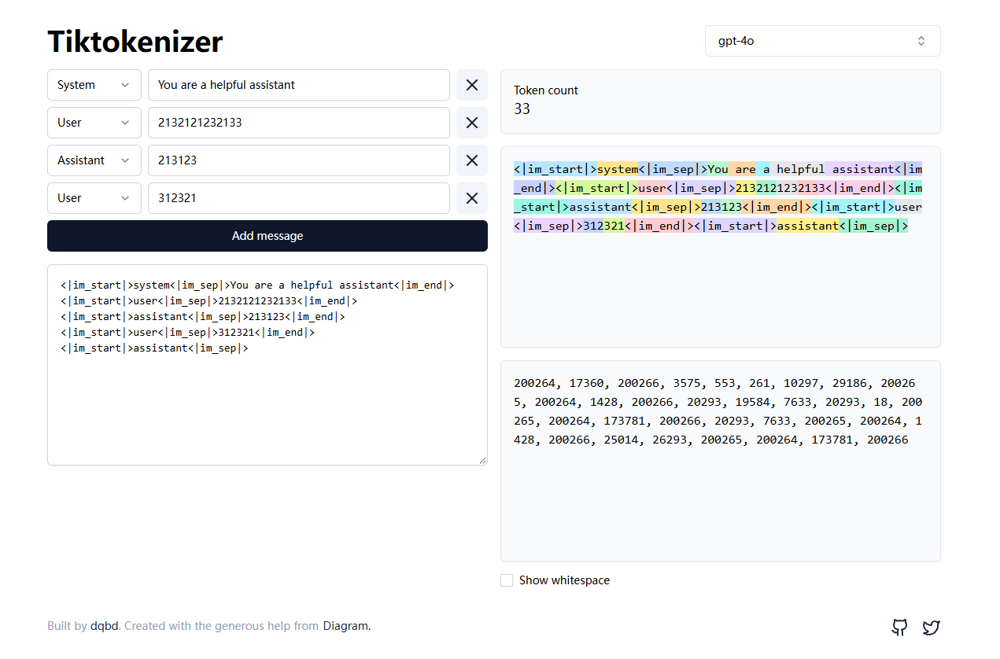
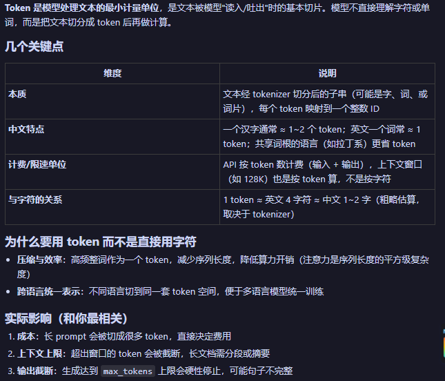
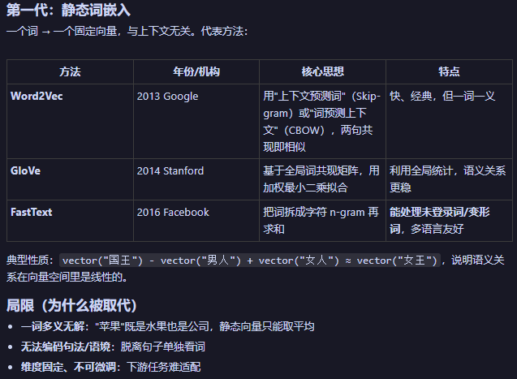
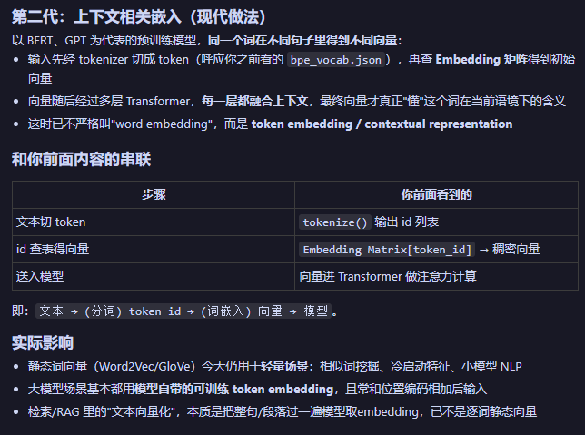
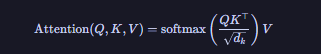

词元（Token）：

词元来自于 NLP 领域，它研究的话题是：

如何将文字序列转化为可被AI使用的数字序列

测试网站：https://tiktokenizer.vercel.app/


转化过程称之为 分词（Tokenize），转化的工具称之为 分词器（Tokenizer），转化的结果序列称之为 词元（Token）序列，每一个数字称为为 词元（Token）



***

词嵌入（word embedding）：

词嵌入是把"词"映射成固定长度稠密向量的技术，向量里的数值编码了词的语义。历史上它指静态词向量（一个词永远对应同一个向量，如 Word2Vec），和现代 LLM 里上下文相关的动态嵌入（同一个词在不同句子里向量不同）是两代技术
---
词嵌入是 transformer 架构前向传播的第一个阶段




## 为什么需要
Token ID 序列不能直接训练：
- **无语义**：ID 只是符号
- **无数学关系**：ID 没有任何语义关联

→ 需要更多维度来描述 token。

## 核心思想
把每个 token 映射成一个**多维连续向量**。

> Embedding 本意：把**低维离散对象**"镶嵌"进**连续高维几何空间**。

## 维度怎么定
不规定每维的含义和取值——**只定维度数量**，具体数值由模型在训练中自动学习。
> 深度学习只规定学习方法，永远不告诉机器答案。

## 术语
| 术语 | 含义 |
|------|------|
| 上下文长度 | 传入 transformer 的 token 数量 |
| 上下文窗口长度 | transformer 能容纳的**最大** token 数量 |

可视化参考：https://projector.tensorflow.org/

***

注意力机制（Attention）：

## 结论
**注意力机制让序列中的每个 token 都能"看向"其它所有 token，并按相关度加权聚合它们的信息**，从而把"静态词向量"升级成"理解上下文后的动态表示"。它解决了你前面提到的**一词多义**问题——"苹果"最终长什么样，取决于它和"吃/公司/手机"等上下文 token 的关联强度。

## 核心直觉
对当前 token，先问："序列里哪些 token 和我相关？" 然后根据相关度分配权重，把相关 token 的信息**加权求和**融进自己。

相关度不是人工设定的，而是从数据中**学出来**的。

## 数学形式：缩放点积注意力（Scaled Dot-Product Attention）



三个角色：

| 符号 | 名称 | 作用 |
|------|------|------|
| **Q** (Query) | 查询 | "我在找什么信息"（当前 token 的视角） |
| **K** (Key) | 键 | "我能提供什么信息"（被检索方的标签） |
| **V** (Value) | 值 | "我实际携带的信息"（被聚合的内容） |

步骤：
1. 每个 token 的嵌入经三个线性层生成 Q/K/V
2. `Q·Kᵀ` 算**相似度**（点积越大越相关）
3. 除以 `√d_k` **缩放**，防止点积过大导致 softmax 梯度消失
4. `softmax` 归一化成权重（一行权重之和=1）
5. 权重乘 V 并求和 → 当前 token 的**上下文表示**

```
文本 → 分词得 ID → 词嵌入(静态向量) → 【注意力：融合上下文】 → 动态表示
                                                      ↑ 本讲
```

没有注意力时，"苹果"永远是同一个向量；有了注意力，它在"吃__"和"买__手机"里会得到**不同的向量**。

## 关键变体

| 类型 | 说明 |
|------|------|
| **Self-Attention（自注意力）** | Q/K/V 都来自同一序列，token 互相看（Transformer 主力） |
| **Multi-Head（多头）** | 并行多组 Q/K/V，各自关注不同子空间（语法/语义/指代…），结果拼接 |
| **Cross-Attention（交叉注意力）** | Q 来自一个序列，K/V 来自另一个（如编码器-解码器、多模态对齐） |
| **Masked Attention** | 训练时遮挡未来 token，保证自回归生成不"偷看"答案 |

## 代价与取舍

- **优点**：并行计算（不像 RNN 必须串行）、直接建模**任意远距离**依赖、可解释（注意力权重能可视化"模型在看哪")
- **代价**：复杂度是序列长度的平方级 \(O(n^2)\)——这正是上下文窗口越大越贵、越慢的根源，也是后续 MQA/GQA、稀疏注意力、KV Cache 等优化的出发点

## 一句话总结
注意力 = 用"谁和谁相关、相关多少"的权重，把整段序列的信息动态揉进每个 token。它是 Transformer 取代 RNN/CNN 成为大模型基石的根本原因。

Embedding的问题:
---
Embedding 层为每一个 token（词/子词） 提供一个静态的、与上下文无关的向量表示，这个向量编码了该词在训练语料中平均意义上的语义/用法倾向。

注意力机制要解决的问题：
---
核心问题：如何让序列中每个位置的表示，根据上下文动态地融合其他位置的信息，而不是只依赖自身固定的向量。

注意力机制要解决的问题是：打破 Embedding 的静态、上下文无关表示，让每个 token 根据与上下文中其他 token 的相关性，动态地加权聚合全局信息，从而获得上下文相关的表示；同时保持等长、可并行、能建模长距离依赖。