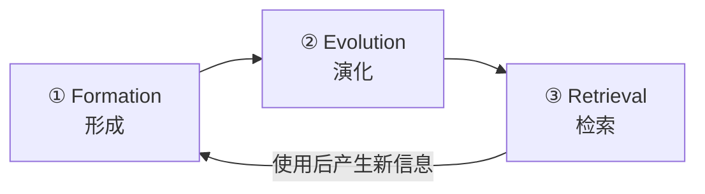

# Agent Memory 记忆体系

> **权威依据**
> ① **arXiv:2512.13564**《Memory in the Age of AI Agents: A Survey》— 47 位作者，v1 2025-12-15 / v2 2026-01-13
> ② **arXiv:2505.00675**《Rethinking Memory in LLM based Agents》— 六大原子操作
> ③ **arXiv:2310.08560**《MemGPT: Towards LLMs as Operating Systems》
> ④ 本知识库：`Context Engineering.md`、`Agent核心实现逻辑.md`、`大模型会话最佳实践.md`

## 结论

**Agent Memory 是"让 Agent 在单次上下文窗口之外，持续记住、更新、取用信息"的能力。**

> **一句话**：**上下文窗口是内存，记忆系统是硬盘。**

为什么它是一等公民？因为 **Agent = LLM + Tools + Memory + Loop**——四大件里，其他三件都有成熟方案，**只有记忆没有标准答案**。

**最核心的认知转变**：

| 旧认知 | 新认知 |
|--------|--------|
| 记忆 = 长/短期两分 | **长/短期二分已不够用**（论文原话） |
| 记忆 = 向量库检索 | 检索只是**六大操作之一** |
| 记忆 = RAG | **两者是不同的东西**（见第一章） |

## 一、先划清边界：记忆 ≠ RAG ≠ 上下文工程

综述论文专门做了一件事：**把 agent memory 与三个易混概念区分开**。

| 概念 | 记忆的"来源" | 记忆的"归属" | 一句话 |
|------|-------------|-------------|--------|
| **Agent Memory** | Agent **自己产生**的 | Agent 私有 | "我经历过什么" |
| **RAG** | **外部文档** | 共享知识库 | "资料里写了什么" |
| **Context Engineering** | — | — | **怎么把东西塞进窗口**（是手段，不是存储） |
| **LLM Memory** | 训练进权重的 | 全局、只读 | "模型天生知道什么" |

### 1.1 最重要的一条区分

> **RAG 是"读别人的笔记"，Agent Memory 是"写自己的日记"。**

| | RAG | Memory |
|---|---|---|
| **数据来源** | 静态文档库 | Agent 运行轨迹 |
| **写入者** | 人（ ingestion 流程） | **Agent 自己** |
| **更新频率** | 低（批次重建索引） | **高（每轮都可能写）** |
| **失败模式** | 检索不到 | **记错了还反复用** |
| **谁负责质量** | 数据工程 | **Agent 的判断力** |

**所以**：RAG 出问题通常是"找不到"，**记忆出问题通常是"记得太牢"**。

## 二、为什么"长/短期记忆"不够用

综述原文的诊断：

> **"传统分类法如长/短期记忆，已被证明不足以刻画当代 Agent 记忆系统的多样性。"**

**原因**：

| 问题 | 说明 |
|------|------|
| **动机不同** | 有的是为了跨会话延续，有的是为了压缩上下文，有的是为了学习 |
| **实现不同** | 有的写数据库，有的写文件，有的微调参数 |
| **评测协议不同** | 各测各的，结果不可比 |
| **术语松散** | "记忆"能指十几种不同的东西 |

**替代方案**：用**三个正交维度**描述任何记忆系统——**形式（Forms）× 功能（Functions）× 动态（Dynamics）**。

## 三、形式维度（Forms）：记忆存在哪里

> 论文识别出三种主导实现方式。

| 形式 | 载体 | 优点 | 缺点 |
|------|------|------|------|
| **Token-level（词元级）** | 离散文本：笔记、摘要、检索片段、文件 | **可读、可审计、可编辑** | 吃上下文、需检索 |
| **Parametric（参数化）** | **模型权重**（微调、持续学习、知识编辑） | **零上下文成本**、内化为能力 | 更新慢、不可审计、**改错难回滚** |
| **Latent（潜变量）** | 隐空间向量表示（KV Cache、记忆向量） | 高效、可微 | **不可读、难调试** |

### 3.1 工程含义（这是最关键的一张判断表）

| 如果你的需求是… | 选 |
|----------------|-----|
| 要让用户/审计看到 Agent 记住了什么 | **Token-level** |
| 要让它变成"能力"而非"知识" | **Parametric** |
| 要在推理时省 token、提速度 | **Latent** |
| 要能随时删除某条记忆（合规） | **Token-level**（另外两种做不到） |

> **实务结论**：**95% 的产品级 Agent 只需要 Token-level**。
> Parametric 用于"风格与技能内化"，Latent 用于性能优化——**都不是第一天的需求**。

## 四、功能维度（Functions）：记忆用来做什么

> 论文提出比长/短期更细粒度的三分法。

| 类型 | 中文 | 内容 | 存什么 | 存多久 |
|------|------|------|--------|--------|
| **Factual** | 事实记忆 | 关于世界与用户的事实 | 用户偏好、项目背景、结论 | 长期 |
| **Experiential** | 经验记忆 | 任务中积累的经验、教训、策略 | "这个 API 要用 v2"、"这类错误先检查 X" | 长期 |
| **Working** | 工作记忆 | 当前任务的活跃信息 | 当前计划、中间结果、待办 | **短期** |

### 4.1 与常见三分法的对应

| 本文 | LangGraph 等常见说法 | 通俗解释 |
|------|---------------------|----------|
| **Factual** | Semantic memory（语义记忆） | **知道什么** |
| **Experiential** | Episodic / Procedural memory | **踩过什么坑** |
| **Working** | Short-term memory | **现在在干什么** |

### 4.2 三类记忆的工程差异（重要）

| | Factual | Experiential | Working |
|---|---|---|---|
| **写入频率** | 低 | 中 | **极高** |
| **读取频率** | 高 | 中 | 极高 |
| **冲突风险** | **高**（用户改了偏好） | 低 | 无 |
| **清理策略** | 版本化 | 按效果加权 | **任务结束即清** |
| **最容易被忽视** | — | **几乎没人做** | 常被当成"上下文" |

> **最大的实践空白是 Experiential**：大多数团队只做了"记住用户是谁"，没人做"记住上次为什么失败"。
> 而这恰恰是 Agent 从"能用"到"越用越顺"的关键。

## 五、动态维度（Dynamics）：记忆怎么流动

> 论文给出记忆的完整生命周期。



| 阶段 | 关键问题 |
|------|----------|
| **Formation（形成）** | 什么时候写？写什么？谁来摘要？ |
| **Evolution（演化）** | 何时更新？冲突怎么办？何时遗忘？ |
| **Retrieval（检索）** | 何时检索？按什么排序？取多少？ |

**三阶段里最容易做错的是 Formation**：

> **"每次都记" = 记忆库快速污染；"从不记" = 没有记忆。**
> 关键在于**设一道写入阈值**。

## 六、六大原子操作（可直接当设计清单）

> 第二篇综述的核心贡献：把记忆从"应用场景"拉回到**六个原子操作**。

| # | 操作 | 中文 | 做什么 | 关键设计问题 |
|---|------|------|--------|-------------|
| 1 | **Consolidation** | 巩固 | 把零散新信息合并、提炼成稳定单元 | **什么时候把 10 条碎片合并成 1 条认知？** |
| 2 | **Updating** | 更新 | 修正过时或错误的内容 | **新信息与旧记忆冲突时，信谁？** |
| 3 | **Indexing** | 索引 | 建立可寻址结构（键/标签/向量） | **按什么维度索引才查得到？** |
| 4 | **Forgetting** | 遗忘 | 有选择地删除或降权 | **什么该忘？忘了会不会出事？** |
| 5 | **Retrieval** | 检索 | 按需取回并注入上下文 | **主动拉取还是被动注入？** |
| 6 | **Condensation** | 压缩 | 摘要、抽象、降维 | **压到多少还保留关键信息？** |

### 6.1 这六项如何映射到代码

```
写入路径：Consolidation → Indexing
维护路径：Updating → Forgetting → Condensation
读取路径：Retrieval
```

**绝大多数实现只做了「Indexing + Retrieval」**，也就是"存进去、查出来"。
**没有 Consolidation、Updating、Forgetting 的记忆系统，用三个月必然变成垃圾场。**

## 七、MemGPT：理解分层的钥匙

> 论文标题就是主张：**《Towards LLMs as Operating Systems》**

### 7.1 操作系统类比

| 操作系统 | Agent |
|----------|-------|
| **内存（RAM）** | **上下文窗口**——快、贵、容量小 |
| **磁盘** | **外部存储**——慢、便宜、容量大 |
| **虚拟内存** | **Virtual context management**——让你以为内存很大 |
| **缺页中断** | **Interrupts**——需要磁盘数据时打断当前执行 |
| **读写系统调用** | **函数/工具调用**——在两层之间搬运数据 |

### 7.2 三个直接可用的启示

| 启示 | 含义 |
|------|------|
| **① 上下文是稀缺资源** | 不要什么都往里塞，要像管理内存一样管理它 |
| **② 换入换出要主动** | Agent 应能**自己决定**把什么写出去、把什么读回来 |
| **③ 中断是必要的** | 需要外部信息时，**允许打断当前流程** |

### 7.3 论文验证的两个场景

| 场景 | 说明 |
|------|------|
| **文档分析** | 分析远超上下文窗口的大型文档 |
| **多轮/多会话聊天** | 让对话 Agent 在长期交互中**记住、反思、动态演化** |

## 八、工程蓝图：四层记忆架构

```
┌─────────────────────────────────────────────┐
│ L0 工作记忆（Working）                       │
│    当前任务的计划、中间结果、待办             │
│    载体：上下文数组  │ 生命周期：任务内        │
├─────────────────────────────────────────────┤
│ L1 会话记忆（Session）                       │
│    本次对话的摘要与关键决策                   │
│    载体：会话表  │ 生命周期：会话内/数天      │
├─────────────────────────────────────────────┤
│ L2 长期记忆（Long-term）                     │
│    Factual（用户/项目事实）                  │
│    Experiential（经验与教训）                 │
│    载体：KV/向量库/文件  │ 生命周期：永久（可忘）│
├─────────────────────────────────────────────┤
│ L3 参数记忆（Parametric）                    │
│    内化为能力的风格与技能                     │
│    载体：微调权重  │ 生命周期：版本级           │
└─────────────────────────────────────────────┘
        ↑ 越往上越快越贵越小，越往下越慢越便宜越大
```

**落地建议**：**先做 L0 + L1，再做 L2 的 Factual，最后才考虑 Experiential 和 L3。**
绝大多数团队一上来就做 L2，结果 L0 和 L1 都没管好。

## 九、实现示例

### 9.1 最小可用的记忆管理器

```python
import json
import time
from dataclasses import dataclass, field, asdict


@dataclass
class Memory:
    id: str
    type: str            # factual | experiential | working
    content: str
    importance: float    # 0~1，决定遗忘优先级
    created_at: float
    last_used_at: float
    use_count: int = 0
    source: str = ""     # provenance：哪来的


class MemoryStore:
    """演示六大操作的最小实现"""

    # ---- 1. Formation + Consolidation ----
    def write(self, type: str, content: str, importance: float = 0.5):
        # 写入门槛：低价值信息不入库
        if importance < 0.3:
            return None

        # 巩固：同类记忆合并（简化版——真实系统用相似度）
        for m in self._all():
            if m.type == type and self._similar(m.content, content):
                m.content = self._merge(m.content, content)
                m.importance = max(m.importance, importance)
                m.last_used_at = time.time()
                self._save(m)
                return m

        m = Memory(
            id=str(time.time_ns()), type=type, content=content,
            importance=importance, created_at=time.time(),
            last_used_at=time.time(),
        )
        self._insert(m)
        return m

    # ---- 2. Updating ----
    def update(self, mem_id: str, content: str):
        """冲突消解：新信息覆盖旧的，但保留来源"""
        m = self._get(mem_id)
        m.content = content
        m.last_used_at = time.time()
        self._save(m)

    # ---- 3. Indexing（略：接向量库） ----

    # ---- 4. Forgetting ----
    def forget(self, now: float = None, decay: float = 0.01):
        """艾宾浩斯式衰减：久不用 + 不重要 → 删除"""
        now = now or time.time()
        for m in self._all():
            age_days = (now - m.last_used_at) / 86400
            score = m.importance * (0.5 ** (age_days * decay))
            if score < 0.05:
                self._delete(m.id)

    # ---- 5. Retrieval ----
    def recall(self, query: str, k: int = 5) -> list[Memory]:
        """混合打分：相关度 × 重要度 × 新鲜度"""
        now = time.time()
        scored = []
        for m in self._all():
            rel = self._similar(m.content, query)
            rec = 0.5 ** ((now - m.last_used_at) / 86400 / 30)
            scored.append((rel * 0.6 + m.importance * 0.2 + rec * 0.2, m))

        scored.sort(key=lambda x: -x[0])
        picked = [m for _, m in scored[:k]]

        for m in picked:          # 用一次就"记住它有用"
            m.use_count += 1
            m.last_used_at = now
            self._save(m)
        return picked

    # ---- 6. Condensation ----
    def compress(self, mems: list[Memory], budget: int) -> str:
        """超过预算就摘要（真实系统用 LLM）"""
        text = "\n".join(f"- [{m.type}] {m.content}" for m in mems)
        return text if len(text) <= budget else text[:budget] + "…"
```

### 9.2 这段代码体现的四个原则

| 原则 | 代码位置 |
|------|----------|
| **写入门槛** | `if importance < 0.3: return None` |
| **巩固优先于新增** | 先找相似记忆合并，再创建新的 |
| **混合打分** | 相关度 0.6 + 重要度 0.2 + 新鲜度 0.2 |
| **衰减式遗忘** | `score = importance * 0.5 ** (age * decay)` |

## 十、五个最难的问题

### 10.1 写什么（Formation 的门槛）

| 策略 | 问题 |
|------|------|
| **每轮都写** | 三个月后记忆库 90% 是噪音 |
| **从不写** | 没有记忆 |
| **LLM 自己判断要不要写** | 成本高但效果好，**目前主流** |

> **推荐**：在 system prompt 里明确写"以下三类信息值得记住：用户明确陈述的偏好、我犯过的错误及原因、任务的关键结论"。**给判据，不要给"自己看着办"。**

### 10.2 记忆污染（最危险）

```
错误记忆 → 被检索到 → 影响决策 → 产生新的错误记忆 → 循环
```

> **记忆系统的失败不是"查不到"，而是"坚信错的"。**

**对策**：
- 记 **provenance**（哪来的）
- 事实类记忆**定期复核**
- **区分"我观察到的"和"我推断的"**

### 10.3 冲突消解

| 情况 | 处理 |
|------|------|
| 用户改了偏好 | **新覆盖旧**，标记时间戳 |
| 两个来源矛盾 | **保留双方 + 置信度**，别急着合并 |
| 经验记忆矛盾 | 按**成功率加权**，保留多条并记录适用条件 |

> **反模式**：直接覆盖。**冲突本身就是信息**——说明这件事不稳定。

### 10.4 检索时机（被动 vs 主动）

| 模式 | 说明 | 适用 |
|------|------|------|
| **被动注入** | 每次请求前固定检索 | 简单、可预测 |
| **主动检索** | Agent 自己决定何时调 `recall()` | 灵活、省 token |

> **趋势是主动**：把记忆检索做成一个**工具**，而不是每次自动塞进去。
> 但代价是——**Agent 可能"忘了去回忆"**。

### 10.5 遗忘策略

| 策略 | 说明 |
|------|------|
| **TTL** | 到期删除 |
| **衰减（decay）** | 按"重要度 × 时间"打分，低于阈值删 |
| **容量上限 + LRU** | 超限淘汰最久未用 |
| **事件驱动** | 任务结束清 working memory |

> **遗忘不是 bug，是 feature。** 不遗忘的记忆系统会**越来越慢、越来越错**。

## 十一、评测

### 11.1 综述列出的方向

论文系统梳理了记忆相关的 **benchmarks 与开源框架**，并指出前沿方向包括：

| 方向 | 说明 |
|------|------|
| **Memory automation** | 记忆管理从手工规则走向自动学习 |
| **RL 集成** | 用强化学习训练"记什么、何时取" |
| **Multimodal memory** | 图像/音频记忆 |
| **Multi-agent memory** | 多个 Agent 共享记忆 |
| **Trustworthiness** | 记忆的隐私、可篡改、投毒 |

### 11.2 实用的四类指标

| 指标 | 测什么 |
|------|--------|
| **召回准确率** | 该想起的想起来了没 |
| **精度** | 取回的是否真的相关 |
| **记忆膨胀率** | 单位时间内记忆条数增长（**健康系统应收敛**） |
| **污染率** | 被后续证明错误的记忆占比 |

> **最容易做又最容易被忽略的**：**记忆膨胀率**。它一旦线性增长，说明系统在无差别记录。

## 十二、常见误区

| 误区 | 事实 |
|------|------|
| "记忆就是向量库" | ❌ 向量库只解决 **Indexing + Retrieval**，六大操作缺四个 |
| "记忆就是 RAG" | ❌ RAG 读别人的文档，记忆写自己的经历 |
| "记忆越多越好" | ❌ **越多越慢越容易污染** |
| "上下文窗口变大了就不需要记忆" | ❌ 窗口再大也有上限，且**长上下文会降质**（Context Rot） |
| "记忆不需要遗忘" | ❌ 不遗忘 = 慢慢腐烂 |
| "让 Agent 自己决定记什么就够了" | ⚠️ 需要**给判据**，否则它要么记太多要么不记 |
| "记忆写入必须精确" | ❌ **记住"大概"往往比记住"精确但错的"好** |
| "多 Agent 共享一个记忆库很简单" | ❌ 并发写、冲突、权限都是硬问题 |

## 十三、Checklist

**定位**
- [ ] 我做的到底是记忆还是 RAG？（来源是"自己产生"还是"外部文档"）
- [ ] 我需要的是 Factual / Experiential / Working 哪几类？
- [ ] 载体选 Token-level 够了吗？（是否需要 Parametric）

**六大操作**
- [ ] **Formation**：写入门槛是什么？
- [ ] **Consolidation**：相似记忆会合并吗？
- [ ] **Updating**：冲突怎么消解？
- [ ] **Indexing**：按什么维度索引？
- [ ] **Forgetting**：什么情况下会忘？
- [ ] **Retrieval**：被动注入还是主动拉取？

**质量**
- [ ] 每条记忆有 **provenance**（来源）
- [ ] 有**记忆膨胀率**监控
- [ ] 有**污染检测 / 复核**机制
- [ ] 用户能**查看和删除**自己的记忆（合规）

**工程**
- [ ] 记忆读写不阻塞主循环
- [ ] 记忆检索有**超时与降级**
- [ ] 有**容量上限**
- [ ] 记忆内容做了**脱敏**

## 十四、总结

**三句话概括三篇论文：**

| 论文 | 一句话 |
|------|--------|
| 2512.13564 | **别再用长/短期二分了，用「形式 × 功能 × 动态」三维描述** |
| 2505.00675 | **记忆不是功能，是六个原子操作** |
| 2310.08560 | **把上下文当内存，把外部存储当磁盘** |

**四条最值得记住的原则**：

1. **记忆 ≠ RAG** —— 一个是自己写的日记，一个是别人的资料
2. **写入比读取难** —— 几乎所有实现都做了读，做好了写的很少
3. **不遗忘的记忆会腐烂** —— 遗忘是 feature
4. **Experiential 是最大的空白** —— "记住上次为什么失败"比"记住用户叫什么"值钱得多

> **最后一句话**：
> **上下文窗口是内存，它决定 Agent 现在能想多复杂；记忆系统是硬盘，它决定 Agent 能不能越用越聪明。**
> 大多数人只在扩容内存，很少有人真正在建硬盘。

---

> **资料说明**
> 「形式 × 功能 × 动态」三维框架、三种形式（token-level / parametric / latent）、三种功能（factual / experiential / working）、三个动态阶段（formation / evolution / retrieval）、"长短期二分不足"的诊断、与 LLM memory / RAG / context engineering 的边界划分、47 位作者与发布修订日期，**依据 arXiv:2512.13564 摘要与 arXiv 页面**。
> 六大原子操作（Consolidation / Updating / Indexing / Forgetting / Retrieval / Condensation）、parametric vs contextual 表示划分，**依据 arXiv:2505.00675 摘要**。
> MemGPT 的操作系统类比、virtual context management、interrupts、两个验证场景，**依据 arXiv:2310.08560 摘要**。
>
> **重要限制**：
> - 三篇均为**预印本**，且我只读到**摘要层面**（未读 PDF 全文）。论文正文中的形式化定义、benchmark 清单、框架对比**未逐项核对**。
> - 2512.13564 的 Functions 三个名称（factual / experiential / working）取自摘要原文；其**与 LangGraph 等工程术语的对应关系是我的类比**，非论文表述。
> - 六大操作的中文释义为**基于命名的解释**（2505.00675 摘要仅列名称未给定义），引用时请核对原文。
> - 第九章代码为**教学示意**：`_similar` / `_merge` / `_insert` 等未实现，缓存后端未接，**不能直接用于生产**。
> - 所有引文为**中文意译**，非逐字直译。
