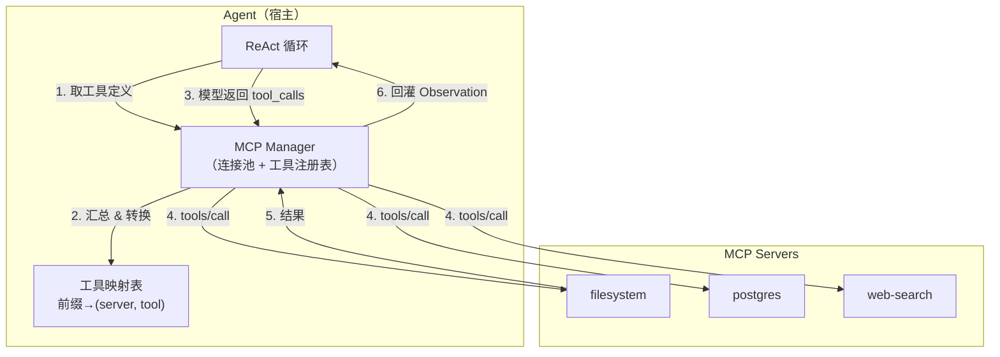

# Agent 接入 MCP

## 结论

**Agent 接入 MCP 的本质是"把远程能力翻译成本地工具"**：启动时连上若干 MCP Server，拉取工具清单，**转换成 Function Calling 的函数定义**，然后在自己的 ReAct 循环里正常调用——模型感知不到 MCP 的存在。

```
Agent 循环（不关心 MCP）
      ↓ 需要工具定义
MCP Manager（翻译层）
      ↓ 连接与调用
MCP Client → MCP Server
```

> 一句话：**MCP 对 Agent 是"插拔式工具源"，对模型是"普通函数"。**

## 一、整体链路



### 六个步骤

| # | 步骤 | 由谁做 |
|---|------|--------|
| 1 | 连接 Server、`initialize` 握手 | Manager |
| 2 | `tools/list` 拉取工具清单 | Manager |
| 3 | 转换成函数定义给模型 | Manager |
| 4 | 模型输出 `tool_calls` | 模型 |
| 5 | `tools/call` 转发到对应 Server | Manager |
| 6 | 结果转文本回灌上下文 | Manager |

## 二、接入前：选传输方式

| 场景 | 传输 | 原因 |
|------|------|------|
| 本地文件、本地脚本、开发调试 | **stdio** | 无需网络、进程隔离、零配置 |
| 云端服务、团队共享、多用户 | **Streamable HTTP** | 可远程、可鉴权、可水平扩展 |
| 旧系统兼容 | ~~HTTP+SSE~~ | 已废弃，不要新接 |

**stdio 的进程模型**：

```
Agent 进程
  └─ 拉起子进程 python server.py
       └─ 通过 stdin 发请求、stdout 收响应
```

> **关键**：stdio 下 **stdout 是协议通道**，Server 的调试日志必须写 **stderr**，否则整条流会被污染。
> （这是接入阶段最常见的"连上了但不工作"的原因。）

## 三、接入四步

### 步骤 1：建立连接与握手

```python
from mcp import ClientSession, StdioServerParameters
from mcp.client.stdio import stdio_client

params = StdioServerParameters(
    command="python",
    args=["server.py"],
    env={"API_KEY": "..."},     # 传给子进程的环境变量
)

read, write = await stack.enter_async_context(stdio_client(params))
session = await stack.enter_async_context(ClientSession(read, write))

init = await session.initialize()   # 握手：协商版本与能力
```

**握手后必须做的事**：记录 `init.capabilities`，决定后续能调哪些方法。

```python
caps = init.capabilities
has_tools     = caps.tools is not None
has_resources = caps.resources is not None
has_prompts   = caps.prompts is not None
```

> **没声明 `tools` 的 Server 就别去 `tools/list`**——会报 "method not found"。

### 步骤 2：发现能力

```python
tools     = await session.list_tools()       # 工具清单
resources = await session.list_resources()   # 资源清单（若有）
prompts   = await session.list_prompts()     # 提示模板（若有）
```

### 步骤 3：转换成函数定义

**这是整个接入的核心，也是最简单的一步**——因为 MCP 的 `inputSchema` 本身就是 **JSON Schema**，可以直接用：

```python
def to_function_def(server_name: str, mcp_tool) -> dict:
    return {
        "type": "function",
        "function": {
            "name": f"{server_name}__{mcp_tool.name}",   # 加前缀防冲突
            "description": mcp_tool.description or "",
            "parameters": mcp_tool.inputSchema,          # 直接复用
        },
    }
```

**字段映射表**：

| MCP 字段 | Function Calling 字段 | 说明 |
|----------|----------------------|------|
| `name` | `function.name` | **必须加前缀**防冲突 |
| `description` | `function.description` | 直接透传，**模型靠它选工具** |
| `inputSchema` | `function.parameters` | 都是 JSON Schema，**零转换** |

> 这就是 MCP 设计的高明之处：**协议层直接用了模型已经理解的 JSON Schema，接入几乎无损耗。**

### 步骤 4：接入 ReAct 循环

```python
async def run_agent(task: str, manager, model, max_steps: int = 10):
    messages = [
        {"role": "system", "content": SYSTEM_PROMPT},
        {"role": "user", "content": task},
    ]
    tools = manager.function_defs()          # ① 一次性取全部工具

    for _ in range(max_steps):
        resp = await model.chat(messages, tools)   # ② 带工具调用模型
        msg = resp.choices[0].message
        messages.append(msg.model_dump(exclude_none=True))

        if not msg.tool_calls:                      # ③ 终止
            return msg.content

        for call in msg.tool_calls:                 # ④ 分发执行
            args = json.loads(call.function.arguments or "{}")
            text = await manager.call(call.function.name, args)
            messages.append({
                "role": "tool",
                "tool_call_id": call.id,
                "content": text,                    # ⑤ 结果回灌
            })

    return "任务未在限定轮数内完成。"
```

> 注意：**Agent 的循环代码完全不需要改**。MCP 只是"工具来源"从本地换成了远程，`tool_calls` 的处理逻辑一模一样。

## 四、核心难点：工具命名空间与冲突

多个 Server 很容易撞名：`filesystem` 和 `nas` 都有 `read_file`。

### 4.1 前缀方案（推荐）

```
{server_name}__{tool_name}

filesystem__read_file
postgres__query
web-search__search
```

用一个映射表在调用时还原：

```python
def split_tool_name(full_name: str) -> tuple[str, str]:
    server, tool = full_name.split("__", 1)
    return server, tool
```

### 4.2 三种方案对比

| 方案 | 做法 | 优点 | 缺点 |
|------|------|------|------|
| **前缀**（推荐） | `server__tool` | 简单、无状态、可逆 | 名字变长 |
| **哈希后缀** | `read_file_a1b2` | 短 | 不可读、需映射表 |
| **只暴露一个 Server** | 单 Server 时无需前缀 | 最简洁 | 多 Server 无解 |

> **建议统一用 `__`（双下划线）**：单下划线在工具名里很常见，容易误切。

## 五、生命周期管理

### 5.1 连接池

```python
class MCPManager:
    def __init__(self):
        self._stack = AsyncExitStack()       # 统一管理所有连接
        self._sessions: dict[str, ClientSession] = {}
        self._tools: dict[str, dict] = {}    # full_name → 元信息

    async def connect(self, name: str, params) -> None:
        read, write = await self._stack.enter_async_context(stdio_client(params))
        session = await self._stack.enter_async_context(ClientSession(read, write))
        init = await session.initialize()
        self._sessions[name] = session

        if init.capabilities.tools:
            result = await session.list_tools()
            for t in result.tools:
                full = f"{name}__{t.name}"
                self._tools[full] = {"server": name, "tool": t}

    def function_defs(self) -> list[dict]:
        return [
            {
                "type": "function",
                "function": {
                    "name": full,
                    "description": meta["tool"].description or "",
                    "parameters": meta["tool"].inputSchema,
                },
            }
            for full, meta in self._tools.items()
        ]

    async def call(self, full_name: str, args: dict) -> str:
        meta = self._tools.get(full_name)
        if meta is None:
            return "[错误] 未知工具"
        session = self._sessions[meta["server"]]
        result = await session.call_tool(meta["tool"].name, args)
        return render_result(result)

    async def aclose(self) -> None:
        await self._stack.aclose()
```

### 5.2 动态刷新

Server 可能中途增删工具，**必须处理 `list_changed`**：

```python
async def handle_tools_changed(server_name: str):
    result = await self._sessions[server_name].list_tools()
    # 清掉该 server 的旧工具，重新注册
    ...
```

> SDK 通常会提供回调注入点，具体参数名以当前版本文档为准。

### 5.3 启动策略

| 策略 | 优点 | 缺点 |
|------|------|------|
| **启动时全连** | 简单、工具齐全 | 启动慢；一个 Server 卡住会拖累全部 |
| **懒加载（用时再连）** | 启动快 | 首次调用有额外延迟 |
| **并行连接 + 超时** | 兼顾速度与鲁棒 | 实现稍复杂 |

**推荐**：**并行连接 + 每个 Server 独立超时**，单个失败只降级该 Server，不影响其它。

## 六、结果渲染（Observation 转换）

MCP 工具返回的是**内容块数组**，要转成模型能读的文本：

```python
def render_result(result) -> str:
    parts: list[str] = []
    for block in result.content:
        if block.type == "text":
            parts.append(block.text)
        elif block.type == "image":
            parts.append("[图片内容]")
        elif block.type == "resource":
            res = block.resource
            parts.append(getattr(res, "text", "[资源内容]"))
        else:
            parts.append(f"[{block.type}]")

    text = "\n".join(parts)
    if result.isError:
        text = f"[工具执行失败] {text}"     # 让模型知道要调整
    return text
```

**要点**：

- `isError: true` 一定要在文本里**显式标出**，否则模型会当成正常结果继续推理
- 长文本要**截断**，防止单个工具结果撑爆上下文
- 二进制内容（图片/音频）不要直接塞，转成占位说明

## 七、Resources 与 Prompts 怎么接

### 7.1 Resources：应用侧注入，不交给模型

资源**不是工具**，模型不会主动调用。正确做法是**应用在合适时机读取并塞进上下文**：

```python
# 启动时读一次配置，作为系统提示的一部分
cfg = await session.read_resource("config://app")
messages[0]["content"] += f"\n\n当前配置：\n{cfg.contents[0].text}"
```

**原则**：**资源由应用控节奏，不要做成"让模型自己决定读什么"**——那会退化成工具调用，失去资源的定位。

### 7.2 Prompts：映射成用户可选的命令

```python
prompts = await session.list_prompts()
# → 在 UI 里展示成斜杠命令 /code_review
```

用户选中后，调 `prompts/get` 拿到消息数组，**直接作为对话起点**注入。

## 八、错误处理

| 故障 | 表现 | 处理 |
|------|------|------|
| **Server 启动失败** | 连接超时 / 进程退出 | 跳过该 Server，记录告警，**不影响其它** |
| **握手版本不兼容** | `initialize` 返回不同版本 | 校验后决定是否断开 |
| **工具执行失败** | `result.isError = true` | 转成文本回灌，让模型调整 |
| **协议错误** | JSON-RPC `error` | 记录日志，**不要重试** |
| **调用超时** | 无响应 | 发 `notifications/cancelled`，返回超时信息 |
| **工具名不存在** | 映射表查不到 | 返回"未知工具"，模型会换一个 |
| **连接中途断开** | 传输异常 | 重连 + 重新 `tools/list` |

**核心原则**：**任何 MCP 故障都不能让 Agent 崩溃**，只能降级。

## 九、安全

| 风险 | 说明 | 防护 |
|------|------|------|
| **恶意 Server** | 暴露危险工具（删库、发邮件） | 只接可信 Server；工具白名单 |
| **工具描述投毒** | description 里藏提示注入 | 接入前人工审阅 |
| **过度授权** | Server 拿到超出需要的权限 | 最小权限；roots 限定目录 |
| **未鉴权远程** | Streamable HTTP 裸奔 | OAuth 2.1 |
| **数据外泄** | 工具偷偷上传 | 网络出口管控 + 审计日志 |
| **间接注入** | 工具返回内容藏指令 | 把返回当**数据**，不当指令 |

> **接入方式决定安全等级**：`stdio` 的本地 Server 风险可控，远程第三方 Server 等同于"在你机器上装软件"。

## 十、常见问题

| 问题 | 原因 | 解法 |
|------|------|------|
| **工具太多，模型选错** | 3 个 Server × 20 工具 = 60 个 | 按场景动态筛选；分组暴露 |
| **上下文被工具定义撑满** | 每个工具的 schema 都占 token | 只暴露与当前任务相关的工具 |
| **描述冲突** | 两个工具描述相似 | 加 Server 前缀 + 在描述里写清差异 |
| **启动慢** | 串行连多个 Server | 并行连接 + 超时 |
| **连上但不工作** | stdio 的 stdout 被日志污染 | Server 日志改 stderr |
| **工具清单过期** | 没处理 `list_changed` | 监听并刷新 |
| **结果太长被截断** | 单次返回几万字 | Server 侧截断 + 分页 |

## 十一、Checklist

**连接**
- [ ] 选对传输（本地 stdio / 远程 HTTP）
- [ ] 并行连接 + 单 Server 超时
- [ ] 记录 `initialize` 返回的能力
- [ ] 单个 Server 失败不影响整体

**工具**
- [ ] 工具名加 `server__` 前缀
- [ ] `inputSchema` 直接透传
- [ ] 维护 `full_name → (server, tool)` 映射
- [ ] 处理 `tools/list_changed`

**调用**
- [ ] `isError` 显式标注
- [ ] 结果截断
- [ ] 调用超时 + 取消
- [ ] 未知工具返回可读错误

**资源与提示**
- [ ] 资源由应用侧注入
- [ ] 提示映射为 UI 命令

**安全**
- [ ] 只接可信 Server
- [ ] 工具白名单
- [ ] 远程服务鉴权
- [ ] 外部内容与指令隔离

## 十二、总结

**Agent 接入 MCP 可以总结为"三个不要改，三个必须做"：**

**不要改的：**
1. **Agent 的 ReAct 循环不用改**——MCP 只是工具来源变了
2. **模型的视角不用改**——它看到的还是普通函数定义
3. **结果处理不用改**——`tool_calls` → 执行 → 回灌，流程一致

**必须做的：**
1. **工具名加前缀**，解决多 Server 冲突
2. **监听 `list_changed`**，工具清单要能动态刷新
3. **故障隔离**，任何 Server 挂了都不能拖垮 Agent

一句话记住：**MCP 是"透明的工具源"，接入的复杂度全部集中在 Manager 层，模型和循环层保持干净。**
