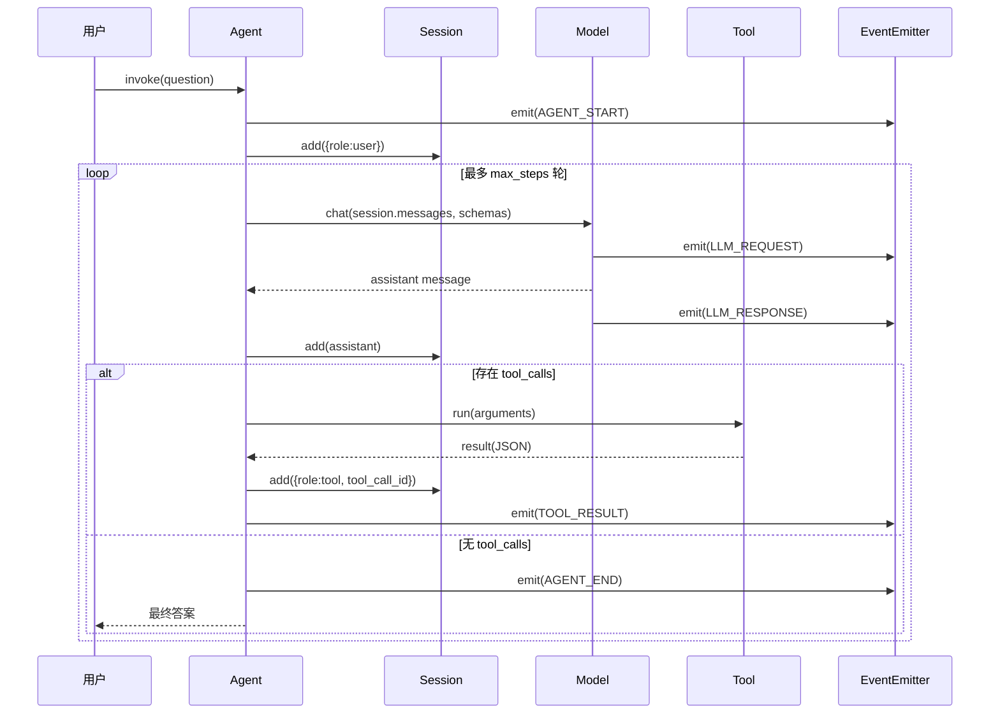

# Agent 最佳架构与实现（ReAct + 分层 + 事件驱动）

## 结论

本项目实现的是一个 **基于 ReAct 模式的 AI Agent**，采用**分层架构 + 观察者模式**：

- **编排层（Agent）** 只负责组织循环，不关心模型与工具的细节
- **模型层 / 会话层 / 工具层 / 监听层** 各自单一职责
- **事件总线（EventEmitter）** 把"发生了什么"广播出去，日志、UI、监控都是可插拔的监听器

> 核心设计判断：**Agent 的可靠性来自分层与解耦，而非循环本身的复杂度。**

## 一、整体架构

```
┌─────────────────────────────────────────────┐
│              Agent（入口 / 编排）             │
├──────────┬──────────┬──────────┬────────────┤
│  Model   │ Session  │   Tool   │  Listener  │
│（模型层）│（会话层）│（工具层）│ （监听层） │
├──────────┴──────────┴──────────┴────────────┤
│         EventEmitter（事件总线）             │
└─────────────────────────────────────────────┘
```

### 分层职责

| 层 | 职责 | 不负责 |
|----|------|--------|
| **Agent（编排层）** | 组织 ReAct 循环、调度各组件 | 不直接调 API、不拼 schema |
| **Model（模型层）** | 与大模型交互、超时重试 | 不管理上下文、不做业务判断 |
| **Session（会话层）** | 维护 messages、追加与裁剪 | 不发请求 |
| **Tool（工具层）** | 工具注册、schema 生成、参数校验、执行 | 不决定何时调用 |
| **Listener（监听层）** | 消费事件、打印/上报 | 不修改业务流程 |
| **EventEmitter（事件总线）** | 发布订阅，解耦通知 | 不承载业务逻辑 |

### 三条设计原则

1. **单一职责**：每层只做一件事，改模型不影响工具
2. **依赖注入**：组件在构造时传入，便于替换与测试
3. **依赖倒置**：Agent 依赖抽象（Model 接口 / Listener 基类），不依赖具体实现

## 二、核心模块详解

### 1. `agent.py` — Agent 主控（编排层）

**职责**：作为整个 Agent 的入口，组织 ReAct 循环的执行流程。

**关键逻辑**：

```python
import json
from .events import EventType
from .tool import get_schemas, get_tool


class Agent:
    def __init__(self, model, session, emitter, max_steps: int = 10):
        self.model = model
        self.session = session
        self.emitter = emitter
        self.max_steps = max_steps

    def invoke(self, q: str) -> str:
        self.emitter.emit(EventType.AGENT_START, query=q)
        self.session.add({"role": "user", "content": q})

        for _ in range(self.max_steps):
            # ① 决策：让模型看完整上下文 + 工具定义
            message = self.model.chat(self.session.messages, get_schemas())
            self.session.add(message.model_dump(exclude_none=True))

            # ② 终止：没有工具调用 = 模型认为可以回答了
            if not message.tool_calls:
                self.emitter.emit(EventType.AGENT_END, answer=message.content)
                return message.content

            # ③ 行动：逐个执行并回灌观察结果
            for call in message.tool_calls:
                result = self._execute(call)
                self.session.add({
                    "role": "tool",
                    "tool_call_id": call.id,
                    "content": result,
                })

        answer = "任务未在限定轮数内完成。"
        self.emitter.emit(EventType.AGENT_END, answer=answer)
        return answer

    def _execute(self, call) -> str:
        self.emitter.emit(
            EventType.TOOL_CALL,
            name=call.function.name,
            arguments=call.function.arguments,
        )
        tool = get_tool(call.function.name)
        result = (
            tool.run(call.function.arguments)
            if tool
            else json.dumps({"ok": False, "error": "未知工具"}, ensure_ascii=False)
        )
        self.emitter.emit(
            EventType.TOOL_RESULT, name=call.function.name, result=result
        )
        return result
```

**设计要点**：

- 编排层只做三件事：**决策 → 终止判断 → 执行回灌**
- 所有副作用（日志、UI）通过 `emitter` 广播，不在循环里写 `print`
- `max_steps` 是硬性兜底，**没有它就没有可靠性**

### 2. `model.py` — 模型层（与大模型交互）

**职责**：封装 LLM 调用，隔离厂商 API 差异。

```python
from openai import OpenAI
from .events import EventType


class Model:
    def __init__(self, config, emitter):
        self.config = config
        self.emitter = emitter
        self.client = OpenAI(
            api_key=config.api_key,
            base_url=config.base_url,
        )

    def chat(self, messages: list[dict], tools: list[dict]):
        self.emitter.emit(EventType.LLM_REQUEST, messages=messages)
        try:
            resp = self.client.chat.completions.create(
                model=self.config.model,
                messages=messages,
                tools=tools,
                timeout=self.config.timeout,
            )
        except Exception as e:
            self.emitter.emit(EventType.ERROR, error=str(e))
            raise

        message = resp.choices[0].message
        self.emitter.emit(EventType.LLM_RESPONSE, message=message)
        return message
```

**设计要点**：

- 换成 Anthropic / 本地模型，**只改这一个文件**
- 上行（请求）与下行（响应）都发事件，便于观测
- 异常发事件后**继续抛出**，不静默吞掉

### 3. `session.py` — 会话层（管理上下文）

**职责**：维护消息历史，保证 append-only。

```python
class Session:
    def __init__(self):
        self._messages: list[dict] = []

    @property
    def messages(self) -> list[dict]:
        return self._messages

    def add(self, message: dict) -> None:
        """只允许追加，禁止修改历史（保 prompt cache 命中）。"""
        self._messages.append(message)

    def clear(self) -> None:
        self._messages.clear()

    def __len__(self) -> int:
        return len(self._messages)
```

**设计要点**：

- **对外只暴露 `add`，不提供 `update` / `delete`** —— 用接口设计强制 append-only
- `messages` 返回引用而非副本，避免每轮深拷贝开销（内部使用，不对外修改）
- 长会话的裁剪策略应在此层实现（如保留最近 N 轮），不影响上层

### 4. `tool/` — 工具层（Function Calling 实现）

#### 4.1 `tool/core/tool.py` — Tool 类与注册机制

```python
import inspect
import json

from pydantic import ValidationError

from .utils import build_params_model


class Tool:
    def __init__(self, fn):
        self.fn = fn
        self.name = fn.__name__
        self.description = inspect.getdoc(fn) or ""
        self.params_model = build_params_model(fn)
        self.parameters = self.params_model.model_json_schema()

    def schema(self) -> dict:
        """转换成模型厂商需要的工具描述格式。"""
        return {
            "type": "function",
            "function": {
                "name": self.name,
                "description": self.description,
                "parameters": self.parameters,
            },
        }

    def run(self, arguments: str) -> str:
        """执行工具：解析 → 校验 → 调用 → 序列化结果。"""
        try:
            raw = json.loads(arguments or "{}")
            validated = self.params_model(**raw)
            result = self.fn(**validated.model_dump())
            return json.dumps({"ok": True, "data": result}, ensure_ascii=False)
        except json.JSONDecodeError:
            return json.dumps(
                {"ok": False, "error": "参数不是合法 JSON"}, ensure_ascii=False
            )
        except ValidationError as e:
            return json.dumps(
                {"ok": False, "error": f"参数校验失败: {e}"}, ensure_ascii=False
            )
        except Exception as e:
            return json.dumps(
                {"ok": False, "error": f"执行失败: {e}"}, ensure_ascii=False
            )
```

#### 4.2 `tool/core/utils.py` — 参数模型工厂

**核心思想**：从函数签名与类型注解**自动生成 Pydantic 模型**，再导出 JSON Schema。

```python
import inspect
import typing

from pydantic import BaseModel, create_model


def build_params_model(fn: typing.Callable) -> type[BaseModel]:
    """根据函数签名自动构建参数校验模型。"""
    sig = inspect.signature(fn)
    hints = typing.get_type_hints(fn)

    fields: dict[str, tuple] = {}
    for name, param in sig.parameters.items():
        if name in ("self", "cls"):
            continue
        annotation = hints.get(name, str)
        default = (
            ...
            if param.default is inspect.Parameter.empty
            else param.default
        )
        fields[name] = (annotation, default)

    return create_model(f"{fn.__name__}Params", **fields)
```

**收益**：

- **Schema 不再手写**，改函数签名即改 schema
- **校验自动完成**（类型、必填、默认值），杜绝"模型传错类型"
- 函数 docstring 直接变成工具 `description`

#### 4.3 `tool/__init__.py` — 工具注册中心

```python
from .core.tool import Tool

_registry: dict[str, Tool] = {}


def tool(fn) -> Tool:
    """装饰器：注册一个工具。"""
    t = Tool(fn)
    _registry[t.name] = t
    return t


def get_tool(name: str) -> Tool | None:
    return _registry.get(name)


def get_schemas() -> list[dict]:
    return [t.schema() for t in _registry.values()]


def reset() -> None:
    """测试用：清空注册表。"""
    _registry.clear()


# 导入具体工具模块，触发注册（必须放在最后）
from . import weather  # noqa: E402,F401
```

**新增一个工具只需要两步**：

```python
# tool/weather.py
from . import tool


@tool
def get_weather(city: str, unit: str = "celsius") -> dict:
    """查询指定城市的实时天气。用户询问天气时调用。

    Args:
        city: 城市名称，如"北京"
        unit: 温度单位，celsius 或 fahrenheit
    """
    return {"city": city, "temp": 25, "desc": "晴", "unit": unit}
```

1. 写一个带类型注解和 docstring 的函数
2. 在 `tool/__init__.py` 末尾 `import` 一下

**schema、校验、错误处理全部自动获得。**

### 5. `events.py` — 事件系统（观察者模式）

```python
from enum import Enum
from typing import Callable


class EventType(str, Enum):
    AGENT_START = "agent_start"
    LLM_REQUEST = "llm_request"
    LLM_RESPONSE = "llm_response"
    TOOL_CALL = "tool_call"
    TOOL_RESULT = "tool_result"
    AGENT_END = "agent_end"
    ERROR = "error"


class EventEmitter:
    def __init__(self):
        self._handlers: dict[EventType, list[Callable]] = {}

    def on(self, event: EventType, handler: Callable) -> "EventEmitter":
        self._handlers.setdefault(event, []).append(handler)
        return self

    def off(self, event: EventType, handler: Callable) -> None:
        self._handlers.get(event, []).remove(handler)

    def emit(self, event: EventType, **payload) -> None:
        for handler in self._handlers.get(event, []):
            handler(event, payload)
```

**设计要点**：

- 事件类型用 `Enum` 而非裸字符串，**避免拼写错误**
- `on` 返回 `self`，支持链式注册
- `emit` 使用 `**payload`，扩展事件字段无需改签名

### 6. `listener.py` — 监听器抽象基类

```python
from abc import ABC, abstractmethod


class Listener(ABC):
    @abstractmethod
    def on_event(self, event, payload: dict) -> None:
        """处理一个事件。"""
        raise NotImplementedError
```

**为什么要有基类**：把"监听器必须实现 `on_event`"变成**编译期/运行期契约**，而不是靠口头约定。

### 7. `printer.py` — 监听器实现（控制台打印）

```python
from .events import EventType
from .listener import Listener


class PrinterListener(Listener):
    def on_event(self, event, payload: dict) -> None:
        if event == EventType.AGENT_START:
            print(f"\n[任务] {payload['query']}")
        elif event == EventType.LLM_RESPONSE:
            msg = payload["message"]
            if msg.tool_calls:
                for c in msg.tool_calls:
                    print(f"[调用] {c.function.name}({c.function.arguments})")
            else:
                print(f"[回答] {msg.content}")
        elif event == EventType.TOOL_RESULT:
            print(f"[结果] {payload['result'][:200]}")
        elif event == EventType.ERROR:
            print(f"[错误] {payload['error']}")
```

**扩展方式**：写一个 `JsonFileListener` 落盘、`MetricsListener` 上报耗时，**都不需要改 Agent 一行代码**。

### 8. `config.py` — 配置管理

```python
import os
from dataclasses import dataclass


@dataclass(frozen=True)
class Config:
    api_key: str
    base_url: str
    model: str
    max_steps: int = 10
    timeout: float = 60.0

    @classmethod
    def from_env(cls) -> "Config":
        return cls(
            api_key=os.environ["OPENAI_API_KEY"],
            base_url=os.environ.get("OPENAI_BASE_URL", "https://api.openai.com/v1"),
            model=os.environ.get("MODEL_NAME", "gpt-4o"),
            max_steps=int(os.environ.get("MAX_STEPS", "10")),
            timeout=float(os.environ.get("TIMEOUT", "60")),
        )
```

**设计要点**：

- `frozen=True`：配置不可变，避免运行期被意外修改
- 密钥只从环境变量读，**绝不硬编码**
- 缺 `OPENAI_API_KEY` 直接 `KeyError` 失败，**快速失败优于带着错误配置跑**

### 9. `prompt.py` — 提示词模板引擎

```python
from string import Template


class PromptTemplate:
    def __init__(self, template: str):
        self._t = Template(template)

    def render(self, **kwargs) -> str:
        return self._t.substitute(**kwargs)


SYSTEM_PROMPT = PromptTemplate(
    """你是一名严谨的技术助理。
当前日期：$today
规则：
1. 不确定时调用工具检索，不要编造；
2. 回答先给结论，再给依据；
3. 涉及金额、日期必须精确。
"""
)
```

**为什么用 `string.Template` 而不是 `str.format`**：提示词里常含 `{}`（JSON 示例），`format` 会误解析并报错，`$var` 占位更安全。

## 三、数据全链路

### 3.1 时序图



### 3.2 消息数组的演进（以一次检索为例）

```
初始：
[ user: "退款政策是什么？" ]

第 1 轮后：
[ user: "退款政策是什么？",
  assistant: { tool_calls: [ search_docs({"query":"退款政策"}) ] },
  tool: { ok:true, data:["7天无理由…"] } ]

第 2 轮后：
[ ...上述3条,
  assistant: "根据政策，支持 7 天无理由退款…" ]   ← 无 tool_calls，循环结束
```

### 3.3 组装入口（`main.py`）

```python
from .agent import Agent
from .config import Config
from .events import EventEmitter, EventType
from .model import Model
from .printer import PrinterListener
from .session import Session


def build_agent() -> Agent:
    config = Config.from_env()

    emitter = EventEmitter()
    printer = PrinterListener()
    for event in EventType:               # 订阅所有事件
        emitter.on(event, printer.on_event)

    return Agent(
        model=Model(config, emitter),
        session=Session(),
        emitter=emitter,
        max_steps=config.max_steps,
    )


if __name__ == "__main__":
    agent = build_agent()
    print(agent.invoke("退款政策是什么？"))
```

## 四、设计亮点

| 亮点 | 说明 | 收益 |
|------|------|------|
| **分层解耦** | Agent 只管循环，其余各司其职 | 换模型只改 `model.py` |
| **事件驱动** | 观察者模式，副作用外置 | 加日志/UI/监控零侵入 |
| **Schema 自动生成** | 装饰器 + 类型注解 + Pydantic | 加工具只需写一个函数 |
| **依赖注入** | 组件构造时传入 | 单元测试可注入 Mock |
| **接口强制约束** | Session 无 update、Listener 有 ABC | 用类型系统防错 |
| **配置不可变** | `@dataclass(frozen=True)` | 避免运行期污染 |
| **失败快** | 校验失败返回结构化错误给模型 | 模型可自我纠正 |

## 五、目录结构

```
agent/
├── agent.py          # 编排层
├── model.py          # 模型层
├── session.py        # 会话层
├── events.py         # 事件总线
├── listener.py       # 监听器基类
├── printer.py        # 控制台监听器
├── config.py         # 配置
├── prompt.py         # 提示词模板
└── tool/
    ├── __init__.py   # 注册中心
    ├── core/
    │   ├── tool.py   # Tool 类
    │   └── utils.py  # 参数模型工厂
    └── weather.py    # 具体工具
```

## 六、关键取舍

| 决策 | 选了 | 代价 |
|------|------|------|
| 事件总线 vs 直接调用 | 事件总线 | 多一层间接，调试时需追事件链 |
| 自动生成 schema vs 手写 | 自动生成 | 依赖类型注解质量，复杂类型需单独处理 |
| Session 内存态 vs 持久化 | 内存（可扩展） | 重启即丢，需自行接存储 |
| 单 Agent vs 多 Agent | 单 Agent | 复杂任务需外层编排 |
| 同步调用 vs 流式 | 同步 | 无法边生成边展示 |

## 七、Checklist

**架构**
- [ ] 每层单一职责，无跨层直接调用
- [ ] 组件通过构造函数注入，无全局单例
- [ ] 事件类型使用 Enum

**Agent 循环**
- [ ] 有 `max_steps` 兜底
- [ ] `assistant` 消息原样追加
- [ ] `tool` 结果带 `tool_call_id`

**工具**
- [ ] schema 由类型注解自动生成
- [ ] 参数经 Pydantic 校验
- [ ] 错误返回结构化 JSON

**工程**
- [ ] 密钥走环境变量
- [ ] 有超时设置
- [ ] 关键事件可观测

## 八、总结

这套架构的价值不在于"用了什么高级模式"，而在于**把 Agent 的复杂度切成四个互不干扰的部分**：

- **Agent** 只关心"循环怎么转"
- **Model** 只关心"怎么调模型"
- **Session** 只关心"上下文怎么存"
- **Tool** 只关心"工具怎么注册与执行"

再用 **EventEmitter** 把"发生了什么"广播出去，让日志、UI、监控全部变成可插拔的旁路——**主流程保持干净，附属能力自由扩展**。

> 这是能长期维护的 Agent 骨架；在此基础上加记忆、加多 Agent、加评测，都不需要推翻重来。

---
