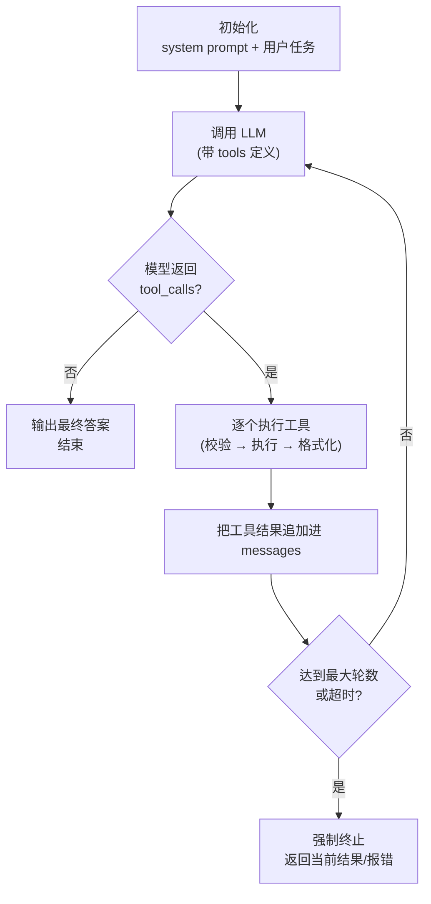

# Agent 核心实现逻辑分析

## 结论

**Agent = LLM（大脑）+ Tools（手脚）+ Memory（记忆）+ 循环控制器（神经）**。
它的核心不是某个复杂架构，而是一个**极简的循环**：模型观察当前状态 → 决定下一步动作 → 执行 → 把结果写回状态 → 再观察。这个循环持续到任务完成或触发终止条件。

> 一句话：**Agent 是"用 LLM 做决策、用工具改变世界、用循环推进任务"的系统。**

## 一、官方定义与边界

业界没有唯一的"Agent 标准"，但有两份被广泛引用的权威描述：

### 1.1 Anthropic《Building Effective Agents》（2024-12）

原文区分了两个概念：

| 概念 | 官方定义 |
|------|----------|
| **Workflow（工作流）** | "systems where LLMs and tools are orchestrated through **predefined code paths**"——**代码预先规定好路径** |
| **Agent（智能体）** | "systems where LLMs **dynamically direct their own processes and tool usage**, maintaining control over how they accomplish tasks"——**模型自主决定流程与工具使用** |

**关键区别：控制权在代码，还是在模型。**

Anthropic 列出的 5 种 Workflow 模式：

| 模式 | 说明 |
|------|------|
| **Prompt Chaining** | 任务拆成固定串行步骤 |
| **Routing** | 先分类，再路由到不同处理分支 |
| **Parallelization** | 并行执行（分段并行 / 多次投票） |
| **Orchestrator-Workers** | 一个主控动态拆分子任务给多个 worker |
| **Evaluator-Optimizer** | 生成 → 评估 → 改进，循环 |

> 官方建议：**先用最简单的方案**，只有当简单方案确实不够时才引入 Agent。多数场景用 Workflow 就够了。

### 1.2 OpenAI《A Practical Guide to Building Agents》

把 Agent 拆成三要素：

1. **Model（模型）**：负责推理与决策
2. **Tools（工具）**：与外部世界交互的能力
3. **Instructions（指令）**：明确的目标、约束与行为规范

并强调 **Guardrails（护栏）**：输入输出审核、工具权限、人工介入点。

## 二、核心组成（四大件）

```
┌────────────────────────────────────────────┐
│                  Agent                      │
│                                             │
│   ┌─────────┐   ┌─────────┐   ┌─────────┐  │
│   │  大脑   │   │  记忆   │   │  工具   │  │
│   │  (LLM)  │◀─▶│ (Memory)│   │ (Tools) │  │
│   └────┬────┘   └─────────┘   └────┬────┘  │
│        │                            │       │
│        └──────── 循环控制器 ────────┘       │
│                      │                      │
└──────────────────────┼──────────────────────┘
                       ▼
                    环境 / 用户
```

| 组件 | 职责 | 实现载体 |
|------|------|----------|
| **大脑（LLM）** | 理解任务、推理、决策下一步 | 任意支持 Tool Calling 的模型 |
| **记忆（Memory）** | 保存历史与外部知识 | 上下文数组（短期）+ 向量库/数据库（长期） |
| **工具（Tools）** | 执行动作、获取信息 | 函数 / API / MCP 服务 |
| **控制器（Loop）** | 驱动循环、判断终止、处理异常 | 普通应用代码（Python/TS） |

> **注意：真正的"智能"来自 LLM，真正的"可靠"来自控制器代码。**

## 三、核心循环（本文最重要的部分）

### 3.1 流程图



### 3.2 最小伪代码

```python
def run_agent(task: str) -> str:
    messages = [
        {"role": "system", "content": SYSTEM_PROMPT},
        {"role": "user", "content": task},
    ]

    for step in range(MAX_STEPS):                    # ① 循环保护
        resp = llm(messages, tools=TOOLS)            # ② 决策
        messages.append(resp)                        # ③ 保留 assistant 消息

        if not resp.tool_calls:                      # ④ 终止判断
            return resp.content

        for call in resp.tool_calls:                 # ⑤ 执行
            output = execute(call)
            messages.append({                        # ⑥ 观察结果回灌
                "role": "tool",
                "tool_call_id": call.id,
                "content": output,
            })

    return "已达最大轮数，任务未完成。"
```

**这 30 行左右就是 90% 的 Agent 实现。** 剩下的都是在这之上的工程加固。

### 3.3 三个本质认识

| 认识 | 含义 | 后果 |
|------|------|------|
| **模型是无状态的** | 每次请求都要发完整 `messages` | 历史必须应用侧维护 |
| **状态 = messages 数组** | 循环的"记忆"全在数组里 | 数组变了，Agent 的"认知"就变了 |
| **每轮只做一件事** | 一轮一次决策 + 一组动作 | 复杂任务需要多轮，成本和延迟随之上升 |

## 四、四个环节的实现细节

### 4.1 状态管理（messages）

- **`assistant` 消息必须原样追加**（含 `tool_calls`），否则下一轮工具结果无法对应
- **`tool` 结果必须带 `tool_call_id`**，与请求一一对应
- **append-only**：历史不可修改（保 prompt cache 命中，详见《大模型会话最佳实践》）

### 4.2 工具调用

- 工具 = **Schema（给模型）+ 执行器（给系统）**
- 模型输出是"意图"，**真正的执行与校验在你自己代码里**
- 详见《Tool Calling 与 Tool 封装》

### 4.3 记忆

| 类型 | 载体 | 特点 |
|------|------|------|
| **短期记忆** | 当前 `messages` 数组 | 容量受上下文窗口限制 |
| **长期记忆** | 向量库 / 数据库 / 文件 | 需检索后注入上下文（RAG） |
| **工作记忆** | 任务状态对象（如 Todo 列表） | 帮助长任务不丢进度 |

> 长任务的核心难点：**上下文会涨到窗口上限**，必须靠摘要、检索、任务状态外置来续命。

### 4.4 终止条件（必须显式设计）

| 终止方式 | 说明 | 可靠性 |
|----------|------|--------|
| **模型不再调工具** | 最常见，模型自己认为答完了 | 一般 |
| **调用 `finish` / `submit` 工具** | 显式提交结果，更可控 | 高 |
| **最大轮数** | 兜底保护，必须设 | 必须 |
| **超时 / 预算上限** | 控制成本与延迟 | 必须 |
| **人工中断** | 高危操作前暂停等待确认 | 场景相关 |

## 五、规划策略（三种主流）

| 策略 | 机制 | 优点 | 缺点 |
|------|------|------|------|
| **ReAct（隐式规划）** | 边想边做，每轮动态决策 | 灵活、能应对意外 | Token 多、可能绕圈 |
| **Plan-and-Execute（显式规划）** | 先一次性列出步骤，再逐步执行 | 省调用、可预览计划 | 计划错了要整体重来 |
| **Reflection（反思）** | 执行后自我评估，失败则修正重试 | 提升质量 | 增加轮次与成本 |

> 实务建议：**默认用 ReAct；任务步骤明确时用 Plan-and-Execute；质量要求高时叠加 Reflection。**

## 六、错误处理与恢复

Agent 的可靠性瓶颈几乎都在这里。

| 故障 | 处理 |
|------|------|
| 工具返回错误 | **把错误作为 Observation 回灌**，让模型自行调整 |
| 参数不合法 | 服务端校验后返回可操作的错误提示 |
| 模型选错工具 | 优化工具命名与 description；减少工具数量 |
| 陷入循环 | 检测重复动作 + 最大轮数 |
| 上下文超限 | 摘要压缩 / 检索替代 / 新开会话 |
| 高危操作 | 人工确认闸门（human-in-the-loop） |
| 模型服务异常 | 重试 + 降级模型 |

> 原则：**错误必须可见、可操作、可恢复**，不能静默吞掉。

## 七、完整最小实现（Python）

```python
import json
from openai import OpenAI

client = OpenAI()

# ① 工具 Schema
TOOLS = [{
    "type": "function",
    "function": {
        "name": "search_docs",
        "description": "在知识库中检索。用户询问产品/政策问题时调用。",
        "parameters": {
            "type": "object",
            "properties": {"query": {"type": "string"}},
            "required": ["query"],
        },
    },
}]

# ② 执行器（含校验与错误处理）
def search_docs(query: str) -> dict:
    if not query.strip():
        return {"ok": False, "error": "query 不能为空"}
    return {"ok": True, "data": [f"关于「{query}」的文档摘要…"]}

REGISTRY = {"search_docs": search_docs}

def execute(call) -> str:
    fn = REGISTRY.get(call.function.name)
    if fn is None:
        return json.dumps({"ok": False, "error": "未知工具"}, ensure_ascii=False)
    try:
        args = json.loads(call.function.arguments)
        return json.dumps(fn(**args), ensure_ascii=False)
    except Exception as e:
        return json.dumps({"ok": False, "error": f"执行失败: {e}"}, ensure_ascii=False)

# ③ 主循环
SYSTEM = "你是一名严谨的技术助理。不确定时使用工具检索，不要编造。"

def run_agent(task: str, max_steps: int = 10) -> str:
    messages = [
        {"role": "system", "content": SYSTEM},
        {"role": "user", "content": task},
    ]
    for _ in range(max_steps):
        resp = client.chat.completions.create(
            model="gpt-4o", messages=messages, tools=TOOLS
        )
        msg = resp.choices[0].message
        messages.append(msg)

        if not msg.tool_calls:
            return msg.content

        for call in msg.tool_calls:
            messages.append({
                "role": "tool",
                "tool_call_id": call.id,
                "content": execute(call),
            })
    return "任务未在限定轮数内完成。"

if __name__ == "__main__":
    print(run_agent("我们的退款政策是什么？"))
```

## 八、生产环境关注点

| 维度 | 要求 |
|------|------|
| **可观测** | 记录每轮的 thought / tool 调用 / 参数 / 耗时 / 结果 |
| **成本控制** | 最大轮数、token 预算、工具数量限制 |
| **权限** | 工具级权限校验，高危操作人工确认 |
| **稳定性** | 超时、重试、降级、熔断 |
| **评测** | 建真实任务测试集，量化端到端成功率（而非只看单步） |
| **安全** | 防提示注入、防参数注入、输出审核 |

## 九、常见失败模式

| 失败模式 | 根因 | 对策 |
|----------|------|------|
| 无限循环 | 无终止判断 / 模型反复尝试同一工具 | 最大轮数 + 重复动作检测 |
| 工具选错 | 工具过多或描述模糊 | 精简工具、优化 description |
| 上下文爆炸 | 历史无限增长 | 摘要、检索、状态外置 |
| 幻觉结果 | Observation 被模型编造 | 结果必须由系统真实注入 |
| 长任务崩在中间 | 无任务状态管理 | 外置 Todo / 进度对象 |
| 一步错步步错 | 无反思机制 | 加校验节点或 Reflection |
| 成本失控 | 无预算约束 | 轮数 + token 双上限 |

## 十、Checklist

**循环**
- [ ] 有最大轮数保护
- [ ] 终止条件显式（无 tool_call / finish 工具 / 超时）
- [ ] 工具错误会回灌给模型

**状态**
- [ ] `messages` append-only
- [ ] `assistant` 与 `tool` 消息严格配对
- [ ] 长任务有状态外置方案

**工具**
- [ ] 服务端独立校验参数
- [ ] 工具数量受控、描述清晰
- [ ] 高危操作有人工闸门

**工程**
- [ ] 全链路可观测
- [ ] 有 token / 时间预算
- [ ] 有真实任务的端到端评测集

## 十一、总结

**Agent 的核心实现逻辑可以浓缩成一句话：一个 while 循环里，让 LLM 决定下一步、让工具改变世界、让结果回到上下文。**

真正拉开差距的不是"循环写得有多花哨"，而是循环之外的工程：

1. **工具封装是否可靠**（校验、错误、权限）
2. **上下文管理是否经济**（缓存、裁剪、记忆）
3. **终止与异常是否可控**（轮数、超时、人工介入）
4. **是否能用真实任务量化效果**（端到端评测）

> 记住 Anthropic 的建议：**能简单就简单**。多数需求用固定 Workflow 就能解决，只有当任务路径确实无法预先枚举时，才值得上 Agent。
