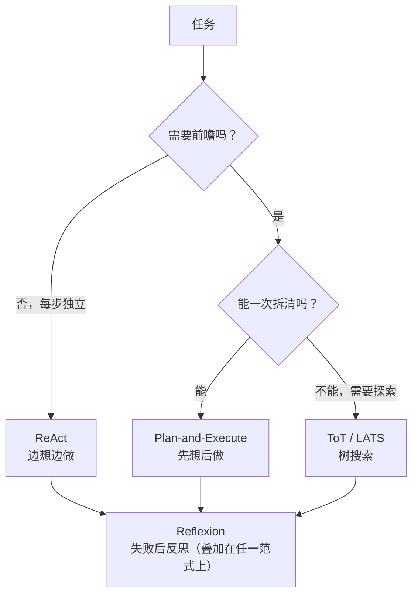

# Agent 规划与任务分解

> **权威依据**
> ① **arXiv:2305.10601**《Tree of Thoughts: Deliberate Problem Solving with LLMs》（NeurIPS 2023）
> ② **arXiv:2303.11366**《Reflexion: Language Agents with Verbal Reinforcement Learning》
> ③ **Anthropic**《Building Effective Agents》（2024-12）— Workflow 模式
> ④ 本知识库：`ReAct.md`、`Agent核心实现逻辑.md`、`子代理 Sub Agent.md`

## 结论

**"规划"是把"一次想清楚"变成"分几步想清楚"的能力。**

**四种范式，按"前瞻程度"排序**：

| 范式 | 一句话 | 前瞻 | 成本 |
|------|--------|------|------|
| **ReAct** | **边想边做** | 无 | 低 |
| **Plan-and-Execute** | **先想后做** | 有（一次） | 中 |
| **ToT / LATS** | **多路探索 + 回溯** | 强 | **很高** |
| **Reflexion** | **做完再反思，下轮改进** | 跨轮 | 中 |

> **核心判断**：**规划的价值不在"看起来聪明"，而在"避免走到死路才发现"。**
> 所以问题不是"要不要规划"，而是"**这个任务值得花多少前瞻成本**"。

## 一、为什么 Agent 需要规划

### 1.1 ReAct 的结构性局限

ReAct 是 `Thought → Action → Observation` 循环。它每一步只向前看一步。

| 局限 | 后果 |
|------|------|
| **没有前瞻** | 走到死路才发现，前面几步白做 |
| **局部最优** | 每步选"当下看起来最好"的，全局可能很差 |
| **无法回溯** | 一步走错只能硬着头皮往下 |
| **顺序无关任务被串行化** | 本可并行的子任务只能一步一步来 |
| **上下文累积** | 步数多了，早期信息被稀释 |

### 1.2 ToT 论文的诊断（原话意译）

> LLM 的推理被限制在**词元级、从左到右的决策过程**中。这导致它在三类任务上表现不佳：
> ① 需要**探索**的任务　② 需要**策略性前瞻**的任务　③ **初始决策具有决定性影响**的任务

**这三类，正是"规划"要解决的事。**

### 1.3 一个关键数字（ToT 论文）

> **Game of 24**：GPT-4 配 CoT 提示**只解决 4%**；同一任务上 **ToT 成功率达 74%**。

**这说明什么**：

> **在需要搜索与试错的任务上，推理的"结构"比模型本身的能力更关键。**

## 二、四种范式全景



### 2.1 四范式对照表

| | **ReAct** | **Plan-and-Execute** | **ToT / LATS** | **Reflexion** |
|---|---|---|---|---|
| **决策时机** | 每步即时 | 开始一次 + 必要时重规划 | 每层多重候选 | 任务结束后 |
| **状态** | 隐式（对话历史） | **显式计划列表** | 搜索树 | 反思笔记 |
| **能否回溯** | ❌ | ✅（重规划） | ✅（回溯） | ✅（下一轮） |
| **可并行** | ❌ | ✅ | 部分 | — |
| **可中断恢复** | 难 | ✅（计划是数据） | 难 | ✅ |
| **模型调用次数** | 1×步数 | ~1×步数 + 少量规划 | **指数级** | 1.2× |
| **适合** | 探索型、步数少 | **多步确定性任务** | 难搜索问题 | 有明确成败信号 |

## 三、范式一：ReAct（详见 `ReAct.md`）

**结构**：

```
Thought: 我需要先查用户信息
Action: get_user(uid=42)
Observation: {name: "张三", plan: "pro"}
Thought: 他是 pro 用户，可以走快速通道
Action: ...
```

**什么时候够用**：

- 步数 ≤ 5–10
- 每步结果决定下一步（**本质上就是反应式**）
- 任务不需要"全局最优"

**什么时候不够**：

- 需要**多个独立的子任务**（ReAct 会串行做完）
- 开始前有**明显的信息依赖需要梳理**
- 需要**并行**提速

## 四、范式二：Plan-and-Execute（最实用的升级）

### 4.1 结构

```
① Plan（一次）：把任务拆成有序步骤，写成显式列表
② Execute（循环）：逐条执行
③ Replan（条件触发）：某步失败或结果超预期 → 重写剩余计划
```

**关键差异**：**计划是数据（一个 list），不是对话历史的一部分。**

```python
plan = [
    {"id": 1, "task": "读取合同 PDF", "status": "pending"},
    {"id": 2, "task": "提取甲乙方名称", "status": "pending"},
    {"id": 3, "task": "提取金额与期限", "status": "pending"},
    {"id": 4, "task": "检查风险条款", "status": "pending"},
    {"id": 5, "task": "生成风险摘要表", "status": "pending"},
]
```

### 4.2 为什么"计划是数据"很重要

| 收益 | 说明 |
|------|------|
| **可并行** | 步骤 2 和 3 无依赖 → 同时跑 |
| **可恢复** | 崩了从 `status=pending` 续跑 |
| **可展示** | 用户能看到"还剩几步" |
| **可审批** | 计划生成后先给人看，批准再执行（**高危场景必需**） |
| **可评测** | 计划本身可以被 judge 打分 |
| **可压缩上下文** | 已完成的步骤只留一句结论 |

> **这是 Plan-and-Execute 比 ReAct 最重要的工程优势**——不是"更聪明"，而是**更可控**。

### 4.3 重规划（Replan）的触发条件

| 触发 | 处理 |
|------|------|
| 某步**失败** | 换方法重试 / 拆分该步 / 跳过 |
| 某步结果**与预期不符** | 检查后续步骤是否还成立 |
| 发现**新信息**改变了任务 | 重写剩余计划 |
| 连续 2 步无进展 | 放弃并上报 |

**反模式**：**每步之后都重规划** → 退化成 ReAct 且更贵。

### 4.4 完整实现

```python
from dataclasses import dataclass, field
from enum import Enum


class Status(str, Enum):
    PENDING = "pending"
    RUNNING = "running"
    DONE = "done"
    FAILED = "failed"
    SKIPPED = "skipped"


@dataclass
class Step:
    id: int
    task: str
    depends_on: list[int] = field(default_factory=list)
    status: Status = Status.PENDING
    result: str = ""


def plan_and_execute(goal: str, max_replans: int = 2) -> str:
    # ① 规划：显式列表，带依赖
    steps = llm_plan(goal)          # -> list[Step]
    replans = 0

    while True:
        ready = [s for s in steps
                 if s.status == Status.PENDING
                 and all(steps[i - 1].status == Status.DONE for i in s.depends_on)]

        if not ready:
            break

        # ② 执行：无依赖的可并行
        for step in ready:
            step.status = Status.RUNNING
            try:
                step.result = run_step(step, context=summarize_done(steps))
                step.status = Status.DONE
            except Exception as e:
                step.status = Status.FAILED
                step.result = f"失败：{e}"

        # ③ 重规划：只在必要时
        failed = [s for s in steps if s.status == Status.FAILED]
        if failed and replans < max_replans:
            replans += 1
            steps = llm_replan(goal, steps, failed)
        elif failed:
            return f"任务未完成，卡在：{[s.task for s in failed]}"

    return llm_synthesize(goal, steps)


def summarize_done(steps: list[Step]) -> str:
    """关键：已完成步骤只留结论，不留全过程 —— 防止上下文膨胀"""
    return "\n".join(f"- {s.task}: {s.result[:200]}" for s in steps if s.status == Status.DONE)
```

**这段代码里有三个值得抄的设计**：

| 设计 | 作用 |
|------|------|
| `depends_on` | 显式依赖 → 可并行、可判就绪 |
| `summarize_done` | **已完成步骤只传结论** → 上下文不膨胀 |
| `max_replans` | 防无限重规划 |

## 五、范式三：搜索式（ToT / LATS）

### 5.1 ToT 的四个要素（论文原文）

| 要素 | 含义 |
|------|------|
| **① Thought 作为可搜索单元** | 不以 token 为单位，以**连贯的文本片段**为单位 |
| **② 树状展开** | 同时考虑**多条推理路径**，形成分支 |
| **③ 自我评估** | LM 同时当**生成器**与**评估器**，给候选状态打分 |
| **④ 前瞻与回溯** | 向前预判、退回上一节点，做**全局更优**选择 |

### 5.2 与 CoT 的关系

| | Chain of Thought | **Tree of Thoughts** |
|---|---|---|
| 结构 | 单条线性链 | 树状多分支 |
| 决策粒度 | token 级 | **thought 级** |
| 是否自评估 | 无 | **有** |
| 能否回溯 | ❌ | **✅** |

> 论文定位：**ToT 是对 CoT 的泛化**，CoT 是"只有一条分支且不回溯"的退化特例。

### 5.3 工程上为什么很少直接用

| 问题 | 说明 |
|------|------|
| **成本爆炸** | 多分支展开 × 每节点自评估 = **模型调用指数增长** |
| **延迟极高** | 不适合交互式产品 |
| **需要设计搜索算法** | BFS/DFS、剪枝策略、评分函数都要自己定 |
| **依赖评估质量** | 自评估不准 → 搜索方向就错 |

> **实务结论**：**ToT 是研究范式，不是产品范式。**
> 产品里"规划"通常用 Plan-and-Execute + 有限次重试就够了。

### 5.4 唯一值得借鉴的思想

> **"显式评估候选，而不是一路走到底。"**

**落地形态**：不需要真的建树，只需在关键分叉点**生成 2–3 个方案并让模型打分选一个**。成本只多一次调用，收益接近。

## 六、范式四：反思式（Reflexion）

### 6.1 机制（论文原文）

> **"不通过更新权重，而是通过语言反馈来强化语言智能体。"**
> *（reinforce language agents not by updating weights, but instead through linguistic feedback）*

**链条**：

```
① 与环境交互 → 收到反馈（分数或自然语言）
② 语言化反思：把经验写成自然语言
③ 写入情节记忆缓冲区（episodic memory buffer）
④ 下一轮试验时读出 → 引导模型改变策略
```

**三个组件**（论文正文）：**Actor**（生成动作）、**Evaluator**（打分）、**Self-Reflection**（把分数转成具体改进建议）。

### 6.2 关键数据

> **HumanEval 代码生成 pass@1 达 91%**，超过此前 SOTA 的 GPT-4（80%）。

### 6.3 为什么它很实用

| 优点 | 说明 |
|------|------|
| **不需要微调** | 纯上下文层，模型参数冻结 |
| **反馈类型灵活** | 可以是分数，也可以是自然语言 |
| **可以跨会话积累** | 反思写进文件就是长期经验 |

### 6.4 工程落地（最简单也最有效）

```markdown
<!-- .agent/lessons.md -->
# 经验教训

## 构建失败
- 若 npm install 报 ERESOLVE，先删 node_modules 与 package-lock.json 再装
- 本项目 Node 版本必须是 20.x，18.x 会在 vite 构建时崩

## 测试
- 跑 e2e 前必须先启动 mock server（`npm run mock`），否则全是超时

## 数据库
- 迁移脚本必须先备份，`drop` 语句在 CI 上会被拦截
```

**在 system prompt 里加一句**：

```
开工前先读 .agent/lessons.md；任务失败后，把你的教训追加进去。
```

> **这一个文件的价值，可能超过你调一个月 prompt。**

### 6.5 Reflexion 的局限

| 局限 | 说明 |
|------|------|
| **依赖可靠的自评估** | Evaluator 不准 → 反思方向错 |
| **反思会占用上下文** | 越积越多，需要筛选与压缩 |
| **可能"过度自我怀疑"** | 把偶发失败当规律 |
| **需要多次尝试** | 一次性任务（发邮件）没法"下轮改进" |

## 七、任务分解：最核心的工程问题

> **分解得好，简单模型也能做；分解得差，最强模型也做不对。**

### 7.1 分解粒度：三层判断

| 粒度 | 表现 | 问题 |
|------|------|------|
| **太粗** | "完成整个需求" | 等于没分解 |
| **太细** | "调用 API 第 1 行" | 步骤数爆炸、编排成本 > 收益 |
| **刚好** | "每个子任务可独立验证" | ✅ |

**判据（一条就够）**：

> **每个子任务都应该有"可独立验证的完成标准"。**
> 如果说不清"怎么算做完了"，说明粒度不对。

### 7.2 三种分解方式

| 方式 | 做法 | 适合 |
|------|------|------|
| **按阶段** | 读→析→写→验 | 流程明确 |
| **按对象** | 文件 A / 文件 B / 文件 C | **可并行** |
| **按职责** | 研究 / 实现 / 审查 | 需要不同专长 |

### 7.3 好子任务的五个标准

| 标准 | 说明 |
|------|------|
| **① 可独立验证** | 有明确的完成信号 |
| **② 输入明确** | 知道需要什么上下文 |
| **③ 输出结构化** | 返回的是可被下一步消费的数据 |
| **④ 依赖显式** | 说清依赖谁 |
| **⑤ 失败可隔离** | 一个失败不拖垮全部 |

### 7.4 五种分解失败模式

| 模式 | 症状 | 解药 |
|------|------|------|
| **假并行** | 拆成 3 个"并行"任务，实际互相依赖 | 先画依赖图 |
| **隐含假设未统一** | 各子任务风格/命名不一致 | **在计划里显式规定公约** |
| **交接有损** | 上一步的产出下一步看不懂 | 结构化输出 + schema |
| **子任务过大** | 某个子任务又变成一个新 Agent 问题 | 递归分解一层 |
| **无终止条件** | 不知道什么时候算完成 | 每个子任务带成功判据 |

> **第 2 条是 Cognition 批评多 Agent 的核心**（详见 `单Agent与多Agent.md`）：
> 子 Agent 各自基于**未被事先规定**的隐含假设行事，最后产出风格/接口不一致。

**解药**：在计划阶段就把"公约"写进去——

```
全局约束（所有子任务必须遵守）：
- 语言：TypeScript，禁用 any
- 命名：camelCase 变量、PascalCase 组件
- 文件位置：新组件放 src/components/
- 样式：只用 Tailwind，不写 CSS 文件
```

### 7.5 分解的两种落点

| | 分解为步骤 | 分解为子 Agent |
|---|---|---|
| 载体 | 计划列表 | 多个独立上下文 |
| 上下文 | **共享** | **隔离** |
| 适合 | 强依赖、需一致风格 | 弱依赖、产出量大 |
| 成本 | 低 | 高（多窗口） |

> **选择依据只有一条**：**子任务之间需要共享上下文吗？**
> 需要 → 分解为步骤；不需要 → 才能分解为子 Agent。

## 八、Anthropic 的两种规划型 Workflow

| 模式 | 结构 | 适合 |
|------|------|------|
| **Orchestrator-Workers** | 主控**动态**拆分子任务给 worker | 子任务在开始前**无法预知** |
| **Evaluator-Optimizer** | 生成 → 评估 → 改进，循环 | 有明确质量标准、可迭代 |

### 8.1 与 Plan-and-Execute 的区别

| | Plan-and-Execute | Orchestrator-Workers |
|---|---|---|
| 谁执行 | **同一个 Agent** | **派生子 Agent** |
| 上下文 | 共享 | 隔离 |
| 计划何时定 | 开始 | **边做边定** |

> **实务建议**：**先做 Plan-and-Execute，撞到上下文墙再升级到 Orchestrator-Workers。**

## 九、推理模型改变了什么

| 传统 | 推理模型（o 系列 / R1 类） |
|------|---------------------------|
| "让我们一步步思考" 需要写进 prompt | **模型内部已经会** |
| 规划是**提示技巧** | 规划是**模型能力** |
| 需要显式 CoT 模板 | 显式 CoT 反而可能**有害** |

### 9.1 但有三件事它替代不了

| 替代不了 | 原因 |
|----------|------|
| **跨调用的计划持久化** | 模型思考在单次调用内 |
| **并行执行** | 规划再强也是一条线 |
| **人审与中断** | 需要计划是外部数据 |

> **结论**：**推理模型让"想清楚"变便宜了，但"组织多步执行"仍然是工程问题。**

## 十、什么时候不需要规划

### 10.1 过度规划的三个征兆

| 征兆 | 说明 |
|------|------|
| **计划比执行还长** | 拆了 20 步，每步一行代码 |
| **每步都重规划** | 退化成 ReAct 且更贵 |
| **简单问题也走完整流程** | "今天几号"也要三步 |

### 10.2 该用 ReAct 的场景

- 步数 ≤ 5
- 每步结果强烈影响下一步
- 探索型（不知道会遇到什么）

> **Anthropic 的官方建议**：**先用最简单的方案**，只有当简单方案确实不够时才引入复杂结构。

## 十一、常见坑

| # | 坑 | 症状 | 解药 |
|---|----|------|------|
| **1** | 计划存在对话历史里 | 上下文膨胀、无法恢复 | **计划是独立数据结构** |
| **2** | 已完成步骤传全过程 | 上下文爆掉 | 只传结论摘要 |
| **3** | 每步都重规划 | 慢且贵 | 只在失败/异常时重规划 |
| **4** | 假并行 | 拆了但没法同时跑 | 画依赖图 |
| **5** | 隐含假设不统一 | 产出风格混乱 | 计划里写全局约束 |
| **6** | 子任务无成功判据 | 不知道何时停 | 每个子任务带验收标准 |
| **7** | 一次性任务用 Reflexion | 没有"下一轮" | 改用重试 + 校验 |
| **8** | 简单任务上 ToT | 成本暴涨收益为零 | 只在分叉点做 2–3 选 1 |
| **9** | 反思记录只增不减 | 上下文被历史占满 | 定期压缩、按命中率淘汰 |
| **10** | 计划不可见 | 出问题无法定位 | 计划要能打印、能展示给用户 |

## 十二、Checklist

**决定要不要规划**
- [ ] 任务步数 > 5 吗？
- [ ] 存在"走到死路才发现"的风险吗？
- [ ] 有可并行的子任务吗？
- [ ] 需要人审计划吗？

**规划设计**
- [ ] 计划是**独立数据结构**，不是对话历史
- [ ] 每个步骤有**可验证的完成标准**
- [ ] 依赖关系**显式声明**
- [ ] 有**全局约束**（风格/命名/位置）
- [ ] 有 `max_replans` 上限
- [ ] 已完成步骤只传**结论**

**执行**
- [ ] 无依赖步骤可并行
- [ ] 失败有分类处理（重试/拆分/跳过/上报）
- [ ] 可断点恢复

**反思（如果用）**
- [ ] 有可靠的成功/失败信号
- [ ] 反思落盘（文件/记忆库）
- [ ] 反思有压缩与淘汰机制
- [ ] 开工前会读反思

## 十三、总结

**四范式一句话：**

| 范式 | 一句话 | 用在哪 |
|------|--------|--------|
| **ReAct** | 边想边做 | 探索型、步数少 |
| **Plan-and-Execute** | 先想后做 | **多步确定性任务（首选升级）** |
| **ToT / LATS** | 多路探索 | 难搜索问题（**研究为主**） |
| **Reflexion** | 做完反思 | 有明确成败信号、可重复 |

**五条最值得记住的原则**：

1. **规划的价值是"避免走到死路"，不是"显得聪明"** —— 先问前瞻值不值这个钱
2. **计划必须是数据，不是对话** —— 这是可并行、可恢复、可审批、可评测的前提
3. **每个子任务都要有"怎么算做完"** —— 否则分解无效
4. **分解前先统一隐含假设** —— 这是多 Agent 失败的头号原因
5. **先 Plan-and-Execute，撞墙再上多 Agent** —— 别从最复杂的开始

> **最后一句话**：
> **规划的本质不是"让模型更聪明地想"，而是"把人脑里的步骤结构，变成机器能检查、能并行、能中断、能恢复的数据"。**
> ReAct 让 Agent 会走路，规划让 Agent 会**看地图**。

---

> **资料说明**
> ToT 的四个要素（thought 作为搜索单元、树状展开、自我评估、前瞻与回溯）、"词元级从左到右"的诊断、"对 CoT 的泛化"定位、Game of 24 的 **4% → 74%**、三个验证任务，**依据 arXiv:2305.10601（NeurIPS 2023 camera ready）摘要**。
> Reflexion 的"用语言反馈而非更新权重"、情节记忆缓冲区、反馈可标量可自然语言、Actor/Evaluator/Self-Reflection 三分工、**HumanEval pass@1 91% vs GPT-4 80%**，**依据 arXiv:2303.11366 摘要与页面说明**。
> Orchestrator-Workers / Evaluator-Optimizer、"先用最简单方案"的建议，**依据 Anthropic《Building Effective Agents》**。
>
> **重要限制**：
> - 两篇论文我**只读到摘要层面**，论文正文中的消融实验、任务细节、超参数**未核对**。
> - ⚠️ **Reflexion 的 HumanEval 91% vs GPT-4 80% 是 2023 年的数据**，早已被后续模型大幅超越，**不可用来评价当前模型**。
> - ⚠️ **ToT 的 4% → 74% 是 Game of 24 这一个任务上的结果**，不可外推为通用能力提升幅度。
> - **Plan-and-Solve、LATS 等我未读原文**，文中未给出其具体数据；"四种范式"的划分是**我的工程归纳**，非论文分类。
> - **推理模型一节为一般性判断**，未引用具体厂商文档。
> - 第四章 `plan_and_execute` 代码为**示意**：`llm_plan` / `run_step` / `llm_replan` / `llm_synthesize` 未实现，`depends_on` 用 `steps[i-1]` 索引假设了 id 连续，**不能直接运行**。
> - 所有引文为**中文意译**，非逐字直译。
