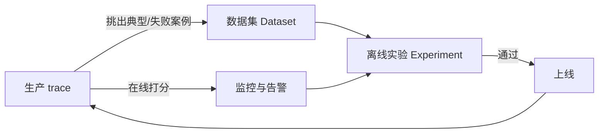
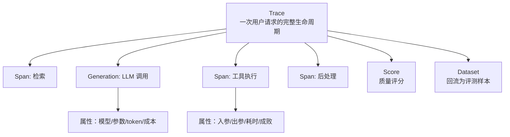
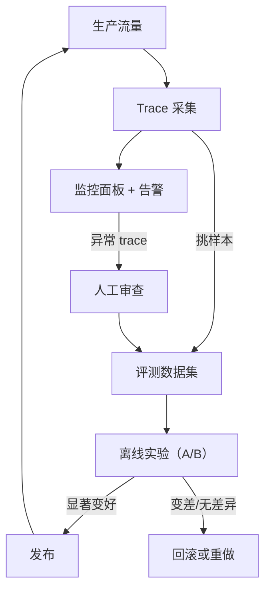

# Agent 评测与可观测性

> **权威依据**
> ① **Anthropic**《How we built our multi-agent research system》— 评测方法论
> ② **Langfuse** 官方文档《AI Observability & Application Tracing》
> ③ **OpenTelemetry** GenAI 语义约定（已迁移至 `semantic-conventions-genai` 仓库）
> ④ **LangChain**《Context Engineering for Agents》— 轨迹可检查性
> ⑤ 本知识库：`单Agent与多Agent.md`、`Graph Engineering.md`

## 结论

**这是两件事，但共用一套数据底座：**

| | 回答什么问题 | 什么时候用 |
|---|---|---|
| **评测（Evaluation）** | **"它好不好？"** | 上线前 + 上线后定期 |
| **可观测（Observability）** | **"它为什么这样？"** | 出问题时 + 持续监控 |

> **一句话**：**评测给你一个分数，可观测给你一个故事。**
> 只有分数没有故事，你不知道怎么改；只有故事没有分数，你不知道有没有变好。

**为什么 Agent 特别需要这两样**：Langfuse 官方说得最直白——

> **生成式 AI 系统本质上是非确定性的，如果不使用可观测性工具，调试就等同于猜测。**

## 一、为什么 Agent 评测比 LLM 评测难

| 难点 | 说明 | 后果 |
|------|------|------|
| **非确定性** | 同样的输入，两次运行轨迹不同 | 单次通过不代表稳定 |
| **路径不唯一** | 多条路都能到终点 | **不能只检查"是否按预设步骤执行"** |
| **多轮多工具** | 十几步串联，每步都可能偏 | 错误**复利放大** |
| **环境依赖** | 依赖真实网页、数据库、文件系统 | 难以复现 |
| **成本高** | 跑一遍评测集可能几十美元 | 不敢频繁跑 |
| **"蒙对"问题** | 结果对但过程错 | 只测结果会**给出虚假信心** |

> Anthropic 原文的痛点描述：*"即使用户提示相同，运行也非确定性。用户报『找不到显而易见的信息』时，仅凭日志无法判断是 query 太差、来源不佳还是工具故障。"*

## 二、四个评测维度（一次评全）

| 维度 | 问什么 | 怎么测 |
|------|--------|--------|
| **① 结果（Outcome）** | 最终答案/状态对吗 | 规则校验 / LLM-Judge / 人工 |
| **② 轨迹（Trajectory）** | 过程合理吗 | 步骤序列检查 / LLM-Judge |
| **③ 效率（Efficiency）** | 步数、工具调用合理吗 | 计数 + 阈值 |
| **④ 成本（Cost）** | token / 金额 | `usage` 聚合 |

### 2.1 为什么必须测轨迹（最关键的一条）

```
案例：问"北京明天天气"
Agent A：正确调用天气 API → 得到答案 ✅ 结果对，轨迹对
Agent B：胡猜"明天晴" → 碰巧对了   ⚠️ 结果对，轨迹错
```

**如果只测结果，A 和 B 都得分**。但 B 在下一个问题上必然崩。

> **所以**：**结果评估是及格线，轨迹评估才是分数。**

### 2.2 轨迹的三种测法

| 方法 | 说明 | 成本 |
|------|------|------|
| **关键步骤断言** | 必须调用过 `search` 且未调用 `delete` | 低 |
| **禁止行为检测** | 不得重复调用同一工具 3 次以上 | 低 |
| **LLM 评审轨迹** | 把轨迹喂给 judge，问"这个路径合理吗" | 中 |

## 三、两种评测场景

| | 离线评测 | 在线评测 |
|---|----------|----------|
| **数据** | 构造好的数据集 | **真实生产 trace** |
| **时机** | 上线前 / 改动后 | 持续 |
| **优点** | 可重复、可对比 | **真实分布** |
| **缺点** | **可能脱离真实分布** | 无法回滚 |
| **典型工具** | dataset + experiment | trace + score |

### 3.1 两者必须闭环



> **Langfuse 的核心论点**：可观测性为评测提供**真实生产 trace** 作为样本——eval 不该只跑在人工构造的样本上。

## 四、四种评估方法（按可靠性排序）

| 方法 | 适用 | 优点 | 缺点 |
|------|------|------|------|
| **① 规则/断言** | 有确定答案（JSON 格式、数值、状态） | 免费、确定、可 CI | 覆盖窄 |
| **② LLM-as-Judge** | 开放式质量 | 可扩展、贴近人类判断 | 有偏差、要校准 |
| **③ 人工评估** | 边缘情况、主观质量 | **不可替代** | 贵、慢 |
| **④ 终态评估** | 状态变更型 Agent | 简单可靠 | 忽略过程 |

### 4.1 LLM-as-Judge 的三个实操要点（Anthropic 原文）

| 要点 | 说明 |
|------|------|
| **单一调用 > 多项打分** | *"单一 LLM 调用 + 单一提示输出 0.0–1.0 分数与 pass/fail，比多 judge 分项打分更稳定、更贴合人类判断。"* |
| **五个评分维度** | 事实准确性、引用准确性、完整性、来源质量、工具效率 |
| **有唯一答案时可判对错** | 从而支持**数百条输出的规模化评估** |

**一个可以直接用的 judge prompt 骨架**：

```
你是评审。给定【用户任务】【Agent 最终答案】【Agent 轨迹摘要】，
按以下维度各打 0.0–1.0 分，并给出 pass/fail 与理由：

1. 事实准确性：声称是否与提供的来源一致
2. 引用准确性：每个引用是否真的支持该论断
3. 完整性：是否覆盖了任务要求的全部方面
4. 来源质量：是否优先一手/权威来源
5. 工具效率：工具选择是否恰当、调用次数是否合理

只输出 JSON：{"scores": {...}, "verdict": "pass|fail", "reason": "..."}
```

### 4.2 人工评估不可替代（一个真实教训）

> Anthropic 提到：人类测试者发现早期 Agent **偏好 SEO 内容农场而非权威但排名较低的来源**（学术 PDF、个人博客），据此在提示中加入来源质量启发规则。

**这类问题自动化评测发现不了**——因为你需要先知道"什么算好来源"。

### 4.3 终态评估（状态变更型 Agent）

> **只判断最终状态是否正确，不逐轮审查。**
> 复杂流程拆成**离散 checkpoint** 验证。

**适用**：改数据库、改代码、改工单状态的 Agent。

## 五、从 20 条开始（最重要的工程建议）

> **Anthropic 原文**：约 **20 条**真实使用 query 即可开始。
> 早期改动效应量大（如 30% → 80%），**少量用例就能看出影响**。不必等建好数百条的大评测集再动手。

### 5.1 为什么 20 条够

| 原因 | 说明 |
|------|------|
| **早期改动幅度大** | 从 30% 到 80%，20 条也能清楚看出 |
| **大评测集建不起来** | 追求 500 条的结果是永远不开始 |
| **20 条能覆盖主路径** | 5 类场景 × 4 条 |

### 5.2 20 条怎么选

```
5 条  典型成功路径（确认没退化）
5 条  已知难点（曾经失败过的）
5 条  边缘情况（空输入、超长、歧义）
5 条  对抗性（诱导越权、注入）
```

### 5.3 然后逐步扩充

> 每次线上事故 → 补一条到数据集 → **永不删除**。
> 半年后你就有了一套**真正贴合业务的回归测试集**。

## 六、评测集构建

### 6.1 三个来源

| 来源 | 说明 |
|------|------|
| **生产 trace 回流** | 最真实，Langfuse 等支持一键转 dataset |
| **人工构造** | 覆盖未出现但可能出现的场景 |
| **公开数据集改写** | 借结构，换领域 |

### 6.2 分层设计

| 层 | 规模 | 跑的频率 |
|----|------|----------|
| **冒烟集** | 5–10 条 | **每次提交** |
| **核心集** | 20–50 条 | 每日 / 每次发版 |
| **全量集** | 200+ 条 | 每周 / 大版本 |
| **压力集** | 边缘 + 对抗 | 大版本 |

> **分层的目的**：让"每次提交都跑"成为可能。**跑不起的评测等于没有评测。**

## 七、公开 Benchmark 全景

| Benchmark | 测什么 | 适用 |
|-----------|--------|------|
| **GAIA** | 通用助手：需要多工具、多步推理的真实问题 | 通用 Agent 能力 |
| **τ-bench** | 工具-用户交互（零售/航空客服域） | **工具调用 + 遵循规则** |
| **SWE-bench** | GitHub issue → 补丁 | 编码 Agent |
| **WebArena** | 真实网站环境中的操作 | 浏览器 Agent |
| **Terminal-Bench** | 终端任务 | CLI Agent |

### 7.1 怎么用公开榜（重要）

| 用途 | 建议 |
|------|------|
| **选模型** | ✅ 看榜单，但**只看相对排序，不看得分绝对值** |
| **证明能力** | ⚠️ 谨慎，榜单饱和严重 |
| **衡量自己** | ❌ **不要用**。你的任务分布和榜单完全不同 |

> **结论**：**公开榜用来"横向比"，自建集用来"纵向看"。**
> 你唯一该优化的数字，是**你自己那 50 条上的通过率**。

## 八、可观测性：核心数据模型

> 依据 Langfuse 的概念模型（各家命名略有差异，结构一致）。



| 概念 | 定义 | 关键作用 |
|------|------|----------|
| **Trace** | 一次请求的**完整**生命周期记录 | 顶层容器，**保留因果关系** |
| **Span** | trace 内的**单个操作节点** | 定位"哪一步慢/贵/错" |
| **Generation** | 特化的 span：一次 LLM 调用 | 携带模型名、参数、token、成本、prompt/completion |
| **Score** | 挂在 trace 上的质量评分 | 来自人工 / LLM-Judge / 代码 / 用户反馈 |
| **Dataset** | 离线评测样本集合 | 可由生产 trace 转化而来 |

### 8.1 一个必须坚持的原则

> **不要记录成平铺流水账，要记录成带父子关系的树。**

**因为**：Agent 的 bug 常常在**层次关系**里——"检索被调用了两次"这种问题，只有看到树才能发现。

## 九、埋点：一个 Agent 请求的 span 树应该长什么样

```
trace: "帮我把这份合同的风险点整理成表"
├── span: agent.run
│   ├── generation: plan（模型 A，1.2k in / 300 out，2.1s）
│   ├── span: tool.extract_text（0.8s ✅）
│   ├── span: retrieve（向量库，返回 6 chunks，0.4s）
│   ├── generation: analyze（模型 A，28k in / 1.5k out，9.3s）
│   │   └── span: tool.call_llm_subcheck（2 次）
│   ├── span: tool.render_table（0.2s ✅）
│   └── generation: final（模型 B，2k in / 800 out，1.8s）
└── score: quality=0.82（LLM-Judge）, user_feedback=👍
```

### 9.1 每条 span 至少记这 8 个字段

| 字段 | 为什么 |
|------|--------|
| `name` | 定位 |
| `start` / `end` | 延迟分解 |
| `parent_id` | **还原树结构** |
| `input` / `output` | 复现 |
| `status`（ok/error） | 快速筛错 |
| `model` | 成本归因 |
| `input_tokens` / `output_tokens` | 成本归因 |
| `metadata`（如 `tool_name`、`retry_count`） | 诊断 |

### 9.2 隐私红线

> **Anthropic 的做法值得抄**：监控 Agent 的**决策模式与交互结构**，而非对话内容。

| 该记 | 不该记 |
|------|--------|
| 工具名、调用次数、耗时 | 完整用户原文 |
| token 数、模型名 | 完整文件内容 |
| 决策分支（选了哪条路） | 敏感字段明文 |
| 错误类型 | PII |

> **原则**：**默认脱敏，显式开启原文**（且带 TTL）。

## 十、OpenTelemetry GenAI 语义约定

### 10.1 为什么值得用

| 理由 | 说明 |
|------|------|
| **厂商中立** | 换追踪后端不用改埋点 |
| **生态成熟** | Langfuse / LangSmith / Phoenix / Datadog 都支持 |
| **有标准字段** | 避免每家自己造一套 `input_tokens` |
| **MCP 也有约定** | 该仓库专门包含 MCP 相关约定 |

### 10.2 大致形状（**细节需核对当前版本**）

| 元素 | 大致形式 |
|------|----------|
| **span 命名** | `{gen_ai.operation.name} {gen_ai.request.model}` |
| **operation 取值** | `chat`、`embeddings`、`execute_tool`、`invoke_agent` 等 |
| **关键属性** | `gen_ai.operation.name`、`gen_ai.provider.name`、`gen_ai.request.model`、`gen_ai.usage.input_tokens`、`gen_ai.usage.output_tokens` |
| **关键指标** | `gen_ai.client.token.usage`（Histogram）、`gen_ai.client.operation.duration`（Histogram） |

### 10.3 三个必须知道的状态提醒

| 提醒 | 说明 |
|------|------|
| ⚠️ **规范已迁移** | 原 `opentelemetry.io/docs/specs/semconv/gen-ai/` 只剩"Moved"占位，正文在 **`open-telemetry/semantic-conventions-genai`** 仓库 |
| ⚠️ **整体处于 Development（实验性）** | 属性名与 span 模板**仍在变动**，仓库 700+ commits、150+ open issues |
| ⚠️ **有破坏性变更史** | 例如 span 命名从"按模型"转向"按 provider" |

> **工程建议**：**埋在自建的抽象层后面**——业务代码只调 `tracer.llm_call(...)`，内部再映射到 OTEL 字段。这样规范一变只改一层。

## 十一、关键指标与告警

### 11.1 四类基础指标（Langfuse 官方框架）

| 类别 | 指标 |
|------|------|
| **Cost** | 总成本、单请求成本、成本/用户 |
| **Latency** | P50/P95/P99、首 token 延迟 |
| **Volume** | 请求量、token 量 |
| **Quality** | 各类 score 的均值与分布 |

### 11.2 Agent 特有的六个指标（更值钱）

| 指标 | 为什么重要 | 异常信号 |
|------|-----------|----------|
| **平均步数** | 反映任务复杂度与效率 | 突然上升 = 陷入循环 |
| **工具调用成功率** | 外部依赖健康度 | 下降 = 接口挂了 |
| **重复调用率** | 同一工具同参数连续调用 | >5% = **循环征兆** |
| **提前终止率** | 未完成就停 | 上升 = 步数上限太紧或规划弱 |
| **轨迹偏离率** | 实际路径 vs 期望路径 | 上升 = 提示或工具变了 |
| **缓存命中率** | 前缀稳定性 | 下降 = 多花钱 |

### 11.3 优先设这五个告警

```
1. 工具成功率 < 90%（连续 5 分钟）
2. P95 延迟 > 阈值
3. 平均步数较上周上升 > 30%
4. 单请求成本 P99 > 阈值
5. 质量分（judge）周均值下降 > 5%
```

## 十二、评测与可观测的闭环（完整版）



**关键点**：

| 环节 | 要点 |
|------|------|
| **trace → dataset** | 一键回流，且**自动脱敏** |
| **离线 A/B** | **必须同时看结果分和效率分**，否则会用 3 倍成本换 2% 提升 |
| **发布** | 灰度 + 指标对比 |
| **告警 → 数据集** | 每次事故补一条回归用例 |

## 十三、实施路线（三阶段）

### 阶段一：能看见（1 周）

- [ ] 接一个 tracing 后端（Langfuse 自托管最快）
- [ ] 三条关键路径埋点：LLM 调用、工具调用、整体 run
- [ ] 一张 dashboard：cost / latency / volume / error
- [ ] **不做评测**，先把"能看"跑通

### 阶段二：能评判（2–3 周）

- [ ] 建 20 条数据集
- [ ] 一个 judge prompt，五个维度
- [ ] 一个跑批脚本，输出 pass 率
- [ ] 加 CI：每次提交跑冒烟集

### 阶段三：能闭环（持续）

- [ ] trace 一键回流数据集
- [ ] 线上 judge 抽样打分
- [ ] 五个核心告警上线
- [ ] 事故 → 用例的固定流程

> **顺序不能反**：**先看见，再评判，最后闭环。**
> 上来就建评测集但没 trace，你会不知道失败原因；只建 trace 不评测，你会不知道有没有变好。

## 十四、常见误区

| 误区 | 事实 |
|------|------|
| "只测最终答案就够了" | ❌ 会奖励"蒙对"，掩盖过程缺陷 |
| "评测集越大越好" | ❌ **20 条就能起步**，大集永远建不完 |
| "LLM-Judge 不可靠所以不用" | ❌ 单次调用 + 单一分数**已足够稳定**；不用才是真瞎 |
| "用公开 benchmark 衡量自己" | ❌ 任务分布不同，**只用于横向选模型** |
| "等产品稳定了再加监控" | ❌ 没监控你**永远不知道什么时候稳定** |
| "日志已经很全了，不需要 trace" | ❌ 平铺日志**没有因果关系**，定位不了"为什么慢" |
| "把用户原文全记下来方便排查" | ❌ 隐私风险；应默认脱敏 |
| "评测跑通就代表线上没问题" | ❌ 离线数据与真实分布有偏差，必须在线抽样 |

## 十五、Checklist

**评测**
- [ ] 有 **20 条**起步数据集
- [ ] 覆盖：成功路径 / 已知难点 / 边缘 / 对抗
- [ ] **结果 + 轨迹**都测
- [ ] LLM-Judge 用**单次调用 + 单一分数**
- [ ] 有**分层**（冒烟 / 核心 / 全量）
- [ ] 冒烟集进 CI
- [ ] 有人工抽查机制
- [ ] 效率指标（步数、工具调用）纳入评分

**可观测**
- [ ] 一次请求 = 一条 trace，内部是**带父子关系的树**
- [ ] span 至少记 8 个字段
- [ ] LLM 调用单独成 generation，记 token 与成本
- [ ] 有 cost / latency / volume / quality 四类看板
- [ ] 有五个核心告警
- [ ] **默认脱敏**，原文可选开启
- [ ] 埋点有自建抽象层，不直接绑死 OTEL 字段

**闭环**
- [ ] trace 能一键转 dataset
- [ ] 每起事故补一条回归用例
- [ ] 离线 A/B 同时看质量与效率

## 十六、总结

**两件事的分工：**

| | 评测 | 可观测 |
|---|------|--------|
| **产出** | 一个**分数** | 一个**故事** |
| **回答** | 好不好 | 为什么 |
| **数据** | 数据集 | 生产 trace |
| **频率** | 定期 | 持续 |

**五条最值得记住的原则**：

1. **只测结果会奖励"蒙对"** —— 轨迹必须一起测
2. **20 条就能开始** —— 追求完美评测集 = 永远不开始
3. **公开榜用来选模型，自建集用来衡量自己**
4. **trace 要记成树，不是流水账** —— 因果链才是诊断的关键
5. **先看见，再评判，最后闭环** —— 顺序不能反

> **最后一句话**：
> **Agent 的非确定性决定了：你不能靠"读代码"知道它好不好，只能靠"看数据"。**
> 评测告诉你有没有变好，可观测告诉你为什么变好——**缺一个，你就是在盲飞。**

---

> **资料说明**
> 20 条起步、LLM-as-Judge 单次调用、五维评分、"人类发现 Agent 偏好 SEO 内容农场"、终态评估、监控决策模式而非对话内容，**依据 Anthropic《How our multi-agent research system》原文**。
> trace/span/generation/score/dataset 概念、cost/latency/volume/quality 四类指标、可观测为评测提供真实 trace 的闭环论点、异步批发送不增延迟，**依据 Langfuse 官方文档**。
> OTEL GenAI 语义约定的 span 命名模式与属性名，**依据规范背景知识**（原文站点已迁移，新仓库页面未给出字段级正文，**未逐项核对**）。
> "轨迹可靠检查"的观点，依据 **LangChain《Context Engineering for Agents》**。
>
> **重要限制**：
> - **OTEL GenAI 语义约定整体处于 Development（实验性）阶段**，且已迁出主仓库，属性名与 span 模板**会变**。第十章的字段名请以 `open-telemetry/semantic-conventions-genai` 当前文档为准。
> - **Benchmark 的描述为概括性说明**，各 benchmark 的版本、指标定义（如 τ-bench 的 pass^k）**未逐一核实**，用于正式对比前请查原文。
> - 第九章 span 树、第四章 judge prompt 为**示意**，非可直接运行代码。
> - 资料抓取时间为 2026-11，架构与产品功能可能已变。
> - 所有引文为**中文意译**，非逐字直译。
