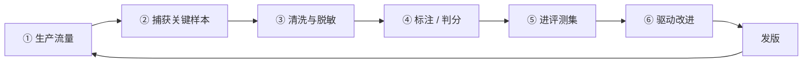
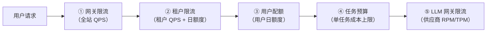

# Agent 运营与治理

> **权威依据**
> ① **Anthropic**《How we built our multi-agent research system》— 生产运营挑战
> ② **Simon Willison**《The Lethal Trifecta for AI Agents》— 数据外泄边界
> ③ **NIST AI RMF** — 风险治理框架（概括引用）
> ④ 本知识库：`Agent评测与可观测性.md`、`Agent成本优化.md`、`Token统计.md`、`运行沙箱与部署.md`、`Agent安全与护栏.md`

## 结论

**上线 ≠ 运营。**

| | 上线 | **运营** |
|---|------|---------|
| 目标 | 能跑通 | **三个月后还能跑，而且更好** |
| 关心 | 功能 | **不退化、可计量、可合规、可追责** |
| 周期 | 一次性 | **持续** |

**运营要做四件事，缺一件就会在半年内出问题：**

| # | 事项 | 不管会发生什么 |
|---|------|---------------|
| **1** | **SLO 与错误预算** | 不知道"变差了"还是"正常波动" |
| **2** | **数据飞轮** | 半年后还是同一批问题，**永不进步** |
| **3** | **多租户与配额** | 一个大客户打爆全局，**全体用户陪葬** |
| **4** | **合规与数据治理** | 出一次事故就是**法律问题** |

> **一句话**：**把 Agent 当"模型调用"运营，它一定会烂；把它当"有质量契约的服务"运营，它才活得下去。**

## 一、为什么 Agent 的运营比普通服务难

| 普通服务 | Agent |
|----------|-------|
| 同输入 → 同输出 | **同输入 → 不同输出** |
| 错误是异常 | **错误可能是一段"看起来很正常"的文本** |
| 单元测试可覆盖 | **组合爆炸，无法穷举** |
| 资源成本稳定 | **成本随对话长度漂移** |
| 版本升级影响可控 | **换模型 = 换了一个"人"** |

> **Anthropic 原文的痛点**：即使提示相同，运行也**非确定性**，仅凭日志**无法判断**是 query 太差、来源不佳还是工具故障。

**结论**：**Agent 的质量必须被"持续测量"，不能靠"上线前测一次"。**

## 二、第一件事：SLO 与错误预算

### 2.1 为什么 Agent 需要四个维度

普通服务一个"可用性"就够。Agent 不够——**它可能"可用"但"答错"**。

| SLO 类别 | 回答什么 |
|----------|----------|
| **① 可用性** | 服务活着吗 |
| **② 质量** | **答对了吗**（最容易被忽略） |
| **③ 延迟** | 快吗 |
| **④ 成本** | 贵吗 |

### 2.2 四个维度的具体指标

#### ① 可用性 SLO

| 指标 | 说明 |
|------|------|
| 请求成功率 | 2xx / 总请求 |
| **任务完成率** | 走完全流程的比例（**比请求成功率更真实**） |
| 依赖可用性 | LLM 供应商、向量库、沙箱 |

> **陷阱**：请求成功率 99.9%，但 30% 的任务在第 5 步超时放弃 —— **用户体感是"这产品不能用"**。

#### ② 质量 SLO（最关键）

| 指标 | 怎么算 |
|------|--------|
| **人工抽检通过率** | 每天抽 N 条，人打分 |
| **Judge 通过率** | LLM-as-Judge 自动打分（见 `Agent评测与可观测性.md`） |
| **用户负面反馈率** | 点踩 / 重问 / 转人工 |
| **回归通过率** | 评测集跑分 |

> **务必同时保留"人工抽检"**——Judge 也会漂移，**只有人是不动的锚**。

#### ③ 延迟 SLO

| 指标 | 说明 |
|------|------|
| **首字延迟（TTFT）** | 体感最关键 |
| **P50 / P95 / P99 端到端** | **必须看 P95，不看均值** |
| 单步延迟 | 定位是模型慢还是工具慢 |

> **Agent 的延迟是"乘法"**：10 步 × 每步 2 秒 = 20 秒。所以**单步优化比端到端优化更有效**。

#### ④ 成本 SLO

| 指标 | 说明 |
|------|------|
| **单任务成本（cost per task）** | 唯一有意义的单位经济指标 |
| 单任务 token 分布 | 看长尾（见 `Agent成本优化.md`） |
| 缓存命中率 | 低于 80% 说明前缀不稳 |

### 2.3 错误预算（Error Budget）

> **核心思想**：**SLO 不是一个"目标"，而是一份"可以花掉的额度"。**

```
SLO = 99%  →  错误预算 = 1%
一个月 10 万次任务 → 可以失败 1000 次
```

| 预算状态 | 行动 |
|----------|------|
| **剩 > 50%** | 正常发版，可以冒险 |
| **剩 20%–50%** | 收紧变更评审 |
| **剩 < 20%** | **冻结功能发布，只修稳定性** |
| **已耗尽** | **只允许回滚和修复** |

> **这解决了一个真实的组织问题**：**没有错误预算，"要不要继续发版"永远靠吵架。**

### 2.4 SLO 示例表（数字是示例，请按业务定）

| 类别 | SLI | SLO 目标 | 测量窗口 |
|------|-----|----------|----------|
| 可用性 | 任务完成率 | ≥ 95% | 7 天滚动 |
| 质量 | 抽检通过率 | ≥ 90% | 7 天滚动 |
| 质量 | 用户负面反馈率 | ≤ 5% | 7 天滚动 |
| 延迟 | TTFT P95 | ≤ 2s | 1 天滚动 |
| 延迟 | 端到端 P95 | ≤ 60s | 1 天滚动 |
| 成本 | 单任务成本 P50 | ≤ ¥0.5 | 7 天滚动 |
| 成本 | 单任务成本 P99 | ≤ ¥5 | 7 天滚动 |

> **⚠️ 这七个数字必须由你按业务定**，照抄无意义。
> **但"质量"和"成本"这两行，很多团队根本没有——这就是它们半年后失控的原因。**

### 2.5 告警分级的正确做法

| 级别 | 触发 | 响应 |
|------|------|------|
| **P0** | 可用性 SLO 破线 / 数据外泄 | **立即电话**，全员 |
| **P1** | 质量骤降 > 10% / 成本翻倍 | 15 分钟内 |
| **P2** | 单指标劣化，未破 SLO | 工作时间处理 |
| **P3** | 趋势性缓慢下降 | 排入迭代 |

> **原则**：**告警必须可行动。** 通知了但没人知道该做什么的告警，等于噪声——**噪声会训练团队忽略所有告警**。

## 三、第二件事：数据飞轮

### 3.1 飞轮的五个环节



> **断掉任何一环，飞轮就变成"数据仓库"**——只进不出。

### 3.2 捕获什么（最重要的设计）

> **不要全留，要"有选择地留"。** 全留既贵又没人看。

| 必留 | 为什么 |
|------|--------|
| **用户负反馈**（点踩、重问、转人工） | 最高信噪比 |
| **失败任务**（超步数、工具报错、超时） | 直接对应缺陷 |
| **成本异常**（P99 以上的任务） | 找到"贵在哪" |
| **新出现的问题类型** | 需求漂移信号 |
| **人工介入案例**（审批被拒、被改） | 模型判断与人不一致的地方 |

**可以不重点留**：

- 完全成功的常规请求（抽样 1% 足够）
- 内容重复的请求（去重）

### 3.3 采样策略

| 类型 | 采样率 |
|------|--------|
| 负反馈 | **100%** |
| 失败任务 | **100%** |
| 成本 P99 以上 | **100%** |
| 常规成功 | 0.1%–1% |
| **新聚类（embedding 聚类出的新模式）** | **100%** |

> **最后一条很实用**：对用户问题做聚类，**出现"没见过的簇"就重点看**——这比随机抽样有效得多。

### 3.4 从失败样本到回归用例

> **这是飞轮真正的产出：一条失败样本 → 一条永久回归用例。**

```markdown
## 回归用例 #142

**来源**：2026-10-28 生产负反馈（用户 3 次重问）

**输入**：
  帮我看看上周的退款单里有没有异常

**期望行为**：
  1. 识别"退款单"需要查数据库（不是文档检索）
  2. 调用 query_refunds 工具，时间范围为上周
  3. 若结果为空，明确说明"没有退款记录"，不得编造

**实际（bug）**：
  用文档检索搜"退款"，返回退款政策文档，模型据此编造了 3 条退款记录

**根因**：知识源路由错误（应为 SQL，被判为 doc）

**修复**：router 增加"含时间范围 + 可计数名词 → 优先 SQL"规则

**状态**：✅ 已修复，纳入每日回归
```

> **这个模板的价值**：它同时记录了**输入、期望、实际、根因、修复**——**根因那一行让同类问题能被批量发现**。

### 3.5 飞轮最常见的失败：只收集不消费

| 症状 | 原因 |
|------|------|
| 日志存了 3 个月没人看 | 没有"消费流程" |
| 评测集半年没更新 | 没把"更新评测集"排进迭代 |
| 同一个 bug 反复出现 | 修完没进回归集 |
| 报告没人读 | 没有每周固定评审会 |

**解药（三条制度）**：

| 制度 | 频率 |
|------|------|
| **每周质量评审会**（看 badcase） | 每周 30 分钟 |
| **每月评测集更新** | 加 10–20 条真实用例 |
| **修复必带回归用例** | **PR 检查项**（不写就不过） |

> **最后一条是硬约束**：**"修 bug 必须同时加回归用例"** 写进代码评审清单，飞轮才能转起来。

### 3.6 隐私要在采集环节就处理

> **不要"先存下来以后脱敏"** —— 存下来的那一刻就已经是风险。

| 环节 | 做法 |
|------|------|
| **采集** | 采集前就过滤明显的敏感字段 |
| **存储** | 加密、访问控制、留存期限 |
| **使用** | 分析用 ID 化，不用原始内容 |
| **进评测集** | **必须脱敏**（评测集会被广泛访问） |
| **删除** | 用户要求删除时能从所有副本删掉 |

> **⚠️ 一个真实的高危做法**：把包含真实用户数据的线上日志**直接拿去做微调或评测**。这既是合规问题，也是**数据外泄的放大器**。

## 四、第三件事：多租户与配额

### 4.1 三个隔离维度

| 维度 | 不隔离的后果 |
|------|-------------|
| **数据隔离** | A 客户搜到 B 客户的文档（**最严重**） |
| **资源隔离** | 一个租户打满 LLM 配额，全员不可用 |
| **配额隔离** | 一个租户烧光预算，公司亏钱 |

### 4.2 配额的四个层级

```
① 请求级   单次请求最大 token / 最大步数
② 任务级   单任务最大成本、最大时长
③ 用户级   单用户日/月额度
④ 租户级   单租户日/月总额度 + QPS 上限
```

**为什么要四层**：**任何单一层级都会被绕过。**

```
只有用户级配额 → 一个用户开 100 个账号并行刷
只有租户级配额 → 一个用户把整个租户的额度用光，同事无法工作
```

### 4.3 限流应该放在哪一层



> **第 ⑤ 层最容易被忘记，也最致命。**
> **你的真实并发上限，通常是 LLM 供应商的 RPM/TPM，不是你的服务器。**
> **必须按供应商配额倒推你的限流阈值**，否则会收到大量 429。

### 4.4 三种计费模型

| 模型 | 优点 | 缺点 | 适合 |
|------|------|------|------|
| **按 token** | 成本透明、公平 | **用户无法预估**，账单争议多 | 开发者工具 |
| **按任务** | 用户好理解 | 长任务可能亏本 | **C 端产品（推荐）** |
| **按席位** | 收入可预测 | 重度用户会亏 | B 端 SaaS |

### 4.5 单位经济：必须算清的一笔账

```
单任务毛利 = 单任务收入 − (推理成本 + 基础设施 + 存储 + 支付通道费)

其中：
  推理成本 = 输入 token × 单价 + 输出 token × 单价
  基础设施 = 沙箱 + 向量库 + 服务器（按任务摊）
```

**必须盯的三个数**：

| 指标 | 含义 |
|------|------|
| **单任务平均成本（P50）** | 定价的基准 |
| **单任务 P99 成本** | **最危险**——少数超长任务能吃掉大部分利润 |
| **成本收入比** | 见下方行业基准 |

> **⚠️ 最容易被忽略的是 P99**：
> 平均成本 ¥0.3，P99 是 ¥30 —— **1% 的用户吃掉 50% 的成本**。
> **必须给单任务设硬上限**，否则免费用户会找到"最贵的用法"。

**成本收入比的行业基准（2026）**：

| 类型 | 毛利率 | 相当于推理成本占收入 |
|------|--------|---------------------|
| 传统 SaaS | **75–85%** | — |
| **AI 原生 SaaS（平均）** | **52%** | **约 23%** |
| 早期 / 用高价模型 | 50–65% | 约 35–50% |

> 数据来自 **ICONIQ Capital《2026 State of AI》**（300 位软件高管调查），经多家独立来源一致引用。
> 其核心口径：**每 $100 万 AI 产品收入，约 $23 万是推理成本。**

**所以"成本收入比 < 30%"意味着什么**：

```
推理成本 < 30% 收入
    → 毛利率需显著高于 AI 原生平均（52%）
    → 是"优于行业平均"的自我要求，不是行业标准
```

> ⚠️ **我没有直读 ICONIQ 原始报告**，只看到多家二手引用。一致性高，但**无法排除同源错误**。定价决策请自行核实原始数据。

### 4.6 免费层怎么设：没有权威答案，只能实测

> **不要相信"设严格配额比降级模型更赚钱"这类说法** —— 我查不到任何权威依据。

**能确定的两条**：

| 能确定 | 理由 |
|--------|------|
| **免费层必须有成本上限** | 否则单任务 P99 成本会吃掉全部利润 |
| **上限应由 P99 成本 × 预期免费用户数 反推** | 这是算术，不是直觉 |

**需要实测的**：严格配额 vs 降级模型哪个转化率高 —— **这是 A/B 测试问题，不是可以引用结论的问题**。

## 五、第四件事：合规与数据治理

### 5.1 五类必须能回答的问题

| 问题 | 不能回答的后果 |
|------|---------------|
| **数据存了哪些？存在哪？** | 无法响应审计 |
| **数据保留多久？** | 违规留存 |
| **用户要求删除，能不能删干净？** | 违规 |
| **数据出境了吗？去了哪些供应商？** | 违规 |
| **谁能看到对话内容？** | 内部越权 |

### 5.2 数据留存策略

| 数据类型 | 建议留存 | 说明 |
|----------|----------|------|
| 原始对话 | 30–90 天（按合规要求） | 越短越好 |
| 脱敏后的样本 | 长期 | 用于评测与改进 |
| 审计日志 | 6 个月–1 年 | 合规要求 |
| 计费记录 | 按财务要求 | 通常更长 |
| **模型训练数据** | **谨慎** | 见 5.3 |

### 5.3 最棘手的问题："被遗忘权" vs 模型

> **这是 Agent 产品最容易陷入法律麻烦的地方。**

| 数据形态 | 能否删除 |
|----------|----------|
| 数据库里的对话记录 | ✅ 直接删 |
| 向量库里的嵌入 | ✅ 删向量（但要注意索引重建） |
| 缓存里的内容 | ✅ 清缓存 |
| **微调后的模型权重** | ❌ **无法"删除某个样本"** |

**把技术事实和法律义务分开看（很重要）**：

| 层次 | 结论 |
|------|------|
| **技术事实** | ✅ 微调后的权重**无法定位并删除"某个样本的贡献"** |
| **法律义务** | ❓ **GDPR Art.17 原文未规定"模型参数是否需删除"** —— 这是当前法律实践的**开放争议点** |
| **工程结论** | ✅ **训练前过滤是唯一确定能做的** |

> **所以不能说"进了权重就删不掉，所以违规"** —— 法条在这点是空白的。
> **准确说法是**：**"在法条明确之前，你无法用技术手段证明已删除"** —— 这才是必须事前设计的原因。

### 5.3.1 GDPR Art.17 的实际条文要求

**第 1 款：六个删除事由**（满足任一即须删除）

| # | 事由 |
|---|------|
| (a) | 数据对处理目的**已不再必要** |
| (b) | 撤回同意且无其他法律依据 |
| (c) | **依第 21 条反对**且无优先正当理由（或反对直接营销） |
| (d) | 数据被**非法处理** |
| (e) | 为遵守法律义务必须删除 |
| (f) | 依第 8(1) 条收集的儿童数据 |

**第 2 款：传播性删除义务（多 Agent 架构必须注意）**

> 若控制者**已公开**数据，须考虑现有技术与实施成本，采取**合理步骤（包括技术措施）**，并**通知其他正在处理该数据的控制者**——数据主体已请求删除指向、复制或复现该数据的链接或副本。

> **这一条对你的架构意味着**：**删了自己的库不够，还要通知下游供应商与合作伙伴。**
> **所以必须维护"数据流向清单"**，否则无法履行这一款。

**第 3 款：五类例外**（此时不适用删除权）

| 例外 |
|------|
| 言论与信息自由 |
| 法律义务 / 公共利益任务 |
| 公共卫生公共利益 |
| 存档 / 科研 / 统计（且删除会使目标无法实现） |
| **确立、行使或抗辩法律主张** |

**四条防线**：

| 防线 | 做法 |
|------|------|
| **① 训练前过滤** | 明确禁止用户数据进训练集，或**必须显式同意** |
| **② 可追溯** | 记录每个训练版本的**数据来源清单** |
| **③ 可重建** | 保留数据版本快照，能重训出"删掉某批数据"的模型 |
| **④ 下游通知** | **Art.17(2) 要求**——维护数据流向清单，能通知所有下游处理者 |

> **⚠️ 本文不是法律意见。** 条文摘录来自条文汇编站（**正式文本以 EUR-Lex 为准**）。具体适用、通知时限、法域差异**必须由法务确认**。

### 5.4 审计日志该记什么

| 必记 | 说明 |
|------|------|
| **谁** | 用户 / 租户 ID |
| **什么时候** | 精确时间戳 |
| **做了什么** | 工具调用 + 参数（**脱敏后**） |
| **结果** | 成功/失败 + 关键结果摘要 |
| **哪个版本** | 模型 / 提示 / 工具版本 |
| **依据是什么** | 引用了哪些文档、哪些数据 |

> **最后一条在 Agent 里特别重要**：用户问"你凭什么这么说"时，**你必须能拿出来源**。

### 5.5 供应商合规

| 必须确认 | 说明 |
|----------|------|
| **数据是否用于训练** | 商用 API 通常默认不训练，**但必须核实合同** |
| **数据留存多久** | 有些供应商保留 30 天用于滥用检测 |
| **数据存放在哪** | 跨境问题 |
| **零数据保留（ZDR）选项** | 敏感场景必选 |
| **子处理者清单** | 合规审计要 |

## 六、版本与配置治理

### 6.1 一个 Agent 其实有五个"版本"

| 版本 | 改错了会怎样 |
|------|-------------|
| **① 模型版本** | 行为特性整体变化 |
| **② 提示版本** | 效果波动 |
| **③ 工具定义版本** | 参数错误、能力变化 |
| **④ 编排/代码版本** | 控制流变化 |
| **⑤ 知识库/索引版本** | 检索结果变化 |

> **只给"代码"打版本是不够的。** 换了一版提示，代码版本号没变——**你无法归因**。

### 6.2 配置即代码

```yaml
# agent-config.yaml —— 必须进 git，必须评审
version: 2026.11.07-1
model:
  name: claude-sonnet-4-5
  temperature: 0
  max_tokens: 4096
prompt:
  system: prompts/system/v12.md      # 引用文件，不内联
  hash: sha256:ab12...               # 内容指纹
tools:
  version: tools/v8
  enabled: [search, read_file, send_email]
knowledge:
  index: kb/prod/2026-11-07
limits:
  max_steps: 30
  max_cost_cny: 2.0
```

```python
# 每次请求都把配置指纹写进 trace
trace.set_attribute("agent.config.version", cfg.version)
trace.set_attribute("agent.prompt.hash", cfg.prompt.hash)
trace.set_attribute("gen_ai.request.model", cfg.model.name)
```

> **没有这三行，线上问题永远无法归因到"是哪次改动"。**

### 6.3 变更评审清单

| 变更类型 | 必须做 |
|----------|--------|
| **换模型** | 全量评测集跑分 + 小流量灰度 |
| **改提示** | 评测集跑分 + 关键用例人工确认 |
| **加/改工具** | 权限复核 + 参数校验测试 |
| **改编排** | 端到端回归 + 成本对比 |
| **改索引** | 检索评测 + 抽样核对 |

## 七、事故响应

### 7.1 五类高发事故

| # | 事故 | 典型原因 |
|---|------|----------|
| **1** | **数据外泄** | 间接注入 + 外发工具（见 `Agent安全与护栏.md` 致命三要素） |
| **2** | **误操作**（发错邮件、删数据） | 缺人工审批 |
| **3** | **成本暴涨** | 循环、上下文失控、被刷 |
| **4** | **质量骤降** | 模型升级、索引更新、供应商变更 |
| **5** | **大面积超时** | 供应商 429、依赖故障 |

### 7.2 止血优先，别急着找根因

```
① 止血（5 分钟内）
   ├─ 回滚配置版本
   ├─ 关掉高危工具
   ├─ 降级到备用模型
   └─ 限流 / 暂停接入
② 确认（30 分钟内）
   └─ 影响范围：多少用户、什么数据、有没有外泄
③ 定位（当天）
   └─ 看 trace + 版本 diff
④ 复盘（3 天内）
```

> **⚠️ 第 ② 步的"影响范围"如果涉及数据外泄，很多法域有强制的通知义务和时限。此时必须立刻通知法务，不要自己判断。**

### 7.3 复盘模板（只问三件事）

| 问题 | 目的 |
|------|------|
| **为什么会发生？**（技术根因） | 修东西 |
| **为什么没早发现？**（监控缺口） | 补监控 |
| **同类问题如何批量防住？**（机制） | 不只修这一个 |

> **不追责个人，只追机制缺失**——否则下次没人敢报事故。

## 八、组织：谁负责什么

| 角色 | 负责 |
|------|------|
| **产品** | 定义质量 SLO、决定能力边界 |
| **工程** | 架构、性能、成本、可靠性 |
| **算法 / 提示** | 提示、评测集、badcase 分析 |
| **安全 / 合规** | 威胁模型、审计、数据治理 |
| **运维 / 值班** | 告警响应、事故止血 |

> **最容易缺位的是"质量负责人"**：提示、评测集、badcase 分析如果没人**专职**负责，飞轮一定停转。

## 九、运营看板（一屏看完）

```
┌── 健康度 ────────────────────────────┐
│ 任务完成率  97.2%  ↓0.3   SLO 95% ✅ │
│ 抽检通过率  91.5%  ↓2.1   SLO 90% ✅ │
│ TTFT P95     1.8s        SLO 2s  ✅ │
│ 端到端 P95   48s         SLO 60s ✅ │
├── 成本 ──────────────────────────────┤
│ 单任务 P50  ¥0.32   P99  ¥4.8        │
│ 缓存命中率  87%                      │
│ 成本收入比  24%                      │
├── 质量趋势 ──────────────────────────┤
│ 负反馈率    3.1%  ↑0.5  ⚠️           │
│ 回归通过率  96/100                   │
│ 本周新增 badcase  12 条（已归类 9 条）│
├── 风险 ──────────────────────────────┤
│ 高危工具调用  1,204 次（审批 100%）  │
│ 注入拦截      17 次                  │
│ 数据删除请求  3 条（已全部处理）     │
└──────────────────────────────────────┘
```

> **一屏就能回答"现在能不能睡觉"。**

## 十、常见坑

| # | 坑 | 后果 | 解药 |
|---|----|------|------|
| **1** | **只监控可用性，不监控质量** | 服务"健康"但答得越来越差 | 加质量 SLO |
| **2** | **只看均值不看 P95/P99** | 少数用户痛不欲生，报表一片祥和 | 全看分位 |
| **3** | **只收集 badcase 不消费** | 数据仓库越堆越大，产品没进步 | 每周评审 + 修复必带用例 |
| **4** | **修 bug 不加回归用例** | 同一个 bug 反复出现 | PR 硬性检查项 |
| **5** | **配额只有一层** | 被刷 / 同事被拖累 | 四层配额 |
| **6** | **限流没算 LLM 供应商配额** | 大量 429，雪崩 | 按 RPM/TPM 倒推 |
| **7** | **单任务无成本上限** | P99 吃掉全部利润 | 硬上限 + 超限中断 |
| **8** | **用户数据直接进训练集** | 合规事故 + 无法遗忘 | 训练前过滤 + 可追溯 |
| **9** | **trace 不带配置版本** | 无法归因 | 三行埋点 |
| **10** | **告警不可行动** | 团队学会忽略所有告警 | 只告警"能动手的事" |
| **11** | **事故复盘追责个人** | 以后没人报事故 | 只追机制 |
| **12** | **没有错误预算** | 为"要不要发版"天天吵架 | 显式预算 + 冻结规则 |
| **13** | **数据隔离只靠应用层过滤** | 一个 bug 就跨租户泄漏 | 存储层分区 / RLS |
| **14** | **只测新功能，不跑回归** | 老功能悄悄坏掉 | 每日回归 |

## 十一、Checklist

**SLO**
- [ ] 定义了可用性、**质量**、延迟、成本四类 SLO
- [ ] 质量 SLO 同时有 Judge 和**人工抽检**
- [ ] 延迟看 **P95/P99**，不看均值
- [ ] 有**单任务成本** P50 与 P99
- [ ] 有错误预算与冻结规则
- [ ] 告警分级明确，P0 有电话

**数据飞轮**
- [ ] 负反馈与失败任务 **100% 捕获**
- [ ] 采集环节就脱敏
- [ ] 有每周 badcase 评审
- [ ] **修复必须带回归用例**（评审硬性项）
- [ ] 每月更新评测集
- [ ] 能对用户问题做聚类、发现新类型

**多租户**
- [ ] 数据隔离在**存储层**（不只是应用层过滤）
- [ ] 四层配额（请求/任务/用户/租户）
- [ ] 按 LLM 供应商 RPM/TPM 倒推限流
- [ ] 单任务有硬成本上限
- [ ] 知道单任务 P99 成本与成本收入比

**合规**
- [ ] 能回答"数据存在哪、存多久、谁能看"
- [ ] 有数据留存策略并自动执行
- [ ] **训练集数据来源可追溯**
- [ ] 审计日志含配置版本与引用来源
- [ ] 供应商的数据使用/留存/跨境已核实
- [ ] 有数据删除流程（含向量库与缓存）
- [ ] 数据外泄有法务通知流程

**版本治理**
- [ ] 模型/提示/工具/编排/索引**都有版本**
- [ ] 配置进 git 并评审
- [ ] **trace 写配置指纹**
- [ ] 换模型必须跑全量评测 + 灰度

**组织**
- [ ] 有明确的质量负责人
- [ ] 有值班与 P0 响应流程
- [ ] 复盘只追机制不追人

## 十二、总结

**四件事，对应四个"半年后会爆炸"的问题：**

| 事项 | 不做会怎样 |
|------|-----------|
| **SLO** | 无法判断好坏，无法决策发版 |
| **飞轮** | 半年后还是同样的问题 |
| **配额** | 一个大客户拖垮所有人 |
| **合规** | 一次事故 = 法律事件 |

**五条最值得记住的原则**：

1. **质量也要有 SLO** —— 只监控可用性等于没监控
2. **修复必须带回归用例** —— 这一条制度能把飞轮从"数据仓库"变回"飞轮"
3. **P99 才是成本真相** —— 均值会骗你
4. **训练前就要想清楚"能不能删"** —— 法条没规定，但技术上你证明不了
5. **告警必须可行动** —— 否则团队会连真告警一起忽略

> **最后一句话**：
> **Agent 的运营，本质上是把"模型的不确定性"关进"服务的确定性"里。**
> SLO 是笼子的尺寸，飞轮是让它变好的机制，配额是防止冲垮别人的护栏，合规是别把笼子建在别人家院子里。

---

> **资料说明**
> "即使提示相同，运行也非确定性，仅凭日志无法判断是 query 太差、来源不佳还是工具故障"——**依据 Anthropic 多 Agent 研究系统原文的工程挑战部分**。
> 致命三要素（私有数据 + 不可信内容 + 外部通信）作为数据外泄边界——**依据 Simon Willison 2025-06-16 原文**。
> 评测方法、Judge 用法、20 条评测集起步、告警设计——**沿用本库 `Agent评测与可观测性.md` 的结论与来源**。
> 缓存命中率、单任务成本、工具定义膨胀、P99 关注——**沿用 `Agent成本优化.md`**。
> 按 LLM 供应商 RPM/TPM 倒推并发、彩虹部署、trace 带版本——**沿用 `运行沙箱与部署.md`**。
> 人工审批、高危工具清单——**沿用 `Agent安全与护栏.md`**。
>
> **重要限制**
> - ⚠️ **第二章的 SLO 数值是示意**，但"必须自定"有官方依据：**Google SRE 明确说"100% reliability is the wrong target"**（《Implementing SLOs》），且要求**从用户在意的事出发，而不是从能测的指标出发**（《Service Level Objectives》）。
> - ⚠️ **GDPR 条文来自条文汇编站**（正式文本以 **EUR-Lex** 为准）；**Art.17 原文未规定"模型参数是否需删除"**，属法律开放争议；具体义务、通知时限、法域差异**必须由法务确认**。本文不构成法律意见。
> - ⚠️ **成本收入比数据为三手引用**（本文 → 二手博客 → **ICONIQ《2026 State of AI》**），显示 AI 原生 SaaS 毛利率约 **52%**、推理成本约占收入 **23%**；**未直读原报告**。
> - **"免费层严格配额 vs 降级模型"的商业结论已删除**——查无权威来源，改为"需 A/B 实测"。
> - **NIST AI RMF 为自愿性、非行业特定框架**（AI RMF 1.0 发布于 2023-01-26，GenAI Profile 为 NIST AI 600-1，2024-07-26）；四功能为 **GOVERN（贯穿）/ MAP / MEASURE / MANAGE（迭代）**，本文未逐条引用 NIST.AI.100-1 原文，且 **RMF 正在修订中**。
> - 第四、五章的配额层级、计费模型为**工程与产品经验归纳**，非官方标准。
> - 第九张看板与第六章 YAML 为**示意**，字段名与结构可按团队规范调整。
> - 所有引文为**中文意译**，非逐字直译。
>
> **数据核对见 `关键数据与标准核对.md`**——本文涉及的 SLO、GDPR、NIST、成本基准均已在该文逐条给出可核验出处。
