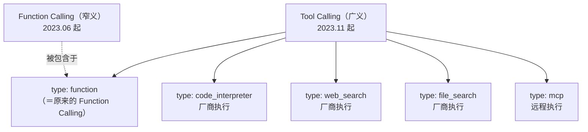
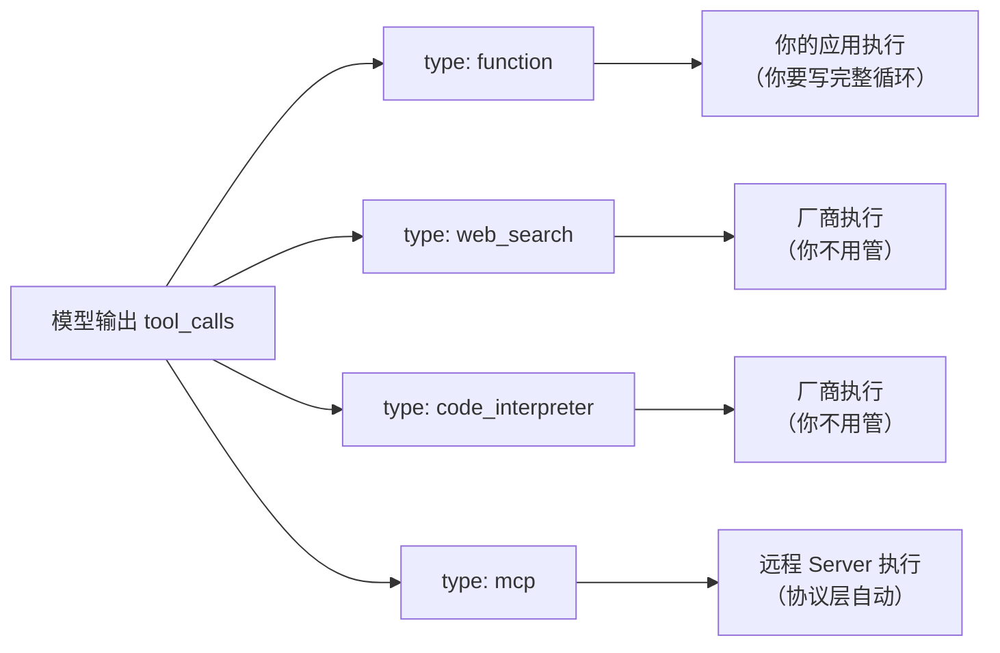

# Function Calling vs Tool Calling

## 结论

**它们是同一个机制在不同时代的两个名字，不是两种技术。**

- **Function Calling** = 2023 年 6 月的**历史名**，也是**窄义**（只指"调用你自己写的函数"）
- **Tool Calling** = 2023 年 11 月起的**当前统称**，是**广义**（涵盖自定义函数、厂商内置工具、远程服务）

> 关键差异不在"名字"，而在**范围**与**谁执行**：
> **Function Calling 一定是你执行；Tool Calling 可能是你、厂商、或远程服务执行。**

## 一、一张图说清关系



**一句话**：**Function Calling 是 Tool Calling 的一个子集。**

## 二、时间线（官方事实）

| 时间 | 事件 |
|------|------|
| **2023-06-13** | OpenAI 推出 **function calling**，参数为 `functions` / `function_call`，模型 `gpt-3.5-turbo-0613` |
| **2023-11-06** | OpenAI DevDay 推出 **tools**，参数为 `tools` / `tool_calls`；`function` 变成工具的一种 `type` |
| 同期 | 新增 `code_interpreter`、`retrieval` 等**内置工具** |
| 之后 | 陆续加入 `file_search`、`web_search`、`computer_use`、`mcp` 等工具类型 |
| 现在 | 官方文档主用 **tool calling**，`functions` 参数已不推荐使用 |

### 2.1 各厂商的术语

| 厂商 | 官方术语 | 参数名 |
|------|----------|--------|
| OpenAI（2023.06） | Function calling | `functions` |
| OpenAI（2023.11+） | Tool calling / Function calling | `tools` |
| **Anthropic** | **Tool use** | `tools` |
| Google Gemini | Function calling | `tools.functionDeclarations` |
| 中文社区 | 函数调用 / 工具调用 | **基本混用** |

> 注意：**Anthropic 从未使用过 "function calling" 这个词**，它从一开始就叫 **Tool Use**。所以"Function Calling"严格说是 OpenAI 的历史术语。

## 三、三个层面的区别

### 3.1 术语层：历史名 vs 现行名

```
Function Calling  ──改名/扩展──▶  Tool Calling
   （2023.06）                      （2023.11+）
```

**改名的原因**：出现了**根本不是函数**的工具（代码解释器、网页搜索、文件检索）。叫"函数调用"已经名不副实。

### 3.2 范围层：窄义 vs 广义

| | Function Calling（窄义） | Tool Calling（广义） |
|---|---|---|
| 工具来源 | **只有你自己定义的函数** | 自定义函数 + **厂商内置** + **远程服务** |
| 工具类型 | 仅 `function` | `function` / `code_interpreter` / `web_search` / `file_search` / `computer_use` / `mcp` |

### 3.3 执行层：谁真正干活（最重要）

**这是最容易被忽略、但影响最大的区别。**

| 工具类型 | 谁执行 | 你要做什么 |
|----------|--------|-----------|
| **`function`**（自定义） | **你的代码** | 解析参数 → 执行 → 回传结果 |
| **`code_interpreter`** | **厂商服务端** | 什么都不用做，结果自动回来 |
| **`web_search`** | **厂商服务端** | 什么都不用做 |
| **`file_search`** | **厂商服务端** | 预先上传文件，其余自动 |
| **`mcp`** | **远程 MCP Server** | 配置 Server 地址，协议层自动 |

> **核心洞察**：
> 用**自定义函数**时，你要写完整的「调用—执行—回传」循环；
> 用**内置工具**时，厂商替你跑完了整个循环，你只看到最终结果。
>
> **这决定你的代码复杂度差一个数量级。**

## 四、API 差异实证

### 4.1 旧格式（2023.06，Function Calling）

**请求**：

```json
{
  "model": "gpt-3.5-turbo-0613",
  "messages": [{ "role": "user", "content": "北京天气" }],
  "functions": [
    {
      "name": "get_weather",
      "description": "查询天气",
      "parameters": {
        "type": "object",
        "properties": { "city": { "type": "string" } },
        "required": ["city"]
      }
    }
  ],
  "function_call": "auto"
}
```

**响应**：

```json
{
  "choices": [{
    "message": {
      "role": "assistant",
      "content": null,
      "function_call": {
        "name": "get_weather",
        "arguments": "{\"city\":\"北京\"}"
      }
    }
  }]
}
```

**回传结果**（**注意：没有 id**）：

```json
{ "role": "function", "name": "get_weather", "content": "{\"temp\":25}" }
```

### 4.2 新格式（2023.11+，Tool Calling）

**请求**：

```json
{
  "model": "gpt-4o",
  "messages": [{ "role": "user", "content": "北京天气" }],
  "tools": [
    {
      "type": "function",
      "function": {
        "name": "get_weather",
        "description": "查询天气",
        "parameters": {
          "type": "object",
          "properties": { "city": { "type": "string" } },
          "required": ["city"]
        }
      }
    },
    { "type": "code_interpreter" }
  ],
  "tool_choice": "auto"
}
```

**响应**：

```json
{
  "choices": [{
    "message": {
      "role": "assistant",
      "content": null,
      "tool_calls": [
        {
          "id": "call_abc123",
          "type": "function",
          "function": { "name": "get_weather", "arguments": "{\"city\":\"北京\"}" }
        }
      ]
    }
  }]
}
```

**回传结果**（**必须带 id**）：

```json
{ "role": "tool", "tool_call_id": "call_abc123", "content": "{\"temp\":25}" }
```

### 4.3 差异总表

| 维度 | 旧（Function Calling） | 新（Tool Calling） |
|------|------------------------|---------------------|
| 定义参数 | `functions` | `tools` |
| 单个定义结构 | `{name, description, parameters}` | `{type:"function", function:{...}}` |
| 选择参数 | `function_call` | `tool_choice` |
| 响应字段 | `message.function_call`（单个） | `message.tool_calls`（**数组**） |
| 调用标识 | **无 id** | **有 id** |
| 结果消息 | `role:"function"` + `name` | `role:"tool"` + `tool_call_id` |
| 并行调用 | ❌ 不支持 | ✅ 支持 |
| 内置工具 | ❌ 不支持 | ✅ 支持 |

> **两个结构性升级**：**加了 `id`**（支持并行与对应）和**改成了数组**（支持一次多调）。

## 五、四种"工具"的执行归属



| 类型 | 执行方 | 你的工作量 | 典型场景 |
|------|--------|-----------|----------|
| `function` | 你的代码 | **高**：定义 + 校验 + 执行 + 回传 | 内部系统集成 |
| `web_search` | 厂商 | **零** | 联网检索 |
| `code_interpreter` | 厂商 | **零** | 数据计算、画图 |
| `file_search` | 厂商 | 低（上传文件） | 知识库问答 |
| `mcp` | 远程 Server | 低（配置服务） | 接入标准工具生态 |

> 这也是为什么"Tool Calling 比 Function Calling 强"——**不是模型更聪明，而是厂商把执行环节也接管了**。

## 六、为什么这区别很重要

### 6.1 代码量差一个数量级

```python
# Function Calling：你必须写完整循环
for _ in range(max_steps):
    resp = client.chat.completions.create(model=..., messages=..., tools=...)
    msg = resp.choices[0].message
    messages.append(msg)
    if not msg.tool_calls:
        break
    for call in msg.tool_calls:
        result = execute(call)              # ← 你的活
        messages.append({"role": "tool", "tool_call_id": call.id, "content": result})
```

```python
# 内置工具（如 web_search）：一次调用就结束
resp = client.responses.create(
    model="...",
    tools=[{"type": "web_search"}],
    input="2026年 AI Agent 趋势",
)
print(resp.output_text)                    # ← 循环由厂商完成
```

### 6.2 可控性权衡

| | 自定义 function | 内置工具 |
|---|---|---|
| **可控性** | 高（完全掌握） | 低（黑盒） |
| **代码量** | 多 | 少 |
| **数据安全** | 数据不出内网 | 数据经过厂商 |
| **可定制** | 任意 | 受限 |
| **成本** | 自己承担工具成本 | 通常含在调用费里 |

**选型建议**：

| 需求 | 选择 |
|------|------|
| 访问内部系统、数据库 | **自定义 function** |
| 需要联网查最新信息 | **内置 web_search** |
| 纯计算、画图 | **内置 code_interpreter** |
| 接标准工具生态 | **MCP** |
| 数据不能出内网 | **自定义 function + 本地执行** |

## 七、常见误解

| 误解 | 事实 |
|------|------|
| "Function Calling 和 Tool Calling 是两种技术" | ❌ 同一机制，前后两代命名 |
| "Tool Calling 是全新 API，与 Function Calling 不兼容" | ❌ `type:"function"` 就是原来的函数调用 |
| "Anthropic 的 Tool Use 是另一套东西" | ❌ 机制相同，只是字段名不同（`input_schema` vs `parameters`） |
| "工具越多越好" | ❌ 工具增多会稀释注意力、降低选择准确率 |
| "内置工具和自定义函数一样可控" | ❌ 内置工具是黑盒，数据和执行都在厂商侧 |
| "改名只是营销" | ❌ 改名背后是**工具类型的实质扩展** |

## 八、术语使用建议

| 场景 | 建议用词 |
|------|----------|
| **正式文档、方案设计** | **Tool Calling**（涵盖面广，不会遗漏内置工具） |
| **特指自定义函数** | **Function Calling**（更精确） |
| **对接 Anthropic** | **Tool Use**（与官方术语一致） |
| **中文口语沟通** | 两者混用无妨，但**先说清是"自定义"还是"内置"** |

> **最重要的一条**：讨论时说清"**是自定义函数，还是厂商内置工具**"——这比纠结叫法重要得多，因为它直接决定架构。

## 九、Checklist

**概念澄清**
- [ ] 团队内部对两个术语的定义达成一致
- [ ] 文档中标明是"自定义函数"还是"内置工具"
- [ ] 明确谁负责执行

**技术选型**
- [ ] 内部系统 → 自定义 function
- [ ] 联网检索 → 内置 web_search
- [ ] 数据分析 → 内置 code_interpreter
- [ ] 生态接入 → MCP
- [ ] 数据敏感场景 → 自定义 + 本地执行

**实现**
- [ ] 使用新版 `tools` / `tool_calls`（不用 `functions`）
- [ ] 回传时带 `tool_call_id`
- [ ] 支持并行调用
- [ ] 服务端独立校验参数

## 十、总结

| | Function Calling | Tool Calling |
|---|------------------|--------------|
| **年代** | 2023.06 | 2023.11+ |
| **地位** | 历史名 / 窄义 | 现行名 / 广义 |
| **范围** | 仅自定义函数 | 函数 + 内置工具 + 远程服务 |
| **执行方** | **一定是你** | 你 / 厂商 / 远程 |
| **API 参数** | `functions` | `tools` |
| **当前状态** | 已被包含 | 官方主用 |

**一句话记住：**

> **Function Calling 是 Tool Calling 的子集。**
> 前者是"我写函数，模型来调"；后者是"模型可以调任何东西——我的函数、厂商的内置能力、远程的服务"。
>
> **名字之争不重要，"谁执行"才重要。**
