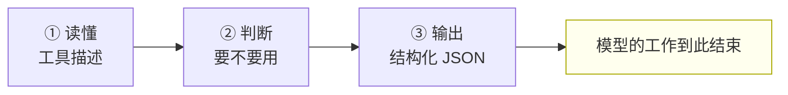
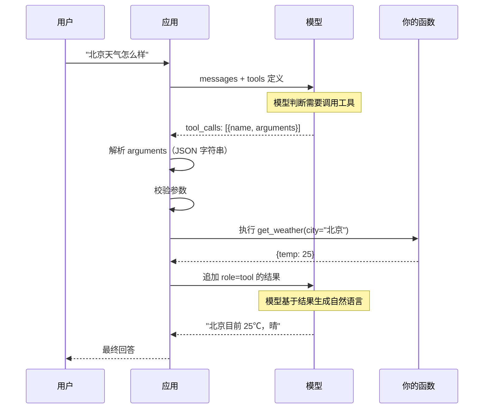

# Function Calling（函数调用）

## 结论

**Function Calling 让模型能输出"结构化的调用意图"，但它自己不执行任何代码，也看不到执行结果。**

模型只做三件事：**读懂工具描述 → 判断要不要用 → 输出一段符合 Schema 的 JSON**。
真正的**执行**和**结果回传**，全部由你的应用代码完成。

> 一句话：**模型负责"开方子"，你负责"抓药"。**

## 一、官方定义与由来

| 项目 | 信息 |
|------|------|
| **提出方** | OpenAI |
| **提出时间** | 2023 年 6 月 13 日（`gpt-3.5-turbo-0613` / `gpt-4-0613`） |
| **原始参数名** | `functions` / `function_call` |
| **现行参数名** | `tools` / `tool_calls`（2023 年 11 月起） |
| **同类能力** | Anthropic 称 **Tool Use**，Google 称 **Function Calling** |

### 1.1 术语演变

```
2023.06  function calling   →  参数 functions
2023.11  tool calling       →  参数 tools（支持 code interpreter 等多种工具类型）
现在      两者混用            →  多数场景指同一件事
```

> **Function Calling 与 Tool Calling 是同一机制的不同叫法**，后者是前者的泛化。

### 1.2 它到底是"训练"还是"提示"

**两者都有，但核心是训练**：

- 厂商在 SFT 阶段专门训练模型**识别工具定义并生成合法调用**
- 所以它不是"靠提示词骗出来的"，而是**模型被训练过的能力**
- 但**工具描述质量**仍强烈影响选择准确率（这是提示能优化的部分）

## 二、核心机制：模型只做三件事



| 阶段 | 模型做什么 | 模型**不**做什么 |
|------|-----------|------------------|
| ① 读懂 | 解析 `name` / `description` / `parameters` | 不访问你的数据库 |
| ② 判断 | 判断当前问题是否需要工具、用哪个 | 不校验参数业务合法性 |
| ③ 输出 | 生成 `{"name": ..., "arguments": ...}` | **不执行、不返回真实结果** |

### 2.1 最关键的一句话

> **模型输出的不是"函数调用结果"，而是"函数调用请求"。**

它写的 `{"city": "北京"}` 只是**猜测的参数**，可能：
- 类型对但值错（编造了一个不存在的城市）
- 格式对但语义错（日期写成明天）
- JSON 被截断（`max_tokens` 不够）

**所以服务端必须独立校验参数，绝不信任模型。**

## 三、一次完整调用（时序）



**注意两个"模型调用"**：

1. **第一次**：模型输出 `tool_calls`（不是给用户的回答）
2. **第二次**：把结果回传后，模型才生成给用户的自然语言

> 这也是 Function Calling 会增加**延迟与成本**的根本原因——**一次交互至少两次模型调用**。

## 四、Schema 解剖

### 4.1 三个字段决定一切

```json
{
  "type": "function",
  "function": {
    "name": "get_weather",
    "description": "查询指定城市的实时天气。用户询问天气、穿衣建议时使用。",
    "parameters": {
      "type": "object",
      "properties": {
        "city": {
          "type": "string",
          "description": "城市名称，如 北京、上海"
        }
      },
      "required": ["city"]
    }
  }
}
```

| 字段 | 作用 | 谁在消费 |
|------|------|----------|
| `name` | 工具标识 | 模型（选择）+ 你的分发逻辑 |
| `description` | **决定模型会不会用** | 模型 |
| `parameters` | 参数约束 | 模型（生成）+ 你的校验 |

> **`description` 是唯一影响"选不选这个工具"的字段**，写不好等于这个工具不存在。

### 4.2 `description` 的好坏对比

| ❌ 差 | ✅ 好 |
|-------|-------|
| `"天气工具"` | `"查询指定城市的实时天气。用户询问天气、出行、穿衣建议时使用。返回温度、天气状况与湿度。"` |
| `"查询数据库"` | `"按订单号查询订单详情，包括状态、金额、物流信息。仅支持已支付订单。"` |
| `"处理文件"` | `"读取指定路径的文本文件内容。仅支持 .txt/.md，单文件上限 1MB。"` |

**好描述的三要素**：

1. **做什么**（能力边界）
2. **何时用**（触发条件，含关键词）
3. **返回什么 / 限制**（帮助模型判断是否够用）

### 4.3 参数设计原则

| 原则 | 说明 |
|------|------|
| **扁平优先** | 嵌套层级 ≤ 2，深嵌套会显著降低准确率 |
| **必填项最少** | `required` 只放真正必需的 |
| **给默认值** | 在 description 里写清默认行为 |
| **用 enum 收敛** | 有限取值用 `enum`，比自由字符串可靠得多 |
| **加约束** | `minimum` / `maximum` / `pattern` / `maxLength` |

### 4.4 `enum` 是最划算的优化

```json
{
  "unit": {
    "type": "string",
    "enum": ["celsius", "fahrenheit"],
    "description": "温度单位，默认 celsius"
  }
}
```

比 `"type": "string"` 好得多——**模型不会编出 "Celsius"、"centigrade" 这种变体**。

## 五、OpenAI vs Anthropic 格式差异

**这是最容易踩坑的地方**，两家的字段名和回传方式完全不同。

### 5.1 请求对比

**OpenAI**：

```json
{
  "model": "gpt-4o",
  "messages": [{ "role": "user", "content": "北京天气" }],
  "tools": [
    {
      "type": "function",
      "function": {
        "name": "get_weather",
        "description": "查询实时天气",
        "parameters": {
          "type": "object",
          "properties": { "city": { "type": "string" } },
          "required": ["city"]
        }
      }
    }
  ]
}
```

**Anthropic**：

```json
{
  "model": "claude-sonnet-4-5",
  "max_tokens": 1024,
  "messages": [{ "role": "user", "content": "北京天气" }],
  "tools": [
    {
      "name": "get_weather",
      "description": "查询实时天气",
      "input_schema": {
        "type": "object",
        "properties": { "city": { "type": "string" } },
        "required": ["city"]
      }
    }
  ]
}
```

### 5.2 响应对比

**OpenAI**（`arguments` 是 **JSON 字符串**）：

```json
{
  "role": "assistant",
  "content": null,
  "tool_calls": [
    {
      "id": "call_abc123",
      "type": "function",
      "function": {
        "name": "get_weather",
        "arguments": "{\"city\":\"北京\"}"
      }
    }
  ]
}
```

**Anthropic**（`input` 是 **对象**）：

```json
{
  "role": "assistant",
  "content": [
    {
      "type": "tool_use",
      "id": "toolu_01ABC",
      "name": "get_weather",
      "input": { "city": "北京" }
    }
  ]
}
```

### 5.3 结果回传对比

**OpenAI** — 独立 `tool` 消息：

```json
{ "role": "tool", "tool_call_id": "call_abc123", "content": "{\"temp\":25}" }
```

**Anthropic** — `user` 消息内的 `tool_result` 块：

```json
{
  "role": "user",
  "content": [
    { "type": "tool_result", "tool_use_id": "toolu_01ABC", "content": "25℃ 晴" }
  ]
}
```

### 5.4 差异总表

| 维度 | OpenAI | Anthropic |
|------|--------|-----------|
| **定义字段** | `function.parameters` | `input_schema` |
| **外层包装** | `{type:"function", function:{...}}` | 直接 `{name, description, input_schema}` |
| **参数格式** | JSON **字符串** | JSON **对象** |
| **响应位置** | `message.tool_calls` | `content[]` 中的 `tool_use` 块 |
| **回传方式** | `role:"tool"` + `tool_call_id` | `user` 消息 + `tool_use_id` |
| **结果格式** | `content` 字符串 | `content` 字符串或内容块数组 |
| **并行调用** | `parallel_tool_calls` | 原生支持多个 `tool_use` 块 |

> **`arguments` 是字符串这点是最高频的 bug 来源**——忘了 `json.loads()` 就会直接崩。

## 六、控制参数

### 6.1 `tool_choice`（OpenAI 语义）

| 值 | 含义 |
|----|------|
| `"auto"` | 模型自己决定用不用工具（默认） |
| `"none"` | 禁止调用工具 |
| `"required"` | **必须**调用至少一个工具 |
| `{"type":"function","function":{"name":"xxx"}}` | 强制调用指定工具 |

Anthropic 对应：`{"type":"auto"}` / `{"type":"any"}` / `{"type":"tool","name":"xxx"}`。

**用途**：

- `"required"`：确保走工具路径（比如必须先检索再回答）
- 指定工具：做**意图路由**（用户问 X 就强制走 X 工具）

### 6.2 并行调用

模型一次可以返回多个 `tool_calls`：

```json
"tool_calls": [
  { "id": "call_1", "function": { "name": "get_weather", "arguments": "{\"city\":\"北京\"}" } },
  { "id": "call_2", "function": { "name": "get_weather", "arguments": "{\"city\":\"上海\"}" } }
]
```

**你要做的**：

1. **并行执行**（互相独立时），减少总延迟
2. **每个都回一条** `tool` 消息，`tool_call_id` 必须对应
3. **少回一条就会报错**——这是最常见的集成失败

### 6.3 严格模式（Structured Outputs）

OpenAI 的 `strict: true` 会**约束解码**，保证输出严格符合 Schema：

```json
{
  "type": "function",
  "function": {
    "name": "get_weather",
    "strict": true,
    "parameters": { ... }
  }
}
```

**代价**：Schema 需满足额外要求（如所有字段必须 `required`、不支持某些关键字）。

> 开了严格模式，**JSON 截断和字段缺失基本消失**，是生产环境的强烈建议。

## 七、模型的局限（必须知道）

| 局限 | 表现 | 应对 |
|------|------|------|
| **看不到结果** | 不回传就永远不知道执行成败 | 必须把结果作为 `tool` 消息回传 |
| **会编造参数** | 城市名、ID、日期都可能是猜的 | 服务端独立校验 + 校验失败回灌错误 |
| **不理解工具副作用** | 不知道 `delete` 会真删数据 | 高危操作加确认闸门 |
| **Schema 复杂度有限** | 深层嵌套、超多参数准确率下降 | 参数扁平化、拆分工具 |
| **不理解返回值语义** | 拿到 `{"ok":false}` 可能当成功 | 错误信息要在文本里**显式说明** |
| **工具太多会选错** | 30+ 工具准确率明显下降 | 按场景动态筛选工具 |
| **JSON 可能被截断** | `max_tokens` 太小 | 提高上限或用 strict 模式 |

## 八、最佳实践

### 8.1 命名

| 原则 | 反例 | 正例 |
|------|------|------|
| 动词开头 | `weather` | `get_weather` |
| 具体明确 | `do_action` | `cancel_order` |
| 避免缩写 | `qry_usr` | `query_user` |
| 加命名空间 | `search` | `docs__search` |

### 8.2 描述

- 写清**何时用**，包含用户可能说的关键词
- 写清**限制**（只支持什么、不支持什么）
- 写清**返回什么**（让模型判断信息是否足够）
- **不要**写实现细节（"使用 requests 库"），模型不关心

### 8.3 数量控制

| 工具数 | 模型表现 |
|--------|----------|
| 1~10 | 准确率高 |
| 10~30 | 需要清晰描述 |
| 30+ | **准确率明显下降**，建议分组/筛选 |

**策略**：按对话阶段或场景**动态暴露工具子集**，而不是一次性全给。

### 8.4 错误处理

```python
def execute_tool(name: str, args: dict) -> str:
    try:
        result = REGISTRY[name](**args)
        return json.dumps({"ok": True, "data": result}, ensure_ascii=False)
    except KeyError:
        return json.dumps({"ok": False, "error": f"未知工具 {name}"}, ensure_ascii=False)
    except ValidationError as e:
        return json.dumps({"ok": False, "error": f"参数不合法: {e}"}, ensure_ascii=False)
    except Exception as e:
        return json.dumps({"ok": False, "error": f"执行失败: {e}"}, ensure_ascii=False)
```

> **错误也必须作为结果回传**，模型才能据此调整。吞掉错误 = 模型永远学不会。

## 九、常见坑

| 坑 | 现象 | 原因 | 解法 |
|----|------|------|------|
| **忘记解析 JSON** | `TypeError: string indices` | OpenAI 的 `arguments` 是字符串 | `json.loads(arguments)` |
| **JSON 截断** | `JSONDecodeError` | `max_tokens` 不足 | 提高上限 / strict 模式 |
| **漏回 tool 消息** | 400 报错 | 并行调用只回了一条 | 每个 `tool_call_id` 都要回 |
| **`tool_call_id` 不匹配** | 400 报错 | 张冠李戴 | 用原 id 回传 |
| **`content` 为 null 误判** | 拿到空回答 | 有 `tool_calls` 时 `content` 就是 `null` | 先判断 `tool_calls` |
| **参数不校验** | 数据库报错 / 越权 | 信任模型输出 | 服务端强校验 |
| **工具定义占太多 token** | 成本高 | 每个 schema 都计入 input | 精简描述、动态筛选 |
| **重复调用同一工具** | 死循环 | 无终止条件 | 最大轮数 + 重复检测 |

## 十、与 MCP / Skill 的关系

| | Function Calling | MCP | Skill |
|---|------------------|-----|-------|
| **层次** | 模型层 | 协议层 | 知识层 |
| **作用** | 模型怎么表达调用意图 | 工具怎么被发现和连接 | 任务怎么按流程做 |
| **形态** | JSON Schema | JSON-RPC | 文件夹 |

**组合链路**：

```
Skill（告诉我按什么流程做）
   ↓
MCP Server（提供可发现的工具）
   ↓ 转成
Function Calling 定义（模型能理解的 Schema）
   ↓
模型输出 tool_calls → 你的代码执行
```

> **MCP 是"怎么连"，Function Calling 是"怎么调"，Skill 是"怎么做"。**

## 十一、Checklist

**定义**
- [ ] `name` 动词开头、语义清晰
- [ ] `description` 含"做什么 + 何时用 + 限制"
- [ ] `parameters` 是合法 JSON Schema
- [ ] 有限取值用 `enum`
- [ ] 参数尽量扁平

**调用**
- [ ] 解析 `arguments` 字符串（OpenAI）
- [ ] 处理 `content: null` 的情况
- [ ] 并行调用逐个回传 `tool_call_id`
- [ ] 有最大轮数保护

**执行**
- [ ] 服务端独立校验参数
- [ ] 错误作为结果回传
- [ ] 高危操作加确认
- [ ] 结果做长度截断

**工程**
- [ ] 控制工具数量（建议 < 30）
- [ ] 记录每次调用的参数与结果
- [ ] 有超时
- [ ] 用 strict 模式保证 JSON 合法

## 十二、总结

**Function Calling 的本质是"给模型一个输出结构化意图的出口"：**

- **模型**：读懂描述 → 决定用不用 → 输出 JSON
- **你的代码**：校验参数 → 执行 → 回传结果
- **模型**：基于结果生成自然语言

三个最容易记住的要点：

1. **模型不执行任何东西**——它只写"申请单"
2. **不回传结果，模型就永远不知道发生了什么**
3. **`description` 决定工具会不会被选中**，比参数设计更重要

> 记住那句比喻：**模型开方子，你抓药，再把药效告诉它。**
