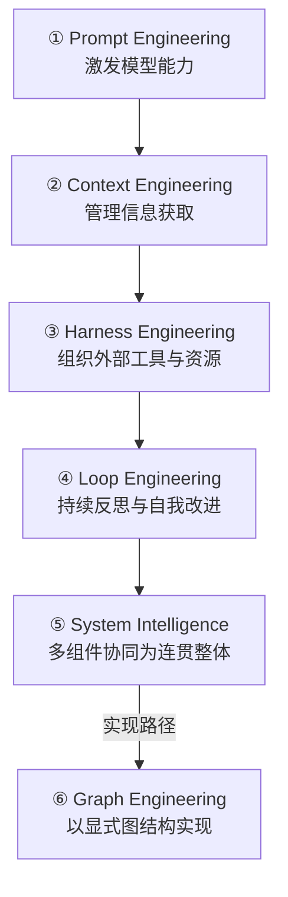

# Graph Engineering（图工程）

> **权威依据**
> ① **arXiv:2608.21156**《Graph Engineering in the Era of LLM Agents: From Individual Intelligence to System Intelligence》— 35 位作者，v1 2026-08-21 / v2 2026-08-26
> ② **V12 Labs**《Graph Engineering for AI Agents: Beyond Loops》（2026-08-17）— 实践模式与批判视角

## 结论

**Graph Engineering 是把 Agent 系统显式设计成"图"的工程范式——节点干活、边决定下一步、共享状态承载证据，并通过分支、并行、验证、审批、终止把系统组织起来。**

它要解决的不是"模型不够强"，而是**架构错配（architectural mismatch）**：

> **当任务需要异构专长、相互依赖的子任务、并行执行、独立验证与持久状态时，把这些全压进"一个 Agent + 一个循环"里，是结构性的不匹配。**
> 增强单个 Agent 的能力或上下文，**解决不了这个问题**——智能必须被**分布**，并在**系统层面**被组织。

一句话记住：**从"个体智能"走向"系统智能"。**

## 一、术语来源（两条并行线）

### 1.1 学术线：arXiv 论文

| 项目 | 内容 |
|------|------|
| **标题** | Graph Engineering in the Era of LLM Agents: From Individual Intelligence to System Intelligence |
| **编号** | arXiv:2608.21156（v1 2026-08-21，v2 2026-08-26） |
| **作者** | 35 人（Yuyuan Feng、Zhishang Xiang、…、Qinggang Zhang、Yi Chang 等） |
| **提交人** | Qinggang Zhang |
| **学科** | cs.IR（主）、cs.AI、cs.ET |
| **性质** | 系统性综述（principles / methodologies / applications） |

> 中文科技媒体称其来自"吉林大学、厦门大学等 **15 个研究机构**"，但 **arXiv 摘要页未列出机构信息**，此说法需核对 PDF 首页。

### 1.2 实践线：社区与厂商

| 时间 | 事件 |
|------|------|
| **2026-07-18** | Peter Steinberger 在 X 上发问："我们还在谈 **loops**，还是已经转向 **graphs** 了？" |
| **2026-07** | "Graph Engineering" 在 X 上爆火；AI Builder Club 发布《Graph Engineering Guide (2026)》 |
| **2026-08-17** | V12 Labs 发布分析文章，给出克制版定义与批判 |

> **V12 Labs 的自我预言**：其 loop engineering 指南结尾曾预测"**graphs 会成为下一个被吸收的术语**"。这个预测在六周内应验了。

## 二、官方定义

### 2.1 论文的定义（学术）

> **"Graph Engineering 构建显式的、动态的、可演化的图结构，用以表示任务、智能体与系统状态。"**
> *（constructs explicit, dynamic, evolving graph structures representing tasks, agents, and system states）*

**三个层次**：

| 层次 | 内容 |
|------|------|
| **定位** | 面向下一代 Agent 系统的范式，继 Prompt / Context / Harness / Loop 之后 |
| **机制** | 用**显式、动态、可演化**的图刻画三类对象：**任务**、**智能体**、**系统状态** |
| **目的** | 统一支撑四类能力：组织复杂目标、编排异构 Agent、建模系统动力学、支撑可扩展演化 |

### 2.2 实践的定义（V12 Labs）

> **"显式设计 Agent、工具、确定性代码、验证器、数据与人类如何连接以完成任务。**
> **节点干活，边决定下一步能发生什么，共享状态承载步骤间的证据。"**

> 并强调：**分支、并行、重试、审批、终止条件，是让它"超出一个 loop"的东西。**

### 2.3 一个直观形态

```
Intake
  → 分类请求
  → 并行跑 [research] + [policy check]
  → 合并证据
  → 生成动作
  → 验证
      ├─ 通过 → 执行
      ├─ 可修复 → 改后重验
      ├─ 高风险 → 人工审批
      └─ 预算耗尽 → 停止并上报
```

## 三、五范式演进：为什么需要第六层

论文摘要给出的完整链条：



| 阶段 | 范式 | 优化对象 |
|------|------|----------|
| 1 | Prompt Engineering | 模型自身能力 |
| 2 | Context Engineering | 信息与上下文 |
| 3 | Harness Engineering | 外部工具与资源 |
| 4 | Loop Engineering | 持续反思与自我改进 |
| 5 | **System Intelligence（目标态）** | 多组件协同 |
| 6 | **Graph Engineering（实现路径）** | 任务图 + Agent 图 + 状态图 |

### 3.1 核心概念：System Intelligence（系统智能）

> **"Agent 系统把多个智能组件组织协调为追求共同目标的连贯自适应整体的能力。"**

**关键判断**：

> 实现它**并非简单堆叠 Agent**，而是**需要显式结构**来组织工作、协调异构 Agent、维护演化中的执行状态。

## 四、核心部件（八种）

| 部件 | 含义 |
|------|------|
| **Node（节点）** | 一个工作单元：Agent、模型调用、工具、函数、**验证器**、**人工决策** |
| **Edge（边）** | 允许的状态转移 |
| **State（状态）** | 需向前传递的持久事实与产物 |
| **Router（路由）** | 基于状态或结构化决策选下一路径 |
| **Fan-out / Fan-in** | 并行拆分与后续合并 |
| **Gate（闸门）** | 测试、策略检查、预算检查、审批——阻断不安全推进 |
| **Cycle（环）** | 回到前序节点做修改或重试 |
| **Termination（终止）** | 显式的成功/失败/上报条件 |

> **注意**：节点**不一定是 Agent**。它可以是普通函数、确定性代码、验证器或人。**"这个决策普通代码能可靠做出，那个节点就不需要 Agent。"**

## 五、与 Loop Engineering 的关系

**不是"loop 已死、graph 当立"，而是问题层次不同。**

| | Loop | Graph |
|---|---|---|
| **回答的问题** | "这个 worker 该不该继续？" | "下一个该跑哪个 worker，带什么状态，在什么条件下？" |
| **作用范围** | 局部迭代 | 系统级协调 |
| **失败表征** | 常表现为"答案不好" | 失败可能**早在路由、交接、合并、验证环节埋下** |
| **规模** | 单 Agent | 多 Agent + 多阶段 |

### 最重要的一条

> **有用的 agent graph 里一定包含 loop。**
> 循环是图的基本构件（Cycle 部件），不是被取代的对手。

```
Graph（系统级协调）
├── Node A（内部是一个 loop）
├── Node B（内部是一个 loop）
├── Node C（纯函数，无 loop）
└── 边与状态把这些连起来
```

## 六、必须澄清的范畴错误

> **Agent Graph Engineering 用的是"执行/控制流图"，不等于 Knowledge Graph、GraphRAG、GNN。**

| 概念 | 图表示什么 | 解决什么 |
|------|-----------|----------|
| **Graph Engineering** | **执行/控制流** | 谁先跑、谁后跑、走哪条路 |
| **Knowledge Graph** | 实体与关系 | 世界知识的结构化 |
| **GraphRAG** | 文档实体关系 | 检索质量与多跳问答 |
| **GNN** | 图神经网络 | 图上学习 |

**两者可共存，但解决不同问题。** 把"图"这个词混用，是理解这个领域最常见的障碍。

## 七、六种典型模式

### 7.1 条件路由（Conditional Routing）

```
客服场景：
  账单问题    → 账单专家
  安全问题    → 人工升级
  已知产品问题 → RAG 应答器
```

**关键**：路由输出应**结构化、可记录、可测试**，而不是埋在自由 prompt 里。

### 7.2 并行 + 显式 join

**适用**：并行研究多个市场、检查多个服务、多维评估答案。

**但并行的价值取决于四件事是否定义清楚**：

1. 结果**如何汇合**
2. **重复**如何处理
3. **单支失败**怎么办
4. **部分成功**是否可接受

> **Anthropic 的数据**：并行子 Agent 与并行工具调用让复杂研究任务**耗时最多降 90%**，但同时警告 **token 消耗快**、**不适合强依赖或需全员共享同一上下文的任务**。
>
> **结论：并行是拓扑选择，不是通用升级。**

### 7.3 独立验证 Gate

**原则**：**生产者与批准者分离。**

- 验证器有**明确权限**，不是同一段对话里的又一条建议
- 但 gate 仍需**可靠的评分标准**

> 2025 年研究《Why Do Multi-Agent LLM Systems Fail?》分析 **7 个框架、1600+ 条 trace**，归纳出 **14 种失败模式**，分三类：
> ① 规格与系统设计　② Agent 间错位　③ 任务验证与终止
>
> **结论：光改 prompt 解决不了——拓扑与通信协议才是关键。**

### 7.4 人工审批节点

| 要求 | 说明 |
|------|------|
| **持久暂停** | 不是事后发 Slack 通知 |
| **从该状态恢复** | 图必须能从暂停点续跑 |
| **携带完整信息** | 拟执行动作、支撑证据、风险标记、确切决策项 |

### 7.5 失败隔离与恢复

**按失败类型分派不同策略**：

| 失败类型 | 策略 |
|----------|------|
| flaky API | 重试 |
| 缺数据 | 改道 |
| 策略冲突 | 转人工 |
| 预算耗尽 | 立即停止 |

### 7.6 修订循环

```
reviewer 发现弱结果 → 退回 builder → 重做
   ↑                                    │
   └────── 直到测试通过或预算耗尽 ───────┘
```

## 八、什么时候值得建图

### 8.1 值得（结构性复杂度被单 loop 掩盖时）

- [ ] 输入确实会**路由到不同专家或策略**
- [ ] 独立子任务**可并行**且之后需合并
- [ ] 生产性动作需要**显式审批或验证 gate**
- [ ] **不同失败需要不同恢复路径**
- [ ] 需要跨长等待或**进程重启暂停与恢复**
- [ ] 中间阶段的 **state 与产物必须可检查**
- [ ] 所有权在 Agent、工具、确定性服务、人类之间**转移**

### 8.2 不需要（继续用一个 loop 或简单函数流水线）

- [ ] 一个 Agent 能端到端负责
- [ ] 流程短、线性、易重放
- [ ] 所有步骤需要**同一份紧耦合上下文**
- [ ] 测试或确定性检查器能验证最终结果
- [ ] **图带来的编排代码多于它带来的有用控制**

### 8.3 反过度工程的两条判据

> **"最好的图往往比第一版草图更小。每加一个节点，就多一份延迟、成本、状态、权限、错误模式和会漂移的接口。"**

> **"如果两个节点总是一起跑且共享全部上下文，它们可能就是一个节点；如果某个决策普通代码能可靠做出，那个节点可能根本不需要 agent。"**

### 8.4 一个被嘲笑的典型

> **"用一个组织架构图来回复一封邮件"** —— 这就是过度工程的样子。

## 九、六个实践盲区

### 必读部分

| # | 盲区 | 后果 |
|---|------|------|
| **1** | **把图画当成架构** | 真正难的是 state schema、每节点 I/O 契约、合并行为、幂等、超时、重试、归属、终止态。**缺这些，图只是"记录了愿望"** |
| **2** | **把"更多 Agent"当"更强能力"** | Anthropic 指出多 Agent 约耗 **15 倍 token**，不适合紧耦合上下文或强依赖任务 |
| **3** | **把共享状态当内存讨论** | 两分支覆写同一字段、摘要抹掉别的节点要用的证据 → **分布式歧义** |
| **4** | **交接（handoff）规格不足** | 每条边都是契约。很多看似"推理弱"的多 Agent 失败，**源头是有损或含糊的交接** |
| **5** | **终止仍是核心难题** | 没有终止语义的图，只是"**更精巧的死循环方式**" |
| **6** | **图生成被卖在图验证之前** | 若让模型提议拓扑，必须用**确定性校验**检查可达节点、环、权限、必需 gate、预算与合法终止路径 |

### 9.1 重点展开：共享状态是"数据契约"，不是"记忆"

| 要求 | 说明 |
|------|------|
| **类型** | 每个字段有明确 schema |
| **来源追溯（provenance）** | 谁写的、什么时候写的 |
| **版本** | 可比较、可回滚 |
| **访问规则** | 谁能读、谁能写 |
| **唯一真相源** | 不允许两个地方各存一份 |
| **幂等键** | **恢复的节点可能从头重跑**，否则会重复发邮件、重复建记录、重复部署 |

### 9.2 重点展开：交接（Edge）就是契约

每条边都要回答：

1. **什么产物过这条边？**
2. **哪些上下文被有意排除？**
3. **谁拥有下一个决策？**
4. **接收方能否拒收不完整输入？**

## 十、可直接当评审清单的三层表

### 10.1 每个节点

- [ ] **单一职责**
- [ ] **可读的最小 state**
- [ ] **必写的结构化输出**
- [ ] **可用工具与权限**
- [ ] **超时、重试、成本预算**
- [ ] **宣布成功所需的证据**

### 10.2 每条边

- [ ] **启用条件**
- [ ] **承载的产物或状态转移**
- [ ] **由模型还是代码决定**
- [ ] **目标拒收输入时的处理**
- [ ] **如何追踪与评估**

### 10.3 整张图

- [ ] **唯一 state 真相源**
- [ ] **并发更新合并规则**
- [ ] **显式成功/失败/上报/取消态**
- [ ] **最大环数与总预算**
- [ ] **高后果动作的审批边界**
- [ ] **重放、检查点、恢复行为**
- [ ] **端到端 eval + 节点/边级诊断**

## 十一、工程实现

### 11.1 框架现状

| 框架 | 图能力 | 成熟度 |
|------|--------|--------|
| **LangGraph** | Graph API：state = 应用快照，node 做事，edge 决定下一步，支持条件分支与并行 | 相对成熟 |
| **AutoGen GraphFlow** | 同一批底层概念 | **官方标注 experimental** |
| **Google ADK 2.0** | 图式编排 | 实时流式与部分第三方集成仍有限制 |
| **OpenAI Agents SDK** | 图式编排原语 | 活跃演进中 |

> **重要判断**：以上暴露的是**同一批底层概念**（条件分支、并行 fan-out、循环退出、状态机、重试退避、检查点重放、审批队列）——**这些是成熟工作流引擎多年的积累**，只是现在被变成了 Agent 框架里**可检查、可测试、可持久化**的一等对象。

### 11.2 框架无关的最小示例

```python
from typing import TypedDict, Literal

class State(TypedDict):
    request: str
    category: str
    evidence: list[dict]
    draft: str
    verdict: Literal["pass", "revise", "reject"]
    budget_left: int


# ---- 节点：都是普通函数，不一定是 agent ----
def classify(state: State) -> State:
    state["category"] = llm_classify(state["request"])
    return state

def research(state: State) -> State:
    state["evidence"] = search(state["request"])
    return state

def policy_check(state: State) -> State:
    state["evidence"] += load_policy(state["request"])
    return state

def build(state: State) -> State:
    state["draft"] = llm_build(state["request"], state["evidence"])
    return state

def verify(state: State) -> State:
    """独立验证器：与 build 不同模型 / 不同指令"""
    state["verdict"] = llm_judge(state["draft"], state["evidence"])
    return state


# ---- 路由：结构化、可记录、可测试 ----
def route_after_verify(state: State) -> str:
    if state["verdict"] == "pass":
        return "execute"
    if state["budget_left"] <= 0:
        return "abort"
    if state["verdict"] == "reject":
        return "human"
    return "build"        # revise → 回到 build（这是一个环）


def route_by_category(state: State) -> str:
    return {"billing": "billing_expert",
            "security": "human",
            "other": "rag"}.get(state["category"], "rag")


# ---- 图定义（伪代码，框架各异）----
graph = Graph()
graph.add_node("classify", classify)
graph.add_node("research", research)
graph.add_node("policy", policy_check)
graph.add_node("build", build)
graph.add_node("verify", verify)

graph.add_edge("classify", route_by_category)
graph.add_parallel(["research", "policy"], join="merge")
graph.add_edge("merge", "build")
graph.add_edge("build", "verify")
graph.add_conditional_edge("verify", route_after_verify)
graph.set_max_cycles(3)
graph.set_entry("classify")
```

**注意示例里体现的四个要点**：

1. **`research` 与 `policy` 并行**，有显式 `join`
2. **`verify` 是独立节点**，不是 `build` 的自检
3. **`route_after_verify` 是纯函数**，不是让模型决定
4. **有 `max_cycles` 与 `budget_left`**，终止是承重结构

## 十二、走向预测

| 预测 | 说明 |
|------|------|
| **图成为可执行规格** | 架构图、运行时配置、权限、可观测性、eval 描述**同一张图**，不再各自漂移 |
| **拓扑被评估** | 不只评最终输出，还评"哪条路由会失败""哪个节点真有价值""状态何时变陈旧" |
| **静态图部分自适应** | 安全关键路径仍由**代码**定义；Agent 只在**有界区域**内提议子任务/路由。可信形态是"**带校验的受限自适应**"，而非 Agent 无限重写自己的控制平面 |
| **持久性成为硬要求** | 持久 state、幂等动作、可恢复审批、超时、基础设施故障后恢复 |

## 十三、总结

**Graph Engineering 回答了一个 Loop 回答不了的问题：**

> Loop 问"**还要不要继续**"，Graph 问"**下一步该轮到谁、带什么状态、在什么条件下**"。

**四条最值得记住的原则**：

1. **图 ≠ 架构** —— 真正的架构是 state schema、I/O 契约、幂等、终止态；画的框和箭头不算
2. **节点不必是 Agent** —— 普通代码能可靠做的决策，就不要放 Agent
3. **有用的图里一定有 loop** —— 不是替代，是升级为基本构件
4. **大多数任务你不需要图** —— 过度工程的典型是"用组织架构图回复一封邮件"

> **最后一句话**：
> **Graph Engineering 的价值不在"图"这个形状，而在"显式"这个词**——把原本藏在 prompt 里的路由、藏在对话里的验证、藏在脑子里的终止条件，**全部变成可检查、可测试、可恢复的结构**。

---

> **资料说明**
> 论文定义、五范式演进、System Intelligence、三类图抽象（任务/Agent/状态）等，依据 **arXiv:2608.21156 摘要**整理。
> 八种部件、六种模式、过度工程判据、六个盲区、评审清单、走向预测等，依据 **V12 Labs《Graph Engineering for AI Agents: Beyond Loops》（2026-08-17）** 整理。
>
> **注意来源性质**：
> - V12 Labs 是**带销售漏斗的厂商博客**（多处 CTA），技术判断可信度尚可，但"行业趋势"表述应视为**观点而非调查结论**。
> - **Anthropic 的"90% 提速""15 倍 token"是单一厂商案例数据**，不宜外推为通用系数。
> - 引用的《Why Do Multi-Agent LLM Systems Fail?》等研究多为**预印本**，结论请按原文核对。
> - 论文**机构信息**（"15 个研究机构"）来自中文媒体报道，**arXiv 摘要页未列**，需核对 PDF。
> - 所有引文均为**中文意译**，非逐字直译。
> - LangGraph / AutoGen / ADK 的**具体 API 与成熟度随版本变化**，接入前请核对官方文档（AutoGen GraphFlow 官方标注 experimental）。
