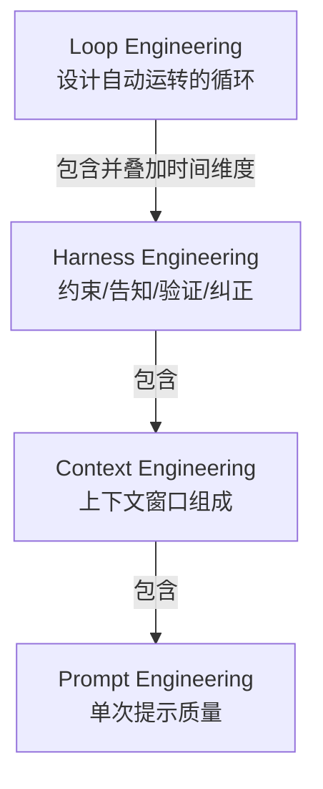

# Loop Engineering（循环工程）

> **权威依据**
> ① **Addy Osmani**《Loop Engineering》，2026-06-07（Anthropic 工程与开发者关系负责人，Claude Code 团队）— **术语提出者**
> ② **IBM Think**《What Is Loop Engineering?》，2026-07-17（Ivan Belcic、Cole Stryker）— **系统化定义与框架**

## 结论

**Loop Engineering 是"设计一套系统去代替你给 Agent 写提示词"的实践。**

你不再逐条指挥，而是**定义一个目标 + 一套可验证的停止条件**，让 Agent 自主"行动 → 观察 → 判断 → 调整"，循环往复直到完成。

> **原始定义**（Addy Osmani 原文）：
> *"Loop engineering is replacing yourself as the person who prompts the agent. You design the system that does it instead. A loop here can be thought of a recursive goal where you define a purpose and the AI iterates until complete."*
>
> **中文**：循环工程就是把自己从"给 agent 写提示词的那个人"这个位置上替换掉，改由你设计一套系统去做这件事。这里的"循环"可以理解为一个**递归式目标**：你定义目的，AI 迭代直到完成。

一句话记住：**从"操作员"变成"教练"。**

## 一、术语来源与行业背书

### 1.1 提出者

| 项目 | 内容 |
|------|------|
| **提出者** | Addy Osmani |
| **身份** | Anthropic 工程与开发者关系负责人（Claude Code 团队）；此前在 Google 14 年，曾任 Google Cloud AI 总监 |
| **时间** | **2026-06-07** |
| **出处** | addyosmani.com/blog/loop-engineering/ |

### 1.2 两条被引用的行业观点

> **Peter Steinberger**：
> "你不应该再给编码 agent 写提示词了，你应该**设计去提示这些 agent 的循环**。"

> **Boris Cherny**（Anthropic Claude Code 负责人）：
> "我已经不再提示 Claude 了。我有一堆循环在跑，由它们去提示 Claude 并判断该做什么。**我的工作是写循环。**"

### 1.3 IBM 的官方定义（2026-07-17）

> **Loop Engineering 是指设计"代理式工作流/循环"（agentic workflows/loops），让 AI Agent 以最少的人工干预、迭代地朝用户设定的目标推进的实践。**

**关键补充**：

- 不再需要人类在每一步提示，代理循环让 Agent **自主行动、观察、决策、迭代**，直到任务完成
- 开发者角色从"给 AI 写提示词"转变为"**设计能自动提示、检查、引导 Agent 的系统**"
- 定位：一种新兴的**代理式工程（agentic engineering）**实践，是 IBM Bob、Claude Code、OpenAI Codex 等编码 Agent 的**底层逻辑**

## 二、它在工程谱系中的位置

Addy Osmani 给出的关键定位：

> **harness 是单个 Agent 运行的环境；循环则是"加了定时器、会派生小助手、能自我喂养的 harness"。**



| 层次 | 关注 | 时间尺度 | 人的角色 |
|------|------|----------|----------|
| **Prompt Engineering** | 一句话怎么写 | 一次调用 | 写提示 |
| **Context Engineering** | 上下文放什么 | 一次推理 | 策展上下文 |
| **Harness Engineering** | 环境/约束/反馈 | 一个任务 | 造工具与护栏 |
| **Loop Engineering** | **闭环+调度+自动发现** | **持续运行** | **设计系统** |

> **演进脉络**：Prompt → Context → Harness → Loop。
> 每上一层，**人的介入频率降一个数量级，设计难度升一个数量级**。

## 三、循环的四个阶段（IBM 框架）

```
┌─────────────────────────────────┐
│  ① Goal（目标）                  │
│  每轮重新评估的"递归目标"         │
└────────────┬────────────────────┘
             ▼
┌─────────────────────────────────┐
│  ② Action（行动）                │
│  写代码 / 跑测试 / 改文件 / 调工具 │
└────────────┬────────────────────┘
             ▼
┌─────────────────────────────────┐
│  ③ Observation（观察）           │
│  跑 CI、看结果、读日志            │
└────────────┬────────────────────┘
             ▼
┌─────────────────────────────────┐
│  ④ Adjustment（调整）            │
│  依据反馈修正方法，重启循环        │
└────────────┬────────────────────┘
             │
             └──────► 回到 ①
```

### 3.1 递归目标（Recursive Goal）

**定义**：每一轮迭代都**重新评估**的目标——既防止跑偏，也防止无谓迭代、控制 token 成本。

**好目标的四个要求**：

| 要求 | 说明 |
|------|------|
| **具体** | 不是"让网站更快" |
| **范围合理** | 一轮能推进，不是永远做不完 |
| **可拆成可测试子任务** | 每步能验证 |
| **带明确可验证的停止条件** | 知道什么时候该停 |

**反例 vs 正例**：

| ❌ 反例 | ✅ 正例 |
|---------|---------|
| "让我的网站加载更快" | "当代码通过全部单元测试且满足需求时停止迭代" |
| "优化代码质量" | "lint 无告警、测试覆盖率 ≥ 80%、无新增 TODO 时停止" |

### 3.2 停止条件（Stop Condition）

**这是循环工程最关键的设计决策**——没有它，循环会变成一个烧 token 的无底洞。

**三种常见停止机制**：

| 机制 | 例子 |
|------|------|
| **客观可验证** | 测试全绿、编译通过、lint 干净 |
| **轮数上限** | 最多 5 轮，超出转人工 |
| **收敛判据** | 连续两轮无实质变更 |

> **最佳实践**：**写代码的 Agent 不负责给自己打分**——由**独立的小模型/子 Agent** 判定是否达标。

## 四、六块积木（Addy Osmani 框架）

这是最实操的部分：**任何循环都由这六样东西拼成**。

### 4.1 Automations（自动化）—— 循环的心跳

**作用**：按计划自动触发，自行做**发现与分诊（discovery + triage）**。

| 平台 | 实现 |
|------|------|
| **Codex** | Automations 标签页：配置项目、提示词、频率、运行环境（本地 checkout 或后台 worktree）。有发现的运行结果进 **Triage 收件箱**，没发现的自动归档 |
| **Claude Code** | `/loop`、cron 定时任务、hooks（生命周期钩子）、GitHub Actions |

**OpenAI 内部的实际用法**：

- 每日 issue 分诊
- CI 失败摘要
- 提交简报
- 抓上周引入的 bug

**第二类会话内原语（关键）**：

| 原语 | 作用 |
|------|------|
| `/loop` | 按节奏重跑 |
| `/goal` | 持续跑到某个条件为真（如 "test/auth 全部通过且 lint 干净"） |

> **`/goal` 的精髓**：每轮结束后由**独立的小模型**检查是否完成——**写代码的 Agent 不负责给自己打分**。

### 4.2 Worktrees（工作树）—— 让并行不变成混乱

**问题**：多个 Agent 同时跑必然文件冲突。

**方案**：git worktree = 独立工作目录 + 独立分支 + **共享同一仓库历史**。一个 Agent 的改动物理上碰不到另一个。

| 平台 | 实现 |
|------|------|
| **Codex** | 内建**每线程一个 worktree**，隔离 subagent |
| **Claude Code** | `git worktree`、`--worktree` 标志、subagent 设 `isolation: worktree`（用完自动清理） |

> **关键提醒**：worktree 只消除**机械性碰撞**，**你仍是天花板**——**你的评审带宽决定你实际能跑多少个**。

### 4.3 Skills（技能）—— 不再每次重讲项目

**形态**：一个文件夹 + `SKILL.md`（指令与元数据）+ 可选脚本、参考资料、资产。

**触发方式**：

| 方式 | 说明 |
|------|------|
| **显式调用** | `$skillname` 或 `/skills` |
| **隐式触发** | 任务匹配描述时自动加载 |

> **因此：朴素准确的描述胜过聪明的描述。**

**为什么对循环至关重要 —— Intent Debt（意图债）**：

> Agent 每次会话都是**冷启动**，会用**自信的猜测**填补意图空洞。
> **Skill 就是把意图写到外部**：一次写清、每次读取。
> 没有 skills，循环每轮都从零重新推导项目；有了 skills，**知识会复利**。

**术语区分**：

| 概念 | 是什么 |
|------|--------|
| **skill** | 编写格式 |
| **plugin** | 分发方式（跨仓库共享或打包多个 skill） |

### 4.4 Plugins / Connectors（插件与连接器）—— 接入真实工具

**基础**：基于 **MCP**（Model Context Protocol）。

**能力**：读 issue tracker、查数据库、打 staging API、发 Slack 消息。

**意义跃迁**：

```
"这是一个修复方案"
        ↓ 接上连接器
"循环自己开 PR → 关联工单 → CI 绿了自动在频道里知会一声"
```

> **一个洞察**：Codex 与 Claude Code 的 MCP 原语**形状几乎一致**，为一个写的连接器通常另一个也能用。

### 4.5 Sub-agents（子 Agent）—— 让"做的人"远离"查的人"

**这是全篇最有用的结构性设计。**

**问题**：**写代码的模型给自己打分太宽容。**

**方案**：第二个 Agent（不同指令、有时不同模型）——能抓出第一个 Agent **自我说服**的部分。

| 平台 | 实现 |
|------|------|
| **Codex** | `.codex/agents/` 下 TOML 定义（名称、描述、指令、可选模型与推理强度） |
| **Claude Code** | `.claude/agents/`、agent teams |

**常见分工**：

```
Agent A：探索代码库
Agent B：实现改动
Agent C：对照规格验证
```

**按任务配模型（成本优化）**：

| 任务 | 模型配置 |
|------|----------|
| 安全审查 | 强模型 + 高强度推理 |
| 探索 | 快速只读模型 |

> **成本提示**：子 Agent 各自跑模型与工具，**token 消耗更大**——只花在"第二意见真正值钱"的地方。

### 4.6 Memory / State（记忆）—— 循环的脊柱

**形态**：一个 markdown 文件、一个 Linear 看板——任何活在**单次对话之外**、记录"什么已完成、什么下一步"的载体。

**核心真理**（这句话值得背下来）：

> **模型在两次运行之间什么都不记得，所以记忆必须在磁盘上而不在上下文里。**
> **Agent 会忘，仓库不会。**

## 五、两套框架的映射

IBM 的"八要素"与 Addy 的"六块积木"高度重合：

| IBM 八要素 | Addy 六积木 | 职责 |
|-----------|-------------|------|
| Automations / Scheduling | **Automations** | 循环的心跳 |
| Hooks | Automations（部分） | 事件触发的治理与质检 |
| Context Engineering | （贯穿） | 压缩历史、结构化 |
| Tool Access | **Plugins / Connectors** | 真正"做事"的能力 |
| Worktrees | **Worktrees** | 隔离并行 |
| Skills | **Skills** | 固化项目知识 |
| Subagents | **Sub-agents** | maker/checker 分离 |
| Spine（持久状态） | **Memory** | 记录进度 |

### IBM 独有的两个要素

**① Hooks（钩子）** —— 值得单独说

- 由**事件**触发（生成代码、改文件、调工具、完成任务），可在事件**前后**触发
- 主要用于**安全与质量**：策略执行、输出校验、自动触发工作流
- **核心价值**：**把治理与质量检查移出 Agent** → 降低 token 与算力开销

> 这句话很重要：**能在循环外做的检查，就不要让模型去做。** 用代码判断比用模型判断便宜几个数量级。

**② Context Engineering 作为独立要素**

- 提供模型所需数据、**尽量减少冗余上下文**
- 手段：**摘要压缩历史迭代**、用 Markdown 组织结构

## 六、一个完整循环长什么样

Addy 给出的可复用形态（**每日晨间循环**）：

```
① 每天早晨，自动化在仓库上触发
   └─ 提示词调用 triage skill：
      读昨天的 CI 失败、开放 issue、最近提交
      把发现写入 markdown 文件或 Linear 看板

② 对每个值得做的发现
   └─ 开一个隔离 worktree，派 sub-agent 起草修复

③ 第二个 sub-agent
   └─ 对照项目 skills 与既有测试评审这份草稿

④ 连接器
   └─ 让循环自己开 PR、更新工单

⑤ 循环处理不了的东西
   └─ 落到 triage 收件箱给人

⑥ 状态文件
   └─ 记住试过什么、通过什么、还开着什么
   └─ 明天早上从今天停下的地方继续
```

> **关键观察**：**你只设计了一次，没有逐条提示其中任何一步。**
> 而且因为积木相同，这个循环在 Codex 和 Claude Code 里是**同一个循环**。

## 七、产品原语映射表

| 原语 | 在循环中的职责 | Codex | Claude Code |
|------|----------------|-------|-------------|
| **Automations** | 定时发现与分诊 | Automations 标签页 + `/goal` | 定时任务/cron、`/loop`、`/goal`、hooks、GitHub Actions |
| **Worktrees** | 隔离并行特性 | 每线程内建 worktree | `git worktree`、`--worktree`、`isolation: worktree` |
| **Skills** | 固化项目知识 | `SKILL.md`，`$name` 或隐式 | `SKILL.md` |
| **Plugins/Connectors** | 接入现有工具 | Connectors（MCP）+ plugins | MCP servers + plugins |
| **Sub-agents** | 出主意与验证分离 | `.codex/agents/` 下 TOML | `.claude/agents/`、agent teams |
| **State** | 记录已完成/待办 | Markdown 或经连接器的 Linear | Markdown（`AGENTS.md`、progress 文件）或 MCP 的 Linear |

> **重要判断**：**这已不再是工具问题。** 一年前要写大量 bash 并永久维护；现在这些能力已内建在产品中。

## 八、四类风险（必读）

IBM 与 Addy 高度一致的警告，**这是循环工程最容易被忽视的部分**。

### 8.1 Unverified Code（未验证代码）

> **检查者终究也是 Agent。** 人类开发者对最终交付的代码负最终责任。

Addy 的表述更狠：

> **"完成"是主张（claim），不是证明（proof）。**

### 8.2 Comprehension Debt（理解债务）

**定义**：系统中**代码总量**与**人类理解程度**之间的差距。

| 与传统技术债的区别 | 说明 |
|-------------------|------|
| 传统技术债 | **主动**走捷径 |
| 理解债务 | **被动累积** |

**为什么更危险**：

- Agent 生成速度快
- 常**静默发生**（代码通过了自动化测试）
- **舒服的循环只会让差距增长更快**
- 后果往往在**生产故障排查、重大变更或事故响应时**才暴露

> **解药**：**去读循环产出的代码。**

### 8.3 Intent Debt（意图债务）

**定义**：系统背后"**为什么这样做**"的具体解释流失。

**后果**：

> 若未显式写进 `agents.md`、`skill.md`，Agent 难以可靠推断开发者意图，可能**优化到错误的战略目标上**——**改动技术上正确、却违背项目目标**。

### 8.4 Cognitive Surrender（认知投降）

| 概念 | 含义 |
|------|------|
| **Cognitive Offloading（认知卸载）** | ✅ **经人类验证的**监督式外包 |
| **Cognitive Surrender（认知投降）** | ❌ 把关键思考**彻底外包**，不加质疑地接受输出 |

> **同一个动作，相反结果**：
> **带着判断力设计循环是解药；为了逃避思考而设计循环是加速剂。**

### 8.5 第五个风险：成本

Addy 开篇即强调：

> token 用量模式会因你"**token 富余或匮乏**"而**剧烈波动**——这是他持怀疑态度的原因之一。

## 九、实施路径

### 9.1 不要一上来就搞多 Agent

> **从一个狭窄的工作流开始。**

| 步 | 动作 |
|----|------|
| **1** | **选一个可重复的问题**——已有开始与结束、明确消耗时间的 |
| **2** | **定义可观察的成功标准**（不是"处理咨询"，而是"每个新咨询都在 X 小时内到达明确的资格状态"） |
| **3** | 写**停止条件**，并让**独立判定**（不是自己给自己打分） |
| **4** | 沉淀第一个 **skill**（把意图写到外部） |
| **5** | 加**状态文件**（markdown 即可） |
| **6** | 加**automation**（定时触发） |
| **7** | 加 **sub-agent 验证者** |
| **8** | 接**连接器**让它能做实事（开 PR/更新工单） |
| **9** | 并行化（worktree）——**但受你评审带宽限制** |

### 9.2 平衡而非取代

> **"去搭你的循环，但也别忘了直接提示 agent 同样有效。"**
> **"关键是找到合适的平衡。"**

### 9.3 难度提醒

> **循环设计比提示词工程更难，而不是更容易。**

原因：你要同时考虑**目标定义、验证机制、状态管理、并行隔离、成本控制**——每一样都有失败模式。

## 十、常见误区

| 误区 | 事实 |
|------|------|
| "循环 = 让 Agent 一直跑" | ❌ 没有停止条件的循环是**烧钱机器** |
| "让 Agent 自己判断做完没有" | ❌ 写代码的 Agent 给自己打分**太宽容**，必须独立判定 |
| "多个 Agent 并行效率高" | ⚠️ 机械冲突可用 worktree 解决，但**你的评审带宽是天花板** |
| "有了循环就不用写提示词了" | ❌ 侧重点变了，但仍要写**目标、停止条件、skill** |
| "循环会取代工程师" | ❌ 它把杠杆从"写提示"移到"设计系统"，**验证责任仍在你** |
| "跑得越久产出越多" | ❌ token 成本会剧烈波动，需设预算 |
| "代码测试过了就没问题" | ❌ 那是**理解债务**的典型藏身处 |
| "这是个工具选型问题" | ❌ 原语形状已趋同，**设计在哪都能跑的循环**才是重点 |

## 十一、Checklist

**目标与停止**
- [ ] 目标具体、可拆成可测试子任务
- [ ] 停止条件客观可验证
- [ ] 由**独立**模型/子 Agent 判定完成
- [ ] 有轮数上限兜底

**六块积木**
- [ ] **Automation**：有定时触发机制
- [ ] **Worktree**：并行任务文件隔离
- [ ] **Skill**：项目知识已写到外部
- [ ] **Connector**：能真正执行动作（开 PR/更新工单）
- [ ] **Sub-agent**：maker/checker 分离
- [ ] **State**：进度持久化在磁盘

**风控**
- [ ] 人类对上线代码负最终责任
- [ ] 定期**读**循环产出的代码
- [ ] 意图已显式写入 `AGENTS.md` / `SKILL.md`
- [ ] 有 token 预算与告警
- [ ] 无法处理的落到**人工收件箱**

## 十二、总结

**Loop Engineering 完成了一次杠杆转移：**

| | 以前 | 现在 |
|---|------|------|
| **你的工作** | 写提示词 | **设计会自己提示的系统** |
| **介入频率** | 每一轮 | 设计一次 + 抽查 |
| **上下文** | 每次重新解释 | 外部化（skill/记忆）可累积 |
| **扩展瓶颈** | 你的时间 | **你的评审带宽** |
| **失败模式** | 提示不好 | **无停止条件 / 无独立验证 / 理解债务** |

**四条最值得记住的原则**：

1. **停止条件比目标更重要** —— 没有出口的循环是成本陷阱
2. **写的人别自查** —— maker/checker 必须分离
3. **Agent 会忘，仓库不会** —— 状态必须在磁盘上
4. **带着判断力设计循环** —— 否则它会加速你的认知投降

> **Addy Osmani 的收尾（原文）**：
> *"Build the loop. But build it like someone who intends to stay the engineer, not just the person who presses go."*
>
> **去构建循环。但要像一个打算继续当工程师的人那样去构建，而不是一个只负责按"开始"的人。**

---

> **资料说明**
> 本文原始定义、五块积木、产品原语映射、四类风险、实施路径等，依据 **Addy Osmani《Loop Engineering》（2026-06-07）** 原文整理；四阶段模型、八要素、Hooks 的价值等，依据 **IBM Think《What Is Loop Engineering?》（2026-07-17）** 整理。
>
> **编码理解说明**：两篇来源**均成功抓取**，但本文所有引文为**中文意译**，非逐字直译；蓝本英文原文请核对上述链接。
> IBM 页面为"主题科普 + 产品引导"结构（文末大量指向 IBM Bob 等产品），**定义部分中立可信，产品对比部分请自行判断**。
> 文中提到的 `/loop`、`/goal`、`isolation: worktree`、`.codex/agents/` 等具体原语**依产品版本可能变化**，接入前请核对官方文档。
