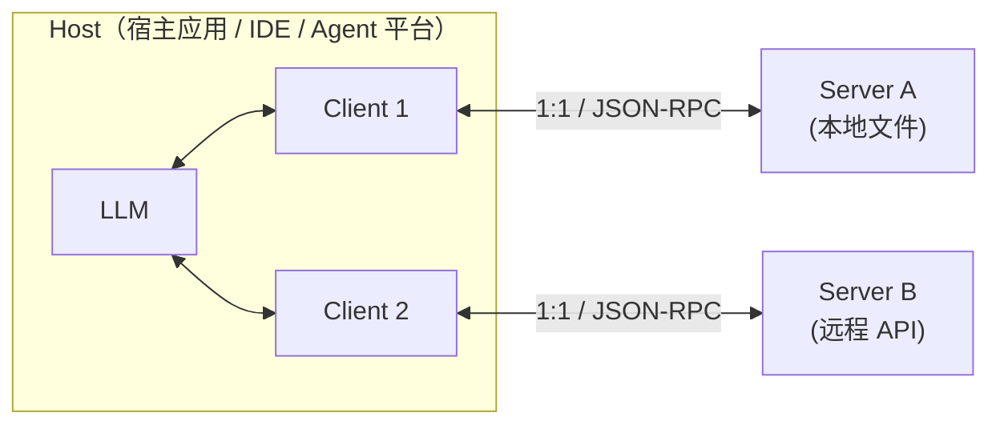
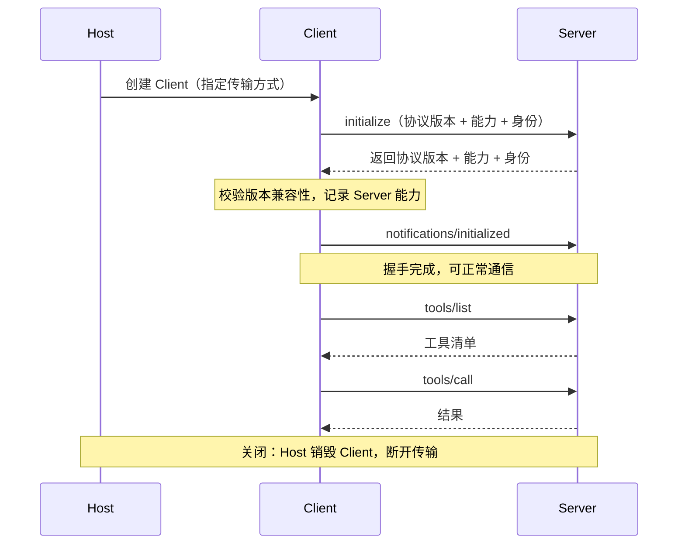

# MCP Client（模型上下文协议客户端）

## 结论

**MCP Client 是宿主应用内部、与单个 MCP Server 保持 1:1 连接的协议客户端。** 它做三件事：**握手协商能力**、**主动向 Server 发请求**（列工具、调工具、读资源）、**响应 Server 的反向请求**（采样、查根目录、问用户）。

> 一句话：**Client 是 Host 派出去专职对接某一个 Server 的"联络员"。**

## 一、Client 在架构中的位置



### 三个角色的分工

| 角色 | 职责 | 例子 |
|------|------|------|
| **Host** | 运行 LLM、管理多个 Client、把工具暴露给模型 | IDE、桌面客户端、Agent 平台 |
| **Client** | 与**一个** Server 通信、维护会话状态 | Host 内部的连接器对象 |
| **Server** | 提供 Tools / Resources / Prompts | 文件服务、数据库网关 |

### 铁律：Client 与 Server 是 1:1

- Host 要连 3 个 Server → 必须创建 **3 个 Client**
- 一个 Client **不负责**多路复用多个 Server
- 这条约束决定了 Client 的状态机可以很简单：**一个连接、一个生命周期**

## 二、Client 的六项职责

| # | 职责 | 说明 |
|---|------|------|
| 1 | **建立连接** | 通过 stdio 或 Streamable HTTP 连到 Server |
| 2 | **握手与能力协商** | `initialize` 交换协议版本与双方能力 |
| 3 | **发起请求** | `tools/list`、`tools/call`、`resources/read`… |
| 4 | **响应反向请求** | 处理 `sampling/createMessage`、`roots/list`、`elicitation/create` |
| 5 | **处理通知** | 工具列表变更、资源更新、进度、取消 |
| 6 | **管理生命周期** | 关闭连接、清理资源、错误上报 |

## 三、生命周期与握手



### 3.1 `initialize` 请求

```json
{
  "jsonrpc": "2.0",
  "id": 1,
  "method": "initialize",
  "params": {
    "protocolVersion": "2025-06-18",
    "capabilities": {
      "roots": { "listChanged": true },
      "sampling": {},
      "elicitation": {}
    },
    "clientInfo": {
      "name": "my-host",
      "version": "1.0.0"
    }
  }
}
```

### 3.2 服务端响应

```json
{
  "jsonrpc": "2.0",
  "id": 1,
  "result": {
    "protocolVersion": "2025-06-18",
    "capabilities": {
      "tools": { "listChanged": true },
      "resources": { "subscribe": true, "listChanged": true },
      "prompts": { "listChanged": true }
    },
    "serverInfo": { "name": "weather", "version": "1.0.0" }
  }
}
```

### 3.3 完成通知

```json
{ "jsonrpc": "2.0", "method": "notifications/initialized" }
```

### 3.4 握手阶段的三个要点

| 要点 | 说明 |
|------|------|
| **版本协商** | Client 发送自己支持的版本；Server 若不支持，会返回它支持的版本，**Client 必须校验能否兼容**，不能兼容就断开 |
| **能力协商** | 双方各自声明支持什么，**后续只使用对方声明支持的能力** |
| **先记录再使用** | Server 的 `capabilities` 要存下来，决定后续能否调 `resources/read` 等 |

> **握手失败 = 立即断开**。不要"先连上再说"，否则后续调用会以难以理解的方式失败。

## 四、Client 能力声明（Capabilities）

Client 在 `initialize` 中声明**自己能支持哪些由 Server 反向发起的请求**：

| 能力 | 声明形式 | 含义 |
|------|----------|------|
| **roots** | `{"listChanged": true}` | 支持告知 Server 可访问的文件系统边界，且边界变化时会通知 |
| **sampling** | `{}` | 支持 Server 请求宿主调用 LLM 生成内容 |
| **elicitation** | `{}` | 支持 Server 向用户请求补充信息 |
| **experimental** | 自定义 | 实验性能力 |

**关键**：Client **不声明**某项能力，Server **就不应该**发起对应请求。这是"协商"的意义。

## 五、Client 主动发起的方法（Client → Server）

| 方法 | 作用 | 依赖 Server 能力 |
|------|------|------------------|
| `tools/list` | 列出所有工具 | `tools` |
| `tools/call` | 调用工具 | `tools` |
| `resources/list` | 列出资源 | `resources` |
| `resources/templates/list` | 列出资源模板 | `resources` |
| `resources/read` | 读取资源内容 | `resources` |
| `resources/subscribe` | 订阅资源变化 | `resources.subscribe` |
| `resources/unsubscribe` | 取消订阅 | `resources.subscribe` |
| `prompts/list` | 列出提示模板 | `prompts` |
| `prompts/get` | 获取提示内容 | `prompts` |
| `completion/complete` | 参数自动补全 | `completions` |
| `ping` | 健康检查 | 无 |

### 5.1 `tools/call` 的调用与返回

```json
{
  "jsonrpc": "2.0",
  "id": 2,
  "method": "tools/call",
  "params": {
    "name": "get_weather",
    "arguments": { "city": "北京" }
  }
}
```

```json
{
  "jsonrpc": "2.0",
  "id": 2,
  "result": {
    "content": [
      { "type": "text", "text": "北京：25℃，晴" }
    ],
    "isError": false
  }
}
```

> **注意**：工具执行失败不一定是 JSON-RPC 错误。MCP 允许用 `isError: true` 在 **result 内部**表达"业务失败"，JSON-RPC 层的 `error` 保留给**协议级错误**（参数格式错、方法不存在等）。这个区分很重要。

## 六、Client 必须实现的反向处理器（Server → Client）

这是 Client 与"简单 HTTP 客户端"最大的不同：**Server 也可以向 Client 发请求**。

### 6.1 `sampling/createMessage` —— Server 借用宿主的模型

Server 自己没有模型，但想用 LLM 处理点东西时，向 Client 请求：

```json
{
  "jsonrpc": "2.0",
  "id": 42,
  "method": "sampling/createMessage",
  "params": {
    "messages": [
      { "role": "user", "content": { "type": "text", "text": "总结这段日志" } }
    ],
    "maxTokens": 200
  }
}
```

Client 收到后：**调用宿主的 LLM 生成结果 → 把结果作为响应返回**。

> 意义：Server 不需要持有 API Key，也能"借用"模型能力。但也意味着 **Client 必须对采样内容做安全判断**（是否有害、是否该拒绝）。

### 6.2 `roots/list` —— 询问可访问边界

```json
{ "jsonrpc": "2.0", "id": 43, "method": "roots/list" }
```

Client 返回它允许 Server 访问的目录列表：

```json
{
  "jsonrpc": "2.0",
  "id": 43,
  "result": {
    "roots": [
      { "uri": "file:///workspace/project", "name": "project" }
    ]
  }
}
```

> 这是**权限边界**的实现方式：Server 只应在这些根目录下操作。

### 6.3 `elicitation/create` —— 向用户要信息

Server 发现信息不足，请求 Client 向用户提问。Client 负责弹出 UI 收集输入再返回。

## 七、通知处理

Client 必须能接收并处理以下通知（无需响应）：

| 通知 | 来源 | Client 该做什么 |
|------|------|-----------------|
| `notifications/tools/list_changed` | Server | 重新 `tools/list`，刷新工具清单 |
| `notifications/resources/list_changed` | Server | 刷新资源列表 |
| `notifications/resources/updated` | Server | 更新已订阅的资源 |
| `notifications/prompts/list_changed` | Server | 刷新提示模板 |
| `notifications/progress` | Server | 更新进度条 |
| `notifications/cancelled` | Server | 中止对应请求 |
| `notifications/roots/list_changed` | **Client 发出** | 告知 Server 根目录变了 |

> **最容易漏掉的是 `tools/list_changed`**：Server 动态增删工具时，Client 不刷新就会一直用过期清单。

## 八、传输层接入

### 8.1 stdio（本地进程）

Host 直接拉起 Server 子进程，通过 stdin/stdout 通信。

```python
import asyncio
from mcp import ClientSession, StdioServerParameters
from mcp.client.stdio import stdio_client


async def main():
    params = StdioServerParameters(
        command="python",
        args=["server.py"],
        env={"API_KEY": "..."},       # 可选：给子进程的环境变量
    )

    async with stdio_client(params) as (read, write):
        async with ClientSession(read, write) as session:
            await session.initialize()                       # 握手

            tools = await session.list_tools()
            for t in tools.tools:
                print(t.name, "-", t.description)

            result = await session.call_tool(
                "get_weather", {"city": "北京"}
            )
            print(result.content)


asyncio.run(main())
```

### 8.2 Streamable HTTP（远程服务）

```python
from mcp.client.streamable_http import streamablehttp_client

async with streamablehttp_client("https://example.com/mcp") as (read, write, _):
    async with ClientSession(read, write) as session:
        await session.initialize()
        ...
```

> 旧的 **HTTP+SSE** 传输已废弃，新接入请用 **Streamable HTTP**。

### 8.3 传输选择

| 场景 | 传输 | 理由 |
|------|------|------|
| 本地文件、本地脚本 | **stdio** | 简单、无需网络、天然隔离 |
| 云端服务、多用户 | **Streamable HTTP** | 可远程、可鉴权、可水平扩展 |
| 旧系统兼容 | ~~HTTP+SSE~~ | 已废弃，仅过渡 |

## 九、完整实现示例（带反向处理器）

```python
import asyncio
from mcp import ClientSession, StdioServerParameters
from mcp.client.stdio import stdio_client
from mcp.shared.context import RequestContext
from mcp.types import (
    CreateMessageRequestParams,
    CreateMessageResult,
    ListRootsResult,
    Root,
    TextContent,
)


async def handle_sampling(
    context: RequestContext, params: CreateMessageRequestParams
) -> CreateMessageResult:
    """Server 请求借用模型：这里对接你自己的 LLM。"""
    # 安全：先审核 params.messages 是否合规
    answer = await my_llm_call(params.messages, max_tokens=params.maxTokens)
    return CreateMessageResult(
        role="assistant",
        content=TextContent(type="text", text=answer),
        model="my-model",
    )


async def handle_roots(context) -> ListRootsResult:
    """告知 Server 可访问的目录边界。"""
    return ListRootsResult(
        roots=[Root(uri="file:///workspace/project", name="project")]
    )


async def main():
    params = StdioServerParameters(command="python", args=["server.py"])

    async with stdio_client(params) as (read, write):
        async with ClientSession(
            read,
            write,
            sampling_callback=handle_sampling,
            list_roots_callback=handle_roots,
        ) as session:
            await session.initialize()

            tools = await session.list_tools()
            print(f"可用工具 {len(tools.tools)} 个")

            result = await session.call_tool("get_weather", {"city": "北京"})
            for block in result.content:
                if block.type == "text":
                    print(block.text)


asyncio.run(main())
```

> 回调参数名以 **Python SDK 当前版本文档**为准；不同 SDK 语言/版本命名略有差异。

## 十、Host 视角：管理多个 Client

一个 Host 通常要连多个 Server，需要处理三件事：

| 问题 | 处理方式 |
|------|----------|
| **工具重名** | 加前缀（`weather__get_weather`）或按 Server 命名空间隔离 |
| **故障隔离** | 单个 Server 挂掉不能拖垮整个 Host |
| **工具聚合** | 把所有 Server 的工具汇总成一份给模型的函数定义列表 |

```python
# 概念示意
all_tools = []
for client in clients:
    tools = await client.list_tools()
    for t in tools.tools:
        all_tools.append(prefix_tool(client.name, t))
```

## 十一、错误处理与取消

### 11.1 JSON-RPC 标准错误码

| 码 | 含义 |
|----|------|
| `-32700` | Parse error（JSON 解析失败） |
| `-32600` | Invalid Request |
| `-32601` | Method not found |
| `-32602` | Invalid params |
| `-32603` | Internal error |
| `-32002` | Resource not found |

### 11.2 两类错误要分清

| 类型 | 表现 | 处理 |
|------|------|------|
| **协议级错误** | JSON-RPC `error` 字段 | 记录日志，可能是实现 bug，**不要重试** |
| **业务级失败** | `result.isError = true` | 把错误信息回灌给模型，让模型调整参数后重试 |

### 11.3 超时与取消

- 每个请求都应有**超时**
- 超时后发 `notifications/cancelled` 通知 Server 中止
- 长任务应支持 `notifications/progress`，避免误判超时

## 十二、安全

| 风险 | 说明 | 防护 |
|------|------|------|
| **恶意 Server** | 暴露危险工具诱导模型调用 | 只连可信 Server，审查工具清单 |
| **工具描述投毒** | 工具 description 里藏指令 | 人工审阅工具描述 |
| **Sampling 滥用** | Server 借宿主模型做恶意生成 | 审核采样请求，记录日志，可拒绝 |
| **Roots 越界** | Server 试图访问边界外文件 | 严格限制 roots，路径做规范化校验 |
| **远程鉴权** | 未鉴权的 HTTP Server | 使用 **OAuth 2.1** 等标准机制 |
| **数据外泄** | Server 上传敏感数据 | 网络出口管控 + 审计 |

> **核心原则**：Client 是"权限守门人"。**Server 永远不会比 Client 授予它的权限更多。**

## 十三、常见误区

| 误区 | 事实 |
|------|------|
| "一个 Client 连多个 Server" | ❌ **1:1**，多 Server 要多 Client |
| "Client 只发请求" | ❌ 还要实现采样/roots/elicitation 的**反向处理器** |
| "工具失败就是 JSON-RPC error" | ❌ 业务失败用 `isError`，协议错误才用 `error` |
| "握手可以跳过" | ❌ 不 `initialize` 就发请求，Server 会拒绝 |
| "能力不用记录" | ❌ 不记录 Server 能力，就会调用它不支持的方法 |
| "通知可以忽略" | ❌ 漏掉 `tools/list_changed` 会一直用过期工具清单 |

## 十四、Checklist

**握手**
- [ ] 发送 `protocolVersion` / `capabilities` / `clientInfo`
- [ ] 校验 Server 返回的协议版本是否兼容
- [ ] 记录 Server 能力
- [ ] 握手后发送 `notifications/initialized`

**能力**
- [ ] 按需声明 roots / sampling / elicitation
- [ ] 未声明的能力不被使用

**反向处理器**
- [ ] 实现 `sampling/createMessage`（含安全审核）
- [ ] 实现 `roots/list`
- [ ] 实现 `elicitation/create`（若声明）

**通知**
- [ ] 处理 `tools/list_changed` 并刷新
- [ ] 处理 `resources/updated`
- [ ] 处理 `progress` 与 `cancelled`

**工程**
- [ ] 每个请求有超时
- [ ] 区分协议错误与业务失败
- [ ] 多 Server 场景处理工具重名
- [ ] 记录完整调用日志

## 十五、总结

**MCP Client 的职责可以浓缩成"一守三门"：**

- **守**住握手与能力协商这道门——先谈好版本和能力，再干活
- **出**门（Client → Server）：列工具、调工具、读资源
- **进**门（Server → Client）：采样、查根目录、问用户
- **守**住权限边界——Server 的权限永远不超出 Client 授予的范围

理解了"**Client 是 1:1 的联络员，同时兼任权限守门人**"，MCP 的整个架构就通了。
