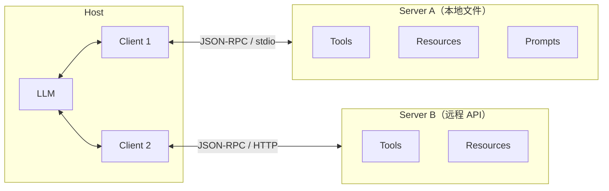

# MCP Server（模型上下文协议服务端）

## 结论

**MCP Server 是"能力的提供方"**：它把一组 **Tools（工具）/ Resources（资源）/ Prompts（提示模板）** 用统一接口暴露出去，任何 MCP Client 连上后都能**自动发现并调用**，无需定制集成。

> 一句话：**Client 是联络员，Server 是供货方。** Server 决定"我能提供什么"，Client 决定"用不用、怎么用"。

## 一、Server 的定位与职责



### 职责清单

| # | 职责 | 说明 |
|---|------|------|
| 1 | **响应握手** | 处理 `initialize`，返回协议版本、能力、身份 |
| 2 | **暴露能力** | 实现 `tools/*`、`resources/*`、`prompts/*` |
| 3 | **执行实际逻辑** | 真正查库、读文件、调 API——**活是 Server 干的** |
| 4 | **主动通知变更** | 工具/资源/提示变化时推通知 |
| 5 | **必要时反向请求** | 借用宿主模型（sampling）、询问用户（elicitation） |

### 与 Client 的分工边界

| | Server | Client |
|---|--------|--------|
| **知道什么** | 自己有哪些工具、怎么执行 | 有哪些 Server、模型要什么 |
| **不能做什么** | 不能直接调 LLM（要借 sampling） | 不能直接执行业务逻辑 |
| **权限来源** | 由 Client 授予 | 由 Host/用户授予 |

> **Server 永远不会比 Client 授予它的权限更多**——这条约束是 MCP 安全模型的基础。

## 二、Server 能力声明（Capabilities）

在 `initialize` 的响应里声明自己支持什么：

```json
{
  "jsonrpc": "2.0",
  "id": 1,
  "result": {
    "protocolVersion": "2025-06-18",
    "capabilities": {
      "tools": { "listChanged": true },
      "resources": { "subscribe": true, "listChanged": true },
      "prompts": { "listChanged": true },
      "logging": {},
      "completions": {}
    },
    "serverInfo": {
      "name": "weather-server",
      "version": "1.0.0"
    }
  }
}
```

| 能力 | 子字段 | 含义 |
|------|--------|------|
| **tools** | `listChanged` | 工具列表会动态变化，变更时发通知 |
| **resources** | `subscribe` / `listChanged` | 支持订阅资源更新 / 列表会变化 |
| **prompts** | `listChanged` | 提示模板会动态变化 |
| **logging** | `{}` | 支持向 Client 推送日志 |
| **completions** | `{}` | 支持参数自动补全 |
| **experimental** | 自定义 | 实验性能力 |

### 铁律：声明即承诺

| 你声明了 | 就必须 |
|----------|--------|
| `listChanged: true` | 变化时**主动发** `notifications/*/list_changed` |
| `subscribe: true` | 实现 `resources/subscribe` / `unsubscribe` |
| `logging` | 能处理 `logging/setLevel` 并推送 `notifications/message` |

**声明了不实现 = 协议违规**，Client 会一直等一个不来的通知。

## 三、三大原语（Server 的核心产出）

### 3.1 Tools（工具）—— 模型决定何时调用

工具是**有副作用的可执行函数**，由**模型**自主决定调用。

#### 工具定义（`tools/list` 返回）

```json
{
  "jsonrpc": "2.0",
  "id": 1,
  "result": {
    "tools": [
      {
        "name": "get_weather",
        "description": "查询指定城市的实时天气。用户询问天气时使用。",
        "inputSchema": {
          "type": "object",
          "properties": {
            "city": { "type": "string", "description": "城市名称，如 北京" }
          },
          "required": ["city"]
        }
      }
    ]
  }
}
```

| 字段 | 必需 | 说明 |
|------|------|------|
| `name` | ✅ | 工具标识，建议 `snake_case` |
| `description` | 强烈建议 | **模型靠它决定是否调用**，写清"何时用" |
| `inputSchema` | ✅ | **JSON Schema**，参数类型与约束 |
| `outputSchema` | 可选 | 输出结构（较新规范支持） |
| `annotations` | 可选 | 行为提示，见下 |

#### 工具调用与结果（`tools/call`）

**请求**：

```json
{
  "jsonrpc": "2.0",
  "id": 2,
  "method": "tools/call",
  "params": {
    "name": "get_weather",
    "arguments": { "city": "北京" }
  }
}
```

**成功响应**：

```json
{
  "jsonrpc": "2.0",
  "id": 2,
  "result": {
    "content": [
      { "type": "text", "text": "北京：25℃，晴" }
    ],
    "isError": false
  }
}
```

**内容块（content）支持的类型**：

| type | 说明 |
|------|------|
| `text` | 纯文本 |
| `image` | base64 图片 |
| `audio` | 音频 |
| `resource` | 内嵌资源（把资源塞进工具结果） |
| `resource_link` | 资源引用（只给 URI，不塞内容） |

#### 业务失败 vs 协议错误

| 情况 | 怎么做 |
|------|--------|
| 工具执行失败（查无数据、参数业务上不合法） | `result.isError = true`，并在 `content` 里给出**可读错误信息** |
| 协议级错误（工具不存在、参数不符合 schema） | JSON-RPC `error` 字段 |

> **区分这两者极其重要**：`isError` 会作为"观察结果"回灌给模型，模型可据此调整重试；JSON-RPC error 通常意味着实现 bug。

#### 工具注解（annotations）

给 Client 和用户的行为提示（**是提示，不是强制**）：

| 注解 | 含义 |
|------|------|
| `title` | 人类可读标题 |
| `readOnlyHint` | 只读，无副作用 |
| `destructiveHint` | 可能执行破坏性更新 |
| `idempotentHint` | 重复调用结果一致 |
| `openWorldHint` | 会与外部世界交互 |

### 3.2 Resources（资源）—— 应用决定何时读取

资源是**只读的上下文数据**，用 **URI** 标识，由**应用**决定何时注入给模型。

#### 静态资源（`resources/list`）

```json
{
  "jsonrpc": "2.0",
  "id": 3,
  "result": {
    "resources": [
      {
        "uri": "file:///project/README.md",
        "name": "README",
        "description": "项目说明",
        "mimeType": "text/markdown"
      }
    ]
  }
}
```

#### 资源模板（`resources/templates/list`）

当资源是"一类"而非"一个"时，用 URI 模板：

```json
{
  "jsonrpc": "2.0",
  "id": 4,
  "result": {
    "resourceTemplates": [
      {
        "uriTemplate": "users://{userId}/profile",
        "name": "用户资料",
        "mimeType": "application/json"
      }
    ]
  }
}
```

#### 读取资源（`resources/read`）

```json
{
  "jsonrpc": "2.0",
  "id": 5,
  "method": "resources/read",
  "params": { "uri": "file:///project/README.md" }
}
```

```json
{
  "jsonrpc": "2.0",
  "id": 5,
  "result": {
    "contents": [
      {
        "uri": "file:///project/README.md",
        "mimeType": "text/markdown",
        "text": "# Project\n..."
      }
    ]
  }
}
```

#### 订阅与更新

若声明了 `subscribe: true`：

```json
{ "method": "resources/subscribe", "params": { "uri": "file:///project/README.md" } }
```

资源变化时 Server 主动推送：

```json
{
  "jsonrpc": "2.0",
  "method": "notifications/resources/updated",
  "params": { "uri": "file:///project/README.md" }
}
```

### 3.3 Prompts（提示模板）—— 用户主动选择

提示模板是**预置的、带参数的消息模板**，通常对应客户端里的斜杠命令。

#### 列表（`prompts/list`）

```json
{
  "jsonrpc": "2.0",
  "id": 6,
  "result": {
    "prompts": [
      {
        "name": "review_code",
        "description": "按团队规范评审代码",
        "arguments": [
          { "name": "code", "description": "待评审代码", "required": true }
        ]
      }
    ]
  }
}
```

#### 获取（`prompts/get`）

```json
{
  "jsonrpc": "2.0",
  "id": 7,
  "method": "prompts/get",
  "params": {
    "name": "review_code",
    "arguments": { "code": "def f(): pass" }
  }
}
```

```json
{
  "jsonrpc": "2.0",
  "id": 7,
  "result": {
    "description": "按团队规范评审代码",
    "messages": [
      {
        "role": "user",
        "content": { "type": "text", "text": "请评审这段代码：\ndef f(): pass" }
      }
    ]
  }
}
```

### 3.4 三者对比

| | Tools | Resources | Prompts |
|---|-------|-----------|---------|
| **控制方** | 模型 | 应用 | 用户 |
| **副作用** | 可能有 | 无（只读） | 无 |
| **标识** | `name` | `uri` | `name` |
| **类比** | 做一件事 | 看一眼资料 | 点一个按钮 |

## 四、Server 必须实现的方法

| 方法 | 何时必须实现 |
|------|--------------|
| `initialize` | **永远**（协议入口） |
| `ping` | 建议 |
| `tools/list` / `tools/call` | 声明了 `tools` |
| `resources/list` / `resources/read` | 声明了 `resources` |
| `resources/templates/list` | 有模板资源 |
| `resources/subscribe` / `unsubscribe` | 声明了 `subscribe` |
| `prompts/list` / `prompts/get` | 声明了 `prompts` |
| `completion/complete` | 声明了 `completions` |
| `logging/setLevel` | 声明了 `logging` |

## 五、Server 主动发起的能力

Server 不只是"被调用"，也可以主动向 Client 请求：

| 能力 | 方法 | 用途 | 前提 |
|------|------|------|------|
| **Sampling** | `sampling/createMessage` | 借用宿主的模型做生成 | Client 声明了 `sampling` |
| **Roots** | `roots/list` | 询问可访问的文件边界 | Client 声明了 `roots` |
| **Elicitation** | `elicitation/create` | 向用户提问补充信息 | Client 声明了 `elicitation` |

```json
{
  "jsonrpc": "2.0",
  "id": 99,
  "method": "sampling/createMessage",
  "params": {
    "messages": [
      { "role": "user", "content": { "type": "text", "text": "总结这段日志" } }
    ],
    "maxTokens": 200
  }
}
```

> **注意**：必须**先检查 Client 是否声明了该能力**，否则请求会被拒绝。

## 六、Server 主动推送的通知

| 通知 | 触发时机 | 前提 |
|------|----------|------|
| `notifications/tools/list_changed` | 工具增删 | `tools.listChanged` |
| `notifications/resources/list_changed` | 资源增删 | `resources.listChanged` |
| `notifications/resources/updated` | 已订阅资源内容变化 | `resources.subscribe` |
| `notifications/prompts/list_changed` | 提示模板变化 | `prompts.listChanged` |
| `notifications/message` | 日志输出 | `logging` |
| `notifications/progress` | 长任务进度 | 请求带 `progressToken` |
| `notifications/cancelled` | 取消某个请求 | 无 |

**进度通知示例**：

```json
{
  "jsonrpc": "2.0",
  "method": "notifications/progress",
  "params": {
    "progressToken": "abc123",
    "progress": 30,
    "total": 100
  }
}
```

## 七、传输层

| 传输 | 适用 | 要点 |
|------|------|------|
| **stdio** | 本地进程 | Host 拉起子进程，走 stdin/stdout；**日志必须写 stderr**，否则污染协议流 |
| **Streamable HTTP** | 远程服务 | 需鉴权（OAuth 2.1 等），可水平扩展 |
| ~~HTTP + SSE~~ | 已废弃 | 不要在新项目中采用 |

> **stdio 最常见的翻车点**：往 stdout 打印调试信息。**stdout 是协议通道，任何非 JSON-RPC 输出都会导致解析失败。**

## 八、完整实现示例

### 8.1 FastMCP 版（推荐）

```python
from mcp.server.fastmcp import FastMCP

mcp = FastMCP("demo-server")


# ---------- Tools ----------
@mcp.tool()
def get_weather(city: str) -> str:
    """查询指定城市的实时天气。用户询问天气时使用。

    Args:
        city: 城市名称，如"北京"
    """
    return f"{city}：25℃，晴"


# ---------- Resources ----------
@mcp.resource("config://app")
def get_config() -> str:
    """应用配置。"""
    return '{"theme": "dark", "lang": "zh"}'


@mcp.resource("users://{user_id}/profile")
def get_profile(user_id: str) -> str:
    """用户资料（模板资源）。"""
    return f'{{"id": "{user_id}", "name": "User {user_id}"}}'


# ---------- Prompts ----------
@mcp.prompt()
def review_code(code: str) -> str:
    """按团队规范评审代码。"""
    return f"请评审以下代码，指出安全问题与改进点：\n\n{code}"


if __name__ == "__main__":
    mcp.run()   # 默认 stdio 传输
```

**三个装饰器对应三大原语**：

| 装饰器 | 产生 | 参数来源 |
|--------|------|----------|
| `@mcp.tool()` | Tool | 函数签名 → `inputSchema` |
| `@mcp.resource(uri)` | Resource | URI 中的 `{var}` → 模板变量 |
| `@mcp.prompt()` | Prompt | 函数签名 → 模板参数 |

> **docstring 会自动变成 `description`**——所以 docstring 写得好不好，直接决定模型会不会正确调用。

### 8.2 远程部署（Streamable HTTP）

```python
if __name__ == "__main__":
    mcp.run(transport="streamable-http")   # 具体参数以 SDK 版本文档为准
```

## 九、工具设计最佳实践

### 9.1 命名与描述

| 原则 | 反例 | 正例 |
|------|------|------|
| **动词开头** | `weather` | `get_weather` |
| **描述写"何时用"** | `"天气工具"` | `"查询实时天气。用户询问天气、出行建议时使用。"` |
| **参数有说明** | `city: string` | `city: "城市名称，如 北京、上海"` |
| **标明边界** | — | `"仅支持中国主要城市"` |

### 9.2 粒度

| ❌ 过粗 | ✅ 合适 |
|---------|---------|
| `do_everything(action, params)` | `search_orders`、`get_order_detail`、`cancel_order` |

**粒度原则：一个工具做一件可命名的事。** 过粗会让模型不知道传什么参数，过细则工具数量爆炸、选择准确率下降。

### 9.3 返回值

```python
# ❌ 返回一大坨不易读的字符串
return str(raw_object)

# ✅ 结构化 + 截断 + 明确字段
return {
    "city": city,
    "temp": 25,
    "desc": "晴",
    "updated": "2026-11-06T10:00:00Z",
}
```

### 9.4 错误处理

```python
@mcp.tool()
def get_order(order_id: str) -> dict:
    """查询订单详情。"""
    try:
        data = db.query(order_id)
    except NotFound:
        return {"ok": False, "error": f"订单 {order_id} 不存在，请确认订单号"}
    except Exception as e:
        return {"ok": False, "error": f"查询失败：{e}，可稍后重试"}
    return {"ok": True, "data": data}
```

> **错误信息要让模型能据此决策**——"查询失败"没用，"订单号不存在，请确认"才有用。

### 9.5 幂等与副作用

- **读操作**标 `readOnlyHint: true`
- **写操作**标 `destructiveHint`，并考虑是否需要确认
- **重复调用是否安全**要明确（`idempotentHint`）

## 十、安全

| 风险 | 说明 | 防护 |
|------|------|------|
| **路径穿越** | 资源 URI 里的 `../` 越界读文件 | 规范化路径 + 白名单根目录 |
| **命令注入** | 工具参数拼进 shell | 禁止拼接，用参数数组 |
| **SSRF** | 工具接受任意 URL 去请求 | 域名白名单 |
| **敏感数据外泄** | 工具返回日志含密钥 | 输出脱敏 |
| **工具投毒** | description 里藏恶意指令 | 自己写的 Server 不要这么干；接入方要审 |
| **未鉴权远程服务** | Streamable HTTP 裸奔 | OAuth 2.1 |
| **stdout 污染** | 调试输出破坏协议 | 日志一律写 stderr |

> **Server 是权限的实际执行者**：所有校验都必须在 Server 侧做，**不能依赖 Client 或模型的自觉**。

## 十一、常见误区

| 误区 | 事实 |
|------|------|
| "Server 声明了能力不实现也没事" | ❌ 声明即承诺，Client 会等一个不会来的通知 |
| "工具失败要抛 JSON-RPC error" | ❌ 业务失败用 `isError`，协议错误才用 `error` |
| "Server 可以直接调 LLM" | ❌ Server 没有模型，只能通过 `sampling` 借用 |
| "resources 就是给模型读的" | ❌ 资源由**应用**决定何时注入，不是模型主动读 |
| "stdio 下可以随便 print" | ❌ stdout 是协议通道，print 会破坏 JSON-RPC 流 |
| "工具越多越好" | ❌ 工具过多会显著降低模型选择准确率 |
| "描述随便写" | ❌ `description` 是模型选工具的唯一依据 |

## 十二、Checklist

**握手**
- [ ] 返回 `protocolVersion` / `capabilities` / `serverInfo`
- [ ] 只声明**确实实现了**的能力

**Tools**
- [ ] `inputSchema` 是合法 JSON Schema
- [ ] `description` 写明"做什么 + 何时用 + 边界"
- [ ] 业务失败用 `isError: true` + 可读信息
- [ ] 参数在服务端**独立校验**（不信任模型传值）

**Resources**
- [ ] URI 唯一且语义清晰
- [ ] 路径做规范化，防穿越
- [ ] 声明了 `subscribe` 就实现订阅与 `updated` 通知

**Prompts**
- [ ] 参数标 `required`
- [ ] 模板内容与团队规范一致

**工程**
- [ ] stdio 下日志写 **stderr**
- [ ] 长任务支持 `progress`
- [ ] 动态变化时发对应 `list_changed`
- [ ] 远程服务启用鉴权

## 十三、总结

**MCP Server 的本质是"把能力标准化地交出去"：**

- **宣告**：`initialize` 里声明能力，**声明即承诺**
- **供货**：Tools（模型调）、Resources（应用读）、Prompts（用户选）
- **反馈**：变更发通知，长任务发进度，失败用 `isError`
- **守界**：所有校验在服务端做，权限不越 Client 授予的边界

写一个好的 MCP Server，**80% 的功夫在工具设计上**——名字清楚、描述准确、粒度合适、错误可读。协议本身很薄，难的是让模型"用得对"。
