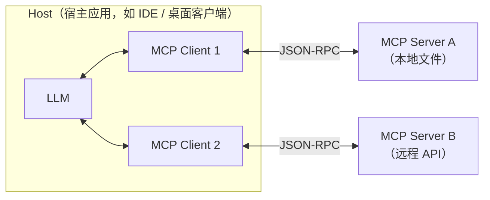
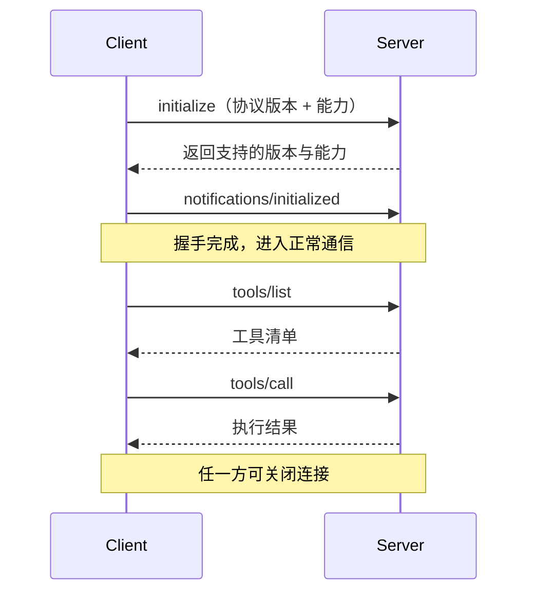

# MCP（Model Context Protocol）

## 结论

**MCP 是一个开放协议，用于标准化"AI 应用 ↔ 外部数据源与工具"之间的连接方式。** 它基于 **JSON-RPC 2.0**，把"模型能用什么工具、能读什么数据"抽象成**可发现的统一接口**，从而把过去 **N×M 的定制集成**变成 **N+M 的即插即用**。

> 官方类比：**MCP 是 AI 应用的 "USB-C 接口"**——一个标准口，接所有外设。

## 一、官方定义

| 项目 | 信息 |
|------|------|
| **全称** | Model Context Protocol（模型上下文协议） |
| **提出方** | Anthropic |
| **发布时间** | 2024 年 11 月，**开源** |
| **协议基础** | **JSON-RPC 2.0** |
| **官方描述** | "An open standard that enables developers to build secure, two-way connections between their data sources and AI-powered tools."（开放标准，让开发者在数据源与 AI 工具之间建立安全的双向连接） |
| **官网** | https://modelcontextprotocol.io/ |
| **规范** | https://modelcontextprotocol.io/specification |

> 它解决的不是"模型怎么推理"，而是"**模型怎么找到并接入外部能力**"。

## 二、要解决什么问题：N×M → N+M

**MCP 之前**：

```
N 个 AI 应用 × M 个数据源 = N×M 套定制集成
（Claude 接数据库要写一套，Cursor 接同一个数据库又要写一套…）
```

**MCP 之后**：

```
每个应用实现 MCP Client 一次（N）
每个数据源实现 MCP Server 一次（M）
总工作量 = N + M
```

| 维度 | 没有 MCP | 有 MCP |
|------|----------|--------|
| 集成数量 | N×M | N+M |
| 复用性 | 每个应用重复造轮子 | 服务一次实现，处处可用 |
| 生态 | 封闭 | 开放，第三方可贡献 Server |

## 三、核心架构：Host / Client / Server



| 角色 | 职责 |
|------|------|
| **Host（宿主）** | 运行 LLM 的应用程序（IDE、聊天客户端、Agent 平台） |
| **Client（客户端）** | Host 内的连接器，**与一个 Server 保持 1:1 连接** |
| **Server（服务端）** | 对外暴露工具/资源/提示的独立进程或服务 |

**关键约束**：**一个 Client 对应一个 Server**。Host 要连 3 个 Server，就要有 3 个 Client。

## 四、服务端原语（Server Primitives）

Server 向模型侧暴露三类能力，**控制方各不相同**：

| 原语 | 作用 | **谁控制** | 典型例子 |
|------|------|-----------|----------|
| **Tools（工具）** | 可执行的函数 | **模型**决定何时调用 | 查数据库、发 HTTP 请求、写文件 |
| **Resources（资源）** | 可读取的上下文数据 | **应用**决定何时注入 | 文件内容、数据库 schema、日志 |
| **Prompts（提示模板）** | 预置的提示词模板 | **用户**主动选择 | "/code-review" 这类斜杠命令 |

> 这张"谁控制"的表是理解 MCP 的**关键**：
> **模型选工具、应用选资源、用户选提示。**

### 4.1 Tools 与 Resources 的区别

| | Tools | Resources |
|---|-------|-----------|
| 是否有副作用 | 可能有（写、发、删） | 只读 |
| 调用方式 | 模型主动调用 | 应用按需读取 |
| 类比 | "做一件事" | "看一眼资料" |

## 五、客户端原语（Client Primitives）

反向能力——**Server 也可以向 Client 请求东西**：

| 原语 | 作用 |
|------|------|
| **Sampling（采样）** | Server 请求 Client 调用 LLM 生成内容（Server 无需自带模型） |
| **Roots（根目录）** | Client 告知 Server 可访问的文件系统边界 |
| **Elicitation（引导）** | Server 向用户请求补充信息（较新版本引入） |

> Sampling 的意义：让 Server 能"借用"宿主的模型，而不必自己持有 API Key。

## 六、传输层（Transports）

| 传输方式 | 适用场景 | 说明 |
|----------|----------|------|
| **stdio（标准输入输出）** | 本地进程 | 最简单，Host 直接拉起 Server 子进程，走 stdin/stdout |
| **Streamable HTTP** | 远程服务 | 当前推荐的 HTTP 传输方式 |
| ~~HTTP + SSE~~ | 已废弃 | 早期方案，已被 Streamable HTTP 取代 |

**选择原则**：

- 本地工具（读写本机文件、跑本地脚本）→ **stdio**
- 云服务 / 多用户共享 → **Streamable HTTP**
- **不要再用旧的 HTTP+SSE 方案**

## 七、通信协议：JSON-RPC 2.0

所有消息都是 JSON-RPC 2.0 格式，三种类型：**请求（有 id）、响应（有 id）、通知（无 id）**。

### 7.1 请求与响应示例

**调用工具**：

```json
{
  "jsonrpc": "2.0",
  "id": 1,
  "method": "tools/call",
  "params": {
    "name": "get_weather",
    "arguments": { "city": "北京" }
  }
}
```

**返回结果**：

```json
{
  "jsonrpc": "2.0",
  "id": 1,
  "result": {
    "content": [
      { "type": "text", "text": "北京：25℃，晴" }
    ]
  }
}
```

### 7.2 常用方法

| 方法 | 方向 | 作用 |
|------|------|------|
| `initialize` | Client → Server | 握手、协商能力与协议版本 |
| `notifications/initialized` | Client → Server | 通知握手完成 |
| `tools/list` | Client → Server | 列出所有工具 |
| `tools/call` | Client → Server | 调用某个工具 |
| `resources/list` | Client → Server | 列出资源 |
| `resources/read` | Client → Server | 读取资源内容 |
| `prompts/list` | Client → Server | 列出提示模板 |
| `prompts/get` | Client → Server | 获取提示模板内容 |
| `sampling/createMessage` | Server → Client | 请求宿主调用 LLM |
| `roots/list` | Server → Client | 查询可访问的根目录 |
| `notifications/tools/list_changed` | Server → Client | 工具列表变更通知 |

## 八、生命周期



**核心是"能力协商"**：双方在 `initialize` 阶段声明自己支持哪些特性（如是否支持 sampling、resources 等），**只使用对方声明支持的能力**。

## 九、一个最小可用示例

### 9.1 服务端（Python，FastMCP）

```python
# server.py
from mcp.server.fastmcp import FastMCP

mcp = FastMCP("weather")


@mcp.tool()
def get_weather(city: str) -> str:
    """查询指定城市的实时天气。

    Args:
        city: 城市名称，如"北京"
    """
    return f"{city}：25℃，晴"


@mcp.resource("config://app")
def get_config() -> str:
    """返回应用配置。"""
    return '{"theme": "dark"}'


if __name__ == "__main__":
    mcp.run()   # 默认使用 stdio 传输
```

### 9.2 客户端配置（以支持 MCP 的宿主为例）

```json
{
  "mcpServers": {
    "weather": {
      "command": "python",
      "args": ["server.py"]
    }
  }
}
```

> 配置字段名以你所使用宿主的文档为准，不同客户端略有差异。

## 十、MCP vs Function Calling vs Skill

这三者经常被混淆，实际是**不同层次**的东西：

| 维度 | Function Calling | MCP | Skill |
|------|------------------|-----|-------|
| **层级** | 模型层 | **协议/传输层** | 知识/流程层 |
| **解决什么** | 模型怎么**输出**调用意图 | 工具怎么**被发现和连接** | 任务**怎么做** |
| **形态** | JSON Schema | JSON-RPC 协议 | 文件夹（SKILL.md） |
| **跨应用复用** | ❌ 需各自重写 | ✅ 协议级复用 | ✅ 文件级复用 |
| **是否含流程知识** | ❌ | ❌ | ✅ |

**协作关系**：

```
Skill（告诉我怎么做）
   ↓ 指导
MCP Server（提供可发现的工具）
   ↓ 通过函数定义暴露
Function Calling（模型输出结构化调用）
```

> MCP 工具最终会被转换成 Function Calling 的定义喂给模型——**MCP 是"怎么连"，Function Calling 是"怎么调"。**

## 十一、安全

| 风险 | 说明 | 防护 |
|------|------|------|
| **提示注入** | 资源内容或工具返回中可能藏有恶意指令 | 把外部内容当**数据**而非指令；用分隔符隔离 |
| **工具投毒** | 恶意 Server 暴露危险工具诱导调用 | 只接入可信 Server；审查工具清单 |
| **过度授权** | Server 拿到超出需要的权限 | 最小权限；用 Roots 限定文件边界 |
| **远程认证** | Streamable HTTP 需鉴权 | 使用 **OAuth 2.1** 等标准机制 |
| **供应链** | 第三方 Server 可能被篡改 | 固定版本、校验来源、沙箱运行 |
| **数据外泄** | Server 可能上传敏感数据 | 网络出口管控；审计日志 |

> **核心认知：安装 MCP Server ≈ 安装软件。** 它能读写你的文件、调用你的 API，必须同等谨慎。

## 十二、常见误区

| 误区 | 事实 |
|------|------|
| "MCP 是给模型用的协议" | ❌ 模型不直接说 MCP；是**宿主应用**在说 |
| "MCP 替代 Function Calling" | ❌ 二者互补，MCP 工具最终转成函数定义 |
| "一个 Client 可以连多个 Server" | ❌ **Client 与 Server 是 1:1** |
| "MCP 只能本地用" | ❌ 支持 stdio（本地）与 Streamable HTTP（远程） |
| "工具和资源一样" | ❌ 工具模型控制、资源应用控制；一个可能有副作用，一个只读 |
| "接了 MCP 就安全了" | ❌ 协议不负责业务安全，权限与审查仍要自己做 |

## 十三、Checklist

**接入**
- [ ] 选对传输：本地 stdio、远程 Streamable HTTP
- [ ] 完成 initialize 能力协商
- [ ] 处理 `tools/list_changed` 通知

**安全**
- [ ] 只接入可信 Server
- [ ] 审查工具清单与描述（防投毒）
- [ ] 用 Roots 限定可访问目录
- [ ] 远程服务启用 OAuth 鉴权
- [ ] 外部内容与指令严格隔离

**工程**
- [ ] 工具调用有超时与错误处理
- [ ] 记录调用日志便于审计
- [ ] 版本固定，避免上游突变

## 十四、总结

**MCP 的本质是一份"AI 与外部世界如何握手"的协议标准：**

- **架构上**：Host / Client / Server 三角，Client 与 Server **1:1**
- **能力上**：Server 提供 **Tools / Resources / Prompts**（模型控工具、应用控资源、用户控提示）
- **传输上**：本地用 **stdio**，远程用 **Streamable HTTP**
- **消息上**：全部是 **JSON-RPC 2.0**

它最大的价值不在技术复杂度，而在**生态效应**——一旦所有工具都实现了 MCP，任何 AI 应用接任何工具都不再需要定制开发。这也是它被称为"**AI 的 USB-C**"的原因。

---

> 说明：本文以 MCP 官方规范（https://modelcontextprotocol.io/）为依据。**协议版本仍在演进**（已历 2024-11-05、2025-03-26、2025-06-18 等修订），具体字段、方法名与能力集**请以当前官方规范为准**。各宿主的配置格式存在差异，接入前务必查阅对应客户端文档。
