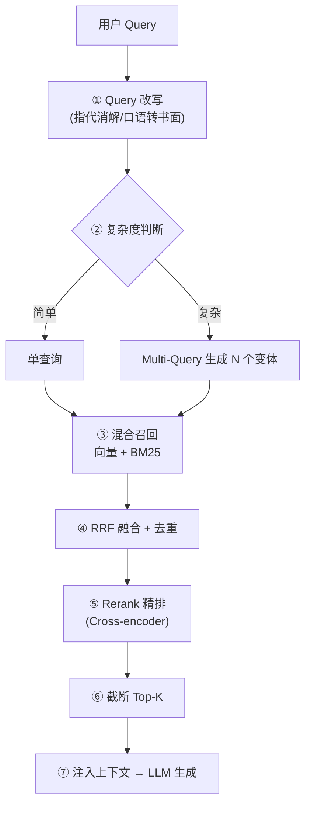

# Query 改写与 Rerank：检索质量的双引擎

## 结论

检索质量 = **召回质量 × 排序质量**。这两个环节分别解决两类失败：

| 环节 | 解决的问题 | 不做的后果 |
|------|-----------|-----------|
| **Query 改写（Rewriting / Expansion）** | 用户表述与文档表述**对不上** | **漏检**：真正相关的内容根本没被召回 |
| **Rerank（重排序）** | 召回了但**排序不准** | **噪声靠前**：相关内容被埋在 50 名开外 |

> 一句话：**改写决定"能不能找到"，Rerank 决定"找到的是不是最好的"。** 这两步是 RAG / Agent 检索里投入产出比最高的优化点。

## 一、为什么原始 Query 不够用

用户的 query 天然存在缺陷：

| 缺陷 | 例子 | 后果 |
|------|------|------|
| **过短** | "退款" | 意图不明确，召回范围过宽或过窄 |
| **口语化** | "东西不想要了怎么弄" | 与文档的书面表述不匹配 |
| **有指代** | "它多少钱？"（多轮对话） | 缺少实体，无法检索 |
| **术语不统一** | 用户说"退钱"，文档写"退款流程" | 关键词匹配失败 |
| **拼写/缩写** | "LLM" vs "大语言模型" | 召回缺失 |
| **多意图混杂** | "对比 A 和 B 的价格和售后" | 一个 query 承载多个子问题 |
| **过具体** | 一个长句塞满细节 | 语义被稀释，检索命中率低 |

## 二、Query 改写（六大技术）

### 2.1 技术全景

| 技术 | 做法 | 解决什么 | 成本 |
|------|------|----------|------|
| **Query Expansion** | 加同义词、相关词、上位词 | 术语不统一 | 低 |
| **Query Rewriting** | 用 LLM 重写成完整、独立的查询 | 口语化、指代、上下文缺失 | 低 |
| **Multi-Query（多查询扩展）** | 生成 3~5 个不同角度的变体，分别检索 | 召回不足 | 中（多次检索） |
| **HyDE** | 先让 LLM 写一段"假设答案"，用答案去检索 | 问题与文档形态差异大 | 中 |
| **Step-back Prompting** | 抽象成更泛化的问题，再检索 | 需要原理性知识 | 低 |
| **Sub-query Decomposition** | 拆成多个子问题分别检索 | 多跳、复合问题 | 中 |

### 2.2 Query Rewriting（对话场景必做）

多轮对话中，用户的问题常常依赖上文：

```
用户：iPhone 16 多少钱？
助手：5999 起。
用户：那它的保修多久？        ← "它" 指什么？直接拿去检索 = 无效
```

改写后：

```
iPhone 16 的保修期是多久？
```

**实现方式**：把最近 N 轮对话喂给 LLM，要求输出一个**自包含（self-contained）**的查询。

```python
def rewrite_query(llm, history: list[dict], question: str) -> str:
    prompt = f"""根据对话历史，把用户的最新问题改写成一个独立、完整的检索查询。
要求：补全指代、补全省略、保持原意、不要回答问题。

对话历史：
{format_history(history)}

最新问题：{question}
改写后的查询："""
    return llm(prompt).strip()
```

> **这是对话式 RAG 的第一优先级优化**，不做它，多轮检索几乎全废。

### 2.3 Multi-Query（多查询扩展）

**核心思想**：同一个问题有多种表述角度，一个 query 只能覆盖其中一部分。

```
原问题：如何提升模型推理速度？

扩展为：
1. 大模型推理加速方法
2. LLM inference optimization techniques
3. KV Cache 优化
4. 模型量化对推理速度的影响
5. 投机解码原理
```

**流程**：

```
原 Query
   │  LLM 生成 N 个变体
   ▼
[Q1, Q2, Q3, Q4]
   │  并行检索
   ▼
[结果1, 结果2, 结果3, 结果4]
   │  融合（RRF / 去重）
   ▼
候选集 → Rerank → Top-K
```

**实现**：

```python
def generate_queries(llm, question: str, n: int = 3) -> list[str]:
    prompt = f"""为下面的问题生成 {n} 个不同角度的检索查询。
要求：覆盖不同表述、不同术语层次；每行一个；不要编号；不要回答问题。

问题：{question}"""
    lines = llm(prompt).strip().splitlines()
    return [l.strip() for l in lines if l.strip()][:n]
```

**取舍**：

| 优点 | 代价 |
|------|------|
| 召回率显著提升 | **检索次数 × N**，成本与延迟上升 |
| 缓解表述差异 | 可能引入噪声，需要 Rerank 兜底 |
| 对长尾问题效果好 | 简单问题上是浪费 |

> **建议**：只对**复杂问题**启用多查询；简单事实性问题用单查询即可。可以先用分类器判断复杂度。

### 2.4 HyDE（Hypothetical Document Embeddings）

**问题**：用户问的是"短问题"，而文档是"长段落"，两者在向量空间的分布差异大。

**做法**：先让 LLM 生成一段**假设性的答案文档**，再用这段"假答案"去检索真实文档。

```
Query: "KV Cache 是什么"
   │  LLM 生成假设答案
   ▼
"KV Cache 是一种在自回归生成中缓存历史 Key/Value 的机制，
 用于避免重复计算，显著降低推理延迟..."
   │  用这段文本去检索
   ▼
真实文档（语义上更接近）
```

**取舍**：对语义检索效果好；但**多一次 LLM 调用**，且假设答案可能引入偏差。

### 2.5 Step-back Prompting

把具体问题"退一步"抽象成更泛的问题：

```
具体：为什么我的 Python 脚本报 KeyError: 'name'？
退一步：Python 字典 KeyError 的常见原因和排查方法
```

**适用**：需要原理性背景知识才能回答的问题。

### 2.6 Sub-query Decomposition

复杂问题拆成子问题：

```
原问题：对比 iPhone 16 和华为 Mate 70 的价格、续航和售后

拆解：
1. iPhone 16 价格 / 续航 / 售后
2. 华为 Mate 70 价格 / 续航 / 售后
```

**适用**：多实体对比、多跳推理。

## 三、Rerank（重排序）

### 3.1 为什么向量检索不够

**向量检索（Bi-encoder）采用"双塔"结构**：query 和 document **各自独立编码**，最后算相似度。

| 特点 | 说明 |
|------|------|
| 优点 | 文档向量可**离线预计算**，检索极快（毫秒级） |
| 缺点 | query 与 doc **没有交互**，只能捕捉"大致语义相近"，无法判断"是否真的回答了问题" |

结果：召回的 Top-50 里可能混着大量"语义相近但无关"的内容。

### 3.2 Cross-encoder：让 query 和 doc 互相看见

**Cross-encoder（交叉编码器）** 把 `[query, document]` **拼在一起**送进 Transformer，输出一个相关性分数。

| | Bi-encoder（召回） | Cross-encoder（精排） |
|---|---|---|
| 输入 | query、doc **分开** | query + doc **拼接** |
| 预计算 | ✅ 可离线 | ❌ 必须在线 |
| 速度 | 极快（毫秒） | 慢（每个候选都要过一次模型） |
| 准确度 | 一般 | **高** |

### 3.3 两阶段检索架构（业界标准）

```
全库（百万级）
   │  ① Recall 召回（Bi-encoder / BM25）
   ▼
Top 100 候选
   │  ② Rerank 精排（Cross-encoder）
   ▼
Top 5~10
   │  ③ 注入上下文
   ▼
LLM 生成
```

**关键洞察**：Rerank 不能对全库做（太慢），只能对**已召回的少量候选**做。所以是"召回求全、精排求准"。

### 3.4 常见 Rerank 方案

| 方案 | 代表 | 特点 |
|------|------|------|
| **开源 Cross-encoder** | `BAAI/bge-reranker-v2-m3`、`bge-reranker-base` | 免费、可私有部署、中英双语 |
| **商业 API** | Cohere Rerank、Jina Reranker | 开箱即用、多语言、按调用计费 |
| **LLM 作为排序器** | 让 LLM 对候选做 listwise 排序 | 效果强但**贵且慢** |
| **ColBERT（后期交互）** | token 级 MaxSim | 精度接近 cross-encoder，可部分预计算 |

### 3.5 实现示例

```python
from sentence_transformers import CrossEncoder

# 加载重排序模型（首次会下载）
reranker = CrossEncoder("BAAI/bge-reranker-v2-m3")

def rerank(query: str, docs: list[dict], top_n: int = 5) -> list[dict]:
    if not docs:
        return []
    pairs = [(query, d["content"]) for d in docs]
    scores = reranker.predict(pairs)

    ranked = sorted(
        zip(docs, scores), key=lambda x: x[1], reverse=True
    )
    return [
        {**doc, "rerank_score": float(score)}
        for doc, score in ranked[:top_n]
    ]
```

### 3.6 Rerank 的取舍

| 优点 | 代价 |
|------|------|
| 精度提升显著（常是单项优化里收益最大的） | **延迟随候选数线性增长** |
| 可用小模型换大收益 | 需要额外模型部署/费用 |
| 能修正向量检索的语义漂移 | 无法召回 Top-100 之外的内容（召回是天花板） |

> **重要认知**：**Rerank 不能弥补召回失败**。如果相关内容根本没进 Top-100，精排再准也没用。所以"改写 + 召回"和"精排"必须配套。

## 四、混合检索（Hybrid Search）

### 4.1 为什么需要

| 检索方式 | 强项 | 弱项 |
|----------|------|------|
| **向量检索（Dense）** | 语义相近、同义表述 | 精确关键词（型号、编号、人名）易漏 |
| **关键词检索（BM25 / Sparse）** | 精确匹配、术语准确 | 不懂同义词、语义 |

**两者互补**，融合后召回质量通常显著优于单一方式。

### 4.2 融合方式：RRF（Reciprocal Rank Fusion）

不需要归一化分数，**只看排名**，简单且鲁棒：

\[
\text{score}(d) = \sum_{i} \frac{1}{k + \text{rank}_i(d)}, \quad k \approx 60
\]

```python
def rrf_fuse(result_lists: list[list[str]], k: int = 60, top_n: int = 50) -> list[str]:
    """result_lists: 每个检索器返回的 doc_id 有序列表"""
    scores: dict[str, float] = {}
    for results in result_lists:
        for rank, doc_id in enumerate(results, start=1):
            scores[doc_id] = scores.get(doc_id, 0.0) + 1.0 / (k + rank)
    return sorted(scores, key=lambda d: -scores[d])[:top_n]
```

**优点**：无需统一不同检索器的分数量纲，也不会被某一家的异常高分带偏。

## 五、完整链路



**每一步都可开关**，按成本逐步启用：

| 优先级 | 措施 | 收益 | 成本 |
|--------|------|------|------|
| P0 | Rerank | 高 | 中 |
| P0 | 混合检索（向量+BM25） | 高 | 低 |
| P1 | 对话场景 Query 改写 | 高（不做基本废） | 低 |
| P2 | Multi-Query | 中 | 中 |
| P2 | HyDE | 中 | 中 |
| P3 | Step-back / 子问题拆解 | 场景相关 | 中 |

## 六、评估方法

**不看指标就优化 = 瞎调。**

| 指标 | 衡量什么 | 说明 |
|------|----------|------|
| **Recall@k** | 相关内容有多少进了 Top-k | 召回的天花板，**最先看这个** |
| **MRR** | 第一个相关结果排多前 | 排序质量 |
| **NDCG@k** | 排序整体质量（考虑位置） | 综合指标 |
| **端到端准确率** | 最终答案对不对 | **最终标准** |

**实践建议**：

1. 先做**检索评测集**（query + 标准相关文档），再谈优化
2. 分开度量「召回」与「精排」，避免混在一起归因
3. 端到端评测必须做——有时检索指标涨了，答案质量反而降

## 七、常见陷阱

| 陷阱 | 问题 | 对策 |
|------|------|------|
| **只做 Rerank 不做召回优化** | 召回天花板没打开 | 先看 Recall@k |
| **Multi-Query 对所有 query 都开** | 简单问题浪费成本 | 按复杂度分流 |
| **Rerank 候选过多** | 延迟线性爆炸 | 控制在 50~100 |
| **改写改变原意** | 检索跑偏 | 改写后用原 query 也做一路检索 |
| **HyDE 假设答案有误** | 检索到错误方向 | 与原始 query 结果融合，不要完全替代 |
| **无评测集** | 优化靠感觉 | 先建 50~100 条标注集 |
| **忽略延迟** | 端到端太慢 | 每步单独计时 |

## 八、Checklist

**Query 改写**
- [ ] 对话场景做了指代消解改写
- [ ] 复杂问题才启用 Multi-Query
- [ ] 改写结果与原 query **同时检索**，不互相替代
- [ ] 改写有长度上限，避免发散

**召回**
- [ ] 向量 + 关键词混合检索
- [ ] 用 RRF 融合，避免分数归一化问题
- [ ] 监控 Recall@k

**精排**
- [ ] 引入 Cross-encoder Rerank
- [ ] 候选数控制在 50~100
- [ ] 记录 rerank 前后对比，验证收益

**工程**
- [ ] 每步有耗时埋点
- [ ] 有端到端评测集
- [ ] 可单步开关，便于 A/B

## 九、总结

**Query 改写与 Rerank 是一对"召回—精排"的黄金组合：**

- **改写**解决"问的和写的不是一回事" → 把该召回的内容捞进来
- **Rerank** 解决"捞上来的排序不对" → 把最好的顶上去
- **混合检索 + RRF** 解决"单一检索方式有偏科" → 互补

三者的关系可以概括为一句话：

> **改写扩大候选池，混合检索保证不漏，Rerank 保证精度。**

投入优先级建议：**Rerank ≥ 混合检索 > 对话改写 > Multi-Query > HyDE**。前两项性价比最高，多数项目做完就能看到明显提升。
