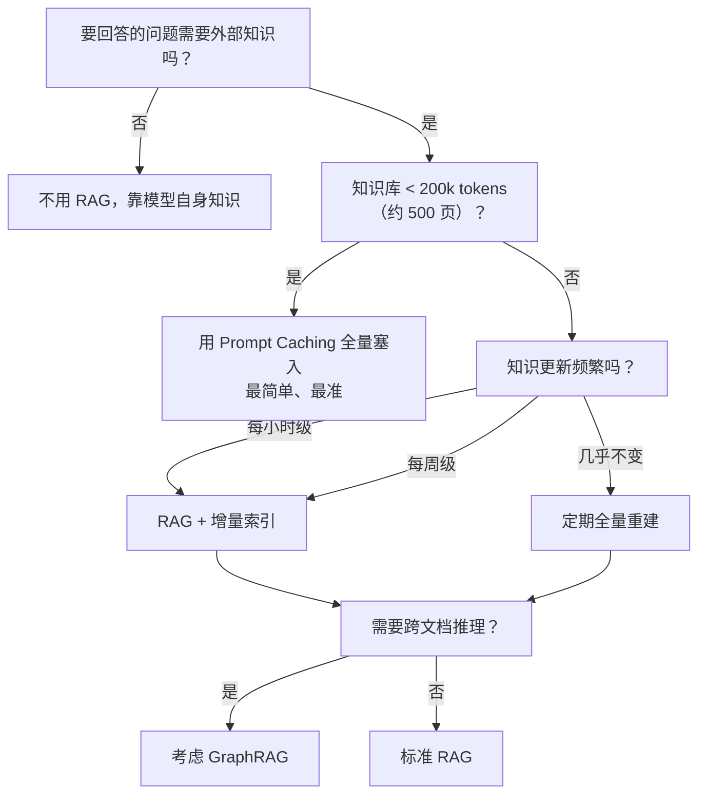

# RAG 完整链路

> **权威依据**
> ① **Anthropic**《Contextual Retrieval》— 上下文分块 + 混合检索 + 重排的实测数据
> ② **Pinecone**《Chunking Strategies for LLM Applications》（2025-06-28）— 六种分块策略
> ③ 本知识库：`Query改写与Rerank.md`、`Agent搜索引擎.md`

## 结论

**RAG 的效果瓶颈，八成不在检索算法，而在上游的数据准备。**

> **Pinecone 的原话**：不存在一劳永逸的分块方案。正确做法是「固定分块起步 → 用代表性查询做 A/B 评估 → 不够再换递归/语义/结构感知/上下文分块」。

**Anthropic 的一组硬数据**（top-20 检索失败率，越低越好）：

| 方案 | 失败率 | 相对下降 |
|------|--------|----------|
| 传统 RAG | 5.7% | — |
| + 上下文嵌入 | 3.7% | **↓35%** |
| + 上下文 BM25 | 2.9% | **↓49%** |
| + 重排序 | **1.9%** | **↓67%** |

> **关键**：这三项收益**可叠加**，而且**全部发生在索引期**——不改推理架构。

## 一、RAG 全景：你已有的两篇补了哪一半

```
① 解析（PDF/HTML/Word → 干净文本）
② 分块（Chunking）              ← 本文
③ 嵌入（Embedding）             ← 本文
④ 索引（向量库 + 元数据）        ← 本文
⑤ 检索（向量/BM25/混合 + Rerank）← Query改写与Rerank.md ✅
⑥ 组装进 Prompt
```

| 环节 | 已有文档 | 状态 |
|------|----------|------|
| Query 改写 | `Query改写与Rerank.md` | ✅ 完整 |
| 混合检索 + RRF | `Query改写与Rerank.md` | ✅ 完整 |
| Rerank | `Query改写与Rerank.md` | ✅ 完整 |
| **分块 / 嵌入 / 向量库 / 索引更新** | **无** | ❌ **本文补齐** |
| Web 检索 | `Agent搜索引擎.md` | ✅ 完整 |

## 二、先做减法：什么时候不需要 RAG

> **Anthropic 明确建议**：若知识库 **< 200,000 tokens（约 500 页）**，**直接用 prompt caching 把全库塞进 prompt 更简单**——缓存可使延迟降低 >2×、成本降低至多 90%。

### 2.1 决策树



### 2.2 一个反直觉的事实

> **小知识库上，把全文塞进上下文往往比 RAG 更准**——因为 RAG 的**分块会丢上下文**，而全量塞入不会。

**代价**是 token 成本。所以这是一道**"准确率 vs 成本"**的选择题，不是技术先进性问题。

## 三、分块（Chunking）：本文最重要的部分

### 3.1 核心矛盾

> **块要大到足以包含有意义的信息，又要小到能保证检索性能和低延迟。**

**两端都失败会发生什么**：

| 块太小 | 块太大 |
|--------|--------|
| 语义不完整，检索时匹配不上 | 一个块里混杂多个主题 |
| 指代丢失（"该公司"是谁？） | 相似度被"平均"掉，精度下降 |
| 需要更多块才能凑齐信息 | 吃上下文、增加成本与延迟 |

### 3.2 六种策略与取舍

| # | 策略 | 做法 | 优点 | 缺点 |
|---|------|------|------|------|
| **1** | **固定长度** | 按预设 token 数机械切 | 最简单、大小可控、**推荐作为默认起点** | 切断句子、忽略结构 |
| **2** | **句子/段落** | 按 `.`、换行切；或用 NLTK / spaCy 分句 | 块内语义完整 | 长度不齐；缩写干扰 |
| **3** | **递归字符**（推荐） | 按 `\n\n` → `\n` → 空格 → 字符 顺序尝试 | **自然边界 + 固定大小**、无需模型、零成本 | 仍是启发式，不懂主题 |
| **4** | **结构感知** | 按 Markdown 标题 / HTML 标签 / LaTeX 章节 / 代码块切 | 保留层级，语义最连贯 | 每种格式要写解析器 |
| **5** | **语义分块** | 句子成组算 embedding，相邻组语义距离突变处下刀 | 按真实话题边界切，精度高 | 实验性、**要算大量 embedding** |
| **6** | **上下文分块**（Anthropic） | 用 LLM 为每块生成 50–100 token 的定位说明，前置拼接 | **解决"脱离上下文即失效"** | 有 LLM 预处理成本 |

### 3.3 递归分块：为什么它是性价比最高的默认选择

```python
# LangChain 的 RecursiveCharacterTextSplitter 思路
SEPARATORS = ["\n\n", "\n", "。", "！", "？", "，", " ", ""]

def recursive_split(text: str, size: int, seps: list[str]) -> list[str]:
    """先按最大的边界切，切出的块仍超长才用下一级边界"""
    if len(text) <= size:
        return [text]

    sep = seps[0] if seps else ""
    parts = text.split(sep) if sep else list(text)

    chunks, buf = [], ""
    for p in parts:
        if len(buf) + len(p) + len(sep) <= size:
            buf += p + sep
        else:
            if buf:
                chunks.append(buf.rstrip(sep))
            buf = p + sep

    if buf:
        chunks.append(buf.rstrip(sep))

    # 还有超大的块 → 用更细的边界再切
    out = []
    for c in chunks:
        if len(c) > size and len(seps) > 1:
            out.extend(recursive_split(c, size, seps[1:]))
        else:
            out.append(c)
    return out
```

**它为什么好**：

| 特性 | 价值 |
|------|------|
| **不需要模型** | 零成本、零延迟 |
| **优先保段落** | 段落切不开才切句子 |
| **块大小可控** | 适配 embedding 模型上限 |
| **通用** | 几乎所有文本都适用 |

> **Pinecone 的定位**：这是"固定字符切分"和"语义切分器"之间**很好的折中**。

### 3.4 上下文分块：Anthropic 的核心创新

**问题示例**（SEC 文件片段）：

```
原文块：The company's revenue grew by 3% over the previous quarter.
```

**这块说的是哪家公司？哪个季度？—— 检索时根本匹配不上「ACME Q2 2023 营收」这种查询。**

**解法**：索引前，用 LLM 给每块补一段定位说明。

```
上下文化后：This chunk is from an SEC filing on ACME corp's performance in Q2 2023;
the previous quarter's revenue was $314 million.
The company's revenue grew by 3% over the previous quarter.
```

**官方提示词**：

```
<document>{{WHOLE_DOCUMENT}}</document>
Here is the chunk we want to situate within the whole document
<chunk>{{CHUNK_CONTENT}}</chunk>
Please give a short succinct context to situate this chunk within the overall
document for the purposes of improving search retrieval of the chunk.
Answer only with the succinct context and nothing else.
```

**两个工程要点**：

| 要点 | 说明 |
|------|------|
| **只输出上下文** | 加 "Answer only with the succinct context and nothing else" |
| **靠 Prompt Caching 降本** | 整篇文档**缓存一次**，后续每块引用缓存，不必重复传入 |

**成本**：800 token chunk / 8k token 文档的假设下，**约 $1.02 / 百万文档 token**（一次性）。

**适用范围**：文档长达数百页、话题频繁切换、**必须依赖多处关联内容才能理解**时最值。

### 3.5 chunk size 怎么定

> **没有统一最优值。** 但有一个可执行的流程。

**Pinecone 的建议区间**：

| 尺寸 | 适合 |
|------|------|
| **128 / 256 token** | 捕捉更细粒度语义（FAQ、条款、API 文档） |
| **512 / 1024 token** | 保留更多上下文（论文、报告、长文） |

**Anthropic 的实测基准**：成本测算用 **800 token** 块；传统惯例是"不超过几百 token"；**top-20 入 prompt 表现最佳**（测过 5 / 10 / 20）。

**怎么做实验**：

```
1. 用 3 个尺寸建 3 个索引（或同索引 3 个 namespace）
2. 准备 30 条代表性查询 + 标注好的正确答案
3. 比较 recall@k
4. 选最好的，再微调边界规则
```

> **⚠️ 关键提醒**：固定分块尺寸常取 embedding 模型上下文窗口上限。**不同模型分词方式不同，必须准确估 token 数**——超出的部分会被**直接截断丢弃**，导致关键信息永远检索不到。

### 3.6 overlap 还是 chunk expansion？

**常见做法是加 10–20% 重叠**，防止边界切断语义。

**Pinecone 提出的替代思路更聪明**：**把"边界信息丢失"从索引期移到查询期解决**。

```
索引期：切得小而准（低延迟、省存储）
                    ↓
查询期：命中块 → 从库里取它相邻的块 → 拼成一个窗口返回
```

| | 固定 overlap | **Chunk expansion** |
|---|---|---|
| 存储成本 | 高（重复存） | 低 |
| 灵活性 | 固定 | **按需扩展**（段落/整页/整篇） |
| 实现 | 简单 | 需存块顺序与文档结构 |
| 检索延迟 | 低 | 略高 |

> **推荐**：**先切小 + 存顺序，查询时按需扩展**。这比盲目加 overlap 更省、更灵活。

### 3.7 一条极简的判断标准

> **Pinecone 原文**：**如果一段文本脱离上下文后，人还能看懂，那语言模型也能看懂。**

**用这条规则自检你的块**：

```
❌ "该产品支持两种模式。"          → 哪个产品？
❌ "详见第 3.2 节。"               → 哪份文档？
❌ "The company's revenue grew 3%." → 哪家公司、哪个季度？
✅ "ACME 公司 2023 Q2 财报显示，营收环比增长 3%。"
```

**看不懂就说明分块有问题**——要么块太小，要么缺上下文（用 3.4 的方法补）。

## 四、Embedding 选型

### 4.1 五个评估维度

| 维度 | 说明 |
|------|------|
| **领域匹配** | 代码/法律/医疗/金融，各有强项 |
| **语言** | 多语言场景必须测中文效果 |
| **维度与成本** | 维度高 ≠ 更好；存储与检索成本线性增长 |
| **最大输入长度** | 必须 ≥ 你的 chunk size |
| **是否支持稀疏/混合** | 有些模型原生输出 sparse 向量 |

> **Anthropic 实测**：在其测试中 **Gemini Text 004 与 Voyage 效果最佳**（这是他们的场景，**不代表通用排序**）。

### 4.2 三条硬规则

| 规则 | 后果 |
|------|------|
| **① 建库与查询必须用同一个模型** | 混用 = 算的是两个不同空间，结果无意义 |
| **② 换模型必须重建索引** | 不能只换查询侧 |
| **③ 区分对称/非对称检索** | query 短、doc 长属于**非对称**，要用为此训练的模型 |

### 4.3 一个常被忽视的点：维度不是越高越好

| | 低维（如 384/768） | 高维（如 3072） |
|---|---|---|
| 精度 | 略低 | 略高 |
| 存储 | 省 | **3–8 倍** |
| 检索速度 | 快 | 慢 |
| 适合 | 大规模、成本敏感 | 精度优先、库不大 |

## 五、向量库

### 5.1 主流选项对比

| 库 | 部署 | 特点 | 适合 |
|----|------|------|------|
| **pgvector** | Postgres 扩展 | **和业务数据同库、支持事务与 JOIN** | 已用 Postgres、规模中等 |
| **Qdrant** | 自建 / 云 | Rust 实现、**过滤能力强**、易上手 | 通用首选 |
| **Milvus** | 自建 / 云 | 分布式、**超大规模** | 上亿向量 |
| **Chroma** | 嵌入式 | 极轻量、**本地开发最快** | 原型、小项目 |
| **FAISS** | 库（非服务） | 纯索引库、**性能最强**、无元数据 | 研究、离线批处理 |
| **Pinecone / Weaviate / 云托管** | SaaS | 免运维 | 不想管基础设施 |

### 5.2 选型的三个真问题

| 问题 | 影响 |
|------|------|
| **要不要和业务数据 JOIN？** | 要 → pgvector；不要 → 专用向量库 |
| **规模多大？** | <100 万 → 几乎都能扛；>1 亿 → Milvus |
| **过滤条件复杂吗？** | 复杂的多租户/权限过滤 → **Qdrant / pgvector** |

### 5.3 最容易被低估的功能：元数据过滤

> **纯向量检索没有"权限"概念。**
> 多租户系统里，如果没有元数据过滤，**A 租户能检索到 B 租户的文档**（OWASP LLM08）。

**必须存的元数据**：

```json
{
  "tenant_id": "acme",
  "doc_id": "policy-v3",
  "doc_version": 3,
  "source_url": "https://...",
  "updated_at": "2026-10-01",
  "acl": ["group:legal", "user:42"],
  "section": "3.2 退款政策",
  "chunk_index": 17
}
```

**检索时必须**：**先按 `tenant_id` / `acl` 过滤，再算相似度**（或至少在同一查询里下推过滤）。

## 六、索引与更新

### 6.1 三种更新策略

| 策略 | 做法 | 适合 |
|------|------|------|
| **全量重建** | 定期删库重建 | 库小、更新少 |
| **增量 upsert** | 按 `doc_id` 覆盖写 | 常规 |
| **双写 + 切换** | 新索引建好再切流量 | **零停机、可回滚（推荐）** |

### 6.2 三个必须处理的边界情况

| 情况 | 处理 |
|------|------|
| **文档被删除** | 必须**级联删除所有 chunk**，否则会检索到已删内容 |
| **文档被修改** | 先删旧 chunk 再写新的（按 `doc_id` + `chunk_index`） |
| **分块规则变更** | **必须全量重建**，不能混用新旧切法的块 |

> **最常见的线上事故**：改了分块参数但只对新文档生效，库里新旧块混在一起，检索质量莫名下降。

### 6.3 版本化

```
doc_id + doc_version + chunk_index   → 唯一键
查询时只取 max(doc_version) 的块
```

## 七、检索环节（详见 `Query改写与Rerank.md`）

### 7.1 四层检索架构

```
① 粗筛：BM25 + 向量，各取 top-50
② 融合：RRF（倒数排名融合）去重
③ 重排：Cross-encoder 对 top-150 打分
④ 取数：保留 top-20，按需 chunk expansion
```

### 7.2 top-k 怎么定（Anthropic 实测）

> 测试了 **5 / 10 / 20**，**top-20 表现最佳**。

**但注意**：*"更多信息提高命中率，但过多会分散模型注意力，存在上限。"*

| k | 效果 |
|---|------|
| 5 | 快，但容易漏 |
| 10 | 平衡 |
| **20** | **命中率最佳（Anthropic 结论）** |
| 50+ | 注意力被稀释 |

### 7.3 Anthropic 认为收益有限的方案

> 原文明确否定了三种替代方案：**给 chunk 加通用文档摘要、HyDE（假设文档嵌入）、基于摘要的索引**。

> ⚠️ **但要正确理解**：这是**在他们那套数据与配置下的结论**。HyDE 在**短查询 + 长文档**场景下仍有价值（见 `Query改写与Rerank.md`）。**不要拿一句话否定一种技术**——要在自己的数据上测。

## 八、评测：不做这个就是在盲调

### 8.1 四类指标（RAG 经典分解）

| 指标 | 测什么 | 怎么算 |
|------|--------|--------|
| **Context Recall** | 该找到的找到了吗 | 标注的标准答案是否被检索到 |
| **Context Precision** | 找到的排序好吗 | 相关块是否排在前面 |
| **Faithfulness** | 回答是否忠于检索内容 | 有无编造 |
| **Answer Relevancy** | 回答是否切题 | 是否答非所问 |

### 8.2 最实用的一个指标

> **recall@k**（前 k 个块里包含了多少相关文档）

**Anthropic 用的就是 `1 − recall@20`**。

**为什么用它**：它**只测检索，不测生成**——**把检索问题和生成问题分离**，你才知道该改哪半。

### 8.3 最小可行评测

```
1. 挑 30 条真实查询
2. 每条标注"哪几个 chunk 是正确答案"
3. 跑检索，算 recall@5 / recall@10 / recall@20
4. 改分块 / 嵌入 / 检索参数，重跑
```

> **半天就能搭起来。** 没有这个，你所有的调参都是猜。

## 九、Agentic RAG：让 Agent 自己决定检索

### 9.1 与静态 RAG 的区别

| | 静态 RAG | **Agentic RAG** |
|---|---|---|
| **检索次数** | 固定 1 次 | **Agent 决定 0 次或多 次** |
| **查询构造** | 改写后固定 | **边查边改** |
| **何时停止** | 一次即止 | **信息够了才停** |
| **成本** | 低、可预测 | 高、不可预测 |
| **适合** | 简单事实问答 | **多跳、需要综合的复杂问题** |

### 9.2 实现形态

```
把检索做成工具：
  search(query: str, top_k: int) -> list[Chunk]

Agent 循环：
  ① 判断当前信息是否足够
  ② 不够 → 构造新 query → 调用 search
  ③ 够了 → 生成答案
```

> **注意**：Agentic RAG 的**检索工具设计**比静态 RAG 重要得多——它要能返回**结构化结果 + 足够元数据**，让 Agent 判断"够不够"。

## 十、GraphRAG：什么时候值得

| | 标准 RAG | **GraphRAG** |
|---|---|---|
| 检索单位 | 文本块 | **实体 + 关系** |
| 擅长 | "文档里说了什么" | **"这些实体之间是什么关系"** |
| 多跳推理 | 弱 | **强** |
| 全局摘要 | 弱 | **强**（社区摘要） |
| 建库成本 | 低 | **高（要抽实体关系）** |
| 更新成本 | 低 | **高（图谱要维护）** |

**什么时候值得**：

- 问题需要**跨文档**串联多个实体
- 需要回答**"整体上讲了什么"**（全局性问题）
- 领域本身是**关系密集**的（法律、医疗、供应链）

**什么时候不值得**：

- 90% 的问题是"某条规定是什么" → 标准 RAG 就够
- 文档更新极频繁 → 图谱维护成本爆炸

## 十一、成本构成

| 环节 | 典型占比 | 优化手段 |
|------|----------|----------|
| **Embedding（建库）** | 一次性，低 | 批次调用、缓存 |
| **上下文分块（LLM）** | 一次性，中 | **Prompt Caching**（$1.02/M tokens） |
| **向量存储** | 持续，中 | 降维、量化、TTL |
| **检索** | 持续，低 | 索引优化 |
| **Rerank** | 持续，中 | 只对 top-150 做 |
| **生成** | **持续，最高** | **减少 top-k、压缩块** |

> **真相**：**RAG 的成本大头是"把检索结果塞进模型"那一步**，不是检索本身。
> 所以"提高 recall@20"和"减少 token 消耗"往往冲突——**需要评测来定平衡点**。

## 十二、常见坑

| # | 坑 | 后果 | 解法 |
|---|----|------|------|
| **1** | **token 超限被静默截断** | 关键信息永远检索不到 | 准确估算 token，chunk < 模型上限 |
| **2** | **换 embedding 模型没重建索引** | 检索完全失效 | 换模型 = 全量重建 |
| **3** | **文档删除没级联删 chunk** | 检索到已删内容 | 按 `doc_id` 级联 |
| **4** | **改了分块规则只对新文档生效** | 新旧块混杂，质量下降 | 规则变更必须全量重建 |
| **5** | **没有元数据过滤** | **跨租户数据泄漏** | tenant_id 下推过滤 |
| **6** | **直接用固定长度切** | 切碎句子、丢指代 | 递归分块作为默认 |
| **7** | **块脱离上下文看不懂** | 检索匹配不上 | 上下文分块 / 结构感知 |
| **8** | **没有 recall 评测** | 调参全靠猜 | 30 条查询 + recall@k |
| **9** | **只做向量检索** | 精确匹配（错误码、型号）漏掉 | **必须加 BM25** |
| **10** | **top-k 开很大求稳** | 成本高、注意力稀释 | 先重排再取 10–20 |

## 十三、Checklist

**先做减法**
- [ ] 知识库真的超过 200k tokens 吗？（否则用 prompt caching）
- [ ] 数据更新频率是多少？（决定索引策略）

**分块**
- [ ] 用**递归分块**作为默认起点
- [ ] 块大小经过实验（128/256 vs 512/1024）
- [ ] 每块**脱离上下文人能看懂**吗
- [ ] 长文档考虑**上下文分块**（配 prompt caching 降本）
- [ ] 切小 + 存顺序，查询时做 **chunk expansion**
- [ ] 确认 chunk 不超 embedding 模型上限

**嵌入**
- [ ] 建库与查询**同一模型**
- [ ] 在**自己的数据**上测过效果
- [ ] 选好维度（精度 vs 成本）
- [ ] 换模型有全量重建流程

**索引**
- [ ] 元数据齐全（tenant / doc_id / version / acl / section / index）
- [ ] 有**权限过滤**
- [ ] 文档删除会**级联删块**
- [ ] 有增量更新与全量重建两条路径

**检索**
- [ ] **BM25 + 向量混合**（不是纯向量）
- [ ] 有 RRF 融合
- [ ] 有 Rerank
- [ ] top-k 经过实验（Anthropic: 20）

**评测**
- [ ] 有 30 条标注查询
- [ ] 测 **recall@k**
- [ ] 测 faithfulness（有无编造）
- [ ] 改动前后有对比

## 十四、总结

**RAG 的四句话：**

| 环节 | 一句话 |
|------|--------|
| **分块** | 块必须**脱离上下文也能看懂** |
| **嵌入** | 建库和查询**必须是同一个模型** |
| **索引** | **没有元数据过滤就没有权限** |
| **检索** | **纯向量不够，必须加 BM25** |

**五条最值得记住的原则**：

1. **先做减法** —— 小于 500 页就直接塞进上下文
2. **分块决定上限** —— 后面 Rerank 再强也救不回切坏的块
3. **上下文分块能叠加** —— −49% 甚至 −67% 失败率，成本仅 $1.02/M
4. **必须测 recall@k** —— 不测就是在盲调
5. **RAG 的成本在生成侧** —— 优化 top-k 比优化检索更省钱

> **最后一句话**：
> **RAG 不是"把文档切碎塞进向量库"这么简单的事。**
> 它的质量在**切的那一刻**就基本决定了——后面所有的检索优化，都只是在争夺那剩下的几个百分点。

---

> **资料说明**
> 5.7%→3.7%→2.9%→1.9% 的失败率数据、`1 − recall@20` 指标、上下文分块的提示词与成本（$1.02/M tokens）、top-20 实测、<200k tokens 建议用 prompt caching、"被否定的三类替代方案"、"分块边界是首要考量"，**依据 Anthropic《Contextual Retrieval》原文**。
> 六种分块策略及其优缺点、128/256 与 512/1024 的尺寸区间、chunk expansion 替代 overlap、"脱离上下文人能看懂"的判据、选型四问，**依据 Pinecone《Chunking Strategies》原文（2025-06-28）**。
> Query 改写 / 混合检索 / RRF / Rerank 细节，见本知识库 `Query改写与Rerank.md`。
>
> **重要限制**：
> - **Anthropic 文中未给出发布日期**，据内容推断为 Claude 3 系列时期（prompt caching 发布后不久）。
> - **"Gemini Text 004 与 Voyage 效果最佳"是 Anthropic 特定测试场景的结论**，**不可作为通用模型排序**；embedding 模型迭代极快，请以当前榜单 + 自测为准。
> - **向量库对比为概括性描述**，各产品的功能、性能与定价变化很快，选型前请查当前文档。
> - **RAGAS 四类指标（Context Recall/Precision、Faithfulness、Answer Relevancy）我未直读 RAGAS 官方文档**，名称与定义按业界通行理解给出。
> - **GraphRAG 部分为概括性说明**，未直读微软 GraphRAG 原始论文。
> - 第三章递归分块代码为**简化示意**（未处理中英文分隔符差异、未保留元数据），**不能直接用于生产**。
> - 所有引文为**中文意译**，非逐字直译。
