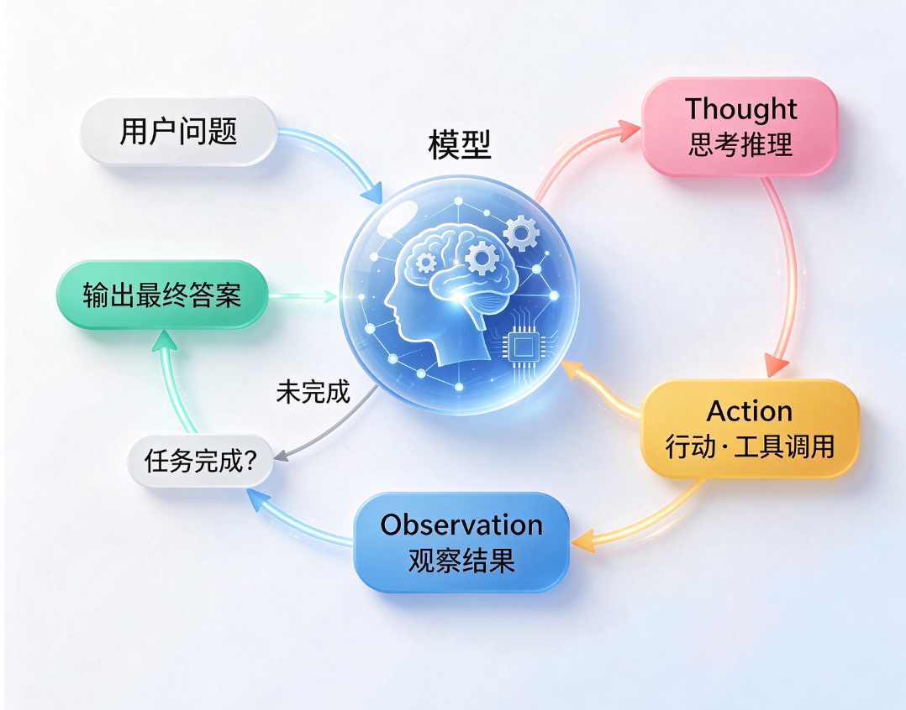
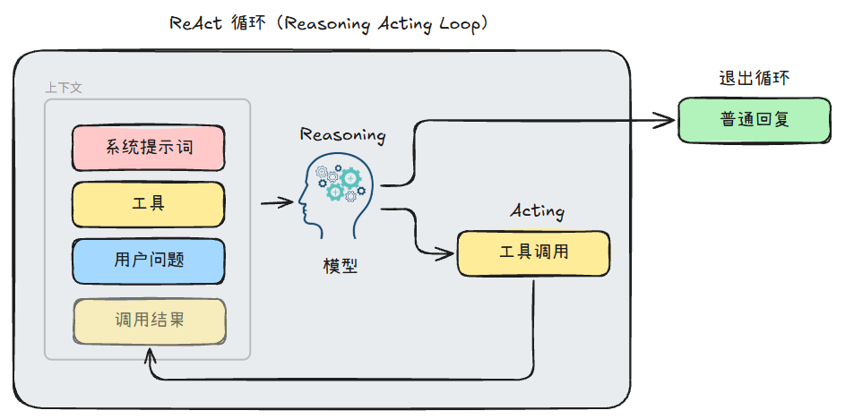
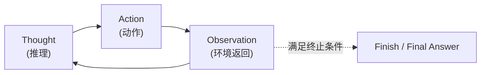

# ReAct：推理与行动协同的提示范式





## 结论

**ReAct（Reasoning + Acting）** 是让大模型**交替生成"推理轨迹（Thought）"和"任务动作（Action）"**，并通过环境返回的**观察（Observation）**来校正下一步推理的提示范式。它同时解决了两个极端：**纯推理（CoT）拿不到外部信息容易幻觉**、**纯行动（Act-only）缺乏规划**。

> 官方定义（论文原文）：ReAct 让 LLM "generate both reasoning traces and task-specific actions in an interleaved manner"——**以交错方式同时生成推理轨迹与任务动作**。

## 一、出处（官方来源）

| 项目 | 信息 |
|------|------|
| **论文** | *ReAct: Synergizing Reasoning and Acting in Language Models* |
| **作者** | Shunyu Yao, Jeffrey Zhao, Dian Yu, Nan Du, Izhak Shafran, Karthik Narasimhan, Yuan Cao |
| **机构** | Princeton University / Google Research |
| **发表** | arXiv 2022 年 10 月；**ICLR 2023** 收录 |
| **arXiv** | 2210.03629 |
| **关键性质** | 该方法最初是 **prompting（提示）方案，不需要训练/微调** |

## 二、要解决的问题

论文指出当时有两条路线，各走极端：

| 路线 | 代表 | 优势 | 致命缺陷 |
|------|------|------|----------|
| **纯推理** | CoT（思维链） | 能做多步分解、有解释性 | **无法获取外部信息**，知识过时或缺失时**产生幻觉** |
| **纯行动** | Act-only | 能调用工具获取信息 | **没有规划与推理**，不会根据观察调整策略 |

作者的核心主张：**推理与行动不是对立的，应该协同**。

- 推理帮助模型：**维护计划、处理异常、综合信息**
- 行动帮助模型：**获取外部知识、与真实环境交互**

## 三、核心思想

ReAct 在一次生成中**交错产生**两类内容：



- **Thought**：不改变环境，只更新模型的"内心计划"
- **Action**：真正作用于环境（搜索、查询、移动、点击…）
- **Observation**：**环境返回的反馈**，由系统注入，模型无法编造

## 四、标准提示格式（论文原版）

论文用**少样本（few-shot）示例**把格式"教"给模型。下面是论文中 HotpotQA 任务的经典样例风格：

```
Question: What is the elevation range for the area that the eastern sector
          of the Colorado orogeny extends into?

Thought 1: I need to search Colorado orogeny, find the area that the eastern
           sector extends into, then find the elevation range of the area.
Action 1: Search[Colorado orogeny]
Observation 1: The Colorado orogeny was an episode of mountain building...
Thought 2: It does not mention the eastern sector. So I need to look up
           eastern sector.
Action 2: Lookup[eastern sector]
Observation 2: (Result 1 / 1) The eastern sector extends into the High Plains...
Thought 3: The eastern sector of Colorado orogeny extends into the High Plains.
           High Plains raise from 1,800 to 7,000 ft in elevation range.
Action 3: Finish[1,800 to 7,000 ft]
```

格式规则：

| 要素 | 作用 | 谁产生 |
|------|------|--------|
| `Thought i` | 当前推理 | 模型 |
| `Action i` | 工具 + 参数，如 `Search[query]` | 模型 |
| `Observation i` | 环境返回结果 | **系统 / 环境** |
| `Finish[answer]` | 终止并给出答案 | 模型 |

> 注意论文里动作是 `Search[...]`、`Lookup[...]`、`Finish[...]` 这类**方括号语法**，不是现代 API 的 JSON。

## 五、论文中的任务与动作空间

ReAct 在论文中跨越两类任务，**动作空间完全不同**：

| 任务类型 | 数据集 | 动作空间 |
|----------|--------|----------|
| **知识密集型** | HotpotQA（多跳问答）、FEVER（事实核查） | `Search[...]` 维基搜索、`Lookup[...]` 查词条、`Finish[...]` |
| **交互式决策** | ALFWorld（文字游戏）、WebShop（网购） | 具体环境动作，如 `go to cabinet 1`、`take apple 1`、`click[buy]` |

这体现了 ReAct 的通用性：**格式不变，动作由环境定义**。

## 六、论文的关键实验结果

| 结论 | 说明 |
|------|------|
| **优于纯推理与纯行动** | 在 HotpotQA / FEVER 上超过 CoT 与 Act-only 基线 |
| **交互任务提升显著** | 在 ALFWorld 上成功率**绝对提升 34%**，WebShop 上提升 **10%**（相对模仿学习/强化学习方法） |
| **可解释、可信** | 推理轨迹可被人阅读，便于定位错误与建立信任 |
| **可与 CoT-SC 结合** | 论文还尝试了 ReAct 与自洽性（self-consistency）组合 |

## 七、论文解释的"为什么有效"

1. **推理让行动更有目的**：Thought 明确"下一步该查什么"，避免盲目调用
2. **观察让推理有依据**：Observation 是真实外部信息，直接压制幻觉
3. **异常可获得处理**：观察到结果不符预期时，模型能在下一轮 Thought 中调整
4. **人类可读**：整个过程是自然语言的推理 + 动作记录

## 八、与相关方法对比

| 方法 | 有推理 | 有外部行动 | 特点 |
|------|--------|-----------|------|
| **Standard prompting** | ❌ | ❌ | 直接作答 |
| **CoT** | ✅ | ❌ | 多步推理，但闭卷 |
| **Act-only** | ❌ | ✅ | 只调工具，无规划 |
| **ReAct** | ✅ | ✅ | **推理与行动交错** |
| **Plan-and-Execute** | ✅ | ✅ | 先一次性规划再执行，省循环但不灵活 |

## 九、与现代 Tool Calling 的关系（关键）

ReAct 诞生时靠**文本格式 + 正则解析**，这是它最大的工程弱点：

| | ReAct（论文原版） | 现代 Tool Calling |
|---|---|---|
| 输出形态 | 自由文本 `Action: Search[...]` | 结构化 JSON（schema 约束） |
| 解析方式 | 正则/字符串匹配 | API 原生解析 |
| 稳定性 | 低（格式写错就崩） | 高 |
| 是否需要提示示例 | 需要 few-shot 教格式 | 由 schema 定义，无需教格式 |

**结论：ReAct 是"思想"，Tool Calling 是"实现"。** 今天的 Agent 循环本质就是：

```
ReAct 的循环结构 + Tool Calling 的结构化协议
```

即：模型内部推理 → 结构化 tool_call → 结果回传 → 继续推理。**不要在生产环境再用正则解析 Action 文本。**

## 十、实现示例

### 10.1 文本范式（理解原理用，不推荐生产）

```python
import re

SYSTEM = """You have access to tools:
- Search[query]: search the web
- Lookup[keyword]: look up a detail in current results
- Finish[answer]: output the final answer

Always alternate: Thought -> Action -> Observation.
"""

def parse(text):
    action = re.search(r"Action \d*:\s*(\w+)\[(.*?)\]", text, re.S)
    return (action.group(1), action.group(2)) if action else None

# 循环：模型输出 -> 解析 Action -> 执行 -> 拼 Observation -> 再请求模型
# 注意：这种解析方式脆弱，仅用于理解 ReAct 原理
```

### 10.2 现代范式（Tool Calling，推荐生产）

```python
messages = [{"role": "user", "content": "北京今天天气如何？"}]
tools = [{
    "type": "function",
    "function": {
        "name": "get_weather",
        "description": "查询指定城市实时天气",
        "parameters": {
            "type": "object",
            "properties": {"city": {"type": "string"}},
            "required": ["city"],
        },
    },
}]

for _ in range(10):                      # 最大轮数保护
    resp = client.chat.completions.create(
        model="gpt-4o", messages=messages, tools=tools
    )
    msg = resp.choices[0].message
    messages.append(msg)                 # assistant 消息原样保留

    if not msg.tool_calls:               # 等价于 Finish
        print(msg.content)
        break

    for call in msg.tool_calls:
        result = execute(call.function.name, call.function.arguments)
        messages.append({
            "role": "tool",
            "tool_call_id": call.id,
            "content": result,           # 等价于 Observation
        })
```

## 十一、优缺点

**优点**

- 抗幻觉：关键事实来自 Observation
- 可解释：Thought 全程可读，便于调试与审计
- 灵活：可根据中间结果动态调整
- 通用：问答、检索、游戏、网页操作都能套

**缺点**

- **Token 消耗大**：每轮都要重发完整历史（与 prompt cache 优化强相关）
- **延迟高**：串行多轮
- **可能死循环**：必须设最大轮数
- **依赖工具质量**：描述不清则选错工具
- **错误会累积**：长链条任务中一步错可能步步错

## 十二、工程要点

| 要点 | 说明 |
|------|------|
| **最大轮数** | 强制终止，防止无限循环 |
| **Observation 必须真实** | 绝不能让模型"脑补"工具结果 |
| **错误也要回灌** | 工具失败信息同样作为 Observation 返回，让模型自行纠正 |
| **历史只追加不修改** | 保证 prompt cache 命中（见《大模型会话最佳实践》） |
| **工具数量受控** | 工具过多显著降低选择准确率，按场景动态筛选 |
| **可观测** | 记录每轮 Thought/Action/Observation，便于复盘 |
| **优先结构化协议** | 用 Tool Calling，不用正则解析 |

## 十三、Checklist

- [ ] 有最大轮数保护
- [ ] Observation 由系统真实填充，模型不可编造
- [ ] 工具执行失败时返回可操作的错误信息
- [ ] 历史消息 append-only，不修改
- [ ] 生产环境使用 Tool Calling 而非文本解析
- [ ] 记录完整轨迹用于调试

## 十四、总结

**ReAct 的贡献不是某个工具，而是一种"边想边做、边做边想"的循环结构。**
它把"推理"和"行动"从对立变成协同：推理负责规划与纠错，行动负责获取真实信息，观察负责把世界反馈回模型。

今天它已从论文里的**提示词技巧**，演化为 **Tool Calling 承载的 Agent 循环**——思想没变，只是工程实现更可靠了。
