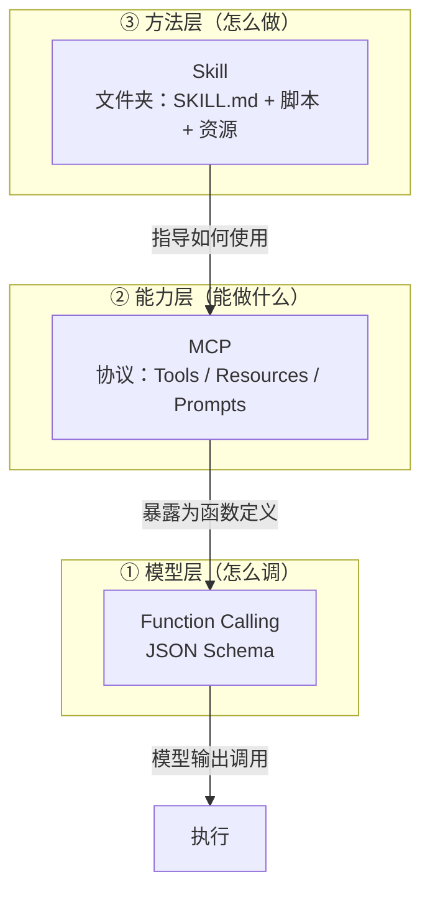

# Skill vs MCP

## 结论

**它们不是竞品，而是两个不同层次的东西。**

| | MCP | Skill |
|---|-----|-------|
| **一句话** | 解决"**怎么连**" | 解决"**怎么做**" |
| **给什么** | **能力**（能做什么） | **方法**（怎么做才对） |
| **类比** | 给一双手 + 一串插座 | 给一本操作手册 |

> **MCP 让 Agent "够得着"外部世界，Skill 让 Agent "做得对"。**
> 二者是**正交**的：可以只用其一，也可以叠加使用。

## 一、官方定义对照

### 1.1 Skill

> **Skills are organized folders of instructions, scripts, and resources that agents can discover and load dynamically to perform better at specific tasks.**

（技能是组织好的文件夹，包含指令、脚本与资源，Agent 可发现并按需动态加载，以在特定任务上表现更好。）

| 属性 | 值 |
|------|-----|
| 提出方 | Anthropic |
| 时间 | 2025 年 10 月 |
| 形态 | **一个文件夹**（含 `SKILL.md`） |
| 核心机制 | **渐进式披露（Progressive Disclosure）** |

### 1.2 MCP

> **An open standard that enables developers to build secure, two-way connections between their data sources and AI-powered tools.**

（开放标准，让开发者在数据源与 AI 工具之间建立安全的双向连接。）

| 属性 | 值 |
|------|-----|
| 提出方 | Anthropic |
| 时间 | 2024 年 11 月 |
| 形态 | **协议**（JSON-RPC 2.0） |
| 核心机制 | **能力发现（initialize → tools/list → tools/call）** |

### 1.3 一句话对比

```
MCP  = 连接层：把外部能力"接进来"
Skill = 知识层：把做事方法"教进去"
```

## 二、本质差异：它们在不同的层



| 层次 | 回答的问题 | 代表 |
|------|-----------|------|
| **方法层** | 这类任务**该怎么做**？ | Skill |
| **能力层** | 我**能调用什么**？ | MCP |
| **模型层** | 模型**怎么表达调用意图**？ | Function Calling |

**关键认知**：这三层是**叠加**的，不是替代的。

## 三、12 维详细对比

| # | 维度 | Skill | MCP |
|---|------|-------|-----|
| 1 | **本质** | 知识与流程包（文件） | 连接协议（JSON-RPC） |
| 2 | **解决的问题** | 怎么做才对 | 怎么连得上 |
| 3 | **物理形态** | 目录 + `SKILL.md` | Server 进程 / 远程服务 |
| 4 | **分发方式** | 复制文件夹 / Git | 部署服务 / 配置端点 |
| 5 | **是否需运行服务** | ❌ 不需要，纯文件 | ✅ 需要 Server 在跑 |
| 6 | **代码在哪执行** | **Agent 所在环境**（本地沙箱） | **Server 进程**（可能远程） |
| 7 | **加载机制** | 元数据 → 正文 → 文件（三级） | 握手 → 列工具 → 调用 |
| 8 | **粒度** | 粗：一个完整任务 | 中：一组能力 |
| 9 | **谁能决定使用** | 模型判断相关性后加载 | 模型判断后调用 |
| 10 | **跨应用复用** | 文件级（拷过去就行） | 协议级（任何 Client 都能连） |
| 11 | **主要成本** | 上下文 token | 网络/进程 + 上下文 token |
| 12 | **依赖前提** | Agent 支持 Skill 机制 | Agent 支持 MCP Client |

### 3.1 最关键的一条差异：代码在哪跑

| | Skill 的脚本 | MCP 的工具 |
|---|---|---|
| 执行位置 | **Agent 本机**（沙箱内） | **Server 进程**（可能远端） |
| 权限来源 | Agent 进程的权限 | Server 自己持有的凭证 |
| 安全边界 | 与 Agent 相同 | 由网络与鉴权隔离 |
| 典型用途 | 本地文件处理、格式转换 | 访问数据库、调第三方 API |

> **这条决定了安全模型完全不同**：
> Skill 的脚本**直接跑在你的机器上**，风险等同"下载了一个脚本"；
> MCP 的工具跑在 Server 侧，风险等同"调用了一个外部服务"。

## 四、加载机制对比：都是渐进式，但方式不同

### 4.1 Skill 的三级披露

| 层级 | 内容 | 何时进上下文 |
|------|------|--------------|
| L1 | `name` + `description` | **常驻**（几十 token） |
| L2 | `SKILL.md` 正文 | 技能被判定相关时 |
| L3 | `scripts/`、`references/` | 实际用到时 |

### 4.2 MCP 的发现流程

| 阶段 | 动作 | 进入上下文的内容 |
|------|------|------------------|
| 1 | `initialize` | 能力声明（不进模型上下文） |
| 2 | `tools/list` | **所有工具的名字 + 描述 + schema** |
| 3 | `tools/call` | 只有结果 |

### 4.3 一个反直觉的对比

| | Skill | MCP |
|---|-------|-----|
| **元数据规模** | 极小（一行描述） | **较大**（每个工具的完整 schema） |
| **扩展时成本** | 增加技能 ≈ 增加一行 | 增加工具 = **持续占用上下文** |

> **重要洞察**：Skill 数量增长时上下文成本几乎不变；但 **MCP 工具数量增长会持续吃掉上下文**（每个工具的 `inputSchema` 都常驻）。
> 这就是为什么"接了很多 MCP Server 后模型变笨"——**工具太多稀释了注意力**。

## 五、什么时候用哪个

```mermaid
flowchart TD
    A["需求"] --> B{"需要访问外部系统？<br/>数据库/API/文件/第三方服务"}
    B -- 是 --> C["需要 MCP<br/>（或本地工具）"]
    B -- 否 --> D{"只是"做事的方法"？<br/>流程/规范/格式"}
    D -- 是 --> E["需要 Skill"]
    D -- 否 --> F["可能只是提示词"]
    C --> G{"还需要"按特定流程用这些能力"？"}
    G -- 是 --> H["MCP + Skill 组合"]
    G -- 否 --> I["只用 MCP"]
```

### 场景对照表

| 场景 | 需要 MCP？ | 需要 Skill？ |
|------|-----------|-------------|
| 查询公司数据库 | ✅ | ❌ |
| 按公司规范做代码评审 | ❌ | ✅ |
| 填 PDF 表单（含固定步骤） | ❌ | ✅ |
| 调 GitHub API 查 PR | ✅ | ❌ |
| 用 Jira + Git 生成周报（有固定模板） | ✅ | ✅ |
| 遵守品牌规范生成 PPT | ❌ | ✅ |
| 访问内部知识库 | ✅ | ❌ |
| 处理扫描件 OCR 的完整流程 | ❌ | ✅ |

## 六、组合使用：Skill 指导 MCP

**这才是威力最大的用法**：Skill 负责"流程与规范"，MCP 负责"能力供给"。

### 6.1 示例：一个"周报生成"技能

```
weekly-report/
├── SKILL.md
├── references/
│   └── report-template.md
└── scripts/
    └── render_markdown.py
```

**`SKILL.md`**：

```markdown
---
name: weekly-report
description: 基于 Jira 与 GitHub 数据生成团队周报。当用户要求生成周报、汇总本周工作时使用。
---

# 团队周报生成

## 前提
需要以下 MCP 工具可用：
- `jira__search_issues`
- `github__list_pull_requests`

## 步骤
1. 用 `jira__search_issues` 查询本周已完成的工单
2. 用 `github__list_pull_requests` 查询本周合并的 PR
3. 按 `references/report-template.md` 的结构组织内容
4. 用 `scripts/render_markdown.py` 输出最终 Markdown

## 规则
- 只统计本周（周一至周日）
- 每条工作必须带工单号或 PR 链接
- 数据缺失时明确标注"未获取到"，不要编造
```

**效果**：

| 只接 MCP | MCP + Skill |
|----------|-------------|
| 模型知道有这些工具，但不知道**该按什么顺序用** | 明确告诉我先查 Jira、再查 GitHub、再套模板 |
| 输出格式随机 | 严格按模板 |
| 可能漏掉某一步 | 流程固定，不漏步 |

> **MCP 提供原料，Skill 提供菜谱。**

### 6.2 组合时的责任划分

| 关注点 | 归属 |
|--------|------|
| 工具能不能用 | MCP |
| 什么时候用哪个工具 | Skill |
| 数据怎么取 | MCP |
| 数据怎么组织 | Skill |
| 权限与鉴权 | MCP |
| 业务规则与格式 | Skill |

## 七、各自的边界与风险

### 7.1 Skill 的风险

| 风险 | 说明 | 防护 |
|------|------|------|
| **脚本执行** | 脚本直接跑在本机 | 只装可信来源，审阅代码 |
| **提示注入** | 技能正文可能含恶意指令 | 第三方技能必须人工审 |
| **无强约束** | 模型"应该"遵守，但不保证 | 用脚本做硬校验 |
| **版本漂移** | 文件被改无人知 | 进 Git，固定版本 |

### 7.2 MCP 的风险

| 风险 | 说明 | 防护 |
|------|------|------|
| **供应链** | 第三方 Server 可能被篡改 | 固定版本、审代码 |
| **工具投毒** | 恶意工具描述诱导调用 | 白名单 + 审阅 |
| **过度授权** | Server 权限过大 | 最小权限 + roots |
| **网络暴露** | 远程服务未鉴权 | OAuth 2.1 |
| **数据外泄** | 工具偷偷上传 | 出口管控 + 审计 |

### 7.3 一句话总结风险差异

> **Skill 的风险是"装了个脚本"，MCP 的风险是"连了个服务"。**

## 八、常见误区

| 误区 | 事实 |
|------|------|
| "Skill 是 MCP 的替代品" | ❌ 层次不同，前者是方法，后者是连接 |
| "有了 MCP 就不需要 Skill" | ❌ MCP 不告诉模型"该按什么流程用" |
| "Skill 更高级，MCP 要淘汰" | ❌ 二者正交，各自解决不同问题 |
| "Skill 里不能调 MCP 工具" | ❌ **可以且推荐**，这是最佳组合 |
| "工具越多 Agent 越强" | ❌ MCP 工具都占上下文，过多会降低选择准确率 |
| "Skill 的脚本在 Server 上跑" | ❌ 在 **Agent 本机**跑 |
| "两者只能选一个" | ❌ 大多数复杂场景需要**两者都要** |

## 九、选型清单

**先问三个问题**

- [ ] 需要访问**外部系统**（数据库/API/第三方服务）？→ 是则必须 **MCP**
- [ ] 有**固定的做事流程或输出格式**？→ 是则必须 **Skill**
- [ ] 两者都有？→ **组合使用**，Skill 里引用 MCP 工具名

**接入 MCP 前**

- [ ] 工具数量是否可控（建议单场景 < 30 个）
- [ ] 是否只接可信 Server
- [ ] 是否有鉴权与审计

**编写 Skill 前**

- [ ] `description` 是否写清"何时用"
- [ ] 是否引用了要用的 MCP 工具名
- [ ] 脚本是否有错误处理
- [ ] 是否纳入版本管理

## 十、总结

| | MCP | Skill |
|---|-----|-------|
| **管什么** | 连接与能力 | 方法与流程 |
| **像什么** | 插座与电线 | 说明书 |
| **不加会怎样** | 够不着外部世界 | 知道能做但做得不对 |
| **加多了会怎样** | 工具过载、注意力稀释 | 成本低，但可能互相冲突 |
| **最佳实践** | 少而精，按场景筛选 | 一个技能一个任务域 |

**最终结论：**

> **MCP 解决"能不能"，Skill 解决"对不对"。**
> 能力靠协议打通，方法靠知识沉淀——**两者叠加，Agent 才既够得着、又做得好。**
