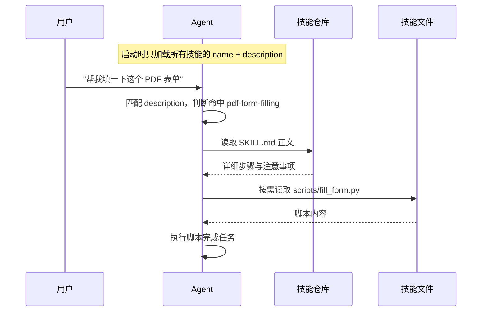

# Skill（Agent 技能）

## 结论

**Skill 是一个文件夹**：把"**指令（怎么做） + 脚本（可执行） + 资源（模板/参考）**"打包成一个可复用的能力包，模型**按需加载**。
它的核心机制叫 **渐进式披露（Progressive Disclosure）**——先只让模型看到一行"这个技能是干什么的"，等真的需要时才把详细说明和文件读进来。

> 一句话：**Tool 给模型"手脚"，Skill 给模型"手艺"。**

## 一、什么是 Skill

### 1.1 官方定义

Anthropic 于 2025 年 10 月提出 **Agent Skills**，定义为：

> **Skills are organized folders of instructions, scripts, and resources that agents can discover and load dynamically to perform better at specific tasks.**
> （技能是组织好的文件夹，包含指令、脚本与资源，Agent 可以发现并按需动态加载，从而在特定任务上表现更好。）

关键点：

| 要素 | 说明 |
|------|------|
| **载体是文件夹** | 不是一个 prompt，也不是一段代码，而是一个目录 |
| **必需文件是 `SKILL.md`** | 放在技能目录根部，是入口 |
| **可以带可执行代码** | 脚本、CLI 工具都可以打包进去 |
| **模型自主发现** | 模型根据 `description` 判断"该不该用" |

### 1.2 与已有概念的边界

| 概念 | 解决的问题 | 类比 |
|------|-----------|------|
| **Prompt** | 一次性告诉模型怎么做 | 口头交代 |
| **Tool** | 让模型能执行动作（查库、发请求） | 给一双手 |
| **RAG** | 让模型能查到资料 | 给一本书 |
| **Skill** | 让模型掌握一整套**流程 + 脚本 + 资源** | 给一本**操作手册 + 工具箱** |

**Skill 可以内含 Tool 的使用方式**：它不只说"有什么工具"，而是说"遇到这类任务，按这几步，用这些脚本，产出这个格式"。

## 二、要解决什么问题

| 痛点 | Skill 的解法 |
|------|--------------|
| **系统提示词无限膨胀** | 不用把所有领域知识都塞进 system prompt，改成按需加载 |
| **专业流程无法复用** | 打包成文件夹，跨会话、跨项目、跨人复用 |
| **光有工具不知道怎么做** | 技能里写清"什么时候用哪个工具、按什么步骤" |
| **知识沉淀无载体** | 技能就是可版本管理的知识资产（进 Git） |

**典型案例**：处理 PDF 表单、生成品牌规范的 PPT、按团队规范做代码评审——这些"有一套固定做法"的任务，特别适合做成 Skill。

## 三、核心机制：渐进式披露

这是 Skill 最关键的工程价值，**也是它区别于"把说明写进 system prompt"的根本原因**。

### 三层加载

| 层级 | 内容 | 何时进入上下文 | 成本 |
|------|------|----------------|------|
| **Level 1：元数据** | `name` + `description` | **启动时常驻** | 每个技能约几十 token |
| **Level 2：SKILL.md 正文** | 详细步骤、注意事项 | **技能被触发时** | 几百到几千 token |
| **Level 3：附加文件** | `references/`、`scripts/`、`assets/` | **实际用到时才读** | 按需 |

### 为什么这样设计

假设你有 20 个技能，每个详细说明 3000 token：

| 方案 | 上下文占用 |
|------|-----------|
| 全塞进 system prompt | **60,000 token**，每次都付 |
| 渐进式披露 | 20 × 50 = **1,000 token**（只有元数据常驻） |

> **结论：技能数量越多，渐进式披露的收益越明显。** 模型不需要"预先知道所有细节"，只需要"知道去哪找细节"。

## 四、目录结构

```
my-skill/
├── SKILL.md            # 必需：入口，含元数据与指令
├── scripts/            # 可选：可执行脚本
│   └── process.py
├── references/         # 可选：参考资料（长文档、规范）
│   └── style-guide.md
└── assets/             # 可选：模板、素材
    └── template.docx
```

**约定**：

- `SKILL.md` **必须**在技能目录根部
- 其余目录名是社区惯例，**不是强制**，但遵循它更利于复用
- 目录名（即技能名）建议用小写连字符

## 五、`SKILL.md` 的格式

### 5.1 结构：YAML 元数据 + Markdown 正文

```markdown
---
name: pdf-form-filling
description: 填写 PDF 表单并保留原始排版。当用户要求填写、修改或提取 PDF 表单字段时使用，支持 AcroForm 与扫描件。
---

# PDF 表单填写

## 何时使用
用户提到 .pdf 文件，且涉及填写字段、修改表单值、提取表单数据时。

## 步骤
1. 用 `scripts/inspect_fields.py` 列出所有字段名与类型
2. 按字段名映射用户提供的数据
3. 用 `scripts/fill_form.py` 写入，不要重建页面
4. 校验输出文件页数与原文件一致

## 注意事项
- 不要用文本覆盖方式"假装填表"，会丢失可编辑性
- 加密 PDF 需先解密

## 参考
- 字段类型说明见 `references/field-types.md`
```

### 5.2 元数据字段（官方约束）

| 字段 | 必需 | 约束 |
|------|------|------|
| `name` | ✅ | 最多 64 字符；**只用小写字母、数字、连字符** |
| `description` | ✅ | 最多 1024 字符；说明**做什么** + **何时使用** |

> `description` 是**触发开关**：模型靠它判断"这个技能和当前任务相关吗"。写得模糊 = 技能永远不被调用。

### 5.3 `description` 的写法对比

| ❌ 差 | ✅ 好 |
|-------|-------|
| `"PDF 相关工具"` | `"填写 PDF 表单并保留原始排版。当用户要求填写、修改或提取 PDF 表单字段时使用，支持 AcroForm 与扫描件。"` |
| `"帮助写代码"` | `"按团队代码规范做评审：检查命名、错误处理、SQL 注入、日志脱敏。当用户请求 code review 或提交前自查时使用。"` |

**好 description 的三要素**：

1. **做什么**（能力）
2. **何时用**（触发条件）
3. **边界**（支持什么、不支持什么）

## 六、Skill vs Tool vs MCP

| 维度 | Skill | Tool | MCP |
|------|-------|------|-----|
| **本质** | 知识与流程包 | 单个可调用函数 | 工具/资源的标准化协议 |
| **形态** | 文件夹（含 Markdown + 脚本） | JSON Schema + 执行器 | 服务端协议 |
| **模型如何使用** | 加载说明后**照着做** | **调用**后拿结果 | 连接服务后**调用** |
| **能否携带流程** | ✅ 可以写完整 SOP | ❌ 只有单步动作 | ❌ 只有能力暴露 |
| **粒度** | 粗（一个完整任务） | 细（一个动作） | 中（一组能力） |

**三者是互补关系**：

```
Skill（怎么做） → 指导使用 → Tool / MCP（能做什么）
```

## 七、加载与执行流程



## 八、编写最佳实践

### 8.1 结构原则

| 原则 | 做法 |
|------|------|
| **正文简短** | SKILL.md 只放"必须知道的"，长内容放 `references/` |
| **步骤可执行** | 用编号列表，每步一个动作 |
| **明确边界** | 写清"不适用什么场景" |
| **避免与系统提示重复** | 重复内容浪费 token，还可能与系统规则冲突 |
| **脚本要健壮** | 有参数校验、错误提示、退出码 |

### 8.2 渐进式披露的落地技巧

| 内容 | 放哪里 | 理由 |
|------|--------|------|
| 一句话说明 | `description` | 常驻，必须短 |
| 核心步骤 | `SKILL.md` 正文 | 触发时加载 |
| 长篇规范、字段表 | `references/*.md` | 用到才读 |
| 可执行逻辑 | `scripts/*.py` | 用到才读 |
| 模板文件 | `assets/` | 产出时复制 |

### 8.3 命名与描述

- **name**：`pdf-form-filling`、`code-review`、`brand-ppt`——动词或名词短语，见名知意
- **description**：用**第三人称**描述（"填写…""当用户…时使用"），不要用"我可以帮你…"

## 九、安全

| 风险 | 说明 | 防护 |
|------|------|------|
| **脚本执行** | 技能可带可执行代码，等同于在本机跑程序 | 只安装可信来源的技能；审查脚本 |
| **提示注入** | 技能正文或参考文件可能含恶意指令 | 第三方技能必须人工审阅 |
| **越权操作** | 技能可能引导模型执行高危动作 | 高危操作仍需人工确认闸门 |
| **数据外泄** | 脚本可能偷偷上传数据 | 审查网络请求；沙箱运行 |
| **供应链** | 从网上下载的技能可能被篡改 | 校验来源与版本，进 Git 管理 |

> **核心原则：技能是"可执行的知识"，安装技能 = 安装软件，必须同等谨慎。**

## 十、完整示例：代码评审技能

```
code-review/
├── SKILL.md
├── references/
│   └── team-rules.md
└── scripts/
    └── check_secrets.py
```

**`SKILL.md`**：

```markdown
---
name: code-review
description: 按团队规范评审代码，检查命名、错误处理、SQL 注入、日志脱敏与硬编码密钥。当用户请求 code review、提交前自查或审查 PR 时使用。
---

# 代码评审

## 何时使用
用户要求 review 代码、审查 PR、或提交前自查时。

## 评审顺序
1. **安全优先**：运行 `scripts/check_secrets.py <path>` 检查硬编码密钥
2. **正确性**：空指针、边界条件、异常吞掉
3. **数据访问**：SQL 是否全参数绑定，禁止字符串拼接
4. **日志**：敏感字段（密码、身份证、手机号）是否脱敏
5. **命名与结构**：是否符合 `references/team-rules.md`

## 输出格式
按严重程度分组，每条给出：位置 → 问题 → 修改建议。

- 【严重】必须修复
- 【建议】可选优化

## 边界
- 只做静态审查，不运行代码
- 不确定的判断标注"需人工确认"，不要臆断
```

## 十一、常见反模式

| 反模式 | 问题 | 改进 |
|--------|------|------|
| `description` 写"一个有用的技能" | 永远不会被触发 | 写清触发条件与关键词 |
| 把整本手册塞进 `SKILL.md` | 触发时 token 爆炸 | 拆到 `references/` |
| 技能里重复系统提示的规则 | 浪费 token、可能冲突 | 只写技能特有的 |
| 步骤写成散文 | 模型难执行 | 改用编号列表 |
| 脚本无错误处理 | 失败时模型无法理解 | 输出结构化错误 |
| 一个技能包办所有事 | 职责不清、难复用 | 一个技能一个任务域 |
| 从不更新 | 随业务变化失效 | 进 Git，定期回归 |

## 十二、Checklist

**元数据**
- [ ] `name` 是小写连字符，≤64 字符
- [ ] `description` ≤1024 字符，含"做什么 + 何时用 + 边界"

**结构**
- [ ] `SKILL.md` 在根目录
- [ ] 正文只放核心步骤，长内容在 `references/`
- [ ] 步骤是可执行的编号列表

**脚本**
- [ ] 有参数校验与错误输出
- [ ] 有退出码
- [ ] 不在脚本里硬编码密钥

**安全**
- [ ] 来源可信，已人工审查
- [ ] 高危操作需确认
- [ ] 纳入版本管理

## 十三、总结

**Skill 的本质是"给 Agent 一份可执行的操作手册"，靠渐进式披露在"能力"与"成本"之间取得平衡：**

- **元数据常驻** → 模型随时知道"有哪些技能"
- **正文按需加载** → 触发时才付出 token
- **文件按需读取** → 深度内容不提前占用上下文

对使用者来说，它让**专业知识沉淀成可复用的资产**；对工程来说，它让**上下文成本随技能数量增长时保持可控**。

> 记住那句话：**Tool 给模型手脚，Skill 给模型手艺。**

---

> 说明：本文以 Anthropic 发布的 **Agent Skills** 设计与公开文档为依据。具体平台（Claude Code / 各类 IDE Agent）的实现细节可能略有差异；Skill 是否已成为正式跨平台开放标准，**目前尚无定论**，接入时请以所使用平台的官方文档为准。
