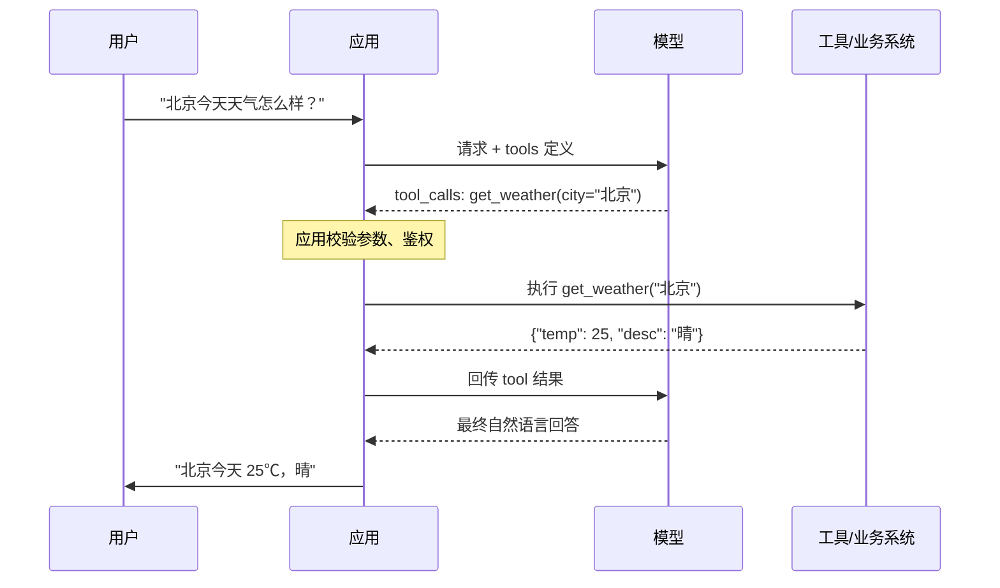

# Tool Calling 与 Tool 封装


## 结论

**Tool Calling（工具调用）是模型输出一段结构化的"调用请求"，由应用执行后把结果回传给模型。模型自己从不执行任何代码。**
**Tool 封装（Tool Wrapping）是把你的业务能力包装成"模型能理解、系统能安全执行"的工具**——包含 Schema 描述、参数校验、执行器、错误处理、权限控制五层。

一句话：**Tool Calling 是协议，Tool 封装是工程。**

## 一、核心认知：模型不执行工具

这是最容易误解的一点：

| 误解 | 事实 |
|------|------|
| 模型会调用 API | ❌ 模型只**生成一段 JSON**，说"我想调这个函数，参数是这些" |
| 模型能访问数据库 | ❌ 真正的查询由**你的代码**执行 |
| 模型知道执行结果 | ❌ 必须由你把结果**回传**给它 |

所以 Tool Calling 是一个**"模型请求 → 应用执行 → 结果回传 → 模型继续"**的循环。

## 二、标准调用流程



关键点：

1. **工具定义随请求发送**（`tools` 参数）
2. 模型返回的是**结构化的调用意图**，不是文本回答
3. 应用负责**校验、执行、回传**
4. 模型可能**连续多轮**调用工具（agentic loop）

## 三、官方请求/响应结构

### 3.1 OpenAI 格式

**请求中定义工具：**

```json
{
  "model": "gpt-4o",
  "messages": [{ "role": "user", "content": "北京天气如何？" }],
  "tools": [
    {
      "type": "function",
      "function": {
        "name": "get_weather",
        "description": "查询指定城市的实时天气。当用户询问天气时调用。",
        "parameters": {
          "type": "object",
          "properties": {
            "city": { "type": "string", "description": "城市名称，如“北京”" },
            "unit": { "type": "string", "enum": ["celsius", "fahrenheit"] }
          },
          "required": ["city"]
        }
      }
    }
  ],
  "tool_choice": "auto"
}
```

**模型响应（发起调用）：**

```json
{
  "choices": [{
    "finish_reason": "tool_calls",
    "message": {
      "role": "assistant",
      "tool_calls": [{
        "id": "call_abc123",
        "type": "function",
        "function": { "name": "get_weather", "arguments": "{\"city\":\"北京\"}" }
      }]
    }
  }]
}
```

> 注意：`arguments` 是 **JSON 字符串**，不是对象，需要自己 `json.loads`。

**应用回传执行结果：**

```json
{
  "role": "tool",
  "tool_call_id": "call_abc123",
  "content": "{\"temp\": 25, \"desc\": \"晴\"}"
}
```

### 3.2 Anthropic（Claude）格式

**请求：**

```json
{
  "model": "claude-sonnet-4",
  "tools": [{
    "name": "get_weather",
    "description": "查询指定城市的实时天气。",
    "input_schema": {
      "type": "object",
      "properties": { "city": { "type": "string" } },
      "required": ["city"]
    }
  }],
  "messages": [{ "role": "user", "content": "北京天气如何？" }]
}
```

**响应（`stop_reason: "tool_use"`）：**

```json
{
  "stop_reason": "tool_use",
  "content": [{
    "type": "tool_use",
    "id": "toolu_abc123",
    "name": "get_weather",
    "input": { "city": "北京" }
  }]
}
```

> Claude 的 `input` 已经是**对象**，无需二次解析。

**回传结果：**

```json
{
  "role": "user",
  "content": [{
    "type": "tool_result",
    "tool_use_id": "toolu_abc123",
    "content": "{\"temp\": 25, \"desc\": \"晴\"}"
  }]
}
```

### 3.3 两家差异速查

| 项目 | OpenAI | Anthropic |
|------|--------|-----------|
| 工具字段 | `tools[].function.{name,description,parameters}` | `tools[].{name,description,input_schema}` |
| 调用字段 | `message.tool_calls[]` | `content[]` 中 `type:"tool_use"` |
| 参数形态 | `arguments` 为 **JSON 字符串** | `input` 为 **对象** |
| 结束标志 | `finish_reason: "tool_calls"` | `stop_reason: "tool_use"` |
| 结果回传 | `role:"tool"` + `tool_call_id` | `user` 消息里的 `tool_result` 块 |

## 四、工具描述（Schema）编写实践

**工具的 `description` 是决定调用准确率的第一要素**，比参数名更重要。

### 4.1 命名规范

| 规则 | 示例 |
|------|------|
| `动词_名词`，小写下划线 | `get_weather`、`create_order`、`search_docs` |
| 避免含糊动词 | ❌ `handle`、`process`、`do_stuff` |
| 同类工具命名有区分度 | `get_order` vs `get_order_list` |

### 4.2 description 写法

```json
{
  "name": "search_docs",
  "description": "在内部知识库中检索文档。当用户询问产品功能、政策、操作步骤时调用。返回最相关的 3 条文档摘要。不要用于查询实时数据。"
}
```

要点：

- **说明什么时候调用**（when）
- **说明返回什么**（what）
- **说明什么时候不要调用**（边界）
- 一句话说清，不要写成散文

### 4.3 参数设计

| 技巧 | 说明 |
|------|------|
| **enum 限制取值** | 比自由字符串可靠得多 |
| **required 明确** | 只把真正必需的字段设为必填 |
| **description 写清单位/格式** | "金额，单位：分"、"日期格式 YYYY-MM-DD" |
| **减少参数数量** | 参数越多，模型填错概率越高 |
| **避免嵌套过深** | 深层嵌套的 JSON 模型容易生成错误 |

## 五、Tool 封装（核心）

### 5.1 封装包含什么

```
┌─────────────────────────────────────────┐
│  ① Schema 层（给模型看）                 │
│     name / description / parameters       │
├─────────────────────────────────────────┤
│  ② 调度层（路由）                         │
│     根据 name 找到对应执行器              │
├─────────────────────────────────────────┤
│  ③ 校验层（给系统看）                     │
│     类型 / 必填 / 范围 / 业务规则         │
├─────────────────────────────────────────┤
│  ④ 执行层（真正的业务）                   │
│     API 调用 / 数据库查询 / 计算          │
├─────────────────────────────────────────┤
│  ⑤ 响应层（给模型看）                     │
│     结构化、精简、过滤敏感信息             │
└─────────────────────────────────────────┘
```

**只写第 ① 层（Schema）就上线的，是 90% 的工具调用事故来源。**

### 5.2 封装模式

| 模式 | 适用场景 | 说明 |
|------|----------|------|
| **函数 + 注册表** | 中小项目 | 每个工具一个函数，用 dict 注册 |
| **装饰器自动生成 Schema** | Python 项目 | 从类型注解推导 JSON Schema |
| **工具类 + 接口** | 大型项目 | 统一基类，便于日志/权限统一处理 |
| **MCP 协议** | 跨应用复用 | 标准化工具服务，见第九节 |

### 5.3 校验层不可省略

模型可能产出：

- 非法 JSON（少括号、多逗号）
- 缺字段 / 多字段
- 类型错误（数字传成字符串）
- 越界值（`page = -1`）
- **恶意参数**（SQL 注入、路径穿越）

> **模型生成 ≠ 可信输入**。校验必须在服务端独立做，前端/提示词里的约束都不算。

### 5.4 错误处理契约

错误信息是给**模型**看的，必须**可操作**，帮助它自我纠正：

| ❌ 差 | ✅ 好 |
|-------|-------|
| `Error: 500` | `city 参数不能为空，请提供城市名` |
| 抛出完整堆栈 | `未找到该订单，请确认订单号格式是否为 OD+8位数字` |
| 静默返回空 | `查询超时，可稍后重试` |

原则：

- 不暴露内部堆栈与实现细节
- 明确告诉模型"怎么改才对"
- 区分**可重试**（网络超时）与**不可重试**（参数错误）

### 5.5 返回值设计

| 原则 | 说明 |
|------|------|
| **结构化** | 返回 JSON，而非大段自然语言 |
| **精简** | 返回值会占用上下文 token，只给模型决策所需字段 |
| **信息完整** | 该有的字段别省，否则模型无法判断 |
| **过滤敏感** | 手机号、身份证、密钥不得出现在结果里 |
| **明确失败** | 用 `{"ok": false, "error": "..."}` 而不是空字符串 |

## 六、安全

| 风险 | 防护 |
|------|------|
| **参数注入** | 数据库全参数绑定；禁止字符串拼接 SQL/命令；路径做白名单校验 |
| **越权调用** | 工具执行前校验当前用户权限，**不能只靠模型自行判断** |
| **提示注入** | 用户可能诱导模型调用危险工具；高危工具需二次确认或人工审批 |
| **数据泄露** | 返回值过滤敏感字段 |
| **资源滥用** | 限流、配额、超时、最大调用轮数 |
| **无限循环** | 限制 agentic loop 的最大轮数（如 10 轮） |

> 核心原则：**权限校验必须在服务端，模型说什么不重要。**

## 七、工程实践

| 项目 | 做法 |
|------|------|
| **幂等** | 写操作带幂等键，防止重试造成重复下单 |
| **超时** | 每个工具设独立超时，避免拖死整个请求 |
| **重试** | 仅对幂等的读操作自动重试，写操作需谨慎 |
| **可观测** | 记录每次调用的工具名、参数、耗时、结果状态 |
| **工具数量** | 单次请求工具过多会显著降低选择准确率，建议**按场景动态筛选**（如 RAG 选工具） |
| **并行调用** | 无依赖的工具调用可并行执行以降低延迟 |

## 八、完整示例（Python + OpenAI SDK）

```python
import json
from openai import OpenAI

client = OpenAI()

# ① Schema 层
TOOLS = [{
    "type": "function",
    "function": {
        "name": "get_weather",
        "description": "查询指定城市的实时天气。用户询问天气时调用。",
        "parameters": {
            "type": "object",
            "properties": {
                "city": {"type": "string", "description": "城市名，如“北京”"},
                "unit": {"type": "string", "enum": ["celsius", "fahrenheit"]},
            },
            "required": ["city"],
        },
    },
}]

# ② 执行层
def get_weather(city: str, unit: str = "celsius") -> dict:
    # 这里是真实的业务调用
    return {"temp": 25, "desc": "晴", "unit": unit}

REGISTRY = {"get_weather": get_weather}

# ③ 校验 + 调度 + 响应
def execute_tool(name: str, raw_args: str) -> str:
    if name not in REGISTRY:
        return json.dumps({"ok": False, "error": f"未知工具: {name}"}, ensure_ascii=False)
    try:
        args = json.loads(raw_args)
    except json.JSONDecodeError:
        return json.dumps({"ok": False, "error": "参数不是合法 JSON"}, ensure_ascii=False)

    if not args.get("city"):
        return json.dumps({"ok": False, "error": "city 不能为空"}, ensure_ascii=False)

    try:
        result = REGISTRY[name](**args)
        return json.dumps({"ok": True, "data": result}, ensure_ascii=False)
    except Exception:
        return json.dumps({"ok": False, "error": "工具执行失败，请稍后重试"}, ensure_ascii=False)

# ④ 主循环（agentic loop）
def chat(user_input: str, max_rounds: int = 10) -> str:
    messages = [{"role": "user", "content": user_input}]

    for _ in range(max_rounds):
        resp = client.chat.completions.create(
            model="gpt-4o", messages=messages, tools=TOOLS
        )
        msg = resp.choices[0].message
        messages.append(msg)  # 关键：assistant 消息必须原样保留

        if not msg.tool_calls:
            return msg.content

        for call in msg.tool_calls:
            output = execute_tool(call.function.name, call.function.arguments)
            messages.append({
                "role": "tool",
                "tool_call_id": call.id,
                "content": output,
            })

    return "工具调用轮数超限，已停止。"
```

要点回顾：

- `assistant` 消息（含 `tool_calls`）必须**原样追加回历史**，否则下一轮报错
- 每次工具结果都要带 `tool_call_id`
- 循环有**最大轮数**保护

## 九、MCP：工具接入的标准化

**MCP（Model Context Protocol）** 是开放协议，把"工具/资源/提示"标准化成可复用的服务。价值：

- 工具**一次封装，多应用复用**
- 生态统一，无需为每个模型厂商重写适配
- 支持资源（数据）、工具（动作）、提示（模板）三类能力

## 十、Checklist

**Schema**
- [ ] 名称是 `动词_名词`，无歧义
- [ ] `description` 说清了**何时调用**、**返回什么**、**何时不调用**
- [ ] 参数有 `enum`/格式说明，数量精简

**封装**
- [ ] 服务端独立校验参数（不信任模型输出）
- [ ] 错误信息可操作、不暴露堆栈
- [ ] 返回值结构化、精简、过滤敏感字段
- [ ] 有超时、限流、最大轮数

**安全**
- [ ] 权限在服务端校验
- [ ] 参数防注入（SQL/命令/路径）
- [ ] 高危操作需二次确认

**可观测**
- [ ] 记录工具名、参数、耗时、结果状态
- [ ] 单次请求工具数量受控

## 十一、总结

**Tool Calling = 协议**：模型输出结构化意图，应用执行并回传。
**Tool 封装 = 工程**：把 Schema、调度、校验、执行、响应五层做扎实。

最容易犯的错不是"模型不会调工具"，而是**把模型输出当成可信输入直接执行**。工具描述写得准、校验做得严、错误回得清，这三件事决定了工具调用系统的实际可用性。
