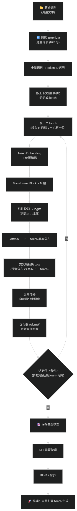

## 关键节点说明

| 阶段 | 关键点 |
|------|--------|
| 离线准备 | Tokenizer 和词表只建一次，之后固定不变 |
| 训练样本 | 输入 = 文本，标签 = 同一文本右移一位（自监督，无需人工标注） |
| 前向核心 | 注意力负责"融合上下文"，FFN 负责"逐位置非线性变换" |
| 损失 | 每个位置都算一次交叉熵，通常对整 batch 取平均 |
| 反向 | 梯度会一路传回 Embedding 矩阵（所以词向量是训练中习得的） |
| 停止 | 按固定步数、或验证集 Loss 不再下降（早停） |

## Transformer Block 的准确阶段

> 现代大模型（GPT-2 之后、Llama、DeepSeek 等）采用 **Pre-Norm** 结构：归一化放在子层**之前**，与 2017 原版 Transformer 的 Post-Norm（子层 → Add → Norm）不同。

单个 Block 接收一个 `4×6` 矩阵（4 个 token，维度 6），输出同样形状的 `4×6` 矩阵，d_model 保持不变。

### 执行顺序

1. **RMSNorm**（子层前归一化）
2. **多头自注意力**
   - 在多头切分后、注意力得分计算之前，对 **Q 和 K** 施加 **RoPE**（旋转位置编码），注入 token 位置信息
   - 因果掩码：训练时遮挡未来 token，防止偷看答案
3. **残差相加（Add）**：注意力输出 + 该子层输入
4. **RMSNorm**
5. **FFN**（前馈网络，引入非线性激活以提升模型表达能力；部分模型在此层使用 **MoE**，如 DeepSeek）
6. **残差相加（Add）**：FFN 输出 + 该子层输入

> 注：DeepSeek 的注意力用的是 **MLA**（多头潜在注意力）而非标准 MHA，MoE 也只在其 FFN 层生效。

### 与常见错误写法的区别

| 项目 | 错误 / 过时写法 | 准确写法 |
|------|----------------|----------|
| Norm 位置 | 子层 → Add → Norm（Post-Norm，仅原版 Transformer） | Norm → 子层 → Add（Pre-Norm，现代大模型） |
| RMSNorm 效果 | "归一化到 [−3,3]，防梯度爆炸/消失" | 不减均值、只除以均方根；典型值在 O(1) 量级，**不保证**落在 [−3,3]；作用是稳定训练、改善优化条件 |
| "残差" 术语 | 把子层输出称作"残差" | 残差流指**输入路径**，Add = 子层输出 + 输入 |
| 位置编码时机 | 在注意力整体之前加 | RoPE 作用于**每个头**的 Q/K，在计算注意力得分之前 |
| 输出含义 | 最后一层每行是"完整上下文" | 在因果注意力下，每行是"**到该位置为止**"的上下文表示 |

### 示意图

```
            输入 X  (4×6)
                 │
      ┌──────────┴──────────┐
      ▼                     │
   RMSNorm                  │
      │                     │
   多头自注意力              │
 (RoPE on Q/K, 因果掩码)     │
      │                     │
      └──────► Add ◀─────────┘
                 │
          ┌──────┴──────┐
          ▼             │
       RMSNorm          │
          │             │
        FFN / MoE       │
          │             │
          └─► Add ◀──────┘
                 │
            输出 (4×6)
```

输出仍是 `4×6`，但每一行已融合更丰富的上下文信息，随后送入下一个 Block，循环堆叠。
