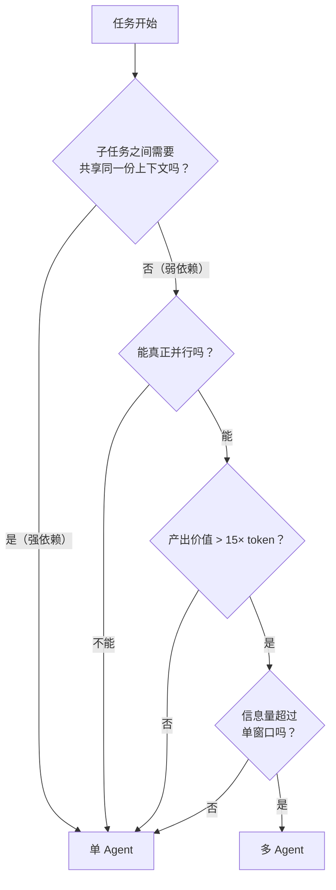

# 单 Agent / 多 Agent

> **权威依据**
> ① **Anthropic**《How we built our multi-agent research system》— 支持方，含完整数据
> ② **Cognition**《Don't Build Multi-Agents》— 反对方，两条上下文原则
> ③ **Anthropic**《Building Effective Agents》（2024-12）— Workflow vs Agent 定义
> ④ **《Why Do Multi-Agent LLM Systems Fail?》**（arXiv:2503.13657）— 14 种失败模式

## 结论

**单 Agent 与多 Agent 不是"新旧替代"，而是"任务形状匹配"的选择。**

| 任务形状 | 推荐 |
|----------|------|
| **广度优先、可并行、信息超单窗口** | **多 Agent** |
| **强依赖、需共享上下文、紧耦合** | **单 Agent** |

**最硬的两个数字**：

| | 相对 chat 的 token 消耗 |
|---|---|
| 单 Agent | **约 4×** |
| 多 Agent | **约 15×** |

> **多 Agent 的性能优势，很大程度上是"花了更多 token 买来的"。**
> 所以第一个问题永远不是"用几个 Agent"，而是"**这个任务的产出值不值 15 倍 token**"。

## 一、先定义

### 1.1 单 Agent

**一个 LLM + 一组工具 + 一个循环**，在**一个连续上下文窗口**内完成任务。

```
┌──────────────────────────┐
│   LLM（一个）             │
│  ├─ 工具集                │
│  ├─ 记忆/历史             │
│  └─ 循环控制器            │
└──────────────────────────┘
     ↑ 全程共享同一份上下文
```

### 1.2 多 Agent

**多个 Agent 各自持有独立上下文窗口**，通过某种编排结构协作完成一个任务。

**关键**：多 Agent 不是"一个东西"，而是**一族形态**——不同形态的收益与风险差别极大。

## 二、单 Agent 的构成与上限

### 2.1 优势

| 优势 | 原因 |
|------|------|
| **上下文天然连续** | 所有决策都能看到彼此，不会出现"隐含假设冲突" |
| **调试相对容易** | 一条轨迹，日志线性 |
| **成本可控** | 约 4× token，不是 15× |
| **延迟低** | 无跨 Agent 通信开销 |
| **错误不放大** | 一个错误不会在多个 Agent 间复利 |

### 2.2 天花板在哪

| 瓶颈 | 表现 |
|------|------|
| **上下文窗口** | 信息量超过窗口就装不下 |
| **注意力稀释** | Context Rot：token 越多，召回越差 |
| **串行速度** | 只能一条线走，慢 |
| **单点能力** | 一个模型要同时扮演研究员、作家、审查员 |
| **自我评估偏松** | 自己写的东西自己打分太宽容 |

> **多 Agent 的设计动机，本质上就是为了突破这五个瓶颈。**

## 三、多 Agent 的五种形态

| # | 形态 | 结构 | 典型收益 | 典型风险 |
|---|------|------|----------|----------|
| **1** | **Orchestrator-Workers** | 主 Agent 拆任务 → 派生多个子 Agent → 汇总 | 并行 + 上下文扩容 | 主 Agent 成瓶颈（同步等待） |
| **2** | **并行子 Agent** | N 个 Agent 同时探索不同侧面 | 时间最多缩短 90% | token 暴涨、结果冲突 |
| **3** | **Pipeline / Handoff** | A 做完交给 B，B 交给 C | 职责清晰 | **交接有损**，错误累积 |
| **4** | **Evaluator-Optimizer** | 生成者 + 独立评估者往返 | 质量提升（**成本最低的多 Agent**） | 评估标准本身要可靠 |
| **5** | **Debate / Group Chat** | 多 Agent 互相对话达成共识 | 讨论型任务 | 容易发散、无终止 |

> **注意第 4 种**：Evaluator-Optimizer 是**最值得先试的多 Agent 形态**——它只增加一个节点，却能解决"自己给自己打分太松"这个单 Agent 最难自解的问题。

### 3.1 Anthropic 的实际架构（Orchestrator-Workers）

| 角色 | 职责 |
|------|------|
| **Lead Agent（主控）** | 分析 query、制定策略、**把计划写入 Memory**（因为超 200K 会截断）、派生子 Agent、综合结果、决定是否迭代 |
| **Subagent（子 Agent）** | 独立上下文窗口，并行探索不同侧面，**返回压缩后的发现** |
| **CitationAgent** | 循环结束后为每条论断定位引用来源 |

**核心设计逻辑**（这句话很关键）：

> **搜索的本质是"压缩"。子 Agent 用独立上下文并行探索，再把最重要的 token 蒸馏回主 Agent**——既扩大总 token 预算，又通过**关注点分离**降低路径依赖。

## 四、最核心的争议：两派观点

### 4.1 支持方：Anthropic

**结论**：多 Agent 在**研究型任务**上显著有效。

**证据**：

| 指标 | 数据 |
|------|------|
| 内部 research eval | 多 Agent 比单 Agent Opus 4 **高 90.2%** |
| BrowseComp 归因 | **token 用量单独解释 80% 的性能方差** |
| 三者合计 | token + 工具调用次数 + 模型选择 = **95%** |
| 并行提速 | 复杂查询研究时间**最多缩短 90%** |
| 工具描述优化 | 重写工具描述后任务时间**下降 40%** |

**他们自己也承认的坦诚结论**：

> **"多 Agent 系统之所以有效，很大程度上是因为它帮助花掉足够的 token。"**
> 架构的价值在于把工作量分配到多个独立上下文窗口，**为并行推理扩容**。

> **这是全文最重要的一句话**——它把"多 Agent 很强"翻译成了"多 Agent 很能花钱"。

### 4.2 反对方：Cognition

**结论**：**不要构建多 Agent**（特指生产级长时编程任务）。

**两条上下文工程原则**：

> **原则 1：共享完整上下文，而且是完整的 Agent 轨迹（full agent traces），不只是单条消息。**

**反例**：任务"做一个 Flappy Bird 克隆"
- 子任务 1「做带绿管和碰撞箱的滚动背景」→ 子 Agent 做成了**超级马里奥风格**
- 子任务 2「做一只可上下移动的鸟」→ 鸟不像素材，手感不对
- 汇总 Agent 被迫去**缝合两个误解**

> 有人会反驳："把原始任务原文一并塞给子 Agent 不就行了？"
> 作者否定：真实系统是多轮的、做过工具调用，**任何细节都可能影响对子任务的解释**。只传"单条消息"不够，必须传"**完整轨迹**"。

> **原则 2：每个动作都隐含决策，决策冲突就会产生坏结果。**

即使补全上下文仍会出问题：子 Agent 1 与子 Agent 2 **彼此不可见**，各自基于**未被事先规定**的隐含假设行事（美术风格、坐标系、命名约定），最终产出风格/接口不一致。

**作者的判断**：这两条原则重要到"**几乎不值得违反**"，因此**默认应排除一切不满足它们的架构**。

### 4.3 为什么两派结论相反？—— 任务类型不同

**这是理解这一切争议的钥匙。**

| | Anthropic 的场景 | Cognition 的场景 |
|---|---|---|
| **任务** | **研究型 / 广度搜索** | **编程 / 长时构建** |
| **子任务关系** | **弱依赖**，可独立探索 | **强依赖**，互相影响 |
| **共享上下文需求** | 低（结果可汇总） | **极高**（风格/接口必须一致） |
| **失败容忍度** | 可多轮迭代修正 | 一处不一致就崩 |
| **token 是否买到价值** | 是（覆盖更多线索） | 否（重复劳动） |

### 4.4 惊人的一致：Anthropic 也说"编程不适合"

> Anthropic 原文明确列出**不适用**场景：
> - 需要**所有 Agent 共享同一上下文**的任务
> - Agent 之间**依赖关系密集**的任务
> - **多数编程任务**：真正可并行的子任务比研究少，且 LLM Agent **尚不擅长实时协调与委派**

**所以两派其实不矛盾**：

```
研究型、广度、弱依赖  →  多 Agent ✅（Anthropic）
编程型、深度、强依赖  →  单 Agent  ✅（Cognition）
```

两派**共享同一条底层原则**：

> **上下文切碎的代价，必须由并行收益来偿还。**

## 五、什么任务适合哪种

### 5.1 决策树



### 5.2 适用 / 不适用（Anthropic 原文）

#### ✅ 适用（表现优异）

- **广度优先（breadth-first）查询**：同时追多条独立线索
- **高度可并行化**的重任务
- **信息量超出单个上下文窗口**
- 需对接**大量复杂工具**
- **开放式、路径不可预测**的研究型问题

#### ❌ 不适用

- 所有 Agent 需**共享同一上下文**
- Agent 之间**依赖关系密集**
- **多数编程任务**
- 需要**强一致风格/接口**的产出

### 5.3 投入分级（很实用）

| 任务类型 | 建议配置 |
|----------|----------|
| 简单事实查找 | 1 个 Agent，3–10 次工具调用 |
| 直接对比 | 2–4 个子 Agent，各 10–15 次调用 |
| 复杂研究 | 10+ 个子 Agent，职责明确划分 |

## 六、失败模式：多 Agent 到底怎么失败的

### 6.1 学术结论

> **《Why Do Multi-Agent LLM Systems Fail?》**（arXiv:2503.13657）分析 **7 个框架、1600+ 条 trace**，归纳 **14 种失败模式**，分三类：

| 类别 | 内容 |
|------|------|
| **① 规格与系统设计** | 任务说明不清、角色定义模糊、流程设计缺陷 |
| **② Agent 间错位** | 信息丢失、假设冲突、推理不一致 |
| **③ 任务验证与终止** | 无正确验证、终止条件缺失、过早结束 |

> **核心结论：光改 prompt 解决不了——拓扑与通信协议才是关键。**

### 6.2 工程视角：错误会复利

> Anthropic 原文：**"一个步骤失败会让 Agent 走上完全不同的轨迹，产生不可预测的结果。"**

**早期失败模式的真实案例**：

| 症状 | 说明 |
|------|------|
| 过度派生 | 简单查询派生了 **50 个子 Agent** |
| 无限爬网 | 为不存在的信息持续搜索 |
| 互相干扰 | Agent 间**过度更新**导致彼此覆盖 |

## 七、如果决定做多 Agent：五个工程挑战

### 7.1 状态管理

| 要求 | 说明 |
|------|------|
| **持久化执行（durable execution）** | 长时间运行、跨多次调用维持状态 |
| **断点恢复** | 不能出错就从头重启（代价高） |
| **确定性重试 + 定期 checkpoint** | 恢复的基础设施 |
| **上下文续接** | 接近上限时摘要已完成阶段、写外部 Memory、派生新子 Agent 交接 |
| **子 Agent 产物写文件系统** | 只回传**轻量引用**给协调者，避免"传话游戏（game of telephone）"失真与 token 膨胀 |

### 7.2 错误传播与调试

| 问题 | 对策 |
|------|------|
| 错误复利式放大 | 让模型"知道工具在失败"并自主适配 + 确定性保障并用 |
| 非确定性难调试 | **全链路生产级 tracing**，监控**决策模式与交互结构**（而非对话内容，以保护隐私） |

### 7.3 部署

| 实践 | 说明 |
|------|------|
| **Rainbow deployment（彩虹部署）** | 新旧版本同时在线，流量逐步迁移，避免打断运行中的 Agent |
| **同步等待是瓶颈** | 主 Agent 同步等子 Agent 批次 → 无法中途 steer、单慢子 Agent 阻塞全局 |
| **异步化的代价** | 结果协调、状态一致性、错误传播都是新难题 |

### 7.4 评测

> **多 Agent 路径不唯一，不能只检查"是否按预设步骤执行"**——需要"结果正确 + 过程合理"的柔性评估。

| 要点 | 说明 |
|------|------|
| **小样本立即开始** | 约 **20 条**真实 query 即可；早期改动效应量大（30%→80%），少量用例就够 |
| **LLM-as-Judge** | **单一** LLM 调用输出 0.0–1.0 分 + pass/fail，**比多 judge 分项打分更稳定** |
| **评分维度** | 事实准确性、引用准确性、完整性、来源质量、工具效率 |
| **人工不可替代** | 能发现边缘情况——如早期 Agent 偏好 SEO 内容农场而非权威但排名低的来源 |
| **终态评估** | 状态变更型 Agent 只判最终状态，不逐轮审查 |

### 7.5 上下文传递（最难的一个）

> Cognition 直言：**"看不到有人专门投入解决跨 Agent 上下文传递这个难题。"**

**可操作的落地原则**（Cognition 原话要点）：

> 确保 Agent 的**每一个动作都被"系统中其他部分做出的所有相关决策"的上下文所支撑**——**理想状态下每个动作都能看到其他一切**。
> 受限于上下文窗口与现实权衡，你需自行决定：**为达到目标可靠性，愿意承担多少复杂度。**

## 八、代码对照

### 8.1 单 Agent

```python
def run_single_agent(task: str) -> str:
    messages = [{"role": "user", "content": task}]
    for _ in range(MAX_STEPS):
        resp = llm(messages, tools=TOOLS)
        if not resp.tool_calls:
            return resp.content
        for tc in resp.tool_calls:
            result = execute(tc)
            messages.append(tool_result(tc.id, result))
    return "达到步数上限"
```

### 8.2 多 Agent（Orchestrator-Workers）

```python
def run_multi_agent(task: str) -> str:
    # ① 主 Agent 拆解（关键是：拆出真正独立的子任务）
    plan = llm_plan(task)                      # → ["子任务A", "子任务B", "子任务C"]

    # ② 并行派发，每个子 Agent 独立上下文
    with ThreadPoolExecutor(max_workers=len(plan)) as pool:
        findings = list(pool.map(run_single_agent, plan))

    # ③ 汇总：只接收压缩后的发现，不接收完整轨迹
    return llm_synthesize(task, findings)
```

**对照要点**：

| | 单 Agent | 多 Agent |
|---|---|---|
| 上下文 | 一份，全程连续 | N 份，**必须靠 summary 桥接** |
| 失败面 | 循环跑歪 | 拆解错 + 子任务错 + 汇总错 |
| 调试 | 看一条轨迹 | 看 N+1 条轨迹 + 边 |

> **注意 `run_multi_agent` 里的隐性风险**：`plan` 一旦有歧义，`run_single_agent` 就会各自"合理发挥"——这就是 Cognition 讲的两条原则被违反的地方。

## 九、常见误区

| 误区 | 事实 |
|------|------|
| "多 Agent 是单 Agent 的升级版" | ❌ 是**不同任务形状的匹配**，不是版本号 |
| "Agent 越多越强" | ❌ 15× token 换来的是**并行度**，不是**智能** |
| "多 Agent 主要赢在聪明" | ❌ Anthropic 自己说：很大程度赢在**花掉足够 token** |
| "让 Agent 互相商量就能解决冲突" | ❌ Cognition：Agent 尚不具备可靠的长上下文主动协商能力 |
| "把原始任务贴给子 Agent 就够" | ❌ 不够，需**完整轨迹**；任何细节都可能影响解释 |
| "编程也能拆给多 Agent" | ❌ 两派**都同意**编程不适合（依赖密集、可并行子任务少） |
| "多 Agent 好调试" | ❌ 错误复利放大，且运行非确定性，仅凭日志难判断 |
| "先搭多 Agent 框架再优化" | ❌ 先做单 Agent，撞到天花板再加 |

## 十、Checklist

**先问自己（决定架构前）**
- [ ] 子任务之间**需要共享同一份上下文**吗？
- [ ] 子任务能**真正并行**，还是只是看起来能？
- [ ] 产出价值能覆盖 **15× token** 吗？
- [ ] 信息量真的**超过单窗口**了吗？
- [ ] 单 Agent 撞到的是**哪个具体天花板**？（窗口？速度？自我评估？）

**如果选单 Agent**
- [ ] 有上下文压缩策略
- [ ] 有独立验证（不自己给自己打分）
- [ ] 有步数上限与预算
- [ ] 有工具结果清理

**如果选多 Agent**
- [ ] 每个子 Agent 拿到**足够完整的上下文**（不是一句话）
- [ ] 子任务间的**隐含假设已事先统一**（风格、命名、坐标系）
- [ ] 子 Agent 产物**写文件系统**，只回传引用
- [ ] 有**持久化 + checkpoint + 断点恢复**
- [ ] 有**全链路 tracing**（看决策结构，不看对话内容）
- [ ] 有**termination 语义**（成功/部分成功/失败/上报）
- [ ] 评测覆盖**过程合理性**，不只最终答案
- [ ] 有 token 预算与告警

## 十一、总结

**两派看似对立，实则共同指向一条原则：**

> **上下文切碎的代价，必须由并行收益来偿还。**

| | 单 Agent | 多 Agent |
|---|---|---|
| **本质** | 一份连续上下文 | N 份上下文 + 桥接 |
| **买到了什么** | 一致性、可调试 | **并行度 + 上下文扩容** |
| **付了什么** | 窗口上限、串行速度 | **15× token、隐含冲突、调试地狱** |
| **典型场景** | 编程、强依赖任务 | 研究、广度搜索 |

**四条最值得记住的原则**：

1. **先问任务形状，再问 Agent 数量** —— 强依赖用单，弱依赖可多
2. **多 Agent 的收益主要是"花掉更多 token"** —— 问自己这钱值不值
3. **上下文不能只切不传** —— 传一句话不够，要传完整轨迹与决策
4. **编程任务两派都说别做** —— 这是最明确的一条共识

> **最后一句话**：
> **多 Agent 不是"更强的 Agent"，而是"更大的计算预算 + 更碎的上下文"。**
> 前者给你上限，后者给你风险——**只有当并行收益明显盖过切碎成本时，它才划算。**

---

> **资料说明**
> 适用/不适用场景、90.2% 提升、15×/4× token、80% 方差归因、90% 提速、40% 工具描述收益、工程挑战（彩虹部署、tracing、LLM-as-Judge、20 条起步）等，依据 **Anthropic《How we built our multi-agent research system》** 原文整理。
> 两条上下文原则、Flappy Bird 反例、edit-apply-model 教训、Claude Code 子 Agent 设计等，依据 **Cognition《Don't Build Multi-Agents》** 原文整理。
> 14 种失败模式与三类归因，依据 **arXiv:2503.13657《Why Do Multi-Agent LLM Systems Fail?》**（转述，未直读全文）。
> Workflow vs Agent 界定与五种 Workflow 模式，依据 **Anthropic《Building Effective Agents》（2024-12）**。
>
> **重要限制**：
> - **两篇文章的发布时间均未在页面显式标注**，据内容推断均为 **2025 年中前后**。Cognition 文中"Claude Code 子 Agent 不并行"的描述是 **2025-06 的状态**，**至今（2026-11）可能已变化**，需核对最新文档。
> - **Anthropic 的 90.2% 与 15× 是特定研究型任务的实测**，**不可外推到编程或其他任务类型**。
> - 《Why Do Multi-Agent LLM Systems Fail?》我**未直读原文**，数据来自多源转述，建议核对 arXiv 2503.13657。
> - 所有引文均为**中文意译**，非逐字直译。
