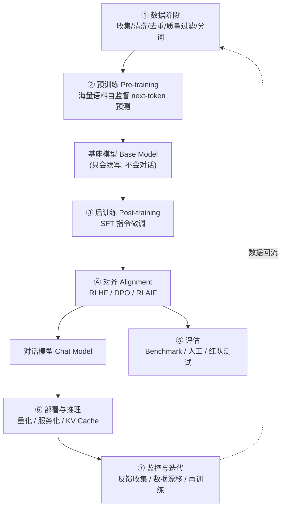

# 大语言模型（LLM）训练流程

## 结论

LLM 的完整生命周期不是"一次训练"，而是 **数据 → 预训练 → 后训练(对齐) → 评估 → 部署 → 监控迭代** 的闭环。Transformer 的训练流程只是其中**预训练**这一个环节。真正的差别在于：预训练让模型"会续写"，后训练才让它"会听话、会对话、够安全"。

## 全景图

## 阶段详解

### ① 数据阶段（决定上限）

- **收集**：网页、书籍、代码、论文、对话等
- **清洗**：去乱码、去广告、去模板
- **去重**：近似重复会浪费算力甚至导致记忆背诵
- **质量过滤**：分类器打分、规则过滤（低质数据是最大毒瘤）
- **配比**：代码/多语言/百科的比例直接影响能力分布
- **分词与词表**：训练 tokenizer（BPE 等）

> 一句话：**数据质量 > 模型结构**，这是当前行业的共识。

### ② 预训练（Pre-training，最贵的一步）

- **目标**：自监督 next-token prediction
- **规模**：万亿级 token、千亿级参数、上万张 GPU、数周到数月
- **产出**：**基座模型（Base Model）** —— 它只会"顺着往下写"，不会回答问题
- **关键**：Scaling Law 决定"给多少算力该配多少数据和参数"

### ③ 后训练（Post-training）

- **SFT（监督微调）**：用高质量「指令 → 回答」对，教模型"问答格式"
- 数据量远小于预训练（万~百万级），但质量要求极高
- 可选：**继续预训练**（领域数据）先注入专业知识，再做 SFT

### ④ 对齐（Alignment）

让模型输出更符合人类偏好、更安全：

| 方法 | 机制 | 特点 |
|------|------|------|
| **RLHF** | 训奖励模型 + PPO 强化学习 | 经典、效果好，但流程复杂、不稳定 |
| **DPO** | 直接用偏好对做对比学习 | 简单稳定，当前主流 |
| **RLAIF** | 用 AI 代替人类打分 | 降成本 |
| **Constitutional AI** | 用规则/原则自我批评 | 提升安全性 |

### ⑤ 评估（Evaluation）

- **客观基准**：MMLU、GSM8K、HumanEval 等（易被刷分/数据污染）
- **人工评测**：Arena 类 pairwise 对战
- **红队测试**：专门诱导有害/越界输出
- **领域评测**：按业务场景自建

### ⑥ 部署与推理

- 量化（FP16→FP8/INT4）、KV Cache、Continuous Batching、投机解码
- 详见 `docs/Transformer 推理机制.md`

### ⑦ 监控与迭代

- 收集真实用户反馈与失败 case
- 监控数据漂移、能力退化
- 用新数据回流 → 再训练/微调，形成闭环

## 三个"训练"别混淆

| 名称 | 数据 | 目标 | 成本 |
|------|------|------|------|
| **预训练** | 万亿 token 无标注文本 | 学会语言与世界知识 | 极高（百万美元级起） |
| **SFT** | 万~百万条指令-回答 | 学会遵循指令 | 中 |
| **RLHF/DPO** | 偏好对比数据 | 对齐人类偏好与安全 | 中 |

## 与其他文档的衔接

| 文档 / 主题 | 在生命周期中的位置 |
|-------------|--------------------|
| 词元 / 词表建立 | ① 数据阶段 |
| 词嵌入 / 注意力 / Transformer Block | ② 预训练（模型内部结构） |
| `Transformer的完整训练流程.md` | ② 预训练的单个训练步 |
| `Transformer 推理机制.md` | ⑥ 部署与推理 |
| 本篇 | 把以上串成端到端生命周期 |

## 关键取舍与风险

- **预训练 vs 微调**：绝大多数团队不做预训练，而是在开源基座上做 **SFT/DPO/领域继续预训练**，成本差几个数量级
- **对齐的副作用**：过度对齐可能牺牲能力（"对齐税"）、导致过度拒答
- **评估不可靠**：公开基准存在污染，**必须自建业务评测集**
- **数据合规**：训练数据版权、隐私是法律风险点，非技术问题
