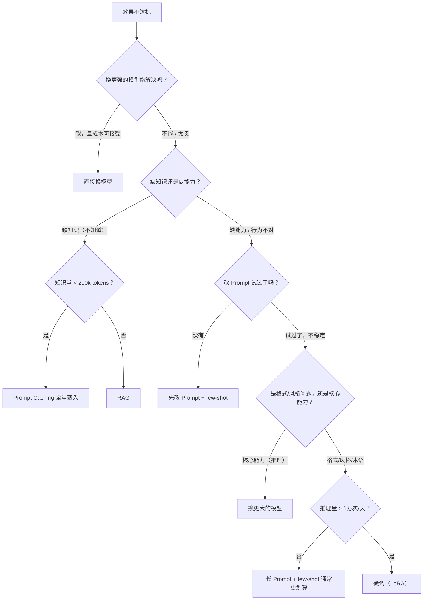

# 微调决策框架

> **权威依据**
> ① **arXiv:2106.09685**《LoRA: Low-Rank Adaptation of Large Language Models》
> ② **arXiv:2305.18290**《Direct Preference Optimization: Your Language Model is Secretly a Reward Model》
> ③ **Anthropic**《Contextual Retrieval》— 小知识库用上下文替代检索
> ④ 本知识库：`Prompt Engineering.md`、`RAG完整链路.md`、`Transformer的完整训练流程.md`

## 结论

**三个手段解决三个不同的问题，优先级不能颠倒：**

```
① 提示工程 → 改"怎么说"
② RAG      → 改"知道什么"
③ 微调     → 改"怎么做"
```

> **一句话铁律**：**先穷尽提示与 RAG，微调是最后手段。**
> 因为**微调的迭代周期是周，提示是分钟，RAG 是小时。**

**最核心的一条判断**：

> **微调改变"行为与风格"，不改变"知识与时事"。**
> 想让模型知道昨天发生的事——**微调是错的工具**。

## 一、三种手段到底改变了什么

| | **Prompt** | **RAG** | **微调** |
|---|---|---|---|
| **改变** | 指令表述 | **上下文内容** | **模型参数** |
| **生效速度** | 秒 | 分钟 | **小时–天** |
| **迭代周期** | 分钟 | 小时 | **天–周** |
| **知识更新** | 即时 | **即时** | ❌ 需重训 |
| **风格控制** | 弱（易被覆盖） | 无 | **强（稳定）** |
| **能减少 token** | 少 | ❌ 增加 | **✅ 可大幅减少** |
| **能教会新技能** | 有限 | ❌ | **✅** |
| **可解释性** | 高 | 高 | **低** |
| **可回滚** | ✅ 改回来即可 | ✅ | ⚠️ 要换版本 |
| **一次性成本** | ~0 | 中（建索引） | **高** |
| **长期成本** | 高（每次带长提示） | 中（每次带检索结果） | **低（省 token）** |

### 1.1 一个容易搞错的分界

| 你想解决 | 该用 |
|----------|------|
| 模型不知道我们公司的最新产品 | **RAG** |
| 模型回答格式总是不对 | 先试 **Prompt**，稳定不了再**微调** |
| 模型语气不像我们的客服 | **微调**（或 few-shot） |
| 模型不懂我们的行业黑话 | 先 **RAG（术语表）**，再**微调** |
| 想用 8B 模型替代 400B 模型做单一任务 | **微调（蒸馏）** |
| 想省 token 成本 | **先 Prompt Caching，再蒸馏微调** |
| 模型推理能力不够 | **换更强的模型**（微调帮不了） |

## 二、五种手段的全景

| # | 手段 | 改什么 | 成本 | 见效 |
|---|------|--------|------|------|
| 1 | **Prompt Engineering** | 指令 | 极低 | 分钟 |
| 2 | **Context Engineering** | 上下文结构 | 低 | 小时 |
| 3 | **Prompt Caching** | 不改变效果，只降成本 | 低 | 小时 |
| 4 | **RAG** | 外部知识注入 | 中 | 小时 |
| 5 | **微调（SFT）** | 模型参数 | 高 | 天 |
| 6 | **偏好优化（DPO）** | 模型参数（对齐） | 高 | 天 |

> **前四项都是"推理时"手段**——不碰权重，随时可改。
> **后两项是"训练时"手段**——改权重，需重训。

## 三、微调能做什么，不能做什么

### 3.1 ✅ 微调擅长的六件事

| 能力 | 说明 |
|------|------|
| **① 固定输出格式** | 每次都要特定的 JSON 结构 / 固定模板 |
| **② 稳定风格语气** | 品牌口吻、客服话术、专业书面语 |
| **③ 领域术语理解** | 行业黑话、内部缩写、专有名词 |
| **④ 内化复杂指令** | 把 2000 token 的 system prompt 压缩进权重 → **省 token** |
| **⑤ 小模型替代大模型** | 单一任务上，7B 微调 ≈ 大模型（**蒸馏**） |
| **⑥ 降低延迟** | 短提示 + 小模型 = 快 |

### 3.2 ❌ 微调做不到的五件事

| 做不到 | 为什么 | 该用什么 |
|--------|--------|----------|
| **注入最新知识** | 训练完就过时 | **RAG** |
| **减少幻觉** | 微调可能**加重**幻觉（它学的是"像"不是"对"） | RAG + 校验 |
| **提升推理能力** | 这是模型规模/训练的问题 | 换更强模型 |
| **加工具能力** | 调用工具是上下文行为 | **Function Calling / MCP** |
| **记住用户数据** | 不适合当数据库（且**有隐私与遗忘问题**） | 数据库 / 记忆系统 |

> **⚠️ 最关键的一条**：**微调让模型"更像"，不保证"更对"。**
> 用错误数据微调，会让模型**更自信地犯错**。

### 3.3 一个反直觉的事实

> **微调常被用来"修复幻觉"，但这是最危险的做法。**
> 微调的目标是模仿训练数据的分布，**不是事实性**。如果你的训练数据里有错误答案，模型会学会它。

## 四、微调的四种类型

| 类型 | 做法 | 数据量 | 成本 | 适用 |
|------|------|--------|------|------|
| **全量微调（Full FT）** | 更新所有参数 | 大 | **极高** | 极少用（大厂自研） |
| **参数高效微调（PEFT）** | 只训练少量附加参数 | 中 | 低 | **主流** |
| **偏好优化（DPO）** | 用"好/坏"成对数据对齐 | 中 | 低 | 风格、安全、偏好 |
| **蒸馏（Distillation）** | 大模型生成数据训练小模型 | **大** | 中 | 降本增效 |

### 4.1 PEFT 的家族

| 方法 | 思路 |
|------|------|
| **LoRA** | 低秩分解矩阵（**最常用**） |
| **QLoRA** | LoRA + 量化基座（**省显存**） |
| **Prefix Tuning** | 训练前缀向量 |
| **Adapter** | 插入小模块（**有推理延迟**） |
| **IA³** | 缩放激活值 |

> **实务中 90% 的场景用 LoRA / QLoRA 就够了。**

## 五、LoRA 详解

### 5.1 机制（论文原文）

> **冻结预训练模型权重，在 Transformer 每一层注入可训练的低秩分解矩阵**——下游任务只更新这些新增矩阵。

```
原始权重 W（frozen，d×d）
                    ↓
输出 = Wx + BAx
       ↑     ↑
    冻结    可训练（B 是 d×r，A 是 r×d，r << d）
```

**关键**：`r`（秩）通常取 8–64，远小于 `d`。所以可训练参数极少。

### 5.2 关键数字（GPT-3 175B 对比 Adam 全量微调）

| 指标 | LoRA 相对优势 |
|------|--------------|
| **可训练参数** | **减少约 10,000 倍** |
| **GPU 显存** | **减少约 3 倍** |
| **推理延迟** | **无额外增加**（与 Adapter 不同） |
| **模型质量** | 与全量微调**相当或更好** |

**验证过的模型**：RoBERTa、DeBERTa、GPT-2、GPT-3。

### 5.3 为什么"无额外推理延迟"很重要

| 方法 | 推理时 |
|------|--------|
| **Adapter** | 多一层计算 → **变慢** |
| **Prefix Tuning** | 多占上下文 → **变慢** |
| **LoRA** | `W + BA` 可**合并成一个矩阵** → **零开销** |

> **这就是 LoRA 成为主流的核心原因**：训练便宜，推理也不贵。

### 5.4 参数选择（经验值）

| 参数 | 建议 | 说明 |
|------|------|------|
| **`r`（rank）** | 8–16（通用）、32–64（复杂任务） | 越大越强但越容易过拟合 |
| **`alpha`（缩放）** | 通常 = `r` 或 `2r` | 控制更新幅度 |
| **`dropout`** | 0.05–0.1 | 防过拟合 |
| **学习率** | 1e-4 ~ 3e-4 | 比全量微调高 |
| **epochs** | 1–3 | **超过 3 极易过拟合** |
| **target_modules** | 所有线性层（`q,k,v,o,gate,up,down`） | 只调 `q,v` 效果通常差 |

### 5.5 QLoRA：显存不够时的方案

> **基座模型量化到 4-bit，LoRA 部分保持高精度。**

| | LoRA | **QLoRA** |
|---|---|---|
| 基座精度 | 16-bit | **4-bit** |
| 显存 | 中 | **低得多** |
| 训练速度 | 快 | 略慢 |
| 效果损失 | — | **很小** |

> **含义**：**单张消费级显卡就能微调 7B–13B 模型。**

## 六、DPO 详解

### 6.1 它解决什么

> **SFT 是"学怎么答"，DPO 是"学更喜欢哪个答案"。**

| | SFT | **DPO** |
|---|---|---|
| **数据** | `(输入, 期望输出)` | `(输入, 好答案, 坏答案)` |
| **目标** | 模仿 | **偏好排序** |
| **适合** | 教新行为 | **微调风格、减少坏习惯** |

### 6.2 机制（论文核心）

> **不需要单独训练奖励模型，也不需要跑强化学习循环，直接在偏好数据上优化策略。**

**关键推导**（有 KL 约束时，最优策略有闭式解）：

1. 在 KL 约束下，最优策略可写成闭式 → 奖励可用"**当前策略与参考策略的 log-ratio**"隐式表示
2. 代入 Bradley-Terry 偏好模型后，**配分函数在成对比较中抵消**
3. 最终得到一个**类似二分类交叉熵**的损失：

$$
-\log \sigma\left(\beta\left[\log \frac{\pi_\theta(y_w|x)}{\pi_{\text{ref}}(y_w|x)} - \log \frac{\pi_\theta(y_l|x)}{\pi_{\text{ref}}(y_l|x)}\right]\right)
$$

> **含义**：**把偏好对当分类样本训练。语言模型"秘密地"就是奖励模型——但不需要显式拟合它。**

### 6.3 相对 RLHF 的五个优势（论文原文）

| 优势 | 说明 |
|------|------|
| **更稳定** | 避免"先训奖励模型再 RL"的复杂不稳定流程 |
| **更轻量** | 计算开销低，**微调中不需要从模型采样** |
| **无需奖励模型** | 不用单独拟合 reward model |
| **无需强化学习** | 不需要 PPO |
| **超参数更少** | 实现与训练显著更简单 |

### 6.4 实验结论

> 效果**与现有方法相当或更好**；在**控制生成情感**上**超过基于 PPO 的 RLHF**；在**摘要**与**单轮对话**上匹配或优于。

### 6.5 什么时候用 DPO

| 场景 | 说明 |
|------|------|
| **风格已经会了，但不稳定** | SFT 后再 DPO 收敛风格 |
| **有明显"坏习惯"** | 例如太多"当然可以"开头 |
| **安全对齐** | 拒绝不当请求 |
| **有大量成对反馈** | 用户点赞/点踩数据 |

> **顺序**：**先 SFT 打底，再 DPO 对齐**。只做 DPO 而没做过 SFT，容易不稳定。

## 七、决策树



**决策树的三个关键问题**：

| 问题 | 指向 |
|------|------|
| **缺知识还是缺能力？** | 知识 → RAG；能力 → 换模型或微调 |
| **改 Prompt 试过了吗？** | 没试过就微调 = 浪费 |
| **调用量大吗？** | 量小 → 长 Prompt 更划算（**一次性成本**） |

## 八、成本对照

### 8.1 一次性成本

| 方案 | 一次性成本 |
|------|-----------|
| Prompt 优化 | ~0（人力几小时） |
| RAG 建库 | 中（解析 + 嵌入 + 向量库） |
| **微调（LoRA）** | **中高**（数据构造 + 训练 + 评测） |
| **全量微调** | **极高** |

> **最容易被低估的是"数据构造"**——通常占整个微调项目 **70% 以上的工作量**。

### 8.2 长期成本（这才是决策关键）

**算例**：某任务用长 prompt（2000 token）vs 微调后（200 token），每天 10 万次调用

```
长 Prompt（无缓存）：
  输入 2,000 × 100,000 = 200M token/天
  × $3/M = $600/天 ≈ $18,000/月

长 Prompt（配缓存，命中价 0.1×）：
  200M × $0.30/M = $60/天 ≈ $1,800/月

微调后（短 prompt）：
  输入 200 × 100,000 = 20M token/天
  × $3/M = $60/天 ≈ $1,800/月

微调的小模型（更便宜单价）：
  20M × $0.5/M = $10/天 ≈ $300/月
```

> **⚠️ 关键发现**：**配好缓存的长 Prompt 和微调的月成本可能差不多！**
> 所以"省 token"**不能**单独构成微调的理由——**必须先算清缓存后的账单**。

### 8.3 三层成本对照

| 维度 | 长 Prompt | RAG | 微调 |
|------|-----------|-----|------|
| 一次性 | 极低 | 中 | **高** |
| 每 token | 高（可缓存降 90%） | 中 | **低** |
| **维护** | 低 | 中（索引更新） | **高（重训/版本管理）** |
| 数据要求 | 无 | 文档 | **高质量标注** |

## 九、什么时候微调是对的

### 9.1 六个信号（满足两个以上才值得考虑）

- [ ] **调用量大**（> 1 万次/天）
- [ ] **任务固定**（输入输出形态稳定）
- [ ] **有大量高质量标注数据**（> 1000 条，最好 5000+）
- [ ] **Prompt 已优化到极限**仍达不到要求
- [ ] **需要小模型降本/降延迟**
- [ ] **需要长期稳定的风格一致性**

### 9.2 一个真实的最优场景

> **单一高频任务 + 明确输出格式 + 大模型成本压力。**

例：每天 50 万次工单分类，8 个类别。
→ LoRA 微调 7B 模型，准确率与大模型持平，**成本降 95%**。

## 十、微调的反模式

| # | 反模式 | 为什么错 |
|---|--------|----------|
| **1** | **用微调注入知识** | 训完就过时，且无法引用来源 |
| **2** | **用微调减少幻觉** | 可能**加重**幻觉 |
| **3** | **没试 Prompt 就微调** | 浪费几周 |
| **4** | **数据量 < 100 条就开训** | 必然过拟合 |
| **5** | **没算缓存成本就为省钱微调** | 可能根本不省钱 |
| **6** | **用微调加工具能力** | 该用 Function Calling |
| **7** | **训练集和评测集混在一起** | 数字虚高 |
| **8** | **只测训练集准确率** | 不知道泛化如何 |
| **9** | **epoch 跑 10 轮** | 记住训练集，泛化崩 |
| **10** | **微调后不做 A/B** | 不知道是不是真变好 |
| **11** | **把用户隐私数据拿去训练** | 合规风险 + 无法遗忘 |
| **12** | **以为微调能提升推理** | 这是模型规模问题 |

## 十一、微调工程流程


### 11.1 各阶段要点

| 阶段 | 关键点 |
|------|--------|
| **① 定义** | 明确**单一指标**（准确率 / 格式合规率 / 成本） |
| **② 数据** | **质量 ≫ 数量**；1000 条好数据 > 10 万条噪声 |
| **③ baseline** | **必须先有 Prompt 方案的分数**，否则无法证明微调有用 |
| **④ 训练** | 1–3 epoch；监控验证集 loss |
| **⑤ 评测** | **独立测试集**（绝不进训练）+ 与 baseline 对比 |
| **⑥ 灰度** | 小流量 A/B，看真实指标 |
| **⑦ 版本** | LoRA adapter 版本化，可回滚 |

### 11.2 数据构造的最小可行方案

```
方式一：人工标注    → 质量最高，最贵
方式二：大模型生成 + 人工审核 → 性价比最高（主流）
方式三：生产数据回流 → 最真实，但需清洗与脱敏
```

> **推荐流程**：**大模型生成 10 倍量 → 人工精修 1 倍 → 保留 20% 做测试集。**

## 十二、Agent 场景的特殊考虑

### 12.1 微调在 Agent 里能改变什么

| 能 | 不能 |
|----|------|
| 稳定**工具选择的偏好** | 新增工具（那是 MCP 的事） |
| 稳定**输出格式**（结构化输出） | 内化检索到的知识 |
| 缩短 **system prompt**（省 token） | 提升多步推理上限 |
| 统一**拒绝行为**（安全对齐） | 改变工具本身的可靠性 |

### 12.2 一个反直觉的建议

> **Agent 场景下，微调的优先级通常比传统任务更低。**

**原因**：

| 原因 | 说明 |
|------|------|
| **变化太快** | 工具、流程、提示每周都在改，微调跟不上 |
| **结构化输出已够用** | `结构化输出.md` 里的机制能解决大部分格式问题 |
| **缓存已能降本** | `Agent成本优化.md` 的缓存策略常比微调划算 |
| **调试更难** | 微调后的模型行为不可解释 |

> **结论**：**Agent 优先做提示、缓存、结构化输出、工具设计；微调留给"高频、稳定、窄任务"的分支。**

## 十三、常见坑

| # | 坑 | 后果 | 解药 |
|---|----|------|------|
| **1** | 数据里有大量重复 | 过拟合、指标虚高 | 去重 |
| **2** | 评测集与训练集重叠 | 分数虚高 | 严格隔离 |
| **3** | epoch 太多 | 记住训练集 | 1–3 epoch + early stop |
| **4** | 只调 `q,v` 模块 | 效果差 | 调所有线性层 |
| **5** | 学习率太低（用全量微调的） | 训不动 | 1e-4 ~ 3e-4 |
| **6** | 数据格式与推理时不一致 | 线上崩 | **训练/推理同模板** |
| **7** | 忘了特殊 token / 模板 | 效果差 | 用模型的 chat template |
| **8** | 没有 baseline | 无法证明有用 | 先跑 Prompt 方案 |
| **9** | 数据含 PII | 合规风险 | 脱敏 |
| **10** | adapter 没版本管理 | 无法回滚 | 注册表 + 标签 |
| **11** | 用测试集调超参 | 间接过拟合 | 单独验证集 |
| **12** | 忽略推理框架支持 | 部署慢 | 确认 vLLM 等支持 LoRA |

## 十四、Checklist

**决策前**
- [ ] 换更强模型能解决吗？（先试这个）
- [ ] 是"缺知识"还是"缺能力"？
- [ ] Prompt + few-shot 试过并到极限了吗？
- [ ] 算了**配好缓存后**的成本对比吗？
- [ ] 调用量够大吗（> 1 万次/天）？

**准备**
- [ ] 有单一明确的评测指标
- [ ] 有 Prompt 方案的 **baseline 分数**
- [ ] 有 **≥1000 条**高质量数据
- [ ] 训练/验证/测试**三方隔离**
- [ ] 数据已去重、已脱敏
- [ ] **训练模板与推理模板一致**

**训练**
- [ ] 用 LoRA / QLoRA（不是全量）
- [ ] `r` 在 8–64
- [ ] `target_modules` 覆盖所有线性层
- [ ] 学习率 1e-4 ~ 3e-4
- [ ] epochs 1–3 + early stopping
- [ ] 监控验证集 loss（不是训练 loss）

**上线**
- [ ] 独立测试集评测通过
- [ ] 与 baseline 对比**显著更好**
- [ ] 小流量 A/B 验证
- [ ] adapter 版本化、可回滚
- [ ] 推理框架支持（vLLM / TGI / Ollama）
- [ ] 有回退到 Prompt 方案的开关

## 十五、总结

**一张表记住分工：**

| 手段 | 改什么 | 何时用 |
|------|--------|--------|
| **Prompt** | 怎么说 | **永远先试这个** |
| **RAG** | 知道什么 | 缺知识 |
| **微调** | 怎么做 | 行为/风格/格式/降本 |

**五条最值得记住的原则**：

1. **微调改行为，不改知识** —— 想让模型知道新东西，用 RAG
2. **微调让模型"更像"，不保证"更对"** —— 错误数据会养出更自信的错误
3. **先算清缓存后的账单** —— 微调的省钱理由常被高估
4. **LoRA 是默认选择** —— 参数少 1 万倍、显存少 3 倍、**推理零延迟**
5. **DPO 在 SFT 之后** —— 先学怎么答，再学更喜欢哪个

> **最后一句话**：
> **微调不是"让模型变强的按钮"，而是"把一种行为固化下来的手段"。**
> 它把你**已经验证有效的做法**刻进权重——**在你还没验证之前，它只会把错误刻得更深。**

---

> **资料说明**
> LoRA 的机制（冻结预训练权重 + 低秩分解矩阵）、**可训练参数减少 10,000 倍**、**GPU 显存减少 3 倍**、与 Adam 全量微调的对比、验证模型（RoBERTa / DeBERTa / GPT-2 / GPT-3）、"无额外推理延迟（与 Adapter 不同）"、质量相当或更好，**依据 arXiv:2106.09685 摘要**。
> DPO 的机制（不训奖励模型、不跑 RL、直接用偏好对做分类损失）、闭式解推导路径、**损失函数形式**、配分函数抵消、五项相对 RLHF 的优势（更稳定 / 更轻量 / 无奖励模型 / 无 RL / 超参数更少）、实验结论（情感控制超过 PPO-RLHF），**依据 arXiv:2305.18290 摘要**。
> "<200k tokens 用上下文替代检索"的判据，**依据 Anthropic Contextual Retrieval**。
>
> **重要限制**：
> - ⚠️ **所有成本数字为示意**（$3/M 输入、$0.30/M 缓存命中价来自 `Agent成本优化.md` 的抓取值），**厂商调价频繁，必须以当前价目表重算**。
> - ⚠️ **LoRA 的 10,000 倍 / 3 倍是针对 GPT-3 175B vs Adam 全量微调的实测**，**不可外推**到所有模型规模；小模型上的收益会小得多。
> - **超参数建议（r / alpha / 学习率 / epoch / target_modules）为社区经验值**，非论文结论，**实际需实验确定**。
> - **QLoRA 的细节**（4-bit NormalFloat、双重量化、分页优化器）**未展开**，也未直读其论文。
> - **DPO 之外的对齐方法**（KTO、ORPO、SimPO 等）**未涉及**。
> - 第七章决策树与第八章算例为**工程归纳**，非任何官方框架。
> - 所有引文为**中文意译**，非逐字直译。
