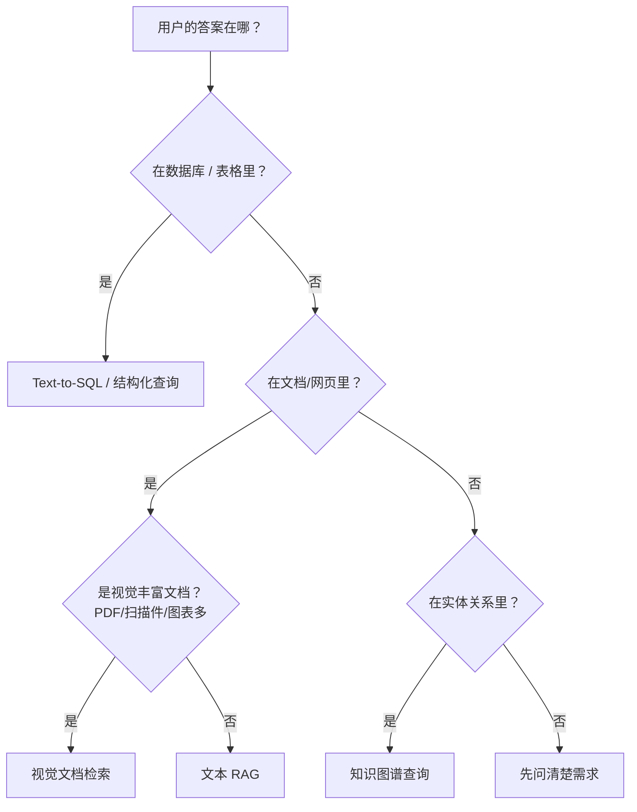

# 结构化与多模态检索

> **权威依据**
> ① **arXiv:2305.03111**《BIRD: A BIg Bench for Large-Scale Database Grounded Text-to-SQLs》（NeurIPS 2023）
> ② **arXiv:2407.01449**《ColPali: Efficient Document Retrieval with Vision Language Models》（ICLR 2025）
> ③ 本知识库：`RAG完整链路.md`、`Query改写与Rerank.md`、`Agent搜索引擎.md`

## 结论

**"检索"不是"RAG"的同义词。Agent 面对的是四类知识源，每类要用完全不同的方法：**

| 知识源 | 形态 | 正确方法 | 文档 |
|--------|------|----------|------|
| **非结构化文本** | 文档、网页、笔记 | 向量检索 + 关键词混合 | `RAG完整链路.md` |
| **开放 Web** | 全网 | 搜索引擎 API + 抓取 | `Agent搜索引擎.md` |
| **结构化数据** | 数据库、API、知识图谱 | **Text-to-SQL / 图查询** | **本文** |
| **视觉文档** | PDF、扫描件、图表、表单 | **页面图像检索** | **本文** |

> **用错方法不是"效果差一点"，而是"根本不可能对"。**
> **拿向量检索去查"上个月华东区销售额"——搜一百个 chunk 也搜不出来。**

**两条最重要的判断**：

1. **Text-to-SQL 进步极快，但错还是错** —— BIRD 现行 SOTA **83.40**，人类 **92.96**（2023 年 ChatGPT 只有 40.08）
2. **视觉文档不该强行转文本** —— OCR + 分块管线会系统性丢掉表格、版式、图表信息

## 一、为什么 RAG 不是"检索"的全部

### 1.1 一个典型的错误匹配

```
用户问："上个月华东区哪些 SKU 的毛利率低于 20%？"

❌ 用向量检索：在商品文档库里搜"华东区 毛利率"
   → 返回一堆"毛利率管理规范.pdf"
   → 模型只能编一个答案

✅ 用 Text-to-SQL：生成
   SELECT sku, (price - cost)/price AS margin
   FROM sales WHERE region='华东' AND month='2026-10'
   HAVING margin < 0.2
   → 拿到真实数据
```

> **这不是"检索质量"问题，是"用错了器官"。**

### 1.2 判断顺序（先想这个，再想技术）



> **先问"答案长什么样"，再问"用什么技术"。**

## 二、Text-to-SQL：最诱人，也最容易翻车

### 2.1 为什么它很诱人

| 优点 | 说明 |
|------|------|
| **数据是准的** | 不靠模型记忆，不靠向量相似 |
| **可聚合可计算** | 求和、分组、排序、时间对比都是精确的 |
| **无需建索引** | 数据库本来就在那 |
| **可审计** | 生成的 SQL 人能看懂、能复核 |

> 对"问数"类需求，**它是唯一正确答案**。

### 2.2 BIRD 的一盆冷水（最关键的数据）

> **BIRD 基准的规模**：**12,751 个 query-database 对**、**95 个数据库**、**33.4 GB** 数据、**37 个专业领域**。

**它为什么比 Spider 难**：

> Spider、WikiSQL 这类基准的数据库**只有少量数据行**，只关注 **schema**，因此"学术研究与真实应用之间存在差距"。

**论文发表时的核心结论（2023）**：

> **即便是当时最有效的模型之一 ChatGPT，执行准确率也只有 40.08%，而人类是 92.96%。**

**但三年后完全不是这个局面了 —— 必须看现行榜单**：

| 方法 | Test 执行准确率 | 说明 |
|------|----------------|------|
| **人类上限** | **92.96** | Data Engineers + DB Students（含 Oracle Knowledge） |
| **AskData**（AT&T CDO / DSAIR） | **83.40** | 现行第 1 |
| **GrainSQL**（Purdue） | 82.95 | 第 2 |
| **DataGallery-Text2SQL**（华为） | 82.39 | 第 3 |
| **Agentar-Scale-SQL**（蚂蚁，开源） | 81.67 | 第 5 |
| ~~ChatGPT（2023）~~ | ~~40.08~~ | **落后 43 个点，不要再引用** |

> **⚠️ 关键认知**：**"Text-to-SQL 不准"这个论断，已经从"差 52 个点"变成"差 9.6 个点"。**
> 用 2023 年的 40.08% 论证"做不到"，是**严重误导**。

**另一个容易被忽略的反转**：

| 指标 | 机器 | 人类 |
|------|------|------|
| 准确率（EX） | 83.40 | **92.96** |
| **效率（R-VES）** | **84.10**（GrainSQL） | 83.26 |

> **机器写的 SQL 已经比人写得更高效** —— 因为它不受"人习惯写法"的束缚。

**但结构性难点没变**（这才是本章要讲的重点）：

> 真实数据库上的 Text-to-SQL **不是"写对语法"的问题**，而是**脏数据、语义鸿沟、外部知识**的问题。
> **证据：榜单上所有 Top 条目都带 `Oracle Knowledge ✔️`** —— **不给外部知识，进不了 80 分。**

**还有一组数字**：Mini-Dev 榜首 87.27，而**经验上界是 96.80** —— 说明**剩下的约 9.5 个点，主要卡在数据质量与语义歧义上，不是模型不会写 SQL**。

### 2.3 三大难点（BIRD 官方归纳）

| 难点 | 说明 |
|------|------|
| **① 脏数据库内容** | 真实库有噪声、格式不一致、字段名不直观（`f_amt_1` 而不是 `amount`） |
| **② 外部知识缺口** | 自然语言问题与数据库内容之间的**语义鸿沟**需要额外知识才能弥合 |
| **③ SQL 效率** | 在大库上不仅要写**对**，还要写得**高效** |

**推论**：

> **模型除了"语义解析"，还必须具备"数据库值理解"能力。**
> **光给 DDL 是不够的——它必须看到真实的数据长什么样。**

### 2.4 工程做法：五个必须

#### 必须一：schema 裁剪（不要全库 DDL 塞进去）

> 一个 200 张表的库，全量 DDL 轻松几万 token，而且**绝大多数表与问题无关**。

```python
def prune_schema(question: str, all_tables: list[Table]) -> list[Table]:
    """两阶段裁剪：先用向量/关键词粗筛候选表，再带详细字段"""
    # 阶段一：只要表名 + 一句话说明，粗筛
    candidates = vector_search(
        query=question,
        corpus=[f"{t.name}: {t.comment}" for t in all_tables],
        top_k=8,
    )
    # 阶段二：只把候选表的完整字段给模型
    return [all_tables[i] for i in candidates]
```

> **参考经验**：候选表控制在 **5–10 张**。太少会漏，太多会干扰（和 RAG 的 top-k 逻辑一样）。

#### 必须二：schema linking（把口语映射到字段）

> 这是 BIRD 说的"外部知识缺口"的正解。

```markdown
## 业务术语表（必须内置）
| 用户说法 | 对应字段 |
|---|---|
| 华东区 | `region_name = '华东'` |
| 毛利率 | `(list_price - cost_price) / list_price` |
| 上个月 | `stat_month = DATE_TRUNC('month', CURRENT_DATE - INTERVAL '1 month')` |
| 活跃用户 | `last_login_at > CURRENT_DATE - INTERVAL '30 days'` |
```

> **这一张表的价值，通常大于换一个更强的模型。**

#### 必须三：值采样（给模型看真实数据）

> BIRD 的核心发现就是"**数据库值**至关重要"。

```python
def sample_values(table: Table, columns: list[str], n: int = 5) -> str:
    """从真实数据里采样，让模型知道值的格式"""
    lines = []
    for col in columns:
        if col.is_enum_like:          # 低基数列（如地区、状态）
            vals = db.query(f"SELECT DISTINCT {col} FROM {table.name} LIMIT 20")
            lines.append(f"-- {col} 的取值：{', '.join(vals)}")
        else:
            samples = db.query(f"SELECT {col} FROM {table.name} LIMIT {n}")
            lines.append(f"-- {col} 示例：{samples}")
    return "\n".join(lines)
```

> **效果**：模型看到 `region_name` 的真实值是 `'华东'` 而不是 `'East China'`，就不会写错。
> **这一步常被跳过，但它是最便宜的准确率提升。**

#### 必须四：执行反馈自纠错（最有价值的一环）

> **SQL 有天然优势：它能被执行，错了会直接报错。**

```python
def text_to_sql(question: str, schema: str, max_rounds: int = 3) -> str:
    sql = llm_generate(question, schema)

    for _ in range(max_rounds):
        try:
            rows = db.query_readonly(sql, timeout=10, max_rows=200)
            return sql, rows            # ✅ 成功
        except SqlError as e:
            # 把错误原样回灌，让模型自己修
            sql = llm_fix(question, schema, sql, f"{type(e).__name__}: {e}")

    raise SqlGenerationFailed(sql)
```

| 修复轮次 | 典型收益 |
|----------|----------|
| 0 轮（一次生成） | baseline |
| **1 轮（带错误信息）** | **提升最明显** |
| 2–3 轮 | 递减，且成本上升 |
| > 3 轮 | **不划算**（说明模型根本没懂 schema） |

#### 必须五：结果校验（别信 40% 以外的自信）

> **SQL 能跑通 ≠ 结果对。** 空结果、全 NULL、数量级离谱都是常见错误。

```python
def sanity_check(rows, question: str) -> str | None:
    if len(rows) == 0:
        return "查询返回空结果，请检查 WHERE 条件或时间范围是否过严"
    if all(v is None for v in rows[0].values()):
        return "所有字段都是 NULL，可能是 JOIN 或字段选择有误"
    if len(rows) > 1000:
        return "结果超过 1000 行，请增加聚合或过滤条件"
    return None
```

### 2.5 安全红线（这条不能妥协）

| 红线 | 做法 |
|------|------|
| **只读账号** | 数据库层授予 `SELECT`，**其余权限全部回收** |
| **禁止 DDL / DML** | 在解析层直接拒绝 `INSERT/UPDATE/DELETE/DROP/ALTER/TRUNCATE` |
| **强制超时** | `statement_timeout`，防笛卡尔积拖垮库 |
| **行数上限** | 自动加 `LIMIT`，防全表返回 |
| **表白名单** | 系统表、用户表、密钥表**不可见** |
| **不要拼接** | 生成的 SQL **原样执行**，不做字符串拼接 |
| **审计** | 记录每条自然语言 → SQL → 结果的完整链路 |

> **⚠️ 最危险的组合**：能自由生成 SQL + 有写权限 + 能访问敏感表。
> 这三者同时具备时，一次提示注入就足以删库。

### 2.6 什么时候别做 Text-to-SQL

| 情况 | 更好的做法 |
|------|-----------|
| 问题种类固定（就那 20 个指标） | **预先写死 SQL 模板**，让模型只填参数 |
| 数据库极脏、无文档 | 先治理数据，别急着上模型 |
| 需要实时性极高的报表 | 走 BI 工具，Agent 只做触发器 |
| 只有一两张宽表且查询简单 | 直接给模型看 CSV 可能更快 |

## 三、知识图谱与图查询

### 3.1 什么时候值得上图

| 值得 | 不值得 |
|------|--------|
| 问题**围绕关系**（谁和谁有什么关系） | 问题是聚合统计（用 SQL） |
| **多跳**推理（A 的供应商的股东） | 单跳查询（用 SQL/API） |
| 需要**路径解释** | 只要最终答案 |
| 实体消歧是核心难点 | 实体本身明确 |

### 3.2 三种查询方式

| 方式 | 说明 | 风险 |
|------|------|------|
| **模型生成 Cypher / SPARQL** | 灵活 | 与 Text-to-SQL 同样易错 |
| **预定义查询模板** | 稳 | 覆盖有限 |
| **图遍历 API**（让模型传参数） | 平衡 | 需设计好抽象 |

> **推荐**：**模板 + 参数填充**，比让模型写查询语言可靠得多。

### 3.3 与向量检索的分工

```
问题："我们和哪家供应商有间接合作关系？"
  ① 向量检索：搜"供应商 合作" → 找到一堆合同文档（不解决"间接"）
  ② 图查询：从本公司出发，2 跳内找供应商实体 → 精确
  ③ 组合：先图查询拿候选，再向量检索拉证据 → 最佳
```

> **图负责"找到是谁"，向量负责"找出证据"。**

## 四、视觉文档检索

### 4.1 传统文本管线的四道损耗

> **ColPali 的出发点（论文原文意译）**：
> 文档是"**视觉丰富的结构**"——信息不仅存在于文字里，还存在于**表格、图表、页面布局、字体**中。
> 而现有系统为了索引必须从页面提取文本，这个过程"**冗长且脆弱**"（lengthy and brittle）。

**四道损耗（逐级放大）**：

| 环节 | 丢失什么 |
|------|----------|
| **① OCR** | 错字、小字、手写体、特殊字体 |
| **② 版面分析** | 双栏顺序、页眉页脚、脚注归属 |
| **③ 表格抽取** | 合并单元格、跨页表、无框线表 |
| **④ 分块** | 切分边界破坏语义；**图表直接变成零信息** |

**结果**：

> **一张折线图在文本管线里就是一段空白**——而它可能正是用户要问的东西。

### 4.2 ColPali 的做法

```
传统：PDF → OCR → 文本 → 分块 → 嵌入 → 检索
ColPali：页面图像 → 视觉语言模型 → 多向量嵌入 → 检索
```

**两个关键设计**：

| 设计 | 说明 |
|------|------|
| **VLM 当嵌入器** | 每页切成若干 patch，每个 patch 出一个向量（**一页约 1000+ 个向量**） |
| **Late Interaction** | 借用 ColBERT 的 MaxSim：查询 token 与页面 patch 求最大相似度再求和 |

> **为什么不压成一个向量**：单向量会把整页信息"平均掉"，**细粒度匹配能力丢失**。
> **论文数据印证了这点**：单向量 VLM（BiPali 58.8 / BiSigLIP 58.6）**反而不如文本管线（67.0）**，加上 late interaction 才跳到 81.3。

### 4.2.1 效果到底好多少（论文 v6 Table 2 实测）

**ViDoRe 基准，nDCG@5 平均**：

| 方法 | 类型 | 平均 nDCG@5 |
|------|------|------------|
| **ColPali（+Late Inter.）** | 多向量 VLM | **81.3** |
| Unstructured + Captioning + BGE-M3 | **最佳文本基线** | 67.0 |
| Unstructured + OCR + BGE-M3 | 文本管线 | 66.1 |
| Unstructured + OCR + BM25 | 文本管线 | 65.5 |
| BiPali / BiSigLIP | 单向量 VLM | 58.8 / 58.6 |
| SigLIP（Vanilla） | 对比 VLM | 51.4 |

> **相对最佳文本基线：+14.3 分（约 +21%）。**

**但增益极不均匀 —— 这才是关键**：

| 任务类型 | 文本基线 | ColPali | 差值 |
|----------|---------|---------|------|
| **ArxivQA（纯科学图表）** | 35.7 | 79.1 | **+43.4** |
| DocVQA（扫描文档） | 32.9 | 54.4 | +21.5 |
| TAT-DQA（金融报告） | 43.8 | 65.8 | +22.0 |
| TabFQuAD（表格） | 69.1 | 83.9 | +14.8 |
| **Shift（法文文本密集报告）** | 73.1 | 73.2 | **+0.1** |

> **⚠️ 最后一行最有价值**：
> **对文本密集的文档，视觉检索几乎没有收益（+0.1）**，而存储要贵 30 倍。
> 论文解释：该数据集文本密度过高、图像冗余 patch 少。
> **所以"该不该上视觉"取决于文档类型，不是取决于趋势。**

**Recall@1（更严格）**：ColPali **72.7** vs Unstructured+OCR+BGE-M3 **57.5** —— 领先 15.2 分。

### 4.3 代价（论文实测，非估算）

| 指标 | ColPali | BGE-M3 | 倍数 |
|------|---------|--------|------|
| **存储 / 页** | **257.5 KB**（float16, D=128） | 8.60 KB | **约 30×** |
| **索引延迟 / 页** | **0.39 s** | 7.22 s（layout 0.81 + OCR 2.67 + captioning 3.71） | **快 18.5×** |
| 在线 query 编码 | ~30 ms | ~22 ms | 略慢 |
| **Late interaction 打分** | **~1 ms / 1000 页** | — | — |

> **必须分开看两个方向**：
> **索引快 18.5 倍，但存储贵 30 倍。**
> 而**在线查询延迟反而略高**（多向量打分）。

**官方提供的缓解手段（附录实验性结论，非默认）**：

> **token pooling，pool factor = 3 时：向量数降 66.7%，保留 97.8% 性能。**

### 4.4 三种落地策略

| 策略 | 做法 | 适合 |
|------|------|------|
| **① 全视觉** | 所有页面都用视觉嵌入 | 全是 PDF/扫描件的场景 |
| **② 混合两阶段** | 文本粗筛 top-100 → 视觉精排 top-10 | **大规模语料（推荐）** |
| **③ 按页型分流** | 纯文本页走文本管线，图表页走视觉 | 混合文档 |

> **大规模场景几乎一定要用策略 ②**——用便宜的粗筛控制成本，用贵的精排保证质量。

### 4.5 表格检索的三种做法（实战中最常见）

| 做法 | 说明 | 适用 |
|------|------|------|
| **表格转 Markdown** | 保留结构，模型能读 | **简单表格，首选** |
| **表格转 SQL 表** | 导入临时库，用 Text-to-SQL 查 | 多表、需聚合 |
| **表格当图像** | 交给 VLM 直接看 | 复杂合并单元格、无框线表 |

> **判断**：**表格能不能被无损转成文本？** 能 → 转 Markdown；不能 → 当图像。

## 五、向量索引算法（工程必知）

### 5.1 精确 vs 近似

| | 精确（Flat） | **近似（ANN）** |
|---|---|---|
| 召回 | 100% | 95–99% |
| 速度 | 慢（O(N)） | 快（亚线性） |
| 适用 | < 10 万条 | **> 10 万条** |

> **建议**：**10 万条以下别折腾 ANN**，Flat + 元数据过滤够用。

### 5.2 三种主流算法

| 算法 | 原理 | 关键参数 | 特点 |
|------|------|----------|------|
| **HNSW** | 多层可导航小世界图 | `m`、`ef_construction`、`ef_search` | **召回高、延迟低**；内存占用大 |
| **IVF** | 倒排聚类，只搜最近的几个簇 | `lists`、`probes` | 内存友好；需训练 |
| **PQ（乘积量化）** | 向量压缩编码 | `m`（子空间数）、`nbits` | **省内存**；精度有损 |

> **⚠️ 参数不要凭经验拍**：以下给的是 **pgvector 官方默认值**（v0.8.x），比社区流传的"经验区间"更值得引用。各家实现默认值不同，**以你用的库为准**。

**常用组合**：`IVF + PQ`（省内存）、`HNSW`（追性能）。

### 5.3 参数怎么调（先看官方默认，再动）

**HNSW（pgvector v0.8.x 官方默认）**：

| 参数 | 官方默认 | 含义 |
|------|---------|------|
| `m` | **16** | 每层最大连接数 |
| `ef_construction` | **64** | 建图时候选列表大小 |
| `ef_search` | **40** | 查询时候选列表大小 |

> **⚠️ 官方原话（要点）："除非召回率低，否则使用默认值。"**
> 理由：`m` 与 `ef_construction` 会**显著影响构建时间**。
> **所以"一上来就把 ef_construction 调到 200"是错的姿势——先测召回，够了就别动。**

**IVFFlat（官方给出的公式，不是经验值）**：

| 参数 | 官方规则 |
|------|----------|
| `lists` | **≤100 万行：`rows / 1000`**；**>100 万行：`sqrt(rows)`** |
| `probes` | 默认 **1**；**起始值 `sqrt(lists)`** |
| 建索引时机 | **表里已有数据后再建**（需 k-means 训练，空表建效果差） |

**调节方向**：

| 目标 | 调法 |
|------|------|
| 提高召回 | ↑ `ef_search`、↑ `probes`、↑ `m` |
| 降低延迟 | ↓ `ef_search`、↓ `probes`、↓ `m` |
| 省内存 | 用 PQ、降 `m` |

> **口诀**：**先测默认值的召回，不够再调 `ef_search`（最便宜的那一档）。**

> 补充：**IVFFlat 构建更快、内存更少，但查询性能（速度-召回权衡）通常不如 HNSW。**

### 5.4 最容易被踩的坑：带过滤的 ANN

```
需求：只在 tenant_id = 42 的文档里搜 top-10

❌ 先 ANN 取 10 条，再过滤 tenant
   → 如果 42 号租户的文档很稀疏，可能 10 条全被过滤掉 → 返回空
```

**这不是"可能"，是可以算出来的。**

> **pgvector 官方原文**：默认 `ef_search = 40` 时，**若过滤条件只匹配 10% 的行，平均可能只有约 4 行结果**。

`40 × 10% = 4` —— **不需要实测，算术就够了。**

**官方的四种解法**（按官方推荐顺序）：

| # | 解法 | 适用 |
|---|------|------|
| **①** | **分区 / 分表** | **官方明确建议多租户按租户分区或分表**，避免互相影响召回与速度 |
| **②** | **Partial index（部分索引）** | 过滤条件固定 |
| **③** | **`hnsw.iterative_scan`** | 匹配比例**高**时启用（`strict_order` / `relaxed_order`，配合 `max_scan_tuples`，默认 20000） |
| **④** | **干脆不用 ANN** | 匹配比例**低**时，给过滤列建 B-tree 精确索引往往更合适 |

> **这是"多租户 RAG"最常见的线上故障来源**——本地数据少时看不出，上线后部分租户**直接搜不到东西**。
> **而且它不会报错，只会静默返回空。**

## 六、四类知识源的统一路由

```python
def route_and_retrieve(question: str) -> Context:
    # ① 先判断：结构化还是非结构化（用轻量模型，别用大模型）
    kind = classify_knowledge_source(question)      # "sql" | "doc" | "graph" | "web"

    if kind == "sql":
        sql = text_to_sql(question, pruned_schema(question))
        return Context(kind="table", data=execute_with_retry(sql), sql=sql)

    if kind == "graph":
        return Context(kind="graph", data=graph_query_from_template(question))

    if kind == "doc":
        candidates = hybrid_search(question, top_k=100)     # 文本粗筛
        if is_visual_doc(candidates):
            candidates = visual_rerank(question, candidates, top_k=10)
        return Context(kind="doc", data=rerank(question, candidates, top_k=5))

    if kind == "web":
        return Context(kind="web", data=web_search(question))

    raise UnroutableQuestion(question)
```

### 6.1 路由的三个原则

| 原则 | 说明 |
|------|------|
| **用轻量模型分类** | 意图分类用小模型即可，别用贵的 |
| **允许多路并行** | 复杂问题可能同时需要 SQL + 文档（**先分类再并行，别串行**） |
| **让模型看到来源类型** | 上下文里标注"这是数据库结果 / 这是文档摘录"，**模型才能正确引用** |

## 七、评测：每类方法指标不同

| 知识源 | 主指标 | 说明 |
|--------|--------|------|
| **文本 RAG** | 召回率、nDCG@k | 见 `RAG完整链路.md` |
| **Text-to-SQL** | **执行准确率（EX）** | **必须执行后比对结果**，不是比对 SQL 字符串 |
| **视觉文档** | 页面级 nDCG@5 | 论文用 ViDoRe 基准 |
| **知识图谱** | 路径命中率 | 找到的实体/路径对不对 |

### 7.1 Text-to-SQL 评测的一个关键点

> **不要比 SQL 字符串**——同一个结果有无数种写法。
> **要比执行结果**（Execution Accuracy）：把模型 SQL 和标准 SQL **都执行**，比对结果集。

```python
def execution_accuracy(pred_sql: str, gold_sql: str, db) -> bool:
    a = db.query(pred_sql)
    b = db.query(gold_sql)
    return normalize(a) == normalize(b)   # 忽略行序、列序
```

> ⚠️ **注意**：EX 会"奖励碰巧对"——WHERE 条件写错但结果恰好一致也算对。所以严苛场景需要额外的**精确匹配（EM）** 与人工抽检。

## 八、常见坑

| # | 坑 | 后果 | 解药 |
|---|----|------|------|
| **1** | **用向量检索查统计问题** | 永远得不到正确答案 | 先判断知识源类型 |
| **2** | **Text-to-SQL 给全库 DDL** | 几万 token + 严重干扰 | schema 裁剪到 5–10 张表 |
| **3** | **只给 DDL 不给数据样例** | 值格式写错（'华东' vs 'East'） | **值采样**（BIRD 的核心结论） |
| **4** | **不做执行自纠错** | 一次生成的错误率极高 | 至少 1 轮错误回灌 |
| **5** | **SQL 用可写账号执行** | **提示注入 = 删库** | 只读 + 白名单 + 超时 |
| **6** | **比对 SQL 字符串做评测** | 分数毫无意义 | 用执行准确率 |
| **7** | **PDF 强行 OCR 转文本** | 图表、版式信息全丢 | 视觉嵌入或表格单独处理 |
| **8** | **全量视觉嵌入** | 存储爆炸、查询变慢 | 两阶段：文本粗筛 + 视觉精排 |
| **9** | **多租户只做 post-filter** | **部分租户搜不到东西** | pre-filter / 分区索引 |
| **10** | **不限制返回行数** | 全表返回、上下文爆掉 | 自动加 `LIMIT` |
| **11** | **知识图谱让模型自由写 Cypher** | 与手写 SQL 一样易错 | 模板 + 参数填充 |
| **12** | **不标注数据来源类型** | 模型把文档内容当数据事实 | 上下文标注"来源：数据库/文档" |

## 九、Checklist

**先分流**
- [ ] 每个查询先判断知识源类型（SQL / 文档 / 图 / Web）
- [ ] 意图分类用轻量模型
- [ ] 上下文标注每段内容的来源类型

**Text-to-SQL**
- [ ] schema 裁剪到 5–10 张候选表
- [ ] 有**业务术语表**（口语 → 字段）
- [ ] 有**值采样**（枚举值 + 样例）
- [ ] 有**执行反馈自纠错**（≤3 轮）
- [ ] 有结果 sanity check（空/全 NULL/超行数）
- [ ] **只读账号**，无 DDL/DML 权限
- [ ] `statement_timeout` 已设
- [ ] 自动 `LIMIT`
- [ ] 表白名单（排除敏感表）
- [ ] 全链路审计（NL → SQL → 结果）

**视觉文档**
- [ ] 已识别哪些文档是"视觉丰富"的
- [ ] 表格能转 Markdown 的先转
- [ ] 复杂表格/图表走视觉嵌入
- [ ] 大规模场景用**两阶段**（粗筛 + 精排）
- [ ] 评估过存储与延迟成本

**向量索引**
- [ ] 数据量 > 10 万才上 ANN
- [ ] 召回目标已定义并实测
- [ ] **多租户过滤用 pre-filter 或分区索引**
- [ ] 没有"先 ANN 后过滤"的写法

**评测**
- [ ] Text-to-SQL 用**执行准确率**
- [ ] 视觉检索用页面级 nDCG
- [ ] 每类知识源有自己的评测集

## 十、总结

**四类知识源，四张桌子：**

| 问题 | 工具 | 关键指标 |
|------|------|----------|
| "具体数字是多少" | **Text-to-SQL** | 执行准确率 |
| "文档里怎么说的" | **文本 RAG** | 召回 / nDCG |
| "谁和谁有关系" | **图查询** | 路径命中 |
| "这张图/表长什么样" | **视觉检索** | 页面 nDCG |

**五条最值得记住的原则**：

1. **先问"答案长什么样"，再问"用什么技术"** —— 器官用错，努力全废
2. **Text-to-SQL 的难点不是语法，是"数据库值"** —— 一定要给模型看真实数据长什么样
3. **SQL 能被执行是最大优势** —— 用它做自纠错，也用它做评测
4. **视觉文档别强行转文本** —— 你的折线图在 OCR 管线里就是一段空白
5. **多租户过滤不能放最后** —— 先 ANN 后过滤 = 部分用户永远搜不到

> **最后一句话**：
> **RAG 只是"检索"的第一格。真正的 Agent 检索能力，体现在它知道——**
> **这个问题该去数据库问，还是该去文档里翻。**

---

> **资料说明**
> BIRD 的规模（**12,751** 个 query-database 对 / **95** 个数据库 / **33.4 GB** / **37** 个领域）、相对 Spider 与 WikiSQL 的差异（"只关注 schema，导致学术与真实应用存在差距"）、三大挑战（**脏数据库内容 / 外部知识 / SQL 效率**）、"必须理解数据库值"的结论，**依据 arXiv:2305.03111 摘要页（NeurIPS 2023，18 位作者）**。
> **BIRD 现行 SOTA**（Test EX **83.40** / 人类 **92.96** / R-VES 机器 **84.10 反超人类 83.26** / **所有 Top 条目均带 Oracle Knowledge** / Mini-Dev 经验上界 **96.80**），**依据 `bird-bench.github.io` 官方排行榜（最新条目 2026-10-31）**。
> ColPali 的核心论点（文档是"视觉丰富的结构"、文本抽取"冗长且脆弱"）、技术路径（VLM + 多向量 + late interaction / MaxSim），**依据 arXiv:2407.01449 摘要页**。
> **ColPali 的具体分数**（nDCG@5 平均 **81.3** vs 最佳文本基线 **67.0**、五类任务分项差值、Recall@1 **72.7**、存储 **257.5 KB/页**、索引 **0.39 s/页**、late interaction **~1 ms/1000 页**、token pooling 实验），**依据 arXiv:2407.01449v6 HTML 版 Table 2 / Table 5 / Table 6 与 §5.2–5.3**。
> **HNSW / IVFFlat 的官方默认值与规则**（`m=16` / `ef_construction=64` / `ef_search=40`、"除非召回率低否则用默认值"、**10% 过滤 ≈ 只剩 4 行**、`lists = rows/1000` 或 `sqrt(rows)`、`probes` 起始 `sqrt(lists)`），**依据 pgvector 官方 README（v0.8.7）**。
>
> **重要限制**
> - ⚠️ **40.08% 是 2023 年 ChatGPT 的成绩**，现行 SOTA 已达 **83.40**，**落后 43 个百分点**。引用"Text-to-SQL 不准"时必须同时给出 83.40 与人类 92.96，否则会严重误导。
> - ⚠️ **BIRD 榜单为自提交 + 人工核验**，部分条目无法独立复现；**不披露各方法的成本、延迟、token 消耗**——EX 单一指标不能代表工程可用性。
> - ⚠️ **BIRD 所有 Top 成绩都带 Oracle Knowledge**（提供了外部知识证据），与"纯 schema"设置**不可直接比较**——但这**恰好验证了本章"必须值采样"的论断**。
> - ⚠️ **ColPali 的增益极不均匀**：图表类 **+43.4**，文本密集类 **+0.1**。**不要笼统说"视觉检索更好"**。
> - ⚠️ **ColPali 存储约为文本管线的 30 倍**（257.5 KB vs 8.60 KB/页），且**在线查询延迟略高**；"快 18.5 倍"指的是**索引阶段**，不是查询。
> - ⚠️ **HNSW 原论文（1603.09320）摘要页没有参数推荐值**——本文用的是**厂商官方默认值**（pgvector）。各家实现默认值不同，**以你用的库为准**，且官方建议**先别调**。
> - **Faiss / Milvus / Qdrant 的默认值未核对**，本文未给其具体数字。
> - **"10 万条以下用 Flat"为经验判断**，非官方阈值。
> - 第六章 `route_and_retrieve` 与第二、四章代码为**示意**：`llm_generate` / `db.query_readonly` / `visual_rerank` / `hybrid_search` 等均未实现，**不能直接运行**。
> - 所有引文为**中文意译**，非逐字直译。
>
> **数据核对见 `关键数据与标准核对.md`**——本文涉及的 BIRD、ColPali、向量索引参数均已在该文逐条给出可核验出处，并记录了本文的自我纠错。
