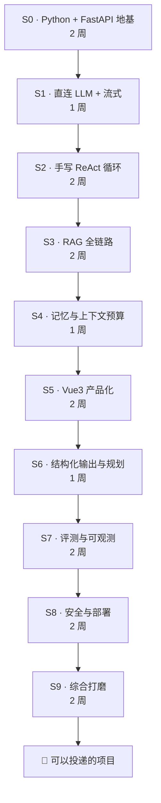

# 学习路线总览（9 阶段详案）

> **这是主线文件**。每个阶段都有：目标 → 教材 → 任务 → 验收 → 坑 → 简历素材。
> **验收不通过，不要进下一阶段。**

## 路线图



## 前端转 Agent：5 个真实难点与 3 个真实优势

### 难点（必须正面处理）

| # | 难点 | 具体表现 | 什么时候会爆 |
|---|------|----------|-------------|
| **1** | **Python 异步** | 在 `async def` 里调 `requests`，整个服务卡死 | S0、S1 |
| **2** | **后端状态** | 前端状态在内存里；后端要持久化、要并发、要恢复 | S4、S5 |
| **3** | **不确定性** | 同输入不同输出，你没法"断言"结果 | S2、S7 |
| **4** | **缺乏正确答案** | 不知道什么叫"改好了" | S7 |
| **5** | **流式链路** | SSE 在 Nginx/代理/前端三层都可能断 | S1、S5 |

### 优势（必须利用）

| # | 优势 | 怎么用 |
|---|------|--------|
| **1** | TypeScript 类型 → Pydantic | 你会 `zod`/`interface`，Pydantic 就是 Python 版，**一天能上手** |
| **2** | 交互设计直觉 | Agent 产品最缺的是"加载态/错误态/中断/重试"，**这正好是你的地盘** |
| **3** | 能独立做完整产品 | 后端转来的人做不出好 UI，你能——**这是差异化** |

> **结论**：**别去补数学和训练，把"全栈 + 产品化"打到最长。**

---

# S0 · Python + FastAPI 地基（2 周）

## 目标

**能独立写出带类型注解的 async FastAPI 服务，并被自己的 Vue3 页面调通。**

## 为什么先学这个

> Agent 应用 **80% 的坑在后端和异步**，不在模型。
> 一个前端直接上手 Agent 的典型结局：**在第 3 天被 `asyncio` 卡住，然后怀疑自己不适合**。

## 教材

| 文档 | 读哪部分 |
|------|----------|
| `docs/AI核心名词.md` | 全文（建立词汇表） |
| `docs/Token统计.md` | 计费与上下文长度概念 |
| `docs/大模型会话最佳实践.md` | 消息结构、多轮组织 |

> S0 主要靠官方文档和动手，`docs/` 只读这三篇做背景。

## 任务清单

### 任务 1：Python 与 TS 的对照表（半天）

不要从零学 Python。**拿你熟的 TS 做对照**，只学差异：

| TypeScript | Python | 注意 |
|-----------|--------|------|
| `interface User { id: string }` | `class User(BaseModel): id: str` | Pydantic v2 |
| `const x = arr.map(v => v * 2)` | `[v * 2 for v in arr]` | 列表推导 |
| `a?.b ?? 'd'` | `a.get('b') or 'd'` | 无 optional chaining |
| `async/await` | `async/await` | **概念一样，运行时不同** |
| `Promise.all([...])` | `asyncio.gather(...)` | 并发 |
| `node_modules` | `.venv` + `pyproject.toml` | 用 `uv` 管理 |
| `npm run dev` | `uvicorn app:app --reload` | 热重载 |

### 任务 2：搭一个能跑的最小后端（1 天）

```bash
mkdir E:\ai-agent-study\code\agent-lab && cd E:\ai-agent-study\code\agent-lab
uv init .            # 或 python -m venv .venv && .venv\Scripts\activate
uv add fastapi uvicorn[standard] pydantic-settings httpx
```

目录结构（**从一开始就分好，后面不用重构**）：

```
agent-lab/
├── app/
│   ├── main.py           # FastAPI 实例 + 路由挂载
│   ├── core/
│   │   ├── config.py     # Settings（.env）
│   │   └── logging.py
│   ├── api/
│   │   └── v1/
│   │       ├── health.py
│   │       └── todos.py
│   ├── models/           # Pydantic
│   └── services/         # 业务逻辑
├── .env
└── pyproject.toml
```

**目标**：`GET /api/v1/health` 返回 `{"status":"ok"}`，`/docs` 能看到 Swagger。

> **这一步的价值**：FastAPI 自动生成 OpenAPI → **前端可以直接生成 TS 类型**，这是你比纯后端强的第一处。

### 任务 3：复刻一个你熟悉的功能——待办 CRUD（3 天）

用 FastAPI + SQLite（`sqlite3` 或 SQLAlchemy 2.0）+ Pydantic v2，实现：

- `POST /todos`、`GET /todos`、`PATCH /todos/{id}`、`DELETE /todos/{id}`
- 依赖注入拿数据库连接（`Depends`）
- 统一异常处理（`@app.exception_handler`）
- CORS 配好（允许 `http://localhost:5173`）

**为什么是待办**：你写过一百次，**注意力全在"Python 怎么写"上，不用分心业务**。

### 任务 4：SSE 流式接口（2 天）★ 最关键

```python
from fastapi.responses import StreamingResponse
import asyncio, json

async def fake_stream():
    for i in range(20):
        yield f"data: {json.dumps({'delta': f'第{i}个字'}, ensure_ascii=False)}\n\n"
        await asyncio.sleep(0.2)

@app.get("/api/v1/stream")
async def stream():
    return StreamingResponse(fake_stream(), media_type="text/event-stream")
```

**必须搞懂的 4 件事**：

1. `data: ...\n\n` —— **两个换行**才是消息结束
2. `Content-Type: text/event-stream` —— 少一个字浏览器就不流
3. `await asyncio.sleep()` —— 不是 `time.sleep()`（后者会阻塞整个事件循环）
4. **代理会缓冲** —— `X-Accel-Buffering: no` 关掉 Nginx 缓冲

### 任务 5：Vue3 接通它（2 天）

```ts
// 前端：注意 SSE 用 GET，若要 POST 得用 fetch + ReadableStream
const res = await fetch('/api/v1/stream')
const reader = res.body!.getReader()
const decoder = new TextDecoder()
while (true) {
  const { done, value } = await reader.read()
  if (done) break
  const text = decoder.decode(value)
  // 按 \n\n 切分事件，按 "data: " 取载荷
}
```

> **提前预告**：S1 之后要改成 `POST`（因为要传消息体），
> 那时 `EventSource` 就不够用了，**必须用 `fetch` + `ReadableStream`**。现在先埋下这个认知。

## 验收标准

- [ ] `/docs` 能打开，所有接口都能在页面上试通
- [ ] Vue 页面能增删改查待办，**刷新不丢数据**
- [ ] 流式接口在浏览器 Network 面板里能看到 **`EventStream`** 类型
- [ ] **能口头解释**：如果在 `async def` 里调 `requests.get()` 会发生什么（答案：阻塞事件循环，所有并发请求排队）
- [ ] 前端能**中途取消**流式请求（`AbortController`）

## 常见坑

| 坑 | 现象 | 解 |
|---|------|-----|
| `async def` 里用 `requests` | 并发时全部变慢 | 换 `httpx.AsyncClient` |
| Pydantic v1 写法 | `@validator` 报 deprecated | v2 用 `@field_validator` |
| Python 相对导入 | `ImportError: attempted relative import` | 用绝对导入 + 正确的工作目录 |
| CORS | 前端报 `blocked by CORS policy` | `allow_origins` 写**具体地址**，不要只写 `*`（带 cookie 时不行） |
| SSE 被缓冲 | 前端一次性收到全部内容 | 加 `X-Accel-Buffering: no` + 关闭前端压缩中间件 |

## 简历素材

> **本阶段不产生简历条目**——它是地基。
> 但 S1 的条目会感谢它：**"全栈独立实现"这句话，前提是你真的写了后端**。

---

# S1 · 直连大模型 + 流式（1 周）

## 目标

**封装一个可靠的 LLM 客户端：流式、重试、超时、token 计量、成本显示。**

## 为什么这一步不能跳

> 大多数人直接用 SDK 的 `chat()` 就以为懂了。
> **一旦遇到：网络抖动、429 限流、流中断、账单暴涨——就完全不知道从哪调。**

## 教材

| 文档 | 重点 |
|------|------|
| `docs/Prompt Engineering.md` | 结构化提示、few-shot、分隔符 |
| `docs/系统提示词.md` | 系统提示的写法与禁忌 |
| `docs/大模型会话最佳实践.md` | 消息角色、多轮拼接 |
| `docs/Token统计.md` | 计费、上下文窗口 |
| `docs/大模型会话最佳实践.md` | 会话组织 |

## 任务清单

### 任务 1：封装 `LLMClient`（2 天）

**不要直接在路由里调 SDK。** 写一个 `services/llm.py`：

```python
class LLMClient:
    async def chat(self, messages, model="...", stream=False): ...
    async def stream(self, messages) -> AsyncIterator[str]: ...
```

必须包含：

| 能力 | 要求 |
|------|------|
| **重试** | 429/5xx 指数退避，最多 3 次 |
| **超时** | 连接超时 + 总超时分开设 |
| **token 统计** | 每次调用记录 in/out tokens |
| **成本计算** | 按单价换算成金额（价格放配置，**别硬编码**） |
| **取消** | 客户端断开时停止生成（省钱的实事） |

### 任务 2：流式对话接口（1 天）

```
POST /api/v1/chat/stream
body: { "session_id": "...", "content": "..." }
resp: text/event-stream
      data: {"delta":"你"}
      data: {"delta":"好"}
      data: {"usage":{"input":12,"output":34,"cost":0.0012},"done":true}
```

**注意**：最后一条事件带 usage，前端才能显示成本。

### 任务 3：前端流式对话页（1 天）

- 打字机效果（逐字追加，**不要每帧 setState 整个数组**）
- **停止生成**按钮（`AbortController` → 后端也要感知断开）
- 显示 token 数与累计成本
- 错误态：超时、限流、余额不足分别提示

### 任务 4：多轮 + 持久化（2 天）

- `sessions` 表、`messages` 表
- 消息角色：`system` / `user` / `assistant`
- 刷新页面能恢复历史
- 会话列表可切换

### 任务 5：压力测试（半天）

用 `hey` 或 `locust` 打 20 并发，看：

- P95 延迟
- 有没有请求串行（如果有 → S0 的异步没学透）

## 验收标准

- [ ] 断网时前端提示"网络错误"而不是白屏
- [ ] 触发 429 后自动重试，用户无感
- [ ] 前端点"停止"后，**后端日志显示 generation cancelled**
- [ ] 每次对话都记录 token 与成本，可在页面上看到累计值
- [ ] 20 并发下 P95 延迟没有比单请求慢 10 倍

## 常见坑

| 坑 | 说明 |
|---|------|
| 流式没处理"最后一块" | `buffer` 里残留的数据要 flush |
| 前端逐字 `setState` | 每字符一次渲染 → 卡；用 `requestAnimationFrame` 批量 |
| 中途断开没通知后端 | 后端要继续烧 token；要检测 `await request.is_disconnected()` |
| 成本硬编码 | 换模型就错；放配置 + 版本化 |
| 忘了 system prompt 也算 token | 上下文越长单价越高 |

## 简历素材

> **实现流式 LLM 网关：支持 SSE 流式输出、指数退避重试、token 级成本计量与请求取消，单实例支撑 20+ 并发对话。**

---

# S2 · 第一个 Agent：手写 ReAct 循环（2 周）

## 目标

**不借助任何 Agent 框架，手写一个能调工具、能自纠错、会停的循环。**

## 为什么必须手写

> **框架解决的是"你已经知道要解决什么"的问题。**
> 没手写过循环的人，遇到 Agent 不调工具、乱调工具、无限循环——**完全无从下手**。

## 教材（本阶段是重点）

| 文档 | 重点 |
|------|------|
| `docs/Function Calling.md` | 工具声明、调用返回结构 |
| `docs/Function Calling VS Tool Calling.md` | 概念差异（面试常问） |
| `docs/Tool Calling与Tool封装.md` | 工具设计原则 |
| `docs/ReAct.md` | 推理-行动循环原型 |
| `docs/Agent核心实现逻辑.md` | **主教材**，循环与状态 |
| `docs/Agent最佳架构与实现.md` | 读，但**先别照抄** |

## 任务清单

### 任务 1：定义 3 个工具（1 天）

```
- get_weather(city: str) -> dict        # 外部 API
- calculator(expression: str) -> float  # 安全求值（别用 eval！）
- todo_search(keyword: str) -> list     # 复用 S0 的待办库
```

用 JSON Schema 声明，**每个工具必须有三样**：

| 要素 | 为什么 |
|------|--------|
| **名字** | 动词开头，`get_` / `search_` / `create_` |
| **描述** | **写清"什么时候用"和"什么时候不要用"** |
| **参数 schema** | `description` 要写示例值 |

> **工具描述是提示词的一部分**——描述烂 = 模型不调或乱调。

### 任务 2：手写循环（3 天）★ 本阶段核心

```python
async def run_agent(user_input: str, max_steps: int = 10):
    messages = [
        {"role": "system", "content": SYSTEM_PROMPT},
        {"role": "user", "content": user_input},
    ]
    trace = []

    for step in range(max_steps):
        resp = await llm.chat(messages, tools=TOOLS)

        if not resp.tool_calls:                       # 没有工具调用 → 收工
            return resp.content, trace

        messages.append(resp.to_message())            # ← 关键：assistant 消息必须入栈

        for call in resp.tool_calls:
            try:
                result = await dispatch(call.name, call.args)
            except Exception as e:
                result = {"error": f"{type(e).__name__}: {e}"}   # ← 错误也是观察
            messages.append({
                "role": "tool",
                "tool_call_id": call.id,
                "content": json.dumps(result, ensure_ascii=False),
            })
            trace.append({"step": step, "tool": call.name, "args": call.args, "result": result})

    return "已达最大步数，未完成", trace
```

**必须理解的 4 个点**：

| # | 点 | 不理解会怎样 |
|---|---|-------------|
| 1 | **assistant 消息要入栈** | 模型会重复调同一个工具 |
| 2 | **`tool_call_id` 必须对应** | API 报错 |
| 3 | **工具错误也要作为观察返回** | 模型不知道失败，会假装成功 |
| 4 | **必须有 `max_steps`** | 无限循环烧钱 |

### 任务 3：三重刹车（1 天）

| 刹车 | 设置 |
|------|------|
| **最大步数** | 10 |
| **最大成本** | 单次任务 ≤ ¥0.5，超了就中断并告知 |
| **单工具超时** | 10s，超时当失败处理 |

> **没有刹车的 Agent 不是 Agent，是炸弹。**

### 任务 4：结构化 trace（1 天）

每一步记录：`step / 模型输出 / 工具名 / 参数 / 结果 / 耗时 / token`。

存成 JSON，**能回放**——这是 S7 评测的基础。

### 任务 5：前端时间线（2 天）

把 trace 渲染成可折叠的时间线：

```
▸ 第 1 步  想：需要查天气         [1.2s · 320 tk]
   └ 调用 get_weather(city="北京")
   └ 结果 {"temp": 12, "weather": "晴"}
▸ 第 2 步  想：信息够了，可以回答  [0.8s · 180 tk]
```

> **这个 UI 就是你和"只会调 API 的人"的分水岭。**

### 任务 6：对抗测试（2 天）

**故意破坏它**，验证鲁棒性：

| 测试 | 期望 |
|------|------|
| 让工具抛异常 | 模型看到 ERROR，换方法或告知用户 |
| 让工具返回空 | 模型说明"没查到"而不是编造 |
| 给不可能完成的任务 | 到 `max_steps` 停下并说明 |
| 给提示注入 `"忽略之前指令"` | 系统提示不被覆盖 |

## 验收标准

- [ ] 问"北京天气怎么样，顺便帮我算 12*35" → **一次任务调 2 个工具**
- [ ] 工具抛异常 → Agent 不崩溃，能换路或道歉
- [ ] 无法完成的任务 → 到步数上限停止，返回明确说明
- [ ] trace 能完整回放每一步（含耗时和 token）
- [ ] **能画出循环流程图并讲清每一步在干什么**

## 常见坑

| 坑 | 现象 | 解 |
|---|------|-----|
| assistant 消息没入栈 | 反复调同一工具 | 每轮都把 assistant 响应 append 进去 |
| 工具描述太简 | 模型不调用 | 描述里写"用于…，当用户问…时使用" |
| 错误没回灌 | 模型假装成功 | `except` 后返回 `{"error": ...}` |
| 参数是字符串不是对象 | 工具收到 `"{...}"` | 严格按 schema 解析，失败就回错误 |
| 循环里没检查成本 | 账单暴涨 | 每步累加，超限 break |

## 简历素材

> **从零实现 ReAct Agent 循环：工具调度、错误自纠、步数与成本双刹车、全链路 trace 回放；不依赖任何 Agent 框架。**

---

# S3 · RAG 全链路（2 周）

## 目标

**做一个"答案带引用、能被评测"的文档问答。**

## 教材

| 文档 | 重点 |
|------|------|
| `docs/RAG完整链路.md` | **主教材**，全流程 |
| `docs/Query改写与Rerank.md` | 提升召回的第二步 |
| `docs/结构化与多模态检索.md` | 按需（有表格/PDF 时看） |

## 任务清单

### 任务 1：摄入管线（3 天）

```
文档 → 解析 → 分块 → 上下文增强 → 嵌入 → 存 pgvector
```

| 环节 | 要点 |
|------|------|
| **解析** | PDF 用 `pymupdf`，Markdown 直接读；**表格单独处理** |
| **分块** | 按语义切（标题层级），**不要固定字数硬切** |
| **上下文增强** | 每块前面加上"来自《XX文档》第X节"，**这是最便宜的效果提升** |
| **嵌入** | 选一个就行，别纠结；记录模型名与维度 |
| **存储** | pgvector，建 HNSW 索引 |

### 任务 2：混合检索 + Rerank（2 天）

```
查询 → [向量检索 top-50] + [关键词检索 top-50] → 合并去重 → rerank → top-5
```

> **纯向量检索对"专有名词、错误码、人名"很差**——这是混合检索存在的理由。

### 任务 3：带引用的回答（1 天）

**必须能让用户点开原文**：

```json
{
  "answer": "根据规范，接口超时应设置为 3 秒 [1]。",
  "citations": [
    { "id": 1, "doc": "前端规范.md", "chunk": "...", "page": 12 }
  ]
}
```

> **没有引用的 RAG 不是 RAG，是"看起来像真的胡编"。**

### 任务 4：建评测集（2 天）★ 别跳过

**20 条问题**，格式：

```json
{ "question": "...", "expected_doc_ids": ["doc_12#chunk_3"] }
```

跑 **Recall@5**：正确文档有没有进前 5。

> **没有这个，你永远不知道改分块是变好还是变坏。**

### 任务 5：前端上传 + 问答（2 天）

- 拖拽上传、解析进度
- 问答 + 引用面板（点击滚动到原文）
- 显示"检索到 N 个片段，用时 X ms"

## 验收标准

- [ ] 20 条评测集 **Recall@5 ≥ 80%**
- [ ] 每个答案都能点开来源，且来源**真的支持答案**
- [ ] 问文档里没有的内容 → 明确说"没找到"，**不编造**
- [ ] **能说出"哪一步对效果影响最大"**（并给出证据）

## 常见坑

| 坑 | 说明 |
|---|------|
| 固定字数分块 | 切断语义；按标题/段落切 |
| 分块太大 | 检索准但噪声多；512–1024 token 起步试 |
| 没做上下文增强 | 单块脱离文档后看不懂 |
| 只做向量检索 | 专有名词查不到 |
| 没有评测集 | 改了就不知道好坏 |
| 引用是假的 | 模型说的引用和实际检索片段对不上——**必须用检索结果拼装，不要让模型自己写引用** |

## 简历素材

> **构建 RAG 检索链路：语义分块 + 上下文增强 + 混合检索 + rerank，自建 20 条评测集，Recall@5 达 XX%。**

---

# S4 · 记忆与上下文预算（1 周）

## 目标

**让对话在 50 轮后依然记得关键信息，且 token 不随时间线性爆炸。**

## 教材

| 文档 | 重点 |
|------|------|
| `docs/Agent Memory 记忆体系.md` | **主教材** |
| `docs/Context Engineering.md` | 上下文预算与组装 |
| `docs/Token统计.md` | 长度与成本 |

## 任务清单

### 任务 1：三层记忆（3 天）

| 层 | 存什么 | 存在哪 | 怎么用 |
|---|--------|--------|--------|
| **工作记忆** | 最近 N 轮原文 | 内存 | 直接进 prompt |
| **摘要记忆** | 更早对话的压缩摘要 | 数据库 | 每次滚动压缩 |
| **长期记忆** | 用户偏好、事实 | 向量库 | 检索后注入 |

### 任务 2：上下文预算管理器（2 天）

```python
def build_context(system, memories, history, retrieved, budget=8000):
    """超预算时按优先级裁剪：system > 当前问题 > 检索 > 摘要 > 早期原文"""
```

**必须能回答**：现在用了多少 token？超了先砍谁？

### 任务 3：会话可恢复（1 天）

- 状态存库，服务重启后能续
- 长任务中断后能接着跑

### 任务 4：前端显示上下文占用（1 天）

一个进度条：`已用 3200 / 8000 token`，超 80% 变黄。

## 验收标准

- [ ] 50 轮对话后，**仍记得第 3 轮说过的用户偏好**
- [ ] token 消耗**不是线性增长**（第 50 轮和第 10 轮差不多）
- [ ] 上下文超限时自动裁剪，**不报错**
- [ ] 服务重启后，会话能继续

## 常见坑

| 坑 | 说明 |
|---|------|
| 只做滑动窗口 | 早期关键信息直接丢 |
| 摘要丢关键细节 | 摘要提示词要明确"保留数字、人名、决定" |
| 长期记忆乱召回 | 相关性阈值太低 → 注入噪声 |
| 裁剪没优先级 | 把系统提示裁了，模型直接失常 |

## 简历素材

> **设计分层记忆（工作记忆 + 滚动摘要 + 长期向量召回）与上下文预算管理器，50+ 轮对话稳定，token 不随时间线性增长。**

---

# S5 · Vue3 产品化（2 周）

## 目标

**把 Agent 做成"别人愿意用"的产品，而不是一个 demo 页面。**

## 教材

本阶段以你已有前端能力为主，`docs/` 只补：

| 文档 | 读什么 |
|------|--------|
| `docs/多模态与ComputerUse.md` | 了解 Agent 交互的发展方向 |
| `docs/HITL与持久化执行.md` | 人工介入的交互模式（S6 会用） |

## 任务清单

### 任务 1：工程化（2 天）

- Vite + Vue3 + TS + Pinia + Vue Router
- 组件库（Element Plus / Naive UI，选一个）
- **从 OpenAPI 自动生成 API 类型**（`openapi-typescript`）→ 后端改字段，前端编译报错

### 任务 2：流式渲染打磨（3 天）

| 细节 | 做法 |
|------|------|
| 打字机 | 用 `requestAnimationFrame` 批量更新，**不要每字符一次** |
| 自动滚动 | 用户上滑时**停止**自动滚（这是体验分水岭） |
| Markdown 流式渲染 | 未闭合的代码块要能容错 |
| 中断 | 停止按钮 → 保留已生成内容 |
| 重生成 | 保留历史，可回退 |

### 任务 3：步骤可视化（3 天）

Agent 的思考过程要让用户看得懂，但不能太吵：

- 默认折叠，只显示"正在查询资料…"
- 展开看完整工具调用
- 耗时长时显示进度感

### 任务 4：状态完备（2 天）

**这四项是你的强项，别省**：

| 状态 | 必须有 |
|------|--------|
| 加载 | 骨架屏，不是转圈 |
| 空 | 引导示例问题 |
| 错误 | 分类提示 + 重试按钮 |
| 超限 | 配额用完的引导 |

### 任务 5：可用性测试（2 天）

找 **5 个人**（同事/朋友）用一次，**只观察不指导**，记录：

- 他们卡在哪
- 他们问了什么你没想到的问题
- 他们误点了什么

**改掉至少 3 个问题**，写进 `notes.md`。

## 验收标准

- [ ] 5 人测试完成，**3 个问题被修复**
- [ ] 流式渲染无卡顿（Chrome Performance 面板验证）
- [ ] 4 种状态（加载/空/错误/超限）都有
- [ ] API 类型从 OpenAPI 生成，改后端字段前端会编译报错
- [ ] 移动端能用（至少不崩）

## 简历素材

> **独立实现 Agent 对话前端（Vue3 + TS）：流式渲染、工具调用时间线、引用溯源、中断与重生成；通过 5 人可用性测试迭代 3 处交互。**

---

# S6 · 结构化输出与规划（1 周）

## 目标

**让 Agent 输出可被程序消费，且任务计划可人工干预。**

## 教材

| 文档 | 重点 |
|------|------|
| `docs/结构化输出.md` | **主教材**，schema 约束与严格模式 |
| `docs/Agent规划与任务分解.md` | 计划即数据 |
| `docs/HITL与持久化执行.md` | 人工审批点设计 |

## 任务清单

### 任务 1：结构化输出 + 二次校验（2 天）

```python
class ReviewResult(BaseModel):
    issues: list[Issue]
    severity: Literal["low", "medium", "high"]

# 模型输出 → Pydantic 校验 → 失败则带着错误重试
```

**关键**：**不要相信模型一定遵守 schema**。客户端必须再校验一遍。

### 任务 2：任务分解（2 天）

把"帮我审查这个 PR"拆成：

```json
{
  "plan": [
    {"id": 1, "action": "fetch_diff",   "status": "pending"},
    {"id": 2, "action": "search_rules", "status": "pending"},
    {"id": 3, "action": "analyze",      "status": "pending"},
    {"id": 4, "action": "confirm",      "status": "pending", "requires_human": true}
  ]
}
```

> **计划是数据，不是对话**——这样才能存、能改、能恢复。

### 任务 3：计划可视化 + 人工干预（2 天）

- 前端展示计划步骤与状态
- 允许**编辑参数**后继续
- 关键步骤（如"回写 PR 评论"）**必须人工确认**

### 任务 4：审批后恢复（1 天）

> ⚠️ **注意**：恢复时会重放，**有副作用操作要幂等**（比如发评论前先查是否已发过）。

## 验收标准

- [ ] 模型输出非法 JSON → 自动重试并修复，**不崩**
- [ ] 计划可暂停、可编辑、可恢复
- [ ] 高危步骤必须人工点确认才执行
- [ ] 重复执行不会产生重复副作用

## 简历素材

> **接入结构化输出与 Pydantic 二次校验，任务计划持久化为可编辑数据结构，关键步骤引入人工审批与幂等恢复。**

---

# S7 · 评测与可观测（2 周）

## 目标

**能证明"我这周的改动，让效果好了多少、贵了多少"。**

## 教材

| 文档 | 重点 |
|------|------|
| `docs/Agent评测与可观测性.md` | **主教材** |
| `docs/Agent成本优化.md` | 缓存、批处理、模型分级 |
| `docs/关键数据与标准核对.md` | 看"数据引用规范"，学会怎么标来源 |

## 任务清单

### 任务 1：结构化 trace（2 天）

按 OpenTelemetry GenAI 语义命名，至少记录：

```
trace_id / span_id / 模型名 / 提示版本 / 工具版本
每步耗时 / token / 成本 / 结果状态
```

> **必须带"配置版本"**——否则线上出问题无法归因到哪次改动。

### 任务 2：50 条评测集（3 天）

| 类型 | 数量 | 判分方式 |
|------|------|----------|
| 有标准答案 | 20 | 精确匹配 / 包含 |
| 主观质量 | 20 | LLM-as-Judge + 人工抽检 |
| 对抗/边界 | 10 | 规则校验（不能崩、不能编） |

**四个指标一起看**：准确率、召回、P95 延迟、单任务成本。

### 任务 3：看板（3 天）

一屏显示：

```
成功率 96% | P95 延迟 4.2s | 单任务成本 ¥0.18
本周回归 47/50 | 失败 3 条（已归类）
```

### 任务 4：接入 CI（2 天）

- PR 提交自动跑评测集
- **通过率低于阈值就阻塞合并**
- 成本比上周涨 20% 也报警

## 验收标准

- [ ] 改一次提示词，能报出"准确率 +6%，成本 +15%"
- [ ] 每条失败样本都有归类和根因
- [ ] **修 bug 必须同时加回归用例**（写进 PR 检查项）
- [ ] 看板一屏能判断"今天能不能发版"

## 常见坑

| 坑 | 说明 |
|---|------|
| 只测"能不能跑" | 不测质量等于没测 |
| 评测集半年不更新 | 加真实失败样本，每月更新 |
| 只看均值 | P95/P99 才是真相 |
| 没有版本指纹 | 出问题无法归因 |

## 简历素材

> **建立 Agent 评测与可观测体系：50 条分层回归集（精确匹配 / LLM-as-Judge / 对抗）、结构化 trace、成本与延迟看板，CI 内回归门禁。**

---

# S8 · 安全与部署（2 周）

## 目标

**能上线，且上线以后不会出事。**

## 教材

| 文档 | 重点 |
|------|------|
| `docs/Agent安全与护栏.md` | **主教材**，提示注入与护栏 |
| `docs/运行沙箱与部署.md` | 沙箱、部署、灰度 |
| `docs/Agent运营与治理.md` | 配额、审计、合规 |

## 任务清单

### 任务 1：威胁建模（1 天）

写下你的 Agent 面临的三类风险：

| 风险 | 例子 |
|------|------|
| **数据外泄** | 用户文档内容被发到外部 |
| **越权操作** | Agent 删了不该删的数据 |
| **成本攻击** | 被刷爆额度 |

> 对照"致命三要素"：**私有数据 + 不可信内容 + 外部通信**，三者同时具备就危险。

### 任务 2：护栏（3 天）

| 层 | 措施 |
|---|------|
| 输入 | 长度限制、注入模式检测 |
| 模型 | 系统提示加固、**不把用户输入当指令** |
| 工具 | **最小权限**、白名单、高危操作人工确认 |
| 输出 | 敏感信息脱敏、引用校验 |
| 资源 | 单任务成本上限、速率限制、日配额 |

### 任务 3：部署（3 天）

```
Dockerfile（多阶段构建）→ docker-compose（app + postgres + redis）→ 云主机 / Fly.io / Railway
```

必须配好：

- 环境变量与密钥管理（**不要提交 .env**）
- 健康检查
- 日志（结构化，不含敏感内容）
- HTTPS
- 数据库备份

### 任务 4：压测与熔断（2 天）

- 50 并发压测，记录 P95/P99
- LLM 供应商限流 → 降级策略（换模型 / 排队 / 提示稍后再试）
- 成本熔断：日花费超阈值自动降级

### 任务 5：上线自查（1 天）

跑一遍清单：注入测试、越权测试、超支测试、断网测试、重启恢复。

## 验收标准

- [ ] 有一个**公网可访问的地址**
- [ ] 提示注入测试全部拦截或无害化
- [ ] 高危操作必须人工确认
- [ ] 日成本有上限，超了自动降级
- [ ] 服务重启后会话与数据不丢
- [ ] 日志里搜不到明文敏感信息

## 简历素材

> **完成 Agent 服务生产化：Docker 化部署、最小权限工具设计、提示注入防护、单任务成本熔断与日配额，公网稳定运行。**

---

# S9 · 综合打磨（2 周）

## 目标

**把它变成一个"能投递、能讲、能演示"的项目。**

## 任务清单

### 任务 1：架构文档（2 天）

必须有**一张能讲 3 分钟的架构图**，包含：

- 请求链路（前端 → 后端 → Agent → 工具 → LLM）
- 数据流（会话、文档、trace 存在哪）
- 关键决策点（为什么手写不用框架、为什么混合检索、为什么这个记忆结构）

> **面试官不看你代码写得多漂亮，看你能不能讲清"为什么这么设计"。**

### 任务 2：效果数据（2 天）

整理成一张表：

| 指标 | 数值 | 怎么测的 |
|------|------|----------|
| 召回率 | 84% | 20 条标注集 Recall@5 |
| 任务成功率 | 91% | 50 条评测集 |
| P95 延迟 | 4.2s | 压测 |
| 单任务成本 | ¥0.18 | trace 汇总 |

> **有数字的项目 > 有功能的项目。**

### 任务 3：Demo 视频（1 天）

3 分钟，讲清：
1. 解决什么问题（15s）
2. 演示核心流程（90s）
3. 架构与取舍（45s）
4. 效果数据（30s）

### 任务 4：README 与简历（2 天）

README 要有：一句话价值、架构图、快速开始、效果数据、技术亮点、踩坑记录。

简历按 `02-简历项目库.md` 的模板写。

### 任务 5：模拟面试（2 天）

把 `02-简历项目库.md` 里的 20 个问题**自己答一遍并录音**，听回放找漏洞。

## 验收标准

- [ ] 3 分钟能讲清项目（不看稿）
- [ ] 有 4 个指标的真实数字
- [ ] 能回答"如果流量涨 10 倍怎么办"
- [ ] 能回答"你这个方案和 XX 方案比，为什么选这个"
- [ ] 代码仓库有 README、有 CI、有清晰提交历史

---

## 阶段间的关系（别做废功）

| 阶段产出 | 在 S9 项目里的角色 |
|----------|-------------------|
| S0 的 FastAPI 骨架 | 后端底座 |
| S1 的 LLMClient | 所有模型调用都走它 |
| S2 的 Agent 循环 | 核心引擎 |
| S3 的 RAG | 规范知识检索 |
| S4 的记忆 | 多轮体验 |
| S5 的 UI | 产品界面 |
| S6 的结构化输出 | 计划与结果格式 |
| S7 的评测 | 证明它好用 |
| S8 的部署 | 公网可访问 |

> **每一步都在往同一个项目里加零件。**
> **到 S9 时，你不是"做了一个项目"，而是"迭代了 9 轮的项目"——这两者在面试里是天壤之别。**

---

> **本文局限**
> - 时间估算按"在职 2h/天 + 周末 4h"，个人差异大，**按里程碑而非按周推进**。
> - 代码片段为**教学示意**，省略了鉴权、完整异常处理、日志，**生产前必须补齐**。
> - 未涉及模型训练、微调、算法原理——那是另一条职业路径。
> - 具体模型/价格/限额会变，`docs/` 中的数字需按当前版本复核。
