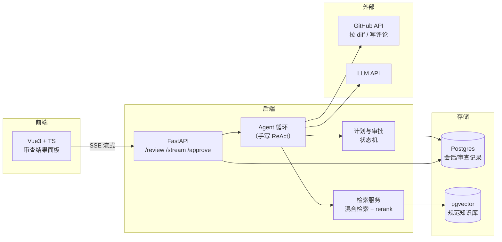

# 简历项目库（选一个做完）

> **原则：一个做完的项目 > 三个半成品。**
> 三个项目按"与你背景的契合度"排序，**强烈建议选 A**。

## 怎么选

| 项目 | 契合度 | 难度 | 数据获取 | 差异化 |
|------|--------|------|----------|--------|
| **A · 前端团队 AI 代码审查助手** | ⭐⭐⭐⭐⭐ | 中 | ⭐⭐⭐⭐⭐ 用自己的仓库 | **高**（前端背景是优势） |
| B · 数据分析 Agent（Text-to-SQL） | ⭐⭐⭐ | 中高 | ⭐⭐⭐⭐ 找公开数据集 | 中 |
| C · 企业知识库客服（含人工介入） | ⭐⭐⭐ | 中 | ⭐⭐⭐ 需编造文档 | 低（太常见） |

**为什么推荐 A**：

1. **你的前端经验是真实优势**——你懂代码规范、懂 diff、懂 PR 流程，能讲出真实痛点
2. **数据零成本**——用自己的 GitHub 仓库，有真实 PR 历史
3. **技术点全**——RAG + 工具调用 + 人工审批 + 多步规划，一个不少
4. **面试好讲**——面试官大概率是前端/全栈，**他能立刻理解并追问**

---

# 项目 A · CodeLens：前端团队 AI 代码审查与规范助手（主推）

## 一句话价值

**自动审查 Pull Request，把团队规范变成可执行的检查，减少人工 review 的低级往返。**

## 为什么这是个真问题

```
真实痛点：
  · 新人 PR 老是被提"命名不规范""没用 xxx 工具函数"
  · Reviewer 重复说同样的话，浪费时间
  · 规范文档写了没人看，靠人肉记忆
  · AI 直接给建议，但经常"幻觉"——引用了不存在的规范
```

**你的解法**：Agent 先**检索团队真实规范**，再对照 diff 逐条检查，**每条建议必须附带规范原文链接**，最后由人确认后回写 PR。

## 功能清单（按优先级）

### P0（必须做完）

| # | 功能 |
|---|------|
| 1 | 输入一个 GitHub PR URL，拉取 diff |
| 2 | Agent 分块分析 diff（大 PR 要能拆） |
| 3 | 检索团队规范文档（RAG），**每条建议必须带引用** |
| 4 | 输出结构化审查结果（严重级别 + 位置 + 建议 + 依据） |
| 5 | 前端展示审查结果，可逐条采纳/忽略 |
| 6 | 人工确认后回写 GitHub PR 评论 |
| 7 | 全流程 trace + 成本可见 |

### P1（加分）

| # | 功能 |
|---|------|
| 8 | 审查规则可配置（团队自己加规则） |
| 9 | 历史审查记录、同类问题统计 |
| 10 | 做成 **MCP Server**，让 Cursor / Claude Desktop 也能用 |
| 11 | 支持 Webhook 自动触发 |
| 12 | 多语言支持（TS / Vue / Python） |

### P2（有余力）

| # | 功能 |
|---|------|
| 13 | 学习团队历史 review 评论，自动提炼规范 |
| 14 | 与历史 PR 对比"同类问题出现频率" |
| 15 | 团队看板：哪类问题最多 |

## 技术架构



## 核心流程

```
1. 用户粘贴 PR URL
2. Agent 规划：
   ├─ fetch_pr_diff(pr_url)
   ├─ search_rules(涉及的技术点)      ← RAG，多轮检索
   ├─ analyze_chunk(chunk, rules)     ← 逐块分析
   └─ propose_comments(issues)        ← 生成建议
3. 暂停，等人确认（HITL）
4. 用户勾选采纳的条目
5. post_pr_comment(只发采纳的)       ← 需幂等
6. 记录 trace 与成本
```

## 技术难点（面试重点，必须能讲）

### 难点 1：大 PR 的 diff 太长

**问题**：一个 PR 可能有 50 个文件、3000 行改动，塞不进上下文。

**你的解法**（按顺序讲）：

| 策略 | 说明 |
|------|------|
| 文件级过滤 | 跳过 lock 文件、生成文件、二进制 |
| **按 hunk 切分** | 不按文件切，按"改动块"切，保留前后 3 行上下文 |
| 相关性排序 | 先按规则库命中度排序，优先分析高风险文件 |
| 分批 + 汇总 | 每批独立分析，最后合并去重 |

> **这句能加分**："我按 hunk 而不是按文件切分，因为一个文件里可能只有一个函数有问题，整文件切会把噪声带进去。"

### 难点 2：AI 会编造规范

**问题**：不检索的话，模型会自己"发明"一条看似合理的规范。

**你的解法**：

1. **强制引用**：每条建议必须带 `rule_id`，`rule_id` 必须来自检索结果
2. **后置校验**：程序检查 `rule_id` 是否真在检索结果里，不在就丢弃
3. **无依据时不说话**：检索不到相关规范 → 只报"通用问题"且标记为"低置信"

> **这句能加分**："我不是让模型'注意不要幻觉'，而是在代码里校验它引用的 rule_id 是否真实存在——**提示词管不住的，用代码管**。"

### 难点 3：回写评论不能重复

**问题**：人工确认后重新执行，可能重复发评论。

**你的解法**：

- 评论带幂等键：`{pr_id}:{file}:{line}:{rule_id}`
- 发送前先查已发评论列表
- 状态机保证"已发送"不可重入

### 难点 4：怎么证明它有用

**你的解法**：

| 指标 | 测法 |
|------|------|
| **采纳率** | 生成的建议里，用户实际采纳的比例 |
| **误报率** | 被标记为"忽略"的比例 |
| **规范覆盖率** | 20 条已知问题，能检出几条 |
| **人工时间节省** | 模拟：纯人工 vs 用工具，耗时对比 |

> **有"采纳率"这个指标，你就比 90% 的简历项目强**——因为它证明你在乎真实效果。

## 评测方法

建 **30 条测试 PR**（从自己仓库历史里挑真实 PR）：

```json
{
  "pr": "https://github.com/.../pull/42",
  "expected_issues": [
    {"file": "src/api.ts", "line": 15, "type": "naming", "rule": "R-003"}
  ],
  "should_not_flag": [
    {"file": "src/utils.ts", "line": 8}
  ]
}
```

跑三个数：**检出率、误报率、漏报率**。

## 分阶段落地路径（对应 01 的 S1–S9）

| 阶段 | 这个项目里加什么 |
|------|-----------------|
| S1 | 能调 LLM，能把 diff 发过去拿到文本建议 |
| S2 | 变成 Agent：会调 `fetch_pr_diff`、`search_rules` |
| S3 | 规范知识库 RAG，建议带引用 |
| S4 | 记住"这个团队不喜欢什么" |
| S5 | 前端审查面板 + 逐条采纳 |
| S6 | 审查计划结构化 + 审批后执行 |
| S7 | 30 条测试 PR + 采纳率看板 |
| S8 | 部署 + 幂等 + 权限控制 |
| S9 | 打磨 + 数据整理 |

## 简历文案（直接可用）

> **CodeLens · 前端团队 AI 代码审查助手**（个人项目 / 2026）
> `Python` `FastAPI` `Vue3` `TypeScript` `PostgreSQL` `pgvector` `LLM Agent`
>
> - 独立设计并实现基于 **ReAct 循环**的代码审查 Agent，支持多步工具调度、错误自纠、步数与成本双刹车
> - 构建团队规范 RAG 检索链路（语义分块 + 上下文增强 + 混合检索 + rerank），**Recall@5 达 XX%**
> - 通过 **rule_id 后置校验**解决 LLM 引用幻觉：建议必须能追溯到真实规范条目，**误报率从 XX% 降至 XX%**
> - 引入**人工审批 + 幂等键**机制，安全回写 GitHub PR 评论，重复执行无副作用
> - 建立 30 条真实 PR 评测集与采纳率看板，迭代后**规范检出率 XX%、建议采纳率 XX%**
> - Vue3 前端实现流式渲染、审查时间线、逐条采纳交互，API 类型由 OpenAPI 自动生成

> ⚠️ **XX 必须换成你的真实数字**。没有数字就别写这一条，别编。

## 面试问题预测（自己先答一遍）

### 架构与选型

1. 为什么手写 Agent 循环而不用 LangGraph？
2. 你的 RAG 为什么用混合检索而不是纯向量？
3. 为什么用 pgvector 而不是专用向量库？
4. 如果把模型换成另一个，你的架构要改哪里？

### 深挖细节

5. 大 PR 怎么处理？hunk 切分的边界怎么定？
6. 怎么保证建议里引用的规范是真实的？
7. 人工审批后恢复执行，怎么保证不重复发评论？
8. Agent 卡在循环里怎么办？你怎么发现？
9. 上下文超了怎么裁剪？先砍什么？
10. tool 调用失败时，你怎么让模型知道失败了？

### 效果与评测

11. 你的采纳率是怎么统计的？样本多大？
12. 误报和漏报你更在意哪个？为什么？
13. 你怎么证明这个工具比人 review 快？
14. 评测集怎么保证不"过拟合"？

### 工程与线上

15. 一个 PR 审查花了多少钱？怎么降？
16. QPS 涨 10 倍怎么办？
17. 用户贴了个恶意 PR（含提示注入）会怎样？
18. 服务重启正在审查的任务怎么办？
19. 日志里会不会泄露代码？
20. 这个项目最大的技术债是什么？

> **第 20 题是送分题**：能诚实说出局限的人，比吹完美的人可信。比如"我的规则库只有 40 条，覆盖不了所有场景"。

---

# 项目 B · 数据分析 Agent（备选）

## 一句话价值

**用自然语言问数据，Agent 自动写 SQL、查库、画图、给结论。**

## 适合谁

- 想往"数据 + AI"方向走
- 愿意花时间找数据集（Kaggle / 公开数据集）
- 后端能力想练得更扎实

## 功能清单

| # | 功能 |
|---|------|
| 1 | 上传 CSV / 连接数据库 |
| 2 | 自然语言 → SQL（Text-to-SQL） |
| 3 | 执行 SQL，错误自动修复 |
| 4 | 结果可视化（Agent 选图表类型） |
| 5 | 多轮追问（"按月份拆开看看"） |
| 6 | 结论生成（带数据依据，不能编） |

## 技术难点

| 难点 | 解法 |
|------|------|
| **schema 太大塞不下** | 裁剪到 5–10 张候选表 |
| **模型不知道值长什么样** | **值采样**：把枚举字段的真实取值给它（这步最关键） |
| **SQL 写错** | 执行报错 → 回灌错误 → 重试（≤3 轮） |
| **结果对了但没意义** | 加 sanity check（空结果/全 NULL/量级异常） |
| **安全** | **只读账号 + 禁止 DDL/DML + 超时 + 行数上限** |

> 教材：`docs/结构化与多模态检索.md` 第二章（Text-to-SQL 全部细节）

## 简历文案

> **DataTalk · 自然语言数据分析 Agent**（个人项目）
> `Python` `FastAPI` `Vue3` `DuckDB` `Text-to-SQL` `ECharts`
>
> - 实现 Text-to-SQL Agent：schema 裁剪 + **值采样** + 错误回灌自纠错（≤3 轮）
> - 通过只读账号、禁止 DML、查询超时与行数上限实现数据库安全边界
> - 构建执行准确率评测集，在 XX 条自然语言查询上达 **XX%**
> - 前端实现 SQL 透明展示、结果表格与图表联动

## 关键数据（可引用）

> BIRD 基准：现行 SOTA **83.40**，人类 **92.96**（2023 年 ChatGPT 只有 40.08）
> —— 见 `docs/关键数据与标准核对.md`。**面试时提这个，说明你了解领域现状。**

---

# 项目 C · 企业知识库客服（备选，最不推荐）

## 为什么排最后

**做的人太多**，简历上很难区分。除非你能做出明显差异（比如垂直行业深度），否则不如 A。

## 如果一定要做，必须有差异化

| 差异化方向 | 说明 |
|-----------|------|
| **人工介入闭环** | 置信度低 → 转人工 → 人工回复回流进知识库 |
| **多轮工单** | 不只是问答，能创建/追踪/关闭工单 |
| **质检与满意度** | 有质检看板、满意度归因 |
| **违规话术拦截** | 合规红线检查 |

## 简历文案

> **智能客服 Agent（含人工介入与质检闭环）**
>
> - 实现"检索 → 生成 → 置信度评估 → 转人工"链路，低置信自动升级
> - 人工回复自动回流知识库，形成数据飞轮
> - 引入话术合规检查，违规输出拦截率 XX%

---

# 通用：简历写法模板

## 结构

```
项目名 · 一句话定位（个人项目 / 时间）
技术栈
· 动词开头的成果句（含数字）
· 动词开头的成果句（含数字）
· 动词开头的成果句（含数字）
· 动词开头的成果句（含数字）
```

## 四条最容易犯的错

| 错 | 改 |
|---|-----|
| "使用了 LangChain 和 FastAPI 实现了一个 Agent" | **"从零手写 ReAct 循环，支持工具调度与错误自纠"**（说清你做了什么，不是用了什么） |
| "效果很好" | **"召回率 84%（20 条标注集）"** |
| "支持多轮对话" | **"50 轮后仍保留关键偏好，token 不随时间线性增长"** |
| 全篇没有数字 | 至少 **3 个数字** |

## 数字从哪来

| 数字 | 出处 |
|------|------|
| 召回率 | S3 的 20 条评测集 |
| 采纳率 / 检出率 | S7 的 30 条测试 PR |
| P95 延迟 | S8 的压测 |
| 单任务成本 | S7 的 trace 汇总 |
| 轮次稳定性 | S4 的长对话测试 |

> **S7 存在的意义就是给你提供这些数字。**
> 跳过 S7 = 简历上只能写形容词。

---

> **本文局限**
> - 项目 A 的"考核指标目标值"（如误报率降到多少）**取决于你的实现，本文不给虚构数字**。
> - GitHub API 的权限范围、PR 评论接口细节需按**当前官方文档**确认。
> - "MCP Server"方案需以 `docs/MCP协议.md`、`docs/MCP Server.md` 与官方规范为准。
> - 20 条面试问题为常见方向归纳，**非真实面试记录**。
